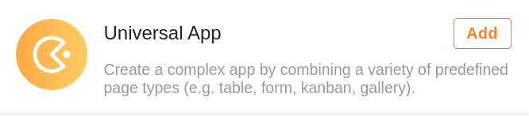
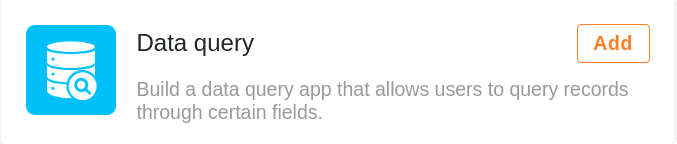

**Apps** in SeaTable sind individuelle **Frontends** für spezifische Benutzergruppen, die unterschiedliche Informationsbedürfnisse haben (z. B. Mitarbeiter, Abteilungsleiter, Geschäftsführer). Durch den offenen Zugang zu Apps können Sie Ihre Daten auch für **externe Dritte** (z. B. Kunden, Geschäftspartner) **ohne SeaTable Konto** nutzbar machen.

Um diese Apps zu bauen, gibt es sogenannte **App Builder**, in denen man verschiedene Benutzeroberflächen anlegen und eine ganze Menge Einstellungen vornehmen kann. Das **Backend** einer App bildet dabei immer eine [Base](). Für jede Base können Sie beliebig viele Apps erstellen. Als Faustregel gilt: eine App pro Benutzergruppe und Anwendungsfall.

## Die Apps im Überblick

Aktuell stehen Ihnen in SeaTable **zwei** verschiedene Arten von Apps zur Verfügung.

### Die Universelle App (Universal App)

Mit der **Universellen App** können Sie Ihrer Kreativität freien Lauf lassen. Die App verfügt über eine Reihe von [Seitentypen](), mit denen Sie Ihre Daten unter anderem in Form von **Tabellen**, **Webformularen**, **Kalendern** oder **Kanban-Boards** darstellen können. Indem Sie eine **individuelle Seite** anlegen, können Sie darüber hinaus Dashboards mit aussagekräftigen **Statistiken** aus Ihren Daten bauen und sie mit anderen (externen) Nutzern teilen.

[Erfahren Sie mehr über die Universelle App]().

### Die Datenabfrage-App (Data Query App)

Eine **Datenabfrage-App** ist eine benutzerspezifische **Suchmaske**. Erstellen Sie eine solche App, wenn Sie wollen, dass andere Nutzer Ihre **Datensätze** in einer Tabellenansicht nach bestimmten Einträgen durchsuchen können. Wählen Sie aus, welche **Spaltenwerte** in den Abfrage-Ergebnissen angezeigt werden sollen, um individuell festzulegen, auf welche Daten eine Nutzergruppe zugreifen darf.

[Erfahren Sie mehr über die Datenabfrage-App]().
