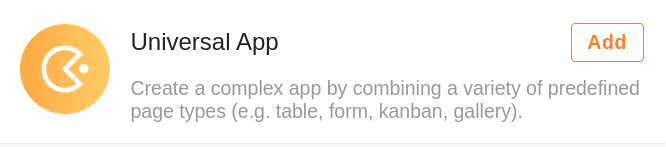
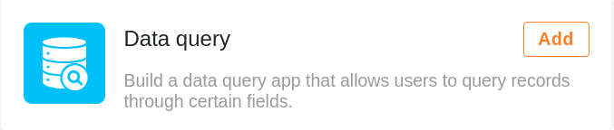

**Apps** in SeaTable are individual **frontends** for specific user groups that have different information needs (e.g. employees, department managers, directors). Open access to apps allows you to make your data available to **external third parties** (e.g. customers, business partners) **without a SeaTable account**.

To build these apps, there are so-called **app builders**, in which you can create different user interfaces and make a whole lot of settings. The **backend of** an app is always a [base](). You can create as many apps as you like for each base. The rule of thumb is: one app per user group and use case.

## The apps at a glance

There are currently **two** different types of apps available in SeaTable.

### The Universal App (Universal App)

With the **Universal app**, you can let your creativity run wild. The app has a number of [page types]() that allow you to present your data in the form of **tables**, **web forms**, **calendars** or **kanban boards**, among others. By creating a **custom page**, you can also build dashboards with meaningful **statistics** from your data and share them with other (external) users.

[Learn more about the Universal App]().

### The data query app (Data Query App)

A **data query app** is a user-specific **search form**. Create such an app if you want other users to be able to search your **records** in a table view for specific entries. Select which **column values** to display in the query results to customize which data a user group can access.

[Learn more about the data query app]().
