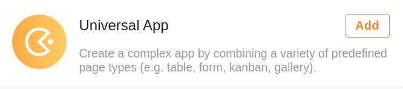
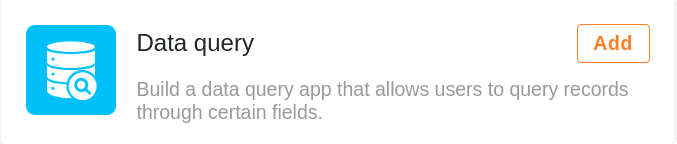

**Приложения** в SeaTable - это индивидуальные **интерфейсы** для определенных групп пользователей, которые имеют различные потребности в информации (например, сотрудники, руководители отделов, директора). Открытый доступ к приложениям позволяет вам сделать ваши данные доступными для **внешних третьих лиц** (например, клиентов, деловых партнеров) **без учетной записи SeaTable**.

Для создания таких приложений существуют так называемые **конструкторы приложений**, в которых можно создавать различные пользовательские интерфейсы и выполнять целый ряд настроек. **Бэкэнд** приложения - это всегда [база](). Для каждой базы вы можете создать столько приложений, сколько захотите. Эмпирическое правило гласит: одно приложение для каждой группы пользователей и каждого случая использования.

## Приложения с первого взгляда

В настоящее время в SeaTable доступны **два** различных типа приложений.

### Универсальное приложение (Universal App)

С **универсальным приложением** вы можете дать волю своему творчеству. В приложении есть несколько [типов страниц](), с помощью которых вы можете представить свои данные в виде **таблиц**, **веб-форм**, **календарей** или **досок Kanban**, среди прочего. Создав **отдельную страницу**, вы также можете создавать информационные панели с содержательной **статистикой** на основе ваших данных и делиться ими с другими (внешними) пользователями.

[Узнайте больше об универсальном приложении]().

### Приложение для запросов данных

**Приложение запроса данных** - это **экран поиска** для конкретного пользователя. Создайте такое приложение, если вы хотите, чтобы другие пользователи могли искать конкретные **записи** в табличном представлении. Выберите, **значения** каких **столбцов** должны отображаться в результатах запроса, чтобы индивидуально определить, к каким данным имеет доступ та или иная группа пользователей.

[Узнайте больше о приложении для запроса данных]().
