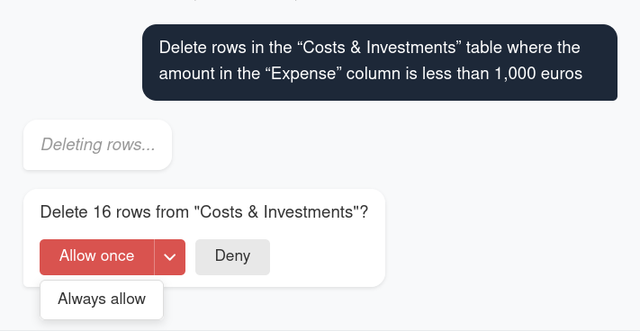

Das KI-Chat-Plugin verbindet Ihre SeaTable-Daten mit einem (externen) Sprachmodell. Dieser Artikel erklärt, wie der Datenfluss funktioniert, welche Schutzmechanismen greifen und wie Sie die Kontrolle über Ihre Daten behalten.

## Wie fließen Ihre Daten?

Wenn Sie im KI-Chat eine Frage stellen, läuft der Datenfluss in vier Schritten:

1. **Ihre Frage** wird an die SeaTable AI oder den gewählten KI-Anbieter gesendet.
2. Das Plugin fragt die relevanten Daten aus Ihrer Base ab.
3. **Die Abfrageergebnisse** werden an die SeaTable AI oder den KI-Anbieter übertragen, damit das Sprachmodell sie auswerten kann.
4. Das Modell formuliert eine Antwort und sendet sie zurück an das Plugin.

Das bedeutet: Wenn Sie nicht die SeaTable AI nutzen, werden die abgefragten Daten an den externen KI-Anbieter übertragen. Das ist technisch notwendig, da ein Sprachmodell nur Daten verarbeiten kann, die es empfängt.

## Wahl des KI-Anbieters

Sie entscheiden selbst, welchen **Anbieter** und welches **Modell** Sie verwenden. 

Standardmäßig nutzt das Plugin die bereits installierte **SeaTable AI**. Dahinter verbirgt sich **Qwen 3.8 27B**, ein Open-Weights-Modell mit 27 Milliarden Parametern, entwickelt von Alibaba. Das KI-Modell wird in deutschen Rechenzentren von Exoscale gehostet – demselben Anbieter, der auch die Server von SeaTable Cloud bereitstellt. Ihre Daten werden also von keinem weiteren Drittanbieter verarbeitet.

Des Weiteren stehen **Anthropic** (Claude), **OpenAI** und **Mistral** zur Auswahl. Jeder dieser externen KI-Anbieter hat eigene Datenschutzrichtlinien. Viele Anbieter verpflichten sich vertraglich, dass Daten, die über ihre API verarbeitet werden, **nicht zum Trainieren von Modellen verwendet** werden. Prüfen Sie dennoch die aktuellen Nutzungsbedingungen Ihres gewählten Anbieters.

## Bestätigung vor Änderungen

Das KI-Chat-Plugin unterscheidet klar zwischen **lesenden** und **schreibenden** Operationen. Bevor eine destruktive Aktion ausgeführt wird (z. B. Zeilen ändern oder löschen), zeigt das Plugin einen **Bestätigungsdialog**. Dieser informiert Sie darüber, welche Änderungen vorgenommen werden und wie viele Zeilen betroffen sind.

Sie haben drei Optionen:

- **Einmal erlauben**: Nur diese eine Aktion wird ausgeführt.
- **Immer erlauben**: Weitere Aktionen dieser Art werden ohne erneute Rückfrage ausgeführt.
- **Ablehnen**: Die Aktion wird nicht ausgeführt.

Auch bei großen Ergebnismengen fragt das Plugin nach, bevor es Tausende von Zeilen verarbeitet. So behalten Sie jederzeit die Kontrolle.

## Maximale Kontrolle durch Self-Hosting

Wer nicht möchte, dass Daten an die SeaTable AI oder externe Anbieter übertragen werden, kann **SeaTable selbst hosten und mit einem lokalen Sprachmodell kombinieren**. In dieser Konfiguration verlassen Ihre Daten zu keinem Zeitpunkt Ihr eigenes Netzwerk.

## Weiterführende Informationen

Eine ausführliche Darstellung zum Thema Datensicherheit bei der Nutzung von KI mit SeaTable finden Sie im Artikel [Berechtigungen und Datenschutz bei KI-Agenten](). Dort werden unter anderem API-Token-Berechtigungen, Strategien zur Minimierung der Datenexposition und das Self-Hosting im Detail behandelt.
