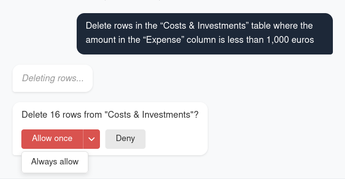

The AI Chat Plugin connects your SeaTable data with an (external) language model. This article explains how the data flow works, what protection mechanisms are in place, and how you maintain control over your data.

## How does your data flow?

When you ask a question in the AI Chat, the data flow proceeds in four steps:

1. **Your question** is sent to SeaTable AI or the selected AI provider.
2. The plugin queries the relevant data from your base.
3. **The query results** are transmitted to SeaTable AI or the AI provider so that the language model can evaluate them.
4. The model formulates a response and sends it back to the plugin.

This means: if you do not use SeaTable AI, the queried data is transmitted to the external AI provider. This is technically necessary because a language model can only process data that it receives.

## Choice of AI provider

You decide which **provider** and which **model** you use.

By default, the plugin uses the already installed **SeaTable AI**. It is powered by **Qwen 3.8 27B**, an open-weights model with 27 billion parameters developed by Alibaba. The AI model is hosted in German data centers operated by Exoscale – the same provider that also supplies the servers for SeaTable Cloud. Your data is therefore not processed by any additional third-party provider.

**Anthropic** (Claude), **OpenAI**, and **Mistral** are also available. Each of these external AI providers has its own data privacy policies. Many providers contractually commit that data processed through their API **is not used to train models**. Nevertheless, review the current terms of use of your chosen provider.

## Confirmation before changes

The AI Chat Plugin clearly distinguishes between **read** and **write** operations. Before a destructive action is executed (e.g. modifying or deleting rows), the plugin displays a **confirmation dialog**. This informs you about what changes will be made and how many rows are affected.

You have three options:

- **Allow once**: Only this single action is executed.
- **Always allow**: Further actions of this type are executed without additional confirmation.
- **Deny**: The action is not executed.

The plugin also asks for confirmation before processing large result sets with thousands of rows. This way, you maintain control at all times.

## Maximum control through self-hosting

If you do not want data to be transmitted to SeaTable AI or external providers, you can **self-host SeaTable and combine it with a local language model**. In this configuration, your data never leaves your own network.

## Further information

A detailed discussion of data security when using AI with SeaTable can be found in the article [Permissions and data privacy for AI agents](). Among other topics, it covers API token permissions, strategies for minimizing data exposure, and self-hosting in detail.
