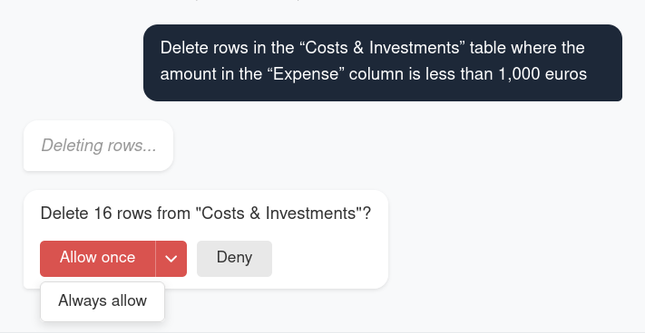

Le plugin de chat IA connecte vos données SeaTable à un modèle de langage (externe). Cet article explique comment fonctionne le flux de données, quels mécanismes de protection sont en place et comment vous gardez le contrôle sur vos données.

## Comment vos données circulent-elles ?

Lorsque vous posez une question dans le chat IA, le flux de données se déroule en quatre étapes :

1. **Votre question** est envoyée à SeaTable AI ou au fournisseur IA sélectionné.
2. Le plugin interroge les données pertinentes de votre base.
3. **Les résultats de la requête** sont transmis à SeaTable AI ou au fournisseur IA afin que le modèle de langage puisse les analyser.
4. Le modèle formule une réponse et la renvoie au plugin.

Cela signifie que, si vous n'utilisez pas SeaTable AI, les données interrogées sont transmises au fournisseur IA externe. C'est techniquement nécessaire, car un modèle de langage ne peut traiter que les données qu'il reçoit.

## Choix du fournisseur IA

Vous décidez vous-même quel **fournisseur** et quel **modèle** vous utilisez.

Par défaut, le plugin utilise **SeaTable AI**, qui est déjà installée. Elle repose sur **Qwen 3.8 27B**, un modèle open-weights de 27 milliards de paramètres développé par Alibaba. Le modèle d'IA est hébergé dans des centres de données allemands d'Exoscale – le même fournisseur qui met également à disposition les serveurs de SeaTable Cloud. Vos données ne sont donc traitées par aucun autre prestataire tiers.

Vous avez également le choix entre **Anthropic** (Claude), **OpenAI** et **Mistral**. Chacun de ces fournisseurs IA externes dispose de ses propres politiques de confidentialité. De nombreux fournisseurs s'engagent contractuellement à ce que les données traitées via leur API **ne soient pas utilisées pour l'entraînement de modèles**. Vérifiez néanmoins les conditions d'utilisation actuelles de votre fournisseur choisi.

## Confirmation avant les modifications

Le plugin de chat IA distingue clairement les opérations de **lecture** des opérations d'**écriture**. Avant l'exécution d'une action destructive (par exemple, modifier ou supprimer des lignes), le plugin affiche un **dialogue de confirmation**. Celui-ci vous informe des modifications qui seront apportées et du nombre de lignes concernées.

Vous disposez de trois options :

- **Autoriser une fois** : seule cette action est exécutée.
- **Toujours autoriser** : les actions suivantes de ce type sont exécutées sans nouvelle demande de confirmation.
- **Refuser** : l'action n'est pas exécutée.

Même pour des ensembles de résultats volumineux, le plugin demande confirmation avant de traiter des milliers de lignes. Vous gardez ainsi le contrôle à tout moment.

## Contrôle maximal grâce à l'auto-hébergement

Si vous ne souhaitez pas que des données soient transmises à SeaTable AI ou à des fournisseurs externes, vous pouvez **héberger SeaTable vous-même et le combiner avec un modèle de langage local**. Dans cette configuration, vos données ne quittent à aucun moment votre propre réseau.

## Informations complémentaires

Vous trouverez une présentation détaillée sur la sécurité des données lors de l'utilisation de l'IA avec SeaTable dans l'article [Autorisations et confidentialité des agents IA](). Y sont notamment abordés les autorisations des tokens API, les stratégies de minimisation de l'exposition des données et l'auto-hébergement en détail.
