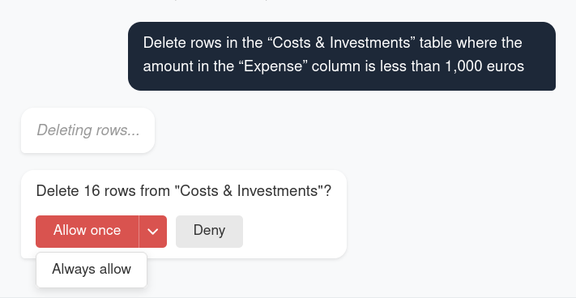

O plugin de chat IA conecta os seus dados do SeaTable a um modelo de linguagem (externo). Este artigo explica como funciona o fluxo de dados, que mecanismos de proteção existem e como mantém o controlo sobre os seus dados.

## Como fluem os seus dados?

Quando faz uma pergunta no chat IA, o fluxo de dados processa-se em quatro etapas:

1. **A sua pergunta** é enviada ao SeaTable AI ou ao fornecedor de IA selecionado.
2. O plugin consulta os dados relevantes da sua base.
3. **Os resultados da consulta** são transmitidos ao SeaTable AI ou ao fornecedor de IA para que o modelo de linguagem os possa avaliar.
4. O modelo formula uma resposta e envia-a de volta ao plugin.

Isto significa que, se não utilizar o SeaTable AI, os dados consultados são transmitidos ao fornecedor de IA externo. Tal é tecnicamente necessário porque um modelo de linguagem só pode processar dados que recebe.

## Escolha do fornecedor de IA

É o utilizador que decide qual **fornecedor** e qual **modelo** utiliza.

Por predefinição, o plugin utiliza o **SeaTable AI**, que já se encontra instalado. Este baseia-se no **Qwen 3.8 27B**, um modelo de pesos abertos com 27 mil milhões de parâmetros desenvolvido pela Alibaba. O modelo de IA é alojado em centros de dados alemães da Exoscale – o mesmo fornecedor que também disponibiliza os servidores do SeaTable Cloud. Assim, os seus dados não são processados por nenhum outro fornecedor terceiro.

Além disso, pode escolher entre **Anthropic** (Claude), **OpenAI** e **Mistral**. Cada um destes fornecedores de IA externos tem as suas próprias políticas de privacidade de dados. Muitos fornecedores comprometem-se contratualmente a que os dados processados através da sua API **não sejam utilizados para treinar modelos**. Ainda assim, consulte os termos de utilização atuais do fornecedor escolhido.

## Confirmação antes de alterações

O plugin de chat IA distingue claramente entre operações de **leitura** e de **escrita**. Antes de uma ação destrutiva ser executada (p. ex., modificar ou eliminar linhas), o plugin apresenta um **diálogo de confirmação**. Este informa-o sobre as alterações que serão efetuadas e quantas linhas são afetadas.

Tem três opções:

- **Permitir uma vez**: Apenas esta ação individual é executada.
- **Permitir sempre**: Outras ações deste tipo são executadas sem confirmação adicional.
- **Recusar**: A ação não é executada.

O plugin também solicita confirmação antes de processar grandes conjuntos de resultados com milhares de linhas. Desta forma, mantém o controlo em todos os momentos.

## Máximo controlo através do auto-alojamento

Se não pretende que os dados sejam transmitidos ao SeaTable AI ou a fornecedores externos, pode **auto-alojar o SeaTable e combiná-lo com um modelo de linguagem local**. Nesta configuração, os seus dados nunca saem da sua própria rede.

## Informações adicionais

Uma discussão detalhada sobre a segurança de dados ao utilizar IA com o SeaTable pode ser encontrada no artigo [Permissões e privacidade de dados para agentes de IA](). Entre outros temas, aborda permissões de tokens API, estratégias para minimizar a exposição de dados e o auto-alojamento em detalhe.
