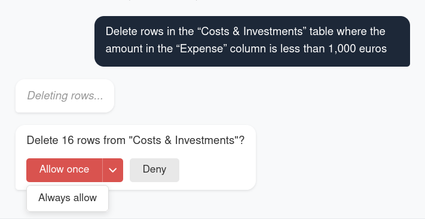

ИИ-чат-плагин связывает ваши данные SeaTable с (внешней) языковой моделью. В этой статье объясняется, как работает поток данных, какие механизмы защиты предусмотрены и как вы сохраняете контроль над своими данными.

## Как передаются ваши данные?

Когда вы задаёте вопрос в ИИ-чате, поток данных проходит четыре этапа:

1. **Ваш вопрос** отправляется в SeaTable AI или выбранному ИИ-провайдеру.
2. Плагин запрашивает соответствующие данные из вашей базы.
3. **Результаты запроса** передаются в SeaTable AI или ИИ-провайдеру, чтобы языковая модель могла их обработать.
4. Модель формулирует ответ и отправляет его обратно в плагин.

Это означает: если вы не используете SeaTable AI, запрошенные данные передаются внешнему ИИ-провайдеру. Это технически необходимо, поскольку языковая модель может обрабатывать только те данные, которые она получает.

## Выбор ИИ-провайдера

Вы сами решаете, какого **провайдера** и какую **модель** использовать.

По умолчанию плагин использует уже установленный **SeaTable AI**. В его основе лежит **Qwen 3.8 27B** — модель с открытыми весами и 27 миллиардами параметров, разработанная Alibaba. ИИ-модель размещена в немецких центрах обработки данных Exoscale — того же провайдера, который предоставляет и серверы SeaTable Cloud. Таким образом, ваши данные не обрабатываются никакими другими сторонними провайдерами.

Кроме того, доступны **Anthropic** (Claude), **OpenAI** и **Mistral**. Каждый из этих внешних ИИ-провайдеров имеет собственную политику конфиденциальности. Многие провайдеры договорно обязуются, что данные, обработанные через их API, **не используются для обучения моделей**. Тем не менее ознакомьтесь с актуальными условиями использования выбранного вами провайдера.

## Подтверждение перед изменениями

ИИ-чат-плагин чётко разграничивает операции **чтения** и **записи**. Перед выполнением деструктивного действия (например, изменения или удаления строк) плагин отображает **диалог подтверждения**. В нём сообщается, какие изменения будут внесены и сколько строк затронуто.

У вас есть три варианта:

- **Разрешить один раз**: выполняется только это одно действие.
- **Всегда разрешать**: дальнейшие действия этого типа выполняются без дополнительного подтверждения.
- **Отклонить**: действие не выполняется.

Плагин также запрашивает подтверждение перед обработкой больших наборов результатов с тысячами строк. Таким образом, вы всегда сохраняете контроль.

## Максимальный контроль через самостоятельный хостинг

Если вы не хотите, чтобы данные передавались в SeaTable AI или внешним провайдерам, вы можете **развернуть SeaTable на собственном сервере и использовать локальную языковую модель**. В такой конфигурации ваши данные никогда не покидают вашу собственную сеть.

## Дополнительная информация

Подробное обсуждение безопасности данных при использовании ИИ с SeaTable вы найдёте в статье [Разрешения и конфиденциальность данных для ИИ-агентов](). Среди прочего, в ней рассматриваются разрешения API-токенов, стратегии минимизации передачи данных и самостоятельный хостинг.
