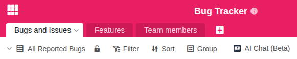
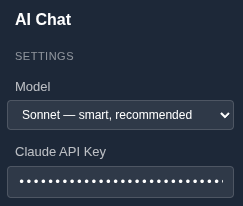
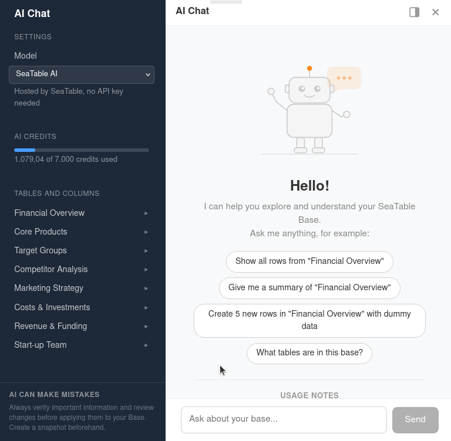

Mit dem KI-Chat-Plugin können Sie direkt in SeaTable mit Ihren Daten chatten. In dieser Anleitung erfahren Sie, wie Sie das Plugin installieren, einen API-Key hinterlegen und Ihre erste Konversation starten. Einen allgemeinen Überblick über das Plugin finden Sie im [Einführungsartikel]().

## Voraussetzungen

- Ein SeaTable-Konto mit Zugriff auf mindestens eine Base
- Wenn Sie die bereits installierte SeaTable AI nicht nutzen möchten, benötigen Sie einen **API-Key** von einem der unterstützten KI-Anbieter:
  - [Anthropic](https://console.anthropic.com/) (Claude)
  - [OpenAI](https://platform.openai.com/) (GPT)
  - [Mistral](https://v2.auth.mistral.ai/login) (Mistral)

## Schritt 1: Plugin in Ihrer Base installieren

1. Öffnen Sie die **Base**, in der Sie das KI-Chat-Plugin nutzen möchten.
2. Klicken Sie im Base-Header auf **Plugins**.
3. Suchen Sie im Plugin-Manager nach **AI Chat** und klicken Sie auf **Hinzufügen**.

Das Plugin erscheint nun in Ihrer **Plugin-Seitenleiste** und kann jederzeit geöffnet werden.

4. Fahren Sie mit dem Mauszeiger über das Plugin und klicken Sie auf die erscheinenden **drei Punkte**. 
5. Nun können Sie das Plugin **der Toolbar hinzufügen**, um es immer griffbereit zu haben.

## Schritt 2: KI-Modell auswählen und evtl. API-Key hinterlegen

1. Öffnen Sie das KI-Chat-Plugin.
2. Wählen Sie das gewünschte Modell – entweder die bereits installierte **SeaTable AI** oder ein Modell der drei KI-Anbieter **Anthropic**, **OpenAI** oder **Mistral**. Die leistungsstärkeren Modelle liefern in der Regel bessere Ergebnisse, verursachen aber höhere Kosten pro Anfrage.
3. Wenn Sie ein externes Modell nutzen: Tragen Sie Ihren **API-Key** in das vorgesehene Feld ein.



## Schritt 3: Erste Konversation starten

Geben Sie Ihre erste Frage in das Eingabefeld ein und drücken Sie **Enter**. Das Plugin analysiert die Struktur und die Daten Ihrer Base und beantwortet Ihre Frage im Chat-Fenster.

## Tipps für den Einstieg

Starten Sie mit einer einfachen Frage, um die Verbindung zu testen und sich mit dem Plugin vertraut zu machen. Gute erste Fragen sind zum Beispiel:

- "Welche Tabellen gibt es in meiner Base?"
- "Wie viele Einträge hat die Tabelle [Tabellenname]?"
- "Fasse die Daten in der Tabelle [Tabellenname] zusammen."

Je präziser Ihre Frage formuliert ist, desto genauer fällt die Antwort aus. Nennen Sie nach Möglichkeit den konkreten Tabellen- oder Spaltennamen, auf den sich Ihre Frage bezieht.
