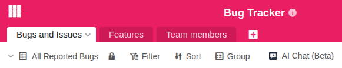
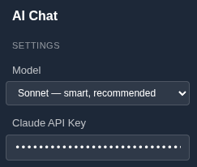
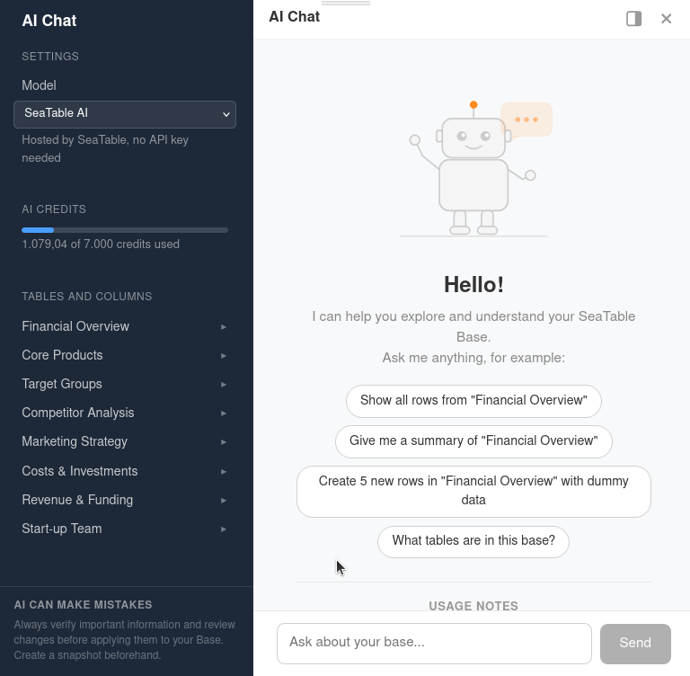

With the AI Chat Plugin, you can chat directly with your data in SeaTable. This guide shows you how to install the plugin, enter an API key, and start your first conversation. For a general overview of the plugin, see the [introduction article]().

## Prerequisites

- A SeaTable account with access to at least one base
- If you do not want to use the already installed SeaTable AI, you need an **API key** from one of the supported AI providers:
  - [Anthropic](https://console.anthropic.com/) (Claude)
  - [OpenAI](https://platform.openai.com/) (GPT)
  - [Mistral](https://v2.auth.mistral.ai/login) (Mistral)

## Step 1: Install the plugin in your base

1. Open the **base** where you want to use the AI Chat Plugin.
2. Click **Plugins** in the base header.
3. Search for **AI Chat** in the Plugin Manager and click **Add**.

The plugin now appears in your **plugin sidebar** and can be opened at any time.

4. Hover over the plugin and click the **three dots** that appear.
5. You can now **add the plugin to the toolbar** to keep it within easy reach.

## Step 2: Select an AI model and enter your API key if needed

1. Open the AI Chat Plugin.
2. Select the desired model – either the already installed **SeaTable AI** or a model from one of the three AI providers **Anthropic**, **OpenAI**, or **Mistral**. The more powerful models generally deliver better results but incur higher costs per request.
3. If you are using an external model: Enter your **API key** in the designated field.



## Step 3: Start your first conversation

Enter your first question in the input field and press **Enter**. The plugin analyzes the structure and data of your base and answers your question in the chat window.

## Tips for getting started

Start with a simple question to test the connection and familiarize yourself with the plugin. Good first questions include:

- "What tables are in my base?"
- "How many records does the table [table name] have?"
- "Summarize the data in the table [table name]."

The more precisely you formulate your question, the more accurate the answer will be. Whenever possible, mention the specific table or column name your question refers to.
