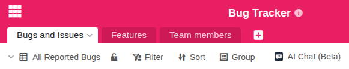
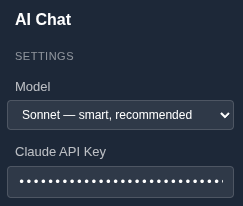
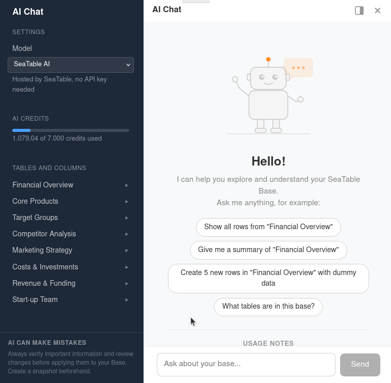

С помощью ИИ-чат-плагина вы можете общаться с данными прямо в SeaTable. Это руководство покажет вам, как установить плагин, ввести API-ключ и начать первый разговор. Общий обзор плагина вы найдёте во [вводной статье]().

## Предварительные требования

- Учётная запись SeaTable с доступом хотя бы к одной базе
- Если вы не хотите использовать уже установленный SeaTable AI, вам понадобится **API-ключ** от одного из поддерживаемых ИИ-провайдеров:
  - [Anthropic](https://console.anthropic.com/) (Claude)
  - [OpenAI](https://platform.openai.com/) (GPT)
  - [Mistral](https://v2.auth.mistral.ai/login) (Mistral)

## Шаг 1: Установите плагин в вашей базе

1. Откройте **базу**, в которой вы хотите использовать ИИ-чат-плагин.
2. Нажмите **Plugins** в заголовке базы.
3. Найдите **AI Chat** в менеджере плагинов и нажмите **Add**.

Плагин теперь отображается на **боковой панели плагинов** и может быть открыт в любое время.

4. Наведите курсор мыши на плагин и нажмите на появившиеся **три точки**.
5. Теперь вы можете **добавить плагин на панель инструментов**, чтобы он всегда был под рукой.

## Шаг 2: Выберите ИИ-модель и при необходимости введите API-ключ

1. Откройте ИИ-чат-плагин.
2. Выберите нужную модель — либо уже установленный **SeaTable AI**, либо модель одного из трёх ИИ-провайдеров: **Anthropic**, **OpenAI** или **Mistral**. Более мощные модели, как правило, дают лучшие результаты, но стоят дороже за запрос.
3. Если вы используете внешнюю модель: введите ваш **API-ключ** в соответствующее поле.



## Шаг 3: Начните первый разговор

Введите свой первый вопрос в поле ввода и нажмите **Enter**. Плагин анализирует структуру и данные вашей базы и отвечает на ваш вопрос в окне чата.

## Советы для начала работы

Начните с простого вопроса, чтобы проверить подключение и познакомиться с плагином. Хорошие первые вопросы:

- «Какие таблицы есть в моей базе?»
- «Сколько записей в таблице [название таблицы]?»
- «Обобщи данные в таблице [название таблицы].»

Чем точнее вы формулируете вопрос, тем точнее будет ответ. По возможности указывайте конкретное название таблицы или столбца, к которому относится ваш вопрос.
