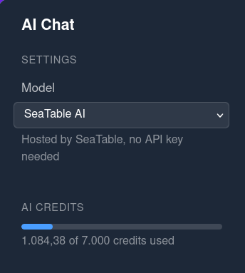

ИИ-чат-плагин по умолчанию использует уже установленный **SeaTable AI**. Кроме того, он поддерживает языковые модели от трёх внешних провайдеров: **Anthropic**, **OpenAI** и **Mistral**. Вы сами выбираете, какую модель использовать. Возникающие расходы на токены либо списываются напрямую в рамках вашей подписки SeaTable, либо оплачиваются внешнему провайдеру выбранной модели.

## SeaTable AI

В основе предустановленного SeaTable AI лежит **Qwen 3.8 27B** — модель с открытыми весами и 27 миллиардами параметров, разработанная Alibaba. ИИ-модель размещена в немецких центрах обработки данных Exoscale — того же провайдера, который предоставляет и серверы SeaTable Cloud. Она предназначена для сложных рассуждений, программирования, исследований, обработки документов и сложных многошаговых задач и распространяется по лицензии Apache 2.0.

Кроме того, для ИИ-чат-плагина вы можете использовать собственный **API-ключ**, чтобы подключить **внешнюю облачную ИИ-модель**.

## Обзор моделей внешних провайдеров

Каждый провайдер предлагает две модели: быструю и доступную модель для простых задач и более мощную модель для сложных анализов.

| Провайдер | Модель | Сильные стороны | Стоимость |
|---|---|---|---|
| **Anthropic** | Claude Haiku | быстрая, эффективная, хороша для простых запросов | низкая |
| **Anthropic** | Claude Sonnet | мощная, точная для сложных анализов | средняя |
| **OpenAI** | GPT-6 Luna | быстрая, экономичная, универсальная | низкая |
| **OpenAI** | GPT-6.1 Sol | очень способная, высокое качество ответов | выше |
| **Mistral** | Mistral Small | быстрая, доступная, хорошая базовая производительность | низкая |
| **Mistral** | Mistral Large | мощная, хороша для сложных задач | выше |

## Настройка API-ключа

Чтобы использовать внешнюю модель в ИИ-чат-плагине, вам нужен **API-ключ** от соответствующего провайдера. Вы создаёте его непосредственно на сайте провайдера:

- **Anthropic**: создайте API-ключ на [console.anthropic.com](https://console.anthropic.com/).
- **OpenAI**: создайте API-ключ на [platform.openai.com](https://platform.openai.com/).
- **Mistral**: создайте API-ключ на [v2.auth.mistral.ai/login](https://v2.auth.mistral.ai/login).

Все три провайдера требуют добавления **способа оплаты**. Стоимость зависит от количества израсходованных токенов и выставляется непосредственно провайдером.

## Рекомендации по сценариям использования

### Простые запросы и быстрые ответы

Для поиска отдельных значений, кратких сводок или простых вопросов-фильтров хорошо подходят доступные модели: **Claude Haiku**, **GPT-6 Luna** или **Mistral Small**. Они обеспечивают быстрые ответы при низких затратах.

### Сложные анализы и оценка данных

Если вы хотите анализировать большие наборы данных, выявлять закономерности или выполнять многошаговые вычисления, выбирайте **Claude Sonnet**, **GPT-6.1 Sol** или **Mistral Large**. Эти модели обеспечивают более точные результаты для сложных задач.

### Генерация текста и написание

Для составления электронных писем, отчётов или описаний на основе ваших данных рекомендуются **Claude Sonnet** или **GPT-6.1**. Обе модели создают лингвистически качественные тексты.

## Стоимость и оплата

### Для SeaTable AI

Токены, израсходованные ИИ, пересчитываются в **кредиты ИИ** и списываются с вашего баланса: 1 миллион входных токенов соответствует 500 кредитам ИИ, а 1 миллион выходных токенов — 1500 кредитам ИИ.

Количество доступных кредитов ИИ зависит от [подписки SeaTable]() вашей команды. В SeaTable Plus это **50 кредитов ИИ на пользователя** в месяц, а в SeaTable Enterprise — **500 кредитов ИИ на пользователя**.

Остаток на балансе и уже израсходованное количество вы можете в любой момент увидеть на **шкале в левой боковой панели** ИИ-чат-плагина.

### Для внешних ИИ-моделей

Все расходы на токены оплачиваются напрямую между вами и соответствующим ИИ-провайдером. SeaTable не взимает дополнительных сборов за использование ИИ-чат-плагина. Точные цены за токен вы найдёте на странице тарифов соответствующего провайдера.
