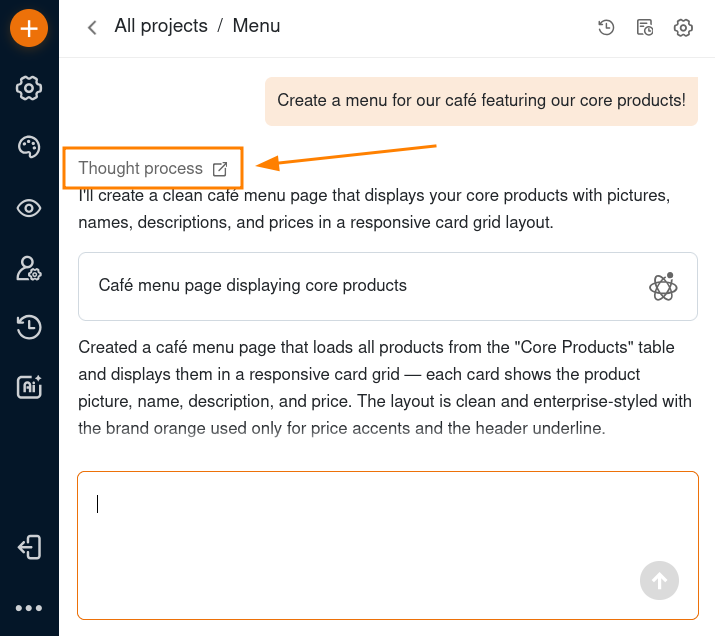

KI-generierte Seiten sind ein bahnbrechendes Feature von SeaTable, das den No-Code-Ansatz bei der Entwicklung von Apps vollendet. Die KI ermöglicht Ihnen, individuelle Benutzeroberflächen auf Basis von HTML, JavaScript und CSS zu erstellen, ohne eine einzige Zeile programmieren zu müssen.

## Wie funktionieren KI-generierte Seiten in Apps?

Für Ihre Apps in SeaTable können Sie im Chat mit einer KI individuelle Seiten ganz nach Ihren Vorstellungen erstellen lassen. Dazu beschreiben Sie in natürlicher Sprache, was die Seite können und wie sie aussehen soll, und die KI baut sie für Sie. Dabei greift die KI auf das Software Development Kit (SDK) für HTML-Seiten zurück. Technisch gesehen handelt es sich beim Ergebnis folglich um eine [HTML-Seite]().



Für die Seitengenerierung setzt SeaTable auf **Qwen 3.8 27B**, ein Open-Weights-Modell mit 27 Milliarden Parametern aus dem Hause Alibaba. Das KI-Modell wird in deutschen Rechenzentren von Exoscale gehostet – demselben Anbieter, der auch die Server von SeaTable Cloud bereitstellt. Die Daten in Ihren Bases gelangen ohnehin nie zum KI-Modell, da es nur Ihre Prompts und Base-Schemata verarbeitet.



## Wie Sie eine KI-generierte Seite anlegen

Um Seiten in SeaTable Apps erstellen zu können, müssen Sie bereits [eine App zu einer Base hinzugefügt]() und diese im [Bearbeitungsmodus]() geöffnet haben. Wenn Sie nun eine maßgeschneiderte Seite von der KI bauen lassen wollen, gehen Sie wie folgt vor:

1. Klicken Sie am linken Seitenrand auf das **AI-Icon**.
   
2. Klicken Sie auf die orange Schaltfläche **Projekt hinzufügen**.
   
3. Geben Sie dem Projekt einen **Namen**, den später auch die KI-generierte Seite tragen soll. Optional können Sie weitere **Projektnotizen** festhalten.
   
4. Bestätigen Sie mit **Absenden** und der KI-Seitengenerator öffnet sich.
5. Entscheiden Sie sich zunächst für einen **UI-Stil**, der das visuelle Erscheinungsbild der Seite definiert.
   
6. Klicken Sie auf **Weiter**. Als Nächstes legen Sie die **Datenquellen** der Seite fest. Kreuzen Sie dazu die benötigten **Tabellen** an und konfigurieren Sie deren **Berechtigungen**.
   
7. Klicken Sie auf **Weiter**. Geben Sie nun einen **Prompt** ein, der die Seite beschreibt, die Sie erstellen möchten. Klicken Sie anschließend auf **Seite generieren**.
   
8. Sobald die KI den ersten Entwurf fertiggestellt hat, zeigt sie eine **Vorschau** an. Daraufhin können Sie mit weiteren Prompts im **Chat** die Seite verfeinern.
9. Wenn Sie zufrieden mit dem Ergebnis sind, klicken Sie oben rechts auf **Veröffentlichen**. Wenn Sie möchten, können Sie noch den **Seitennamen** anpassen und ein **Icon** auswählen, bevor Sie die Seite veröffentlichen.
   
10. Klicken Sie auf das **Ausgang-Symbol** am unteren linken Seitenrand, um den KI-Seitengenerator zu verlassen und sich die **KI-generierte Seite in der App** anzuschauen.
   

## Einstellungen der KI-generierten Seite 

Um die **Seiteneinstellungen** zu öffnen, fahren Sie mit dem Mauszeiger über den Seitennamen in der Navigationsleiste und klicken auf das erscheinende **Zahnrad-Symbol**.

### Verfügbare Tabellen konfigurieren

In der Regel ist eine KI-generierte Seite **dynamisch** – das heißt, sie passt sich an, wenn sich die Daten in den zugrundeliegenden Tabellen verändern. Andererseits können Sie aber auch erlauben, Daten in den Tabellen über die KI-generierte Seite zu verändern.

Um die Berechtigungen der verfügbaren Tabellen zu bearbeiten, klicken Sie in den Seiteneinstellungen auf das **Zahnrad-Symbol** der entsprechenden Tabelle.

Es stehen fünf Berechtigungen zur Verfügung, die Sie über die Regler aktivieren bzw. deaktivieren können:
- **Darf Zeilen hinzufügen**
- **Darf Zeilen auflisten**
- **Darf Zeilen bearbeiten**
- **Darf Zeilen löschen**
- **Darf Zeilen abfragen**

Indem Sie **Spalten ausblenden**, können Sie granular steuern, welche Felder hinzugefügt, angesehen, bearbeitet oder abgefragt werden dürfen.



Die gleichen Optionen haben Sie auch, wenn Sie beim Anlegen der KI-generierten Seite die Datenquellen einrichten.



### Schaltflächen-Aktionen erlauben

Zudem können Sie von der KI [Schaltflächen]() auf Ihrer Seite einbauen lassen. So können Sie auf KI-generierten Seiten zum Beispiel per Knopfdruck eine E-Mail verschicken oder Skripte ausführen. Die E-Mail-Konten und Skripte, die Sie verwenden möchten, müssen aber bereits in der Base eingerichtet sein.

Folgende Aktionen können Sie separat mit einem Regler erlauben: 
- **Benachrichtigungen senden**
- **E-Mails senden**
- **Skripte ausführen**

### Seitenberechtigung

Zu guter Letzt können Sie einstellen, wer die KI-generierte Seite sehen darf. Mehr zu den verschiedenen Seitenberechtigungen in der App erfahren Sie [hier]().

## KI-Projekte in der App verwalten

Sobald Sie ein **Projekt** für eine KI-generierte Seite angelegt haben, erscheint es als neue **Kachel** auf der Übersichtsseite, die Sie über das **AI-Icon** am linken Seitenrand erreichen. Fahren Sie mit dem Mauszeiger über die Kachel und klicken Sie auf die erscheinenden **drei Punkte**. Hier können Sie die Details (Name und Projektnotizen) ändern oder das Projekt **löschen**.

### An einem Projekt weiterarbeiten

Es kommt nicht selten vor, dass Sie eine KI-generierte Seite noch einmal überarbeiten oder weiterentwickeln möchten, weil Sie zum Beispiel Ideen für weitere Funktionen oder Elemente haben. Gut, dass SeaTable **den gesamten Chat und alle Versionen der Seite speichert**. So können Sie jederzeit weitermachen, wo Sie aufgehört haben, oder zu einer früheren Version zurückspringen, falls eine Änderung nicht Ihren Vorstellungen entspricht. 



Unterhaltungen und nicht veröffentlichte Seiten werden 365 Tage lang aufbewahrt.



Klicken Sie auf die **Kachel**, um das gewünschte Projekt zu öffnen, und dann auf **Fortsetzen**. 

Nun haben Sie verschiedene Möglichkeiten:
- **Uhr-Symbol**: Ihre bisherigen Chats mit der KI ansehen oder löschen.
- **Versionen-Symbol**: zu älteren Seitenversionen zurückkehren, diese ansehen oder löschen.
- **Zahnrad-Symbol**: den UI-Stil, die Datenquellen oder die Aktionsberechtigungen anpassen.
- **Eingabefeld**: im Chat mit der KI weitere Prompts ausprobieren.

Wenn Sie wissen möchten, was bei der Erstellung einer Seitenversion hinter den Kulissen passiert ist, klicken Sie im Chat auf **Denkprozess**.

Die ausklappbaren Elemente zeigen Ihnen für jeden Schritt den System-Prompt, Ihre Eingabe und das Ergebnis der KI. Die **Statistiken** ergänzen, wie lange der Schritt gedauert und wie viele Tokens er verbraucht hat.

## Eine KI-generierte Seite selbst weiterentwickeln

Sie können sich jederzeit den **HTML-Code einer KI-generierten Seite anzeigen** lassen. Klicken Sie dazu im Vorschaufenster oben links auf das **Code-Symbol**. Über das **Augen-Symbol** können Sie wiederum zur visuellen Vorschau zurückkehren.

Sofern Sie über Programmierkenntnisse verfügen, können Sie den HTML-Code nutzen, um die Seite selbst weiterzuentwickeln. Dazu können Sie **die Seite als HTML-Datei herunterladen**. Klicken Sie einfach auf das **Download-Symbol** in der oberen rechten Ecke – und schon ist die HTML-Datei auf Ihrem Gerät gespeichert.

Sobald Sie die HTML-Seite außerhalb von SeaTable fertig programmiert haben, können Sie eine **Zip-Datei hochladen**, welche die HTML-, JavaScript- und CSS-Dateien enthält. 

1. Fahren Sie mit dem Mauszeiger über den Namen der KI-generierten Seite und klicken Sie auf die erscheinenden **drei Punkte**.
2. Wählen Sie die Option **Datei der Seite aktualisieren** aus.
3. Klicken Sie auf das Feld mit dem **Plus-Symbol** und laden Sie eine **Datei für die HTML-Seite** hoch.
4. Bestätigen Sie mit **Absenden**.

Weiterführende Informationen finden Sie im [Artikel über HTML-Seiten]().