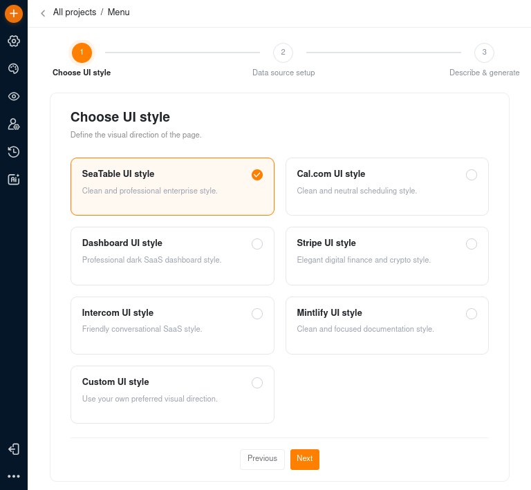
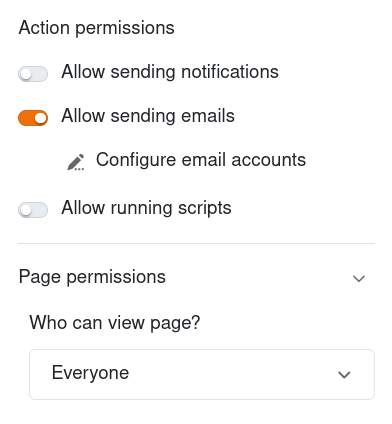
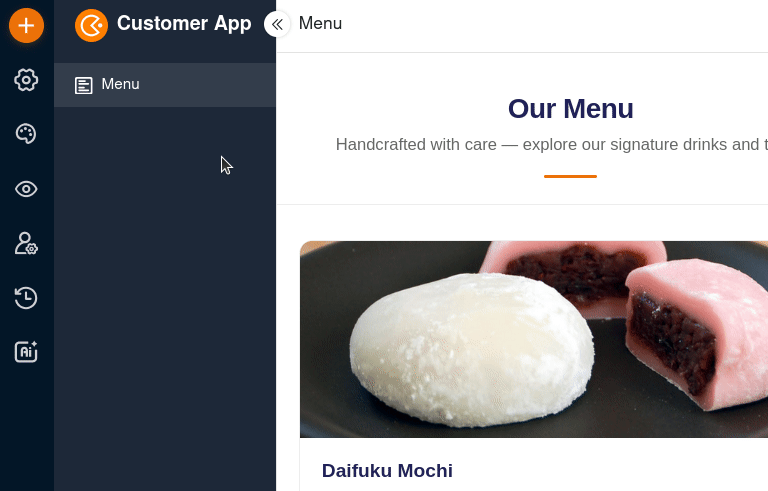

AI-generated pages are a groundbreaking feature of SeaTable that completes the no-code approach to app development. The AI enables you to create custom user interfaces based on HTML, JavaScript and CSS without having to write a single line of code.

## How do AI-generated pages in apps work?

For your apps in SeaTable, you can have custom pages created exactly as you envision them by chatting with an AI. You describe in natural language what the page should do and how it should look, and the AI builds it for you. To do so, the AI uses the Software Development Kit (SDK) for HTML pages. Technically speaking, the result is therefore an [HTML page]().



For page generation, SeaTable relies on **Qwen 3.8 27B**, an open-weights model with 27 billion parameters developed by Alibaba. The AI model is hosted in German data centers by Exoscale – the same provider that also supplies the servers of SeaTable Cloud. The data in your bases never reaches the AI model in the first place, as it only processes your prompts and base schemas.



## How to create an AI-generated page

To create pages in SeaTable apps, you must have already [added an app to a base]() and opened it in [editing mode](). If you now want the AI to build a tailor-made page, proceed as follows:

1. Click the **AI icon** on the left side of the page.
   
2. Click the orange **Add project** button.
   
3. Give the project a **name**, which the AI-generated page will later bear as well. Optionally, you can add further **project notes**.
   
4. Confirm with **Submit** and the AI page generator opens.
5. First, choose a **UI style** that defines the visual appearance of the page.
   
6. Click **Next**. Now define the **data sources** of the page. To do so, check the required **tables** and configure their **permissions**.
   
7. Click **Next**. Now enter a **prompt** that describes the page you want to create. Then click **Generate page**.
   
8. As soon as the AI has finished the first draft, it displays a **preview**. You can then refine the page with further prompts in the **chat**.
9. When you are satisfied with the result, click **Publish** in the top right. If you like, you can adjust the **page name** and select an **icon** before publishing the page.
   
10. Click the **exit icon** at the bottom left of the page to leave the AI page generator and view the **AI-generated page in the app**.
   

## Settings of the AI-generated page

To open the **page settings**, hover your mouse over the page name in the navigation bar and click the **gear icon** that appears.

### Configure available tables

As a rule, an AI-generated page is **dynamic** – that is, it adapts when the data in the underlying tables changes. Conversely, you can also allow data in the tables to be changed via the AI-generated page.

To edit the permissions of the available tables, click the **gear icon** of the respective table in the page settings.

There are five permissions available, which you can enable or disable using the sliders:
- **Can add records**
- **Can list records**
- **Can modify records**
- **Can delete records**
- **Can query records**

By **hiding columns**, you can control at a granular level which fields may be added, viewed, edited or queried.



You have the same options when setting up the data sources while creating the AI-generated page.



### Allow button actions

You can also have the AI add [buttons]() to your page. This allows you, for example, to send an email or run scripts at the click of a button on AI-generated pages. However, the email accounts and scripts you want to use must already be set up in the base.

You can allow the following actions separately using a slider:
- **Send notifications**
- **Send emails**
- **Run scripts**

### Page permission

Last but not least, you can define who may see the AI-generated page. You can find out more about the various page permissions in the app [here]().

## Manage AI projects in the app

As soon as you have created a **project** for an AI-generated page, it appears as a new **tile** on the overview page, which you can access via the **AI icon** on the left side of the page. Hover your mouse over the tile and click the **three dots** that appear. Here you can **modify details** (name and project notes) or **delete** the project.

### Continue working on a project

It is not uncommon to want to revise or further develop an AI-generated page, for example because you have ideas for additional functions or elements. Fortunately, SeaTable **saves the entire chat and all versions of the page**. This means you can pick up where you left off at any time or jump back to an earlier version if a change does not meet your expectations.



Conversations and unpublished pages are retained for 365 days.



Click the **tile** to open the desired project and then click **Continue**.

You now have various options:
- **Clock icon**: view or delete your previous chats with the AI.
- **Versions icon**: return to, view or delete older page versions.
- **Gear icon**: adjust the UI style, the data sources or the action permissions.
- **Input field**: try out further prompts in the chat with the AI.

If you want to know what happened behind the scenes when a page version was created, click **Thought process** in the chat.

For each step, the expandable elements show you the system prompt, your input and the result returned by the AI. The **statistics** add how long the step took and how many tokens it consumed.

## Further develop an AI-generated page yourself

You can **display the HTML code of an AI-generated page** at any time. To do so, click the **code icon** in the top left of the preview window. You can return to the visual preview via the **eye icon**.

If you have programming skills, you can use the HTML code to develop the page further yourself. To do so, you can **download the page as an HTML file**. Simply click the **download icon** in the top right corner – and the HTML file is saved on your device.

As soon as you have finished programming the HTML page outside of SeaTable, you can **upload a zip file** that contains the HTML, JavaScript and CSS files.

1. Hover your mouse over the name of the AI-generated page and click the **three dots** that appear.
2. Select the **Update page file** option.
3. Click the field with the **plus icon** and upload a **file for the HTML page**.
4. Confirm with **Submit**.

You can find further information in the [article on HTML pages]().
