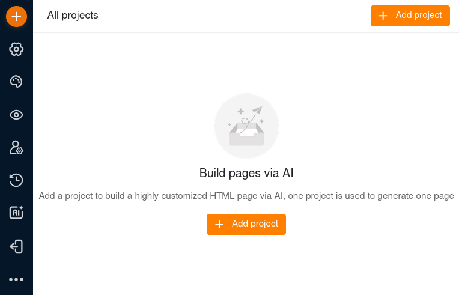
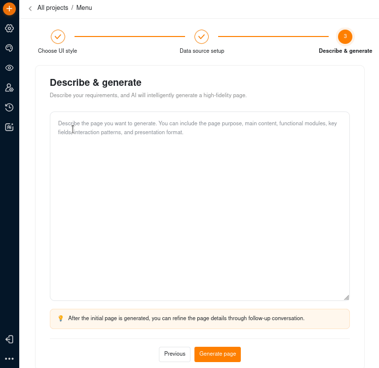
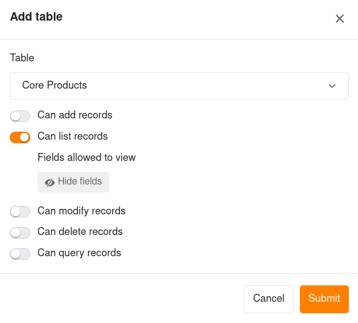

Las páginas generadas con IA son una función revolucionaria de SeaTable que culmina el enfoque no-code en el desarrollo de aplicaciones. La IA le permite crear interfaces de usuario personalizadas basadas en HTML, JavaScript y CSS sin tener que programar ni una sola línea.

## ¿Cómo funcionan las páginas generadas con IA en las aplicaciones?

Para sus aplicaciones en SeaTable, puede hacer que una IA cree en un chat páginas personalizadas exactamente según sus ideas. Para ello, describa en lenguaje natural qué debe hacer la página y qué aspecto debe tener, y la IA la creará por usted. La IA recurre para ello al Software Development Kit (SDK) para páginas HTML. Por lo tanto, desde el punto de vista técnico, el resultado es una [página HTML]().



Para la generación de páginas, SeaTable utiliza **Qwen 3.8 27B**, un modelo de pesos abiertos con 27 000 millones de parámetros desarrollado por Alibaba. El modelo de IA está alojado en centros de datos alemanes de Exoscale, el mismo proveedor que también suministra los servidores de SeaTable Cloud. En cualquier caso, los datos de sus bases nunca llegan al modelo de IA, ya que este solo procesa sus prompts y los esquemas de sus bases.



## Cómo crear una página generada con IA

Para poder crear páginas en aplicaciones de SeaTable, debe haber [añadido previamente una aplicación a una base]() y haberla abierto en el [modo de edición](). Si ahora desea que la IA cree una página a medida, proceda del siguiente modo:

1. Haga clic en el **icono AI** en el borde izquierdo de la página.
   
2. Haga clic en el botón naranja **Añadir proyecto**.
   
3. Asigne al proyecto un **nombre**, que más tarde llevará también la página generada con IA. Opcionalmente, puede añadir **notas del proyecto**.
   
4. Confirme con **Enviar** y se abrirá el generador de páginas con IA.
5. Elija primero un **estilo de interfaz** que defina el aspecto visual de la página.
   
6. Haga clic en **Siguiente**. A continuación, defina las **fuentes de datos** de la página. Para ello, marque las **tablas** necesarias y configure sus **permisos**.
   
7. Haga clic en **Siguiente**. Introduzca ahora un **prompt** que describa la página que desea crear. A continuación, haga clic en **Generar página**.
   
8. En cuanto la IA haya terminado el primer borrador, mostrará una **vista previa**. A partir de ahí, puede perfeccionar la página con más prompts en el **chat**.
9. Cuando esté satisfecho con el resultado, haga clic arriba a la derecha en **Publicar**. Si lo desea, puede adaptar el **nombre de la página** y seleccionar un **icono** antes de publicarla.
   
10. Haga clic en el **icono de salida** en el borde inferior izquierdo de la página para abandonar el generador de páginas con IA y ver la **página generada con IA en la aplicación**.
   

## Ajustes de la página generada con IA

Para abrir los **ajustes de página**, pase el ratón por encima del nombre de la página en la barra de navegación y haga clic en el **icono de la rueda dentada** que aparece.

### Configurar las tablas disponibles

Por lo general, una página generada con IA es **dinámica**, es decir, se adapta cuando cambian los datos de las tablas subyacentes. A la inversa, también puede permitir que los datos de las tablas se modifiquen a través de la página generada con IA.

Para editar los permisos de las tablas disponibles, haga clic en los ajustes de página en el **icono de la rueda dentada** de la tabla correspondiente.

Hay cinco permisos disponibles que puede activar o desactivar mediante los controles deslizantes:
- **Puede añadir filas**
- **Puede listar filas**
- **Puede editar filas**
- **Puede eliminar filas**
- **Puede consultar filas**

**Ocultando columnas**, puede controlar de forma granular qué campos se pueden añadir, ver, editar o consultar.



También dispone de las mismas opciones al configurar las fuentes de datos durante la creación de la página generada con IA.



### Permitir acciones de botones

Además, puede hacer que la IA integre [botones]() en su página. Así, en las páginas generadas con IA puede, por ejemplo, enviar un correo electrónico o ejecutar scripts con solo pulsar un botón. No obstante, las cuentas de correo electrónico y los scripts que desee utilizar deben estar ya configurados en la base.

Puede permitir las siguientes acciones por separado con un control deslizante:
- **Enviar notificaciones**
- **Enviar correos electrónicos**
- **Ejecutar scripts**

### Permiso de página

Por último, puede definir quién puede ver la página generada con IA. Encontrará más información sobre los distintos permisos de página en la aplicación [aquí]().

## Gestionar proyectos de IA en la aplicación

En cuanto haya creado un **proyecto** para una página generada con IA, aparecerá como un nuevo **mosaico** en la página de resumen, a la que se accede a través del **icono AI** en el borde izquierdo de la página. Pase el ratón por encima del mosaico y haga clic en los **tres puntos** que aparecen. Aquí puede modificar los detalles (nombre y notas del proyecto) o **eliminar** el proyecto.

### Seguir trabajando en un proyecto

No es raro que desee revisar o seguir desarrollando una página generada con IA, por ejemplo, porque tiene ideas para más funciones o elementos. Por suerte, SeaTable **guarda todo el chat y todas las versiones de la página**. Así, puede retomar el trabajo donde lo dejó en cualquier momento o volver a una versión anterior si un cambio no responde a sus expectativas.



Las conversaciones y las páginas no publicadas se conservan durante 365 días.



Haga clic en el **mosaico** para abrir el proyecto deseado y, a continuación, en **Continuar**.

Ahora dispone de varias posibilidades:
- **Icono del reloj**: ver o eliminar sus chats anteriores con la IA.
- **Icono de versiones**: volver a versiones anteriores de la página, verlas o eliminarlas.
- **Icono de la rueda dentada**: adaptar el estilo de interfaz, las fuentes de datos o los permisos de acciones.
- **Campo de entrada**: probar más prompts en el chat con la IA.

Si desea saber qué ha ocurrido entre bastidores al crear una versión de la página, haga clic en **Proceso de pensamiento** en el chat.

Para cada paso, los elementos desplegables le muestran el prompt del sistema, su entrada y el resultado de la IA. Las **estadísticas** añaden cuánto ha durado el paso y cuántos tokens ha consumido.

## Seguir desarrollando por su cuenta una página generada con IA

Puede **visualizar el código HTML de una página generada con IA** en cualquier momento. Para ello, haga clic en el **icono de código** situado arriba a la izquierda en la ventana de vista previa. Con el **icono del ojo** puede volver a la vista previa visual.

Si tiene conocimientos de programación, puede utilizar el código HTML para seguir desarrollando la página por su cuenta. Para ello, puede **descargar la página como archivo HTML**. Solo tiene que hacer clic en el **icono de descarga** en la esquina superior derecha y el archivo HTML se guardará en su dispositivo.

En cuanto haya terminado de programar la página HTML fuera de SeaTable, puede **cargar un archivo zip** que contenga los archivos HTML, JavaScript y CSS.

1. Pase el ratón por encima del nombre de la página generada con IA y haga clic en los **tres puntos** que aparecen.
2. Seleccione la opción **Actualizar archivo de la página**.
3. Haga clic en el campo con el **icono del signo más** y cargue un **archivo para la página HTML**.
4. Confirme con **Enviar**.

Encontrará más información en el [artículo sobre páginas HTML]().
