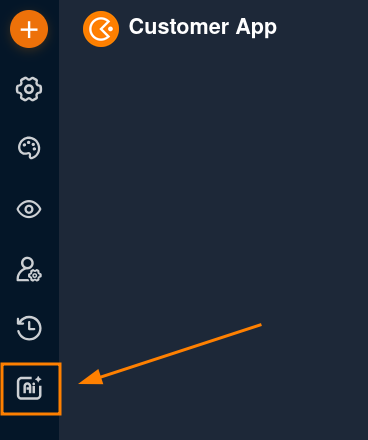
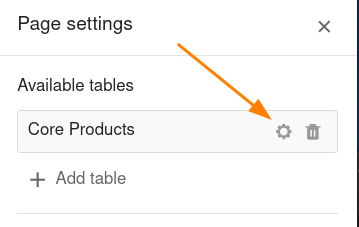
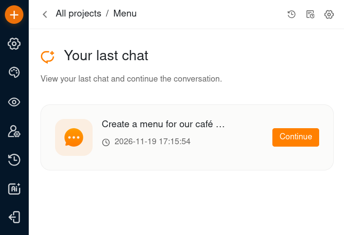
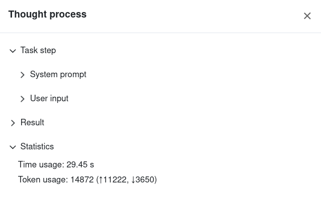
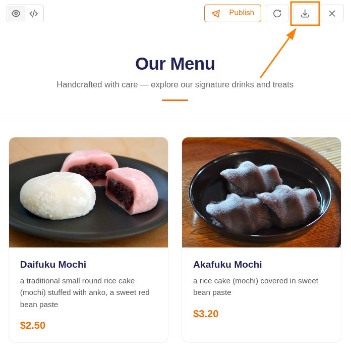

Les pages générées par l'IA sont une fonctionnalité révolutionnaire de SeaTable qui parachève l'approche no-code dans le développement d'applications. L'IA vous permet de créer des interfaces utilisateur personnalisées basées sur HTML, JavaScript et CSS sans avoir à programmer une seule ligne.

## Comment fonctionnent les pages générées par l'IA dans les applications ?

Pour vos applications dans SeaTable, vous pouvez faire créer des pages personnalisées, exactement selon vos idées, en dialoguant avec une IA. Pour cela, vous décrivez en langage naturel ce que la page doit faire et à quoi elle doit ressembler, et l'IA la construit pour vous. L'IA s'appuie à cet effet sur le Software Development Kit (SDK) pour les pages HTML. D'un point de vue technique, le résultat est donc une [page HTML]().



Pour la génération de pages, SeaTable utilise **Qwen 3.8 27B**, un modèle open-weights de 27 milliards de paramètres développé par Alibaba. Le modèle d'IA est hébergé dans des centres de données allemands d'Exoscale – le même fournisseur qui met également à disposition les serveurs de SeaTable Cloud. De toute façon, les données de vos bases ne parviennent jamais au modèle d'IA, car celui-ci ne traite que vos prompts et les schémas de vos bases.



## Comment créer une page générée par l'IA

Pour pouvoir créer des pages dans les applications de SeaTable, vous devez déjà avoir [ajouté une application à une base]() et l'avoir ouverte en [mode d'édition](). Si vous souhaitez maintenant faire construire une page sur mesure par l'IA, procédez comme suit :

1. Cliquez sur l'**icône IA** sur le bord gauche de la page.
   
2. Cliquez sur le bouton orange **Ajouter un projet**.
   
3. Donnez au projet un **nom**, que portera également par la suite la page générée par l'IA. Vous pouvez éventuellement ajouter des **notes de projet**.
   
4. Confirmez avec **Envoyer** et le générateur de pages par IA s'ouvre.
5. Choisissez d'abord un **style d'interface** qui définit l'apparence visuelle de la page.
   
6. Cliquez sur **Suivant**. Définissez ensuite les **sources de données** de la page. Pour ce faire, cochez les **tableaux** nécessaires et configurez leurs **autorisations**.
   
7. Cliquez sur **Suivant**. Saisissez maintenant un **prompt** décrivant la page que vous souhaitez créer. Cliquez ensuite sur **Générer la page**.
   
8. Dès que l'IA a terminé la première ébauche, elle affiche un **aperçu**. Vous pouvez alors affiner la page avec d'autres prompts dans le **chat**.
9. Lorsque le résultat vous convient, cliquez en haut à droite sur **Publier**. Si vous le souhaitez, vous pouvez encore modifier le **nom de la page** et sélectionner une **icône** avant de publier la page.
   
10. Cliquez sur l'**icône de sortie** en bas à gauche de la page pour quitter le générateur de pages par IA et voir la **page générée par l'IA dans l'application**.
   

## Paramètres de la page générée par l'IA

Pour ouvrir les **paramètres de la page**, passez la souris sur le nom de la page dans la barre de navigation et cliquez sur l'**icône en forme de roue dentée** qui apparaît.

### Configurer les tableaux disponibles

En règle générale, une page générée par l'IA est **dynamique**, c'est-à-dire qu'elle s'adapte lorsque les données des tableaux sous-jacents changent. Inversement, vous pouvez aussi autoriser la modification des données des tableaux via la page générée par l'IA.

Pour modifier les autorisations des tableaux disponibles, cliquez dans les paramètres de la page sur l'**icône en forme de roue dentée** du tableau correspondant.

Cinq autorisations sont disponibles, que vous pouvez activer ou désactiver à l'aide des curseurs :
- **Peut ajouter des lignes**
- **Peut lister des lignes**
- **Peut modifier des lignes**
- **Peut supprimer des lignes**
- **Peut interroger des lignes**

En **masquant des colonnes**, vous pouvez contrôler de manière granulaire quels champs peuvent être ajoutés, consultés, modifiés ou interrogés.



Vous disposez des mêmes options lorsque vous configurez les sources de données lors de la création de la page générée par l'IA.



### Autoriser les actions de bouton

Vous pouvez en outre demander à l'IA d'intégrer des [boutons]() à votre page. Sur les pages générées par l'IA, vous pouvez ainsi, par exemple, envoyer un e-mail ou exécuter des scripts d'un simple clic. Les comptes e-mail et les scripts que vous souhaitez utiliser doivent toutefois déjà être configurés dans la base.

Vous pouvez autoriser séparément les actions suivantes à l'aide d'un curseur :
- **Envoyer des notifications**
- **Envoyer des e-mails**
- **Exécuter des scripts**

### Autorisation de page

Enfin, vous pouvez définir qui peut voir la page générée par l'IA. Pour en savoir plus sur les différentes autorisations de pages dans l'application, cliquez [ici]().

## Gérer les projets d'IA dans l'application

Dès que vous avez créé un **projet** pour une page générée par l'IA, il apparaît sous forme de nouvelle **tuile** sur la page d'aperçu, accessible via l'**icône IA** sur le bord gauche de la page. Passez la souris sur la tuile et cliquez sur les **trois points** qui apparaissent. Vous pouvez y modifier les détails (nom et notes de projet) ou **supprimer** le projet.

### Continuer à travailler sur un projet

Il n'est pas rare de vouloir remanier ou développer davantage une page générée par l'IA, par exemple parce que vous avez des idées de fonctions ou d'éléments supplémentaires. Heureusement, SeaTable **enregistre l'intégralité du chat et toutes les versions de la page**. Vous pouvez ainsi reprendre à tout moment là où vous vous étiez arrêté, ou revenir à une version antérieure si une modification ne correspond pas à vos attentes.



Les conversations et les pages non publiées sont conservées pendant 365 jours.



Cliquez sur la **tuile** pour ouvrir le projet souhaité, puis sur **Continuer**.

Plusieurs possibilités s'offrent alors à vous :
- **Icône en forme d'horloge** : consulter ou supprimer vos précédents chats avec l'IA.
- **Icône des versions** : revenir à d'anciennes versions de la page, les consulter ou les supprimer.
- **Icône en forme de roue dentée** : adapter le style d'interface, les sources de données ou les autorisations d'actions.
- **Champ de saisie** : essayer d'autres prompts dans le chat avec l'IA.

Si vous souhaitez savoir ce qui s'est passé en coulisses lors de la création d'une version de la page, cliquez sur **Raisonnement** dans le chat.

Pour chaque étape, les éléments dépliables vous montrent le prompt système, votre saisie et le résultat de l'IA. Les **statistiques** indiquent en outre la durée de l'étape et le nombre de tokens consommés.

## Développer vous-même une page générée par l'IA

Vous pouvez à tout moment **afficher le code HTML d'une page générée par l'IA**. Pour ce faire, cliquez sur l'**icône de code** en haut à gauche de la fenêtre d'aperçu. L'**icône en forme d'œil** vous permet de revenir à l'aperçu visuel.

Si vous avez des connaissances en programmation, vous pouvez utiliser le code HTML pour continuer à développer la page vous-même. Pour cela, vous pouvez **télécharger la page sous forme de fichier HTML**. Il vous suffit de cliquer sur l'**icône de téléchargement** dans le coin supérieur droit, et le fichier HTML est enregistré sur votre appareil.

Dès que vous avez fini de programmer la page HTML en dehors de SeaTable, vous pouvez **téléverser un fichier zip** contenant les fichiers HTML, JavaScript et CSS.

1. Passez la souris sur le nom de la page générée par l'IA et cliquez sur les **trois points** qui apparaissent.
2. Sélectionnez l'option **Mettre à jour le fichier de la page**.
3. Cliquez sur le champ avec l'**icône plus** et téléversez un **fichier pour la page HTML**.
4. Confirmez avec **Envoyer**.

Vous trouverez de plus amples informations dans l'[article sur les pages HTML]().
