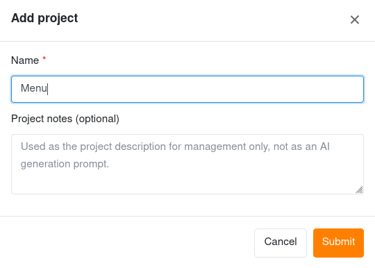
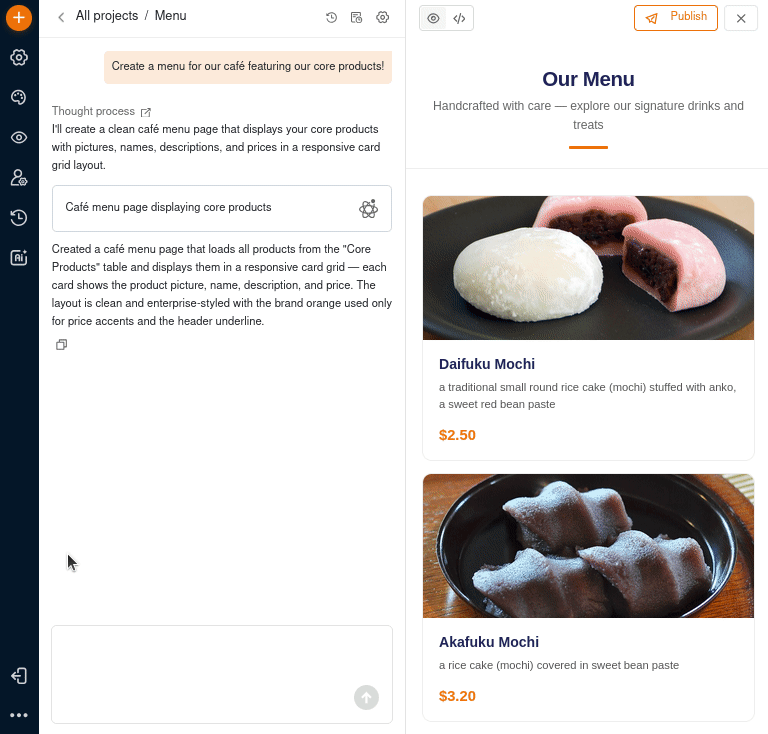
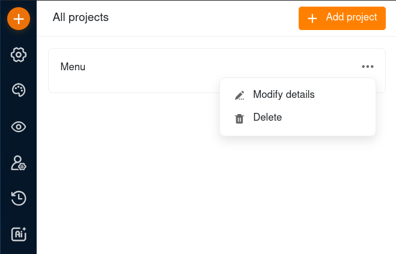
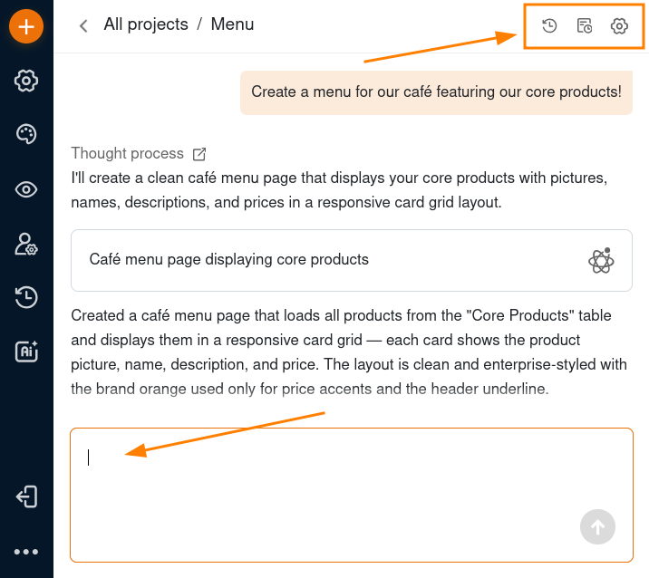
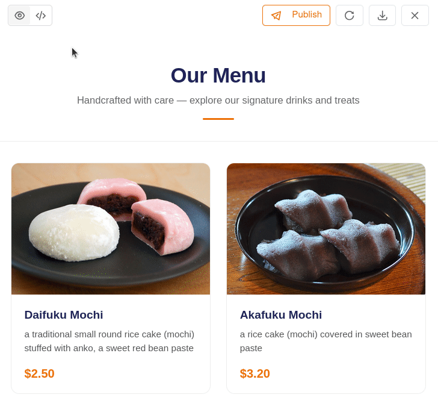

As páginas geradas com IA são uma funcionalidade inovadora do SeaTable que completa a abordagem no-code no desenvolvimento de aplicações. A IA permite-lhe criar interfaces de utilizador personalizadas baseadas em HTML, JavaScript e CSS sem ter de programar uma única linha.

## Como funcionam as páginas geradas com IA nas aplicações?

Para as suas aplicações no SeaTable, pode pedir a uma IA, através de um chat, que crie páginas personalizadas exatamente de acordo com as suas ideias. Para tal, descreva em linguagem natural o que a página deve fazer e qual o seu aspeto, e a IA cria-a por si. Para isso, a IA recorre ao Software Development Kit (SDK) para páginas HTML. Do ponto de vista técnico, o resultado é, portanto, uma [página HTML]().



Para a geração de páginas, o SeaTable utiliza o **Qwen 3.8 27B**, um modelo de pesos abertos com 27 mil milhões de parâmetros desenvolvido pela Alibaba. O modelo de IA está alojado em centros de dados alemães da Exoscale – o mesmo fornecedor que também disponibiliza os servidores do SeaTable Cloud. De qualquer modo, os dados das suas bases nunca chegam ao modelo de IA, uma vez que este processa apenas os seus prompts e os esquemas das suas bases.



## Como criar uma página gerada com IA

Para poder criar páginas em aplicações de SeaTable, tem de já ter [adicionado uma aplicação a uma base]() e de a ter aberto no [modo de edição](). Se pretender agora que a IA construa uma página à medida, proceda da seguinte forma:

1. Clique no **ícone AI** na margem esquerda da página.
   
2. Clique no botão cor de laranja **Adicionar projeto**.
   
3. Dê ao projeto um **nome**, que a página gerada com IA também terá mais tarde. Opcionalmente, pode registar **notas do projeto**.
   
4. Confirme com **Enviar** e o gerador de páginas com IA abre-se.
5. Escolha primeiro um **estilo de interface** que defina o aspeto visual da página.
   
6. Clique em **Seguinte**. Em seguida, defina as **fontes de dados** da página. Para tal, assinale as **tabelas** necessárias e configure as respetivas **permissões**.
   
7. Clique em **Seguinte**. Introduza agora um **prompt** que descreva a página que pretende criar. Em seguida, clique em **Gerar página**.
   
8. Assim que a IA tiver concluído o primeiro rascunho, apresenta uma **pré-visualização**. A partir daí, pode aperfeiçoar a página com mais prompts no **chat**.
9. Quando o resultado lhe agradar, clique em **Publicar** em cima à direita. Se quiser, pode ainda ajustar o **nome da página** e selecionar um **ícone** antes de publicar a página.
   
10. Clique no **ícone de saída** na margem inferior esquerda da página para sair do gerador de páginas com IA e ver a **página gerada com IA na aplicação**.
   

## Definições da página gerada com IA

Para abrir as **definições da página**, coloque o cursor do rato sobre o nome da página na barra de navegação e clique no **ícone da roda dentada** que aparece.

### Configurar as tabelas disponíveis

Regra geral, uma página gerada com IA é **dinâmica** – ou seja, adapta-se quando os dados nas tabelas subjacentes se alteram. Por outro lado, também pode permitir que os dados nas tabelas sejam alterados através da página gerada com IA.

Para editar as permissões das tabelas disponíveis, clique, nas definições da página, no **ícone da roda dentada** da tabela correspondente.

Estão disponíveis cinco permissões, que pode ativar ou desativar através dos controlos deslizantes:
- **Pode adicionar linhas**
- **Pode listar linhas**
- **Pode editar linhas**
- **Pode eliminar linhas**
- **Pode consultar linhas**

Ao **ocultar colunas**, pode controlar de forma granular que campos podem ser adicionados, vistos, editados ou consultados.



Dispõe das mesmas opções ao configurar as fontes de dados durante a criação da página gerada com IA.



### Permitir ações de botões

Além disso, pode pedir à IA que integre [botões]() na sua página. Assim, nas páginas geradas com IA pode, por exemplo, enviar um e-mail ou executar scripts com um simples clique num botão. No entanto, as contas de e-mail e os scripts que pretende utilizar já têm de estar configurados na base.

Pode permitir separadamente as seguintes ações com um controlo deslizante:
- **Enviar notificações**
- **Enviar e-mails**
- **Executar scripts**

### Permissão de página

Por último, pode definir quem pode ver a página gerada com IA. Encontra mais informações sobre as várias permissões de página na aplicação [aqui]().

## Gerir projetos de IA na aplicação

Assim que tiver criado um **projeto** para uma página gerada com IA, este aparece como um novo **mosaico** na página de visão geral, à qual acede através do **ícone AI** na margem esquerda da página. Coloque o cursor do rato sobre o mosaico e clique nos **três pontos** que aparecem. Aqui pode alterar os detalhes (nome e notas do projeto) ou **eliminar** o projeto.

### Continuar a trabalhar num projeto

Não é raro querer rever ou continuar a desenvolver uma página gerada com IA, por exemplo, porque tem ideias para mais funções ou elementos. Felizmente, o SeaTable **guarda todo o chat e todas as versões da página**. Assim, pode retomar o trabalho onde o deixou a qualquer momento ou voltar a uma versão anterior, caso uma alteração não corresponda às suas expectativas.



As conversas e as páginas não publicadas são conservadas durante 365 dias.



Clique no **mosaico** para abrir o projeto pretendido e, em seguida, em **Continuar**.

Tem agora várias possibilidades:
- **Ícone do relógio**: ver ou eliminar os seus chats anteriores com a IA.
- **Ícone de versões**: voltar a versões mais antigas da página, vê-las ou eliminá-las.
- **Ícone da roda dentada**: ajustar o estilo de interface, as fontes de dados ou as permissões de ações.
- **Campo de introdução**: experimentar mais prompts no chat com a IA.

Se quiser saber o que aconteceu nos bastidores durante a criação de uma versão da página, clique em **Processo de pensamento** no chat.

Para cada passo, os elementos expansíveis mostram-lhe o prompt do sistema, a sua entrada e o resultado da IA. As **estatísticas** acrescentam quanto tempo demorou o passo e quantos tokens consumiu.

## Continuar a desenvolver por conta própria uma página gerada com IA

Pode **ver o código HTML de uma página gerada com IA** a qualquer momento. Para tal, clique no **ícone de código** em cima à esquerda na janela de pré-visualização. Através do **ícone do olho**, pode voltar à pré-visualização visual.

Se tiver conhecimentos de programação, pode utilizar o código HTML para continuar a desenvolver a página por conta própria. Para tal, pode **transferir a página como ficheiro HTML**. Basta clicar no **ícone de transferência** no canto superior direito – e o ficheiro HTML fica guardado no seu dispositivo.

Assim que tiver terminado de programar a página HTML fora do SeaTable, pode **carregar um ficheiro zip** que contenha os ficheiros HTML, JavaScript e CSS.

1. Coloque o cursor do rato sobre o nome da página gerada com IA e clique nos **três pontos** que aparecem.
2. Selecione a opção **Atualizar ficheiro da página**.
3. Clique no campo com o **ícone de mais** e carregue um **ficheiro para a página HTML**.
4. Confirme com **Enviar**.

Encontra mais informações no [artigo sobre páginas HTML]().
