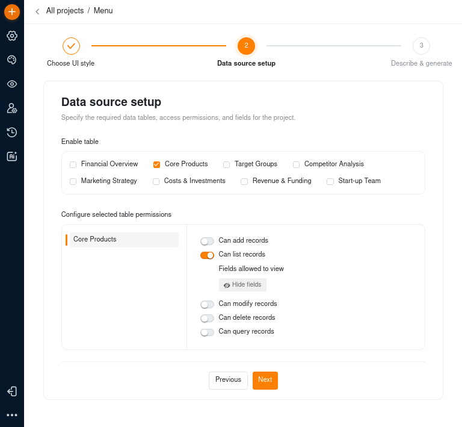
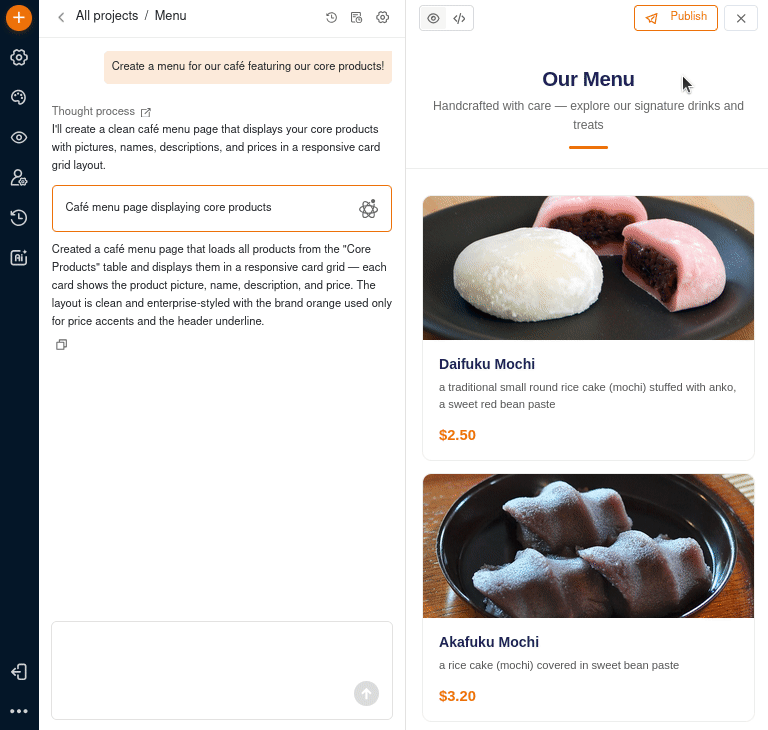
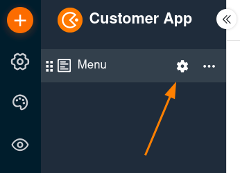

Страницы, созданные ИИ, – это революционная функция SeaTable, которая завершает no-code-подход к разработке приложений. ИИ позволяет вам создавать индивидуальные пользовательские интерфейсы на основе HTML, JavaScript и CSS, не написав ни одной строки кода.

## Как работают страницы, созданные ИИ, в приложениях?

Для своих приложений в SeaTable вы можете создавать индивидуальные страницы точно по своим представлениям в чате с ИИ. Для этого опишите на естественном языке, что должна делать страница и как она должна выглядеть, и ИИ создаст её для вас. При этом ИИ использует Software Development Kit (SDK) для HTML-страниц. Таким образом, с технической точки зрения результат представляет собой [HTML-страницу]().



Для генерации страниц SeaTable использует **Qwen 3.8 27B** – модель с открытыми весами и 27 миллиардами параметров, разработанную Alibaba. Модель ИИ размещена в немецких центрах обработки данных Exoscale – того же провайдера, который предоставляет и серверы SeaTable Cloud. Данные из ваших баз в любом случае никогда не попадают к модели ИИ, поскольку она обрабатывает только ваши промпты и схемы баз.



## Как создать страницу с помощью ИИ

Чтобы создавать страницы в приложениях SeaTable, вы должны предварительно [добавить приложение в базу]() и открыть его в [режиме редактирования](). Если теперь вы хотите, чтобы ИИ создал индивидуальную страницу, выполните следующие действия:

1. Нажмите на **значок AI** у левого края страницы.
   
2. Нажмите на оранжевую кнопку **Добавить проект**.
   
3. Задайте проекту **имя**, которое впоследствии будет носить и созданная ИИ страница. При желании вы можете добавить **заметки к проекту**.
   
4. Подтвердите кнопкой **Отправить**, и откроется ИИ-генератор страниц.
5. Сначала выберите **стиль интерфейса**, который определяет внешний вид страницы.
   
6. Нажмите **Далее**. Затем определите **источники данных** страницы. Для этого отметьте нужные **таблицы** и настройте **права доступа** к ним.
   
7. Нажмите **Далее**. Теперь введите **промпт**, описывающий страницу, которую вы хотите создать. Затем нажмите **Создать страницу**.
   
8. Как только ИИ завершит первый вариант, он покажет **предварительный просмотр**. После этого вы можете доработать страницу с помощью дополнительных промптов в **чате**.
9. Если результат вас устраивает, нажмите **Опубликовать** вверху справа. При желании перед публикацией страницы вы можете изменить **имя страницы** и выбрать **значок**.
   
10. Нажмите на **значок выхода** у левого нижнего края страницы, чтобы покинуть ИИ-генератор страниц и посмотреть **созданную ИИ страницу в приложении**.
   

## Настройки страницы, созданной ИИ

Чтобы открыть **настройки страницы**, наведите курсор мыши на имя страницы в навигационной панели и нажмите на появившийся **значок шестерёнки**.

### Настройка доступных таблиц

Как правило, созданная ИИ страница является **динамической**, то есть она меняется при изменении данных в исходных таблицах. С другой стороны, вы также можете разрешить изменять данные в таблицах через страницу, созданную ИИ.

Чтобы изменить права доступа к доступным таблицам, нажмите в настройках страницы на **значок шестерёнки** соответствующей таблицы.

Доступны пять разрешений, которые вы можете включать и отключать с помощью ползунков:
- **Может добавлять строки**
- **Может выводить список строк**
- **Может редактировать строки**
- **Может удалять строки**
- **Может запрашивать строки**

**Скрывая столбцы**, вы можете детально управлять тем, какие поля разрешено добавлять, просматривать, редактировать или запрашивать.



Те же параметры доступны и при настройке источников данных во время создания страницы с помощью ИИ.



### Разрешение действий кнопок

Кроме того, вы можете поручить ИИ добавить на страницу [кнопки](). Так, на страницах, созданных ИИ, вы можете, например, отправлять электронные письма или запускать скрипты нажатием кнопки. Однако учётные записи электронной почты и скрипты, которые вы хотите использовать, должны быть уже настроены в базе.

Следующие действия вы можете разрешить по отдельности с помощью ползунка:
- **Отправлять уведомления**
- **Отправлять электронные письма**
- **Запускать скрипты**

### Права доступа к странице

Наконец, вы можете определить, кто может видеть созданную ИИ страницу. Подробнее о различных правах доступа к страницам в приложении вы узнаете [здесь]().

## Управление ИИ-проектами в приложении

Как только вы создадите **проект** для страницы, создаваемой ИИ, он появится в виде новой **плитки** на обзорной странице, которую можно открыть с помощью **значка AI** у левого края страницы. Наведите курсор мыши на плитку и нажмите на появившиеся **три точки**. Здесь вы можете изменить сведения (имя и заметки к проекту) или **удалить** проект.

### Продолжение работы над проектом

Нередко возникает желание переработать или доработать созданную ИИ страницу, например потому, что у вас появились идеи новых функций или элементов. К счастью, SeaTable **сохраняет весь чат и все версии страницы**. Поэтому вы можете в любой момент продолжить с того места, где остановились, или вернуться к более ранней версии, если изменение не соответствует вашим представлениям.



Беседы и неопубликованные страницы хранятся 365 дней.



Нажмите на **плитку**, чтобы открыть нужный проект, а затем на **Продолжить**.

Теперь у вас есть несколько возможностей:
- **Значок часов**: просмотреть или удалить предыдущие чаты с ИИ.
- **Значок версий**: вернуться к более старым версиям страницы, просмотреть или удалить их.
- **Значок шестерёнки**: изменить стиль интерфейса, источники данных или разрешения на действия.
- **Поле ввода**: опробовать другие промпты в чате с ИИ.

Если вы хотите узнать, что происходило за кулисами при создании версии страницы, нажмите в чате на **Ход рассуждений**.

Раскрывающиеся элементы показывают для каждого шага системный промпт, ваш ввод и результат ИИ. В **статистике** дополнительно указано, сколько времени занял шаг и сколько токенов он израсходовал.

## Самостоятельная доработка страницы, созданной ИИ

Вы можете в любой момент **просмотреть HTML-код страницы, созданной ИИ**. Для этого нажмите на **значок кода** вверху слева в окне предварительного просмотра. С помощью **значка глаза** вы можете вернуться к визуальному просмотру.

Если у вас есть навыки программирования, вы можете использовать HTML-код, чтобы доработать страницу самостоятельно. Для этого вы можете **скачать страницу в виде HTML-файла**. Просто нажмите на **значок скачивания** в правом верхнем углу – и HTML-файл сохранится на вашем устройстве.

Как только вы закончите программировать HTML-страницу вне SeaTable, вы можете **загрузить zip-файл**, содержащий файлы HTML, JavaScript и CSS.

1. Наведите курсор мыши на имя страницы, созданной ИИ, и нажмите на появившиеся **три точки**.
2. Выберите пункт **Обновить файл страницы**.
3. Нажмите на поле со **значком плюса** и загрузите **файл для HTML-страницы**.
4. Подтвердите кнопкой **Отправить**.

Дополнительную информацию вы найдёте в [статье об HTML-страницах]().
