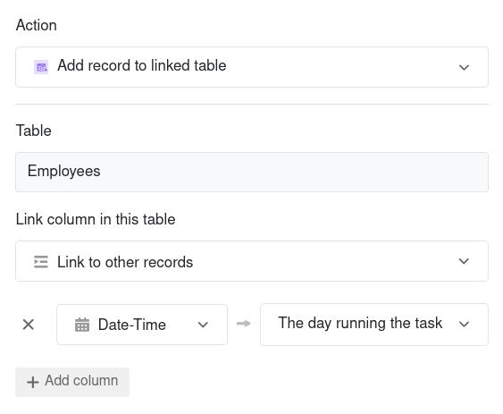
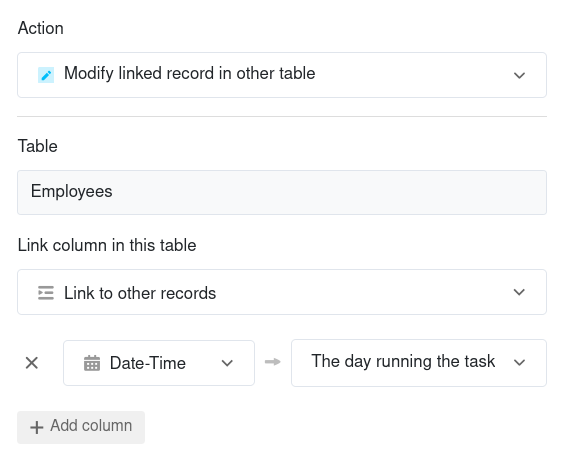
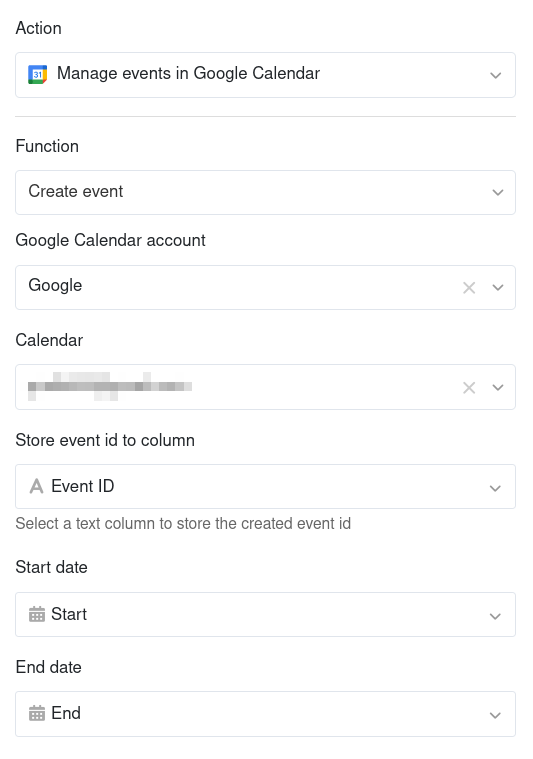
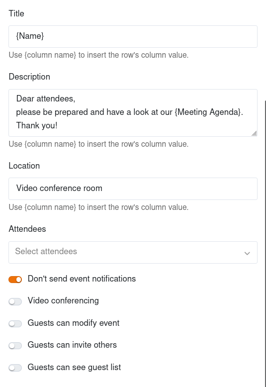
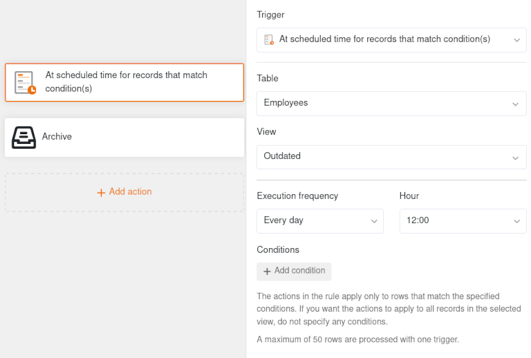

**Les actions automatisées** représentent l'une des deux composantes essentielles des automatisations. Les actions sont alors déclenchées par des **événements déclencheurs** définis. Selon le [déclencheur](), SeaTable peut exécuter différentes actions d'automatisation. Cet article vous donne un **aperçu** des différents types d'actions automatisées.

## Actions d'automatisation disponibles

La dernière version de SeaTable propose un total de 17 actions d'automatisation différentes :

- Envoyer une notification
- Envoyer une notification à une app
- Envoyer un e-mail
- Ajouter un enregistrement
- Verrouiller l'enregistrement
- Modifier l'enregistrement
- Ajouter des liens
- Ajouter un enregistrement dans un autre tableau
- Ajouter un enregistrement dans un tableau lié
- Modifier un enregistrement lié dans un autre tableau
- Exécuter un script Python
- Appeler l'IA
- Gérer les rendez-vous dans Google Agenda
- Exécuter un traitement de données
- Convertir une page en PDF
- Créer un PDF à partir d'un document et l'envoyer
- Archiver

## Ajouter, dupliquer, déplacer et supprimer des actions d'automatisation

Pour ajouter une action, cliquez sur **le gros bouton avec l'icône plus** et sélectionnez l'action correspondante dans la liste déroulante. Notez que les actions disponibles varient selon le déclencheur.

Si vous avez déjà mis en place des actions plus élaborées, comme l'envoi d'e-mails, le traitement des données ou les fonctions d'intelligence artificielle, vous pouvez également les dupliquer. Il suffit de cliquer sur les **trois points** puis sur **Dupliquer**. Vous n'aurez ainsi que peu de modifications à apporter à ces actions et vous gagnerez beaucoup de temps.

L'ordre des actions peut être facilement modifié **par glisser-déposer**. Placez le curseur de la souris sur une case d'action, maintenez le bouton gauche de la souris enfoncé sur la **surface de préhension à six points** et déplacez l'action à l'endroit souhaité. Vous pouvez ainsi adapter le déroulement de l'automatisation de manière flexible.

Bien entendu, vous pouvez également supprimer les actions dont vous n'avez plus besoin. Pour ce faire, cliquez sur les **trois points** puis sur **Supprimer**. Notez que les actions automatisées sont **supprimées immédiatement et définitivement** et ne peuvent pas être restaurées.

## Action d'automatisation : Envoyer une notification

En définissant "Envoyer une notification" comme action automatisée, vous pouvez configurer une notification pour un ou plusieurs utilisateurs. Les utilisateurs sélectionnés recevront une **notification** à chaque fois que le déclencheur correspondant sera activé. Cette action d'automatisation est disponible **pour tous les déclencheurs d'automatisation**.

Vous pouvez modifier les **destinataires** et le **contenu** des notifications à tout moment dans les **paramètres** de l'action. Pour les destinataires, vous pouvez concrètement sélectionner **des utilisateurs individuels** ou notifier des utilisateurs dans une colonne spécifique de type [Collaborateur](), [Créateur]() ou [Dernier éditeur](). Écrivez le message souhaité dans la zone de texte et travaillez avec des références de colonne entre accolades pour insérer des valeurs spécifiques.

Les utilisateurs peuvent consulter leurs notifications via l'**icône en forme de cloche**  à côté de leur avatar dans le coin supérieur droit.

L'article [Envoyer des notifications par automatisation]() illustre cette automatisation à travers un cas d'utilisation concret.

## Action d'automatisation : Envoyer une notification à une app

En définissant "Envoyer une notification à une app" comme action automatisée, vous pouvez configurer une notification pour un ou plusieurs utilisateurs d'une app. Les utilisateurs sélectionnés recevront une **notification** dans l'app chaque fois que le déclencheur correspondant sera activé. Cette action d'automatisation est disponible **pour tous les déclencheurs d'automatisation**.

Dans les **paramètres** de l'action, vous pouvez définir à quelle **app** et à quels **destinataires** les notifications doivent être envoyées. Pour les destinataires, vous pouvez concrètement sélectionner **des utilisateurs d'apps individuels** ou notifier des utilisateurs dans une colonne spécifique de type **Collaborateur, Créateur ou Dernier éditeur**. Saisissez le **contenu** souhaité de la notification dans la zone de texte. Utilisez les références de colonne entre accolades pour insérer des valeurs spécifiques.

Les utilisateurs de l'app concernée peuvent consulter leurs notifications via l'**icône en forme de cloche**  à côté de leur avatar dans le coin supérieur droit.

## Action d'automatisation : Envoyer un e-mail

En définissant "Envoyer un e-mail" comme action automatisée, vous pouvez envoyer des e-mails prédéfinis à un ou plusieurs utilisateurs. SeaTable envoie un **e-mail** à chaque utilisateur sélectionné lorsque le déclencheur correspondant est activé. Cette action d'automatisation est disponible **pour tous les déclencheurs d'automatisation**.

Vous pouvez modifier à tout moment le **compte e-mail**, l'**objet**, les **destinataires**, le **message** et les **pièces jointes** de l'e-mail dans les **paramètres** de l'action. Utilisez des références de colonne entre accolades pour insérer des valeurs spécifiques dans les champs de texte.

L'article [Envoi d'e-mails par automatisation]() illustre cette automatisation à travers un cas d'utilisation concret.

## Action d'automatisation : Ajouter un enregistrement

Si vous définissez "Ajouter un enregistrement" comme action automatisée, une **nouvelle ligne** sera ajoutée au tableau chaque fois que le déclencheur correspondant sera activé. Vous pouvez définir à l'avance les valeurs exactes pour chaque colonne individuellement.

L'action d'automatisation "Ajouter un enregistrement" est actuellement disponible pour les **déclencheurs d'automatisation** suivants :
- Lorsqu'une ligne est mise à jour
- Lorsqu'une ligne est ajoutée
- À une heure programmée

L'article [Ajouter des lignes par automatisation]() passe en revue cette automatisation à travers un cas d'utilisation concret.

## Action d'automatisation : Verrouiller l'enregistrement

Si vous définissez "Verrouiller l'enregistrement" comme action automatisée, la **ligne** qui a déclenché l'automatisation sera verrouillée pour l'édition. Vous ne pouvez pas définir d'autres paramètres pour cette action – vous devez configurer les conditions de verrouillage de la ligne dans le **déclencheur**. Notez que vous ne pouvez plus **déverrouiller** les lignes verrouillées sans droits d'administrateur.

L'action d'automatisation "Verrouiller l'enregistrement" est actuellement disponible pour les **déclencheurs d'automatisation** suivants :
- Lorsqu'une ligne est mise à jour
- Lorsqu'une ligne est ajoutée
- À une heure programmée pour les enregistrements qui correspondent aux conditions

L'article [Verrouiller des lignes par automatisation]() passe en revue cette automatisation à travers un cas d'utilisation concret.

## Action d'automatisation : Modifier l'enregistrement

Si vous sélectionnez "Modifier l'enregistrement" comme action automatisée, les **lignes** du tableau seront modifiées après l'activation du déclencheur selon les **paramètres** définis au préalable. Vous pouvez définir pour chaque colonne une valeur que les lignes prendront automatiquement après la modification.

L'action d'automatisation "Modifier l'enregistrement" est actuellement disponible pour les **déclencheurs d'automatisation** suivants :
- Lorsqu'une ligne est mise à jour
- Lorsqu'une ligne est ajoutée
- À une heure programmée pour les enregistrements qui correspondent aux conditions

## Action d'automatisation : Ajouter des liens

Si vous sélectionnez "Ajouter des liens" comme action automatisée, un [lien vers d'autres enregistrements]() sera créé dans la colonne correspondante lors de l'activation du déclencheur. Dans les **paramètres** de l'action, vous pouvez définir précisément les conditions d'ajout de tel ou tel lien dans le tableau.

L'action d'automatisation "Ajouter des liens" est actuellement disponible pour les **déclencheurs d'automatisation** suivants :
- Lorsqu'une ligne est mise à jour
- Lorsqu'une ligne est ajoutée
- À une heure programmée

L'article [Lier des enregistrements par automatisation]() illustre cette automatisation à travers un cas d'utilisation concret.

## Action d'automatisation : Ajouter un enregistrement dans un autre tableau

Si vous sélectionnez "Ajouter un enregistrement dans un autre tableau" comme action automatisée, une **ligne sera créée dans un autre tableau** lorsque le déclencheur sera activé. Dans les **paramètres** de l'action, vous pouvez définir des valeurs individuelles pour chaque colonne, qui seront affectées aux lignes du tableau sélectionné au cours de l'automatisation. De même, vous pouvez sélectionner des colonnes du même type dans le tableau source pour copier des enregistrements de ligne dans l'autre tableau.

L'action d'automatisation "Ajouter un enregistrement dans un autre tableau" est actuellement disponible pour les **déclencheurs d'automatisation** suivants :
- Lorsqu'une ligne est mise à jour
- Lorsqu'une ligne est ajoutée

L'article [Ajouter des enregistrements dans d'autres tableaux par automatisation]() illustre cette automatisation à travers un cas d'utilisation concret.

## Action d'automatisation : Ajouter un enregistrement dans un tableau lié

Si vous sélectionnez "Ajouter un enregistrement dans un tableau lié" comme action automatisée, une **nouvelle ligne sera créée dans un autre tableau** lorsque le déclencheur sera activé. En outre, SeaTable **lie** la nouvelle ligne à l'enregistrement qui a déclenché l'automatisation. Pour cela, une [colonne de liens]() sélectionnable est nécessaire.

Dans les **paramètres** de l'action, vous pouvez définir des valeurs individuelles pour chaque colonne, qui seront affectées à la nouvelle ligne du tableau sélectionné au cours de l'automatisation. De même, vous pouvez sélectionner des colonnes du même type dans le tableau source pour copier des enregistrements de ligne dans l'autre tableau.

L'action d'automatisation "Ajouter un enregistrement dans un tableau lié" est actuellement disponible pour le **déclencheur d'automatisation** suivant :
- Lorsqu'une ligne est mise à jour

## Action d'automatisation : Modifier un enregistrement lié dans un autre tableau

Si vous sélectionnez "Modifier un enregistrement lié dans un autre tableau" comme action automatisée, les **enregistrements liés existants dans un autre tableau** seront modifiés lorsque le déclencheur sera activé. Si, par exemple, le statut d'une ligne change, tous les enregistrements liés peuvent être mis à jour immédiatement. Dans les **paramètres** de l'action, vous devez sélectionner une [colonne de liens](), puis vous pouvez définir des valeurs individuelles pour chaque colonne, qui seront affectées aux lignes du tableau sélectionné au cours de l'automatisation.

L'action d'automatisation "Modifier un enregistrement lié dans un autre tableau" est actuellement disponible pour le **déclencheur d'automatisation** suivant :
- Lorsqu'une ligne est mise à jour

## Action d'automatisation : Exécuter un script Python

Si vous choisissez l'exécution d'un script Python comme action automatisée, le déclencheur met en route un **script Python** défini au préalable. Vous pouvez créer ou éditer le script à tout moment dans l'[éditeur de script](), puis le sélectionner dans les **paramètres** de l'action.

L'action d'automatisation "Exécuter un script Python" est actuellement disponible pour les **déclencheurs d'automatisation** suivants :
- Lorsqu'une ligne est mise à jour
- Lorsqu'une ligne est ajoutée
- À une heure programmée

## Action d'automatisation : Appeler l'IA

Lorsque vous sélectionnez l'exécution d'une fonction d'IA comme action automatisée, le déclencheur appelle un **modèle d'IA** qui exécute une action définie au préalable dans le tableau. Vous pouvez configurer précisément l'action à exécuter dans les **paramètres**. Selon le type de fonction d'IA, vous pouvez avoir besoin de **colonnes d'entrée**, de **colonnes de sortie** et d'un **prompt**.

Vous pouvez faire exécuter les **fonctions d'IA** suivantes par une automatisation :

- **Résumer** : Résume le texte d'une ou plusieurs colonnes. Vous pouvez contrôler la longueur, le ton, le format et la langue du résumé en ajustant le prompt.
- **Classer** : Classifie les enregistrements d'une ou plusieurs colonnes. Vous pouvez personnaliser les catégories et les règles à l'aide du prompt. Le résultat est enregistré dans une [colonne de sélection unique]() ou [colonne de sélection multiple]().
- **OCR** : Extrait du texte d'une [colonne d'image](). Le contenu reconnu est écrit dans la colonne de résultat de type [Texte ou Texte mis en forme]().
- **Extraire** : Extrait des informations spécifiques d'une colonne de type texte ou nombre en fonction de votre demande. Les informations extraites sont écrites dans les colonnes de résultats.
- **Personnalisé** : Génère du contenu basé sur votre prompt. Utilisez {nom de la colonne} entre accolades pour insérer la valeur de la colonne d'une ligne.

L'action d'automatisation "Appeler l'IA" est actuellement disponible pour les **déclencheurs d'automatisation** suivants :
- Lorsqu'une ligne est mise à jour
- Lorsqu'une ligne est ajoutée

Vous trouverez des instructions détaillées sur les différentes fonctions d'IA avec des exemples pas à pas dans la section [Automatisations IA]().

## Action d'automatisation : Gérer les rendez-vous dans Google Agenda

Si vous sélectionnez "Gérer les rendez-vous dans Google Agenda" comme action automatisée, un rendez-vous de SeaTable sera créé ou mis à jour dans un Google Agenda lorsque le déclencheur est activé. Il y a quelques conditions à remplir pour que cette action fonctionne correctement :
- Tout d'abord, vous devez [synchroniser votre compte Google Agenda avec SeaTable]().
- Dans un tableau, il doit y avoir deux [colonnes de dates]() qui définissent le **début** et la **fin** des rendez-vous.
- Vous avez également besoin d'une [colonne de texte]() dans laquelle Google peut enregistrer l'**ID de l'événement** afin de synchroniser les rendez-vous.

En outre, vous pouvez définir d'autres paramètres. Ajoutez un **titre**, une **description**, un **lieu** et des **participants** au rendez-vous. Pour ce faire, écrivez les informations dans les **champs de texte** ou utilisez les **références de colonne entre accolades** pour insérer des valeurs spécifiques du tableau. En activant les **curseurs**, vous pouvez décider si vous souhaitez envoyer des notifications, s'il s'agit d'une vidéoconférence et si les invités peuvent modifier le rendez-vous, voir la liste des invités et inviter d'autres invités.

L'action d'automatisation "Gérer les rendez-vous dans Google Agenda" est actuellement disponible pour les **déclencheurs d'automatisation** suivants :
- Lorsqu'une ligne est mise à jour
- Lorsqu'une ligne est ajoutée

## Action d'automatisation : Exécuter un traitement de données

Si vous choisissez d'exécuter un traitement de données comme action automatisée, le déclencheur lancera une [opération de traitement de données]() définie à l'avance dans le tableau. Vous pouvez configurer précisément l'opération à effectuer dans les **paramètres**. Selon le type d'opération, **certaines colonnes d'entrée et de sortie** peuvent être nécessaires.

Les **opérations de traitement de données** suivantes peuvent être exécutées avec une automatisation :

- [Calculer la différence]()
- [Calculer le pourcentage]()
- [Calculer le classement]()
- [Extraire le nom d'utilisateur]()
- [Comparer et copier]()

L'action d'automatisation "Exécuter un traitement de données" est actuellement disponible pour le **déclencheur d'automatisation** suivant :
- À une heure programmée

## Action d'automatisation : Convertir une page en PDF

Si vous sélectionnez "Convertir une page en PDF" comme action automatisée, SeaTable **créera un document PDF à partir de l'enregistrement** et l'enregistrera dans une [colonne de fichiers]() lorsque le déclencheur sera activé. Pour cela, choisissez un **modèle** que vous aurez préalablement créé dans le [plugin de conception de page](). Vous pouvez également définir le **nom de fichier** dans les paramètres de l'action.

L'action d'automatisation "Convertir une page en PDF" est actuellement disponible pour les **déclencheurs d'automatisation** suivants :
- Lorsqu'une ligne est mise à jour
- Lorsqu'une ligne est ajoutée
- À une heure programmée pour les enregistrements qui correspondent aux conditions

## Action d'automatisation : Créer un PDF à partir d'un document et l'envoyer

Si vous sélectionnez "Créer un PDF à partir d'un document et l'envoyer" comme action automatisée, SeaTable **créera un document PDF** et l'enregistrera dans la [gestion des fichiers]() lorsque le déclencheur est activé. De plus, SeaTable peut l'envoyer directement par e-mail.

Pour cela, dans les **paramètres** de l'action, sélectionnez un **modèle** que vous avez préalablement créé dans le **plugin de conception de rapports** et attribuez un **nom de fichier**. Activez ensuite le curseur pour sélectionner un **dossier spécifique** dans lequel vous souhaitez enregistrer le fichier. Si vous souhaitez uniquement générer le document, vous pouvez terminer la configuration à ce stade.

Si vous souhaitez ensuite envoyer le document généré, activez le curseur "Envoyer par e-mail". Vous pouvez à tout moment modifier le **compte de messagerie**, le **destinataire**, l'**objet** et le **message** de l'e-mail dans les **paramètres** de l'action.

L'action d'automatisation "Créer un PDF à partir d'un document et l'envoyer" est actuellement disponible pour le **déclencheur d'automatisation** suivant :
- À une heure programmée

## Action d'automatisation : Archiver

L'action d'archivage vous permet de [déplacer automatiquement des lignes vers le stockage Big Data](). Pour cela, la fonction Big Data doit bien sûr être activée dans la base concernée. Comme vous définissez déjà la **vue** et les éventuelles conditions de filtrage pour les lignes à archiver dans les paramètres du déclencheur, vous ne pouvez effectuer aucun réglage pour l'action elle-même.

L'action d'automatisation "Archiver" est actuellement disponible pour les **déclencheurs d'automatisation** suivants :
- À une heure programmée
- À une heure programmée pour les enregistrements qui correspondent aux conditions