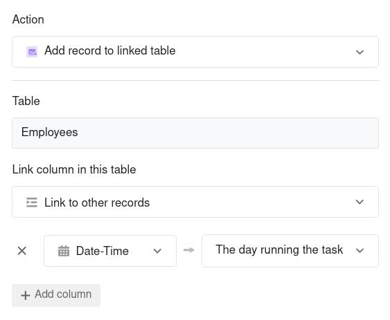
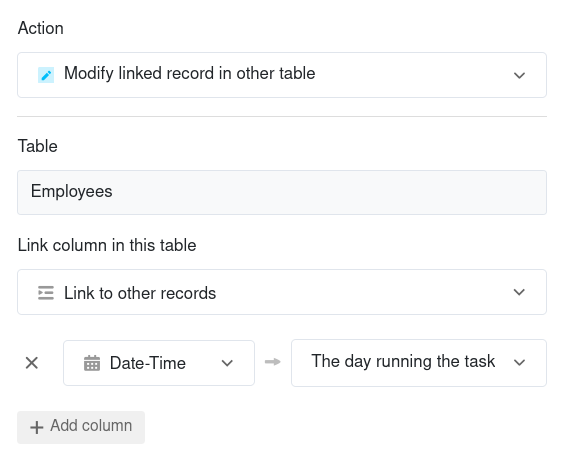
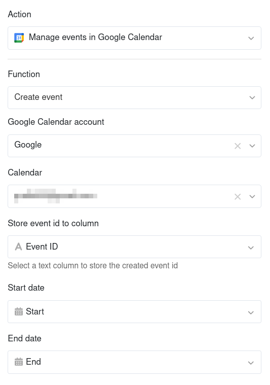
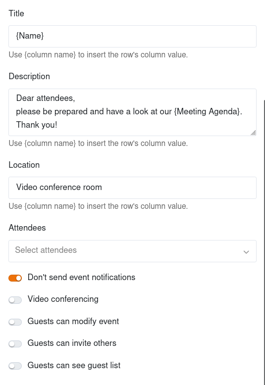
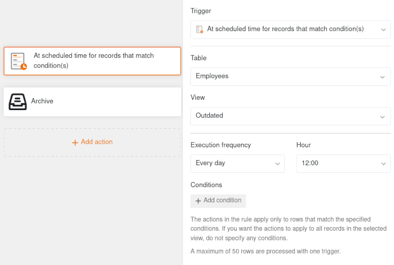

**Автоматизированные действия** представляют собой один из двух основных компонентов автоматизации. Действия запускаются определенными **триггерными событиями**. В зависимости от [триггера]() SeaTable может выполнять различные действия по автоматизации. В этой статье представлен **обзор** различных типов автоматизированных действий.

## Доступные действия автоматизации

Последняя версия SeaTable предлагает на выбор 17 различных действий по автоматизации:

- Отправить уведомление
- Отправить уведомление приложения
- Отправить электронное письмо
- Добавить запись
- Заблокировать запись
- Изменить запись
- Добавить ссылки
- Добавить запись в другую таблицу
- Добавить запись в связанную таблицу
- Изменить связанную запись в другой таблице
- Запустить скрипт Python
- Запустить AI (искусственный интеллект)
- Управлять встречами в Календаре Google
- Запустить обработку данных
- Преобразование страницы в PDF
- Сгенерировать PDF из документа и отправить
- Архивировать

## Добавление, дублирование, перемещение и удаление действий автоматизации

Чтобы добавить действие, нажмите на **большую кнопку с символом плюса** и выберите соответствующее действие из выпадающего списка. Обратите внимание, что доступные действия различаются в зависимости от триггера.

Если вы уже настроили более сложные действия, такие как отправка электронной почты, обработка данных или функции искусственного интеллекта, вы также можете продублировать их. Просто нажмите на **три точки**, а затем на **Дублировать**. Так вам придется внести в эти действия лишь незначительные изменения, и вы сэкономите массу времени.

Порядок действий можно легко изменить **путем перетаскивания**. Наведите указатель мыши на поле действия, удерживайте левую кнопку мыши на **маркере перетаскивания с шестью точками** и переместите действие в нужное место. Это позволяет вам гибко настраивать последовательность автоматизации.

Конечно же, вы можете удалить действия, которые больше не нужны. Для этого нажмите на **три точки**, а затем на **Удалить**. Обратите внимание, что автоматизированные действия удаляются **немедленно и навсегда** и не могут быть восстановлены.

## Действие автоматизации: Отправить уведомление

Определив "Отправить уведомление" в качестве автоматического действия, вы можете настроить уведомление для одного или нескольких пользователей. Выбранные пользователи будут получать **уведомление** каждый раз, когда сработает соответствующий триггер. Это действие автоматизации доступно **для всех триггеров автоматизации**.

Вы можете в любой момент изменить **получателей** и **содержание** уведомлений в **настройках** действия. Для получателей вы можете выбрать **отдельных пользователей** или уведомить пользователей в определенной колонке типа [Сотрудник](), [Создатель]() или [Последний редактор](). Напишите нужное сообщение в текстовом поле и работайте со ссылками на столбцы в фигурных скобках, чтобы вставить определенные значения.

Пользователи могут проверять свои уведомления через  **значок колокольчика** рядом со своим аватаром в правом верхнем углу.

В статье [Отправка уведомлений с помощью автоматизации]() рассматривается эта автоматизация на примере конкретного случая использования.

## Действие автоматизации: Отправить уведомление приложения

Определив "Отправить уведомление приложения" в качестве автоматического действия, вы можете настроить уведомление для одного или нескольких пользователей приложения. Выбранные пользователи получают **уведомление** в приложении каждый раз, когда срабатывает соответствующий триггер. Это автоматическое действие доступно **для всех триггеров автоматизации**.

В **настройках** действия вы можете определить, в какое **приложение** и каким **получателям** должны быть отправлены уведомления. Для получателей вы можете выбрать **отдельных пользователей приложения** или уведомить пользователей в определенной колонке типа **сотрудник, создатель или последний редактор**. Введите желаемое **содержание** уведомления в текстовое поле. Используйте ссылки на столбцы в фигурных скобках, чтобы вставить определенные значения.

Пользователи соответствующего приложения могут проверять свои уведомления через  **значок колокольчика** рядом со своим аватаром в правом верхнем углу.

## Действие автоматизации: Отправить электронное письмо

Определив "Отправить электронное письмо" как автоматическое действие, вы можете отправлять предопределенные электронные письма одному или нескольким пользователям. SeaTable отправит **электронное письмо** каждому выбранному пользователю, как только сработает соответствующий триггер. Это автоматическое действие доступно **для всех триггеров автоматизации**.

Вы можете в любой момент изменить **учетную запись электронной почты**, **тему**, **получателей**, **сообщение** и **вложения** письма в **настройках** действия. Используйте ссылки на столбцы в фигурных скобках, чтобы вставить определенные значения в текстовые поля.

В статье [Отправка электронной почты с помощью автоматизации]() рассматривается эта автоматизация на примере конкретного случая использования.

## Действие автоматизации: Добавить запись

Если вы определите "Добавить запись" в качестве автоматического действия, то **новая строка** будет добавляться в таблицу каждый раз, когда срабатывает соответствующий триггер. Вы можете заранее определить точные значения для каждого столбца в отдельности.

Действие автоматизации "Добавить запись" в настоящее время доступно для следующих **триггеров автоматизации**:
- Когда строка обновляется
- Когда строка добавляется
- В заданное время

В статье [Добавление строк с помощью автоматизации]() рассматривается эта автоматизация на примере конкретного случая использования.

## Действие автоматизации: Заблокировать запись

Если вы определите "Заблокировать запись" в качестве автоматического действия, **строка**, которая вызвала автоматизацию, будет заблокирована для редактирования. Вы не можете сделать никаких дополнительных настроек для этого действия – вы должны настроить условия для блокировки строки в **триггере**. Обратите внимание, что вы больше не можете **разблокировать** заблокированные строки без прав администратора.

Действие автоматизации "Заблокировать запись" в настоящее время доступно для следующих **триггеров автоматизации**:
- Когда строка обновляется
- Когда строка добавляется
- В заданное время по условию

В статье [Блокировка строк с помощью автоматизации]() рассматривается эта автоматизация на примере конкретного случая использования.

## Действие автоматизации: Изменить запись

Если вы выберете "Изменить запись" в качестве автоматического действия, **строки** в таблице будут скорректированы в соответствии с ранее заданными **настройками** после срабатывания триггера. Вы можете задать значение для каждого столбца, которое строки автоматически примут после изменения.

Действие автоматизации "Изменить запись" в настоящее время доступно для следующих **триггеров автоматизации**:
- Когда строка обновляется
- Когда строка добавляется
- В заданное время по условию

## Действие автоматизации: Добавить ссылки

Если вы выберете "Добавить ссылки" в качестве автоматического действия, то при срабатывании триггера в соответствующем столбце будет создана [ссылка на другие записи](). В **настройках** действия вы можете указать, при каких именно условиях какая ссылка будет добавлена в таблицу.

Действие автоматизации "Добавить ссылки" в настоящее время доступно для следующих **триггеров автоматизации**:
- Когда строка обновляется
- Когда строка добавляется
- В заданное время

В статье [Связывание записей с помощью автоматизации]() рассматривается эта автоматизация на примере конкретного случая использования.

## Действие автоматизации: Добавить запись в другую таблицу

Если вы выберете "Добавить запись в другую таблицу" в качестве автоматического действия, то при срабатывании триггера **в другой таблице будет создана строка**. В **настройках** действия вы можете задать индивидуальные значения для каждого столбца, которые будут присвоены строкам выбранной таблицы в рамках автоматизации. Вы также можете выбрать столбцы того же типа в исходной таблице, чтобы скопировать записи строк в другую таблицу.

Действие автоматизации "Добавить запись в другую таблицу" в настоящее время доступно для следующих **триггеров автоматизации**:
- Когда строка обновляется
- Когда строка добавляется

В статье [Добавление записей в другие таблицы с помощью автоматизации]() рассматривается эта автоматизация на примере конкретного случая использования.

## Действие автоматизации: Добавить запись в связанную таблицу

Если вы выберете "Добавить запись в связанную таблицу" в качестве автоматического действия, то при срабатывании триггера **в другой таблице будет создана новая строка**. Кроме того, SeaTable **связывает** новую строку с записью, которая запустила автоматизацию. Для этого требуется выбираемая [колонка ссылок]().

В **настройках** действия вы можете задать индивидуальные значения для каждого столбца, которые будут присвоены новой строке выбранной таблицы в рамках автоматизации. Вы также можете выбрать столбцы того же типа в исходной таблице, чтобы скопировать записи строк в другую таблицу.

Действие автоматизации "Добавить запись в связанную таблицу" в настоящее время доступно для следующего **триггера автоматизации**:
- Когда строка обновляется

## Действие автоматизации: Изменить связанную запись в другой таблице

Если вы выберете "Изменить связанную запись в другой таблице" в качестве автоматического действия, то при срабатывании триггера будут изменены **существующие связанные записи в другой таблице**. Например, если в строке меняется статус, все связанные записи можно сразу же обновить. В **настройках** действия вы должны выбрать [колонку ссылок](), а затем можете задать индивидуальные значения для каждого столбца, которые будут присвоены строкам выбранной таблицы в рамках автоматизации.

Действие автоматизации "Изменить связанную запись в другой таблице" в настоящее время доступно для следующего **триггера автоматизации**:
- Когда строка обновляется

## Действие автоматизации: Запустить скрипт Python

Если вы выбрали выполнение скрипта Python в качестве автоматического действия, триггер приводит в движение ранее определенный **скрипт Python**. Вы можете в любой момент создать или отредактировать скрипт в [редакторе скриптов](), а затем выбрать его в **настройках** действия.

Действие автоматизации "Запустить скрипт Python" в настоящее время доступно для следующих **триггеров автоматизации**:
- Когда строка обновляется
- Когда строка добавляется
- В заданное время

## Действие автоматизации: Запустить AI (искусственный интеллект)

Если вы выбрали в качестве автоматического действия выполнение функции AI, триггер вызывает **AI-модель**, которая выполняет предопределенное действие в таблице. Вы можете настроить точное действие, которое должно быть выполнено, в **настройках**. В зависимости от типа функции искусственного интеллекта, могут потребоваться **входные столбцы**, **выходные столбцы** и **промпт**.

С помощью автоматизации вы можете выполнять следующие **функции AI**:

- **Резюмировать**: Резюмирует текст из одной или нескольких колонок. Вы можете контролировать длину, тон, формат и язык резюме, настраивая промпт.
- **Классифицировать**: Классифицирует записи из одного или нескольких столбцов. Вы можете настроить категории и правила с помощью промпта. Результат записывается в столбец типа [одиночный выбор]() или [множественный выбор]().
- **OCR**: Извлекает текст из [колонки изображений](). Распознанное содержимое записывается в результирующий столбец типа [Текст или Длинный текст]().
- **Извлечь**: Извлекает определенную информацию из колонки типа текст или число в соответствии с вашими требованиями. Извлеченная информация записывается в результирующие столбцы.
- **Пользовательский**: Генерирует содержимое на основе вашего промпта. Используйте {имя столбца} в фигурных скобках, чтобы вставить значение столбца из строки.

Действие автоматизации "Запустить AI" в настоящее время доступно для следующих **триггеров автоматизации**:
- Когда строка обновляется
- Когда строка добавляется

Подробные инструкции по отдельным функциям AI с пошаговыми примерами вы найдете в разделе [ИИ-автоматизации]().

## Действие автоматизации: Управлять встречами в Календаре Google

Если вы выберете в качестве автоматического действия "Управлять встречами в Календаре Google", то при срабатывании триггера в Календаре Google будет создана или обновлена встреча из SeaTable. Для того чтобы это действие работало без сбоев, необходимо выполнить несколько требований:
- Во-первых, вы должны [синхронизировать свой аккаунт Календаря Google с SeaTable]().
- В таблице должны существовать два [столбца даты](), которые определяют **начало** и **конец** встреч.
- вам также нужен [текстовый столбец](), в который Google может записать **идентификатор события**, чтобы встречи могли быть синхронизированы.

Вы также можете сделать дополнительные настройки. Добавьте к встрече **заголовок**, **описание**, **место** и **участников**. Для этого напишите подробности в **текстовых полях** или используйте **ссылки на столбцы в фигурных скобках**, чтобы вставить определенные значения из таблицы. Активировав **ползунки**, вы можете решить, отправлять ли уведомления, будет ли это видеоконференция и смогут ли гости редактировать встречу, просматривать список гостей и приглашать других гостей.

Действие автоматизации "Управлять встречами в Календаре Google" в настоящее время доступно для следующих **триггеров автоматизации**:
- Когда строка обновляется
- Когда строка добавляется

## Действие автоматизации: Запустить обработку данных

Если вы выбрали выполнение операции обработки данных в качестве автоматического действия, триггер инициирует предопределенную [операцию обработки данных]() в таблице. Вы можете настроить точное действие, которое будет выполнено, в **настройках**. В зависимости от типа операции, могут потребоваться **определенные столбцы ввода и вывода**.

С помощью автоматизации вы можете выполнить следующие **операции обработки данных**:

- [Рассчитать дельту]()
- [Рассчитать процентное соотношение]()
- [Рассчитать рейтинг]()
- [Извлечь имя пользователя]()
- [Сравнить и скопировать]()

Действие автоматизации "Запустить обработку данных" в настоящее время доступно для следующего **триггера автоматизации**:
- В заданное время

## Действие автоматизации: Преобразование страницы в PDF

Если вы выберете "Преобразование страницы в PDF" в качестве автоматического действия, SeaTable **создаст PDF-документ из записи** при срабатывании триггера и сохранит его в [колонке файлов](). Для этого выберите **шаблон**, который вы ранее создали в [плагине дизайна страниц](). Вы также можете задать **имя файла** в настройках действия.

Действие автоматизации "Преобразование страницы в PDF" в настоящее время доступно для следующих **триггеров автоматизации**:
- Когда строка обновляется
- Когда строка добавляется
- В заданное время по условию

## Действие автоматизации: Сгенерировать PDF из документа и отправить

Если вы выберете "Сгенерировать PDF из документа и отправить" в качестве автоматического действия, SeaTable **создаст PDF-документ** при срабатывании триггера и сохранит его в [файловом менеджере](). SeaTable также может отправить его непосредственно по электронной почте.

В **настройках** действия выберите **шаблон**, который вы ранее создали в **плагине дизайна отчетов**, и назначьте **имя файла**. Затем активируйте ползунок, чтобы выбрать **собственную папку**, в которой вы хотели бы сохранить файл. Если вы хотите только сгенерировать документ, вы можете завершить настройку на этом этапе.

Если затем вы хотите отправить сгенерированный документ, активируйте ползунок "Отправить на e-mail". В **настройках** действия вы можете в любой момент изменить **учетную запись электронной почты**, **получателя**, **тему** и **сообщение** письма.

Действие автоматизации "Сгенерировать PDF из документа и отправить" в настоящее время доступно для следующего **триггера автоматизации**:
- В заданное время

## Действие автоматизации: Архивировать

Вы можете использовать действие архивации для [автоматического перемещения строк в хранилище больших данных](). Функция больших данных, конечно же, должна быть активирована в соответствующей базе. Поскольку вы уже определили **вид** и любые условия фильтрации для архивируемых строк в настройках триггера, вы не можете сделать никаких настроек для самого действия.

Действие автоматизации "Архивировать" в настоящее время доступно для следующих **триггеров автоматизации**:
- В заданное время
- В заданное время по условию