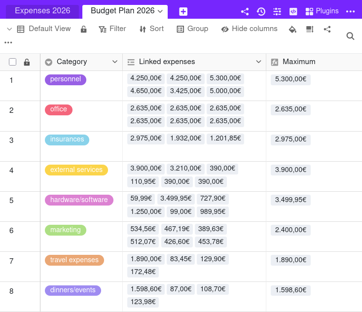
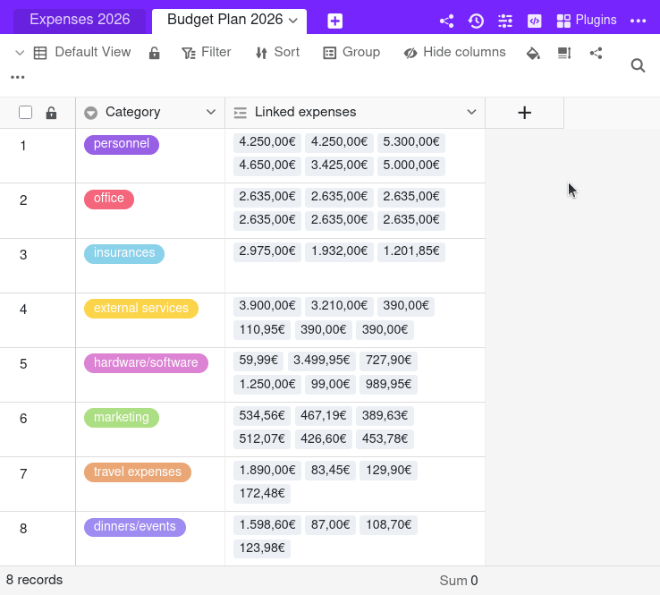

La **formule Findmax** recherche la **valeur maximale** parmi les entrées de la colonne liée et l'affiche. Cela est utile lorsqu'il y a **plusieurs entrées** dans le tableau lié qui se réfèrent au même enregistrement (par exemple d'une personne ou d'une catégorie) dans un autre tableau.

## À quoi sert la formule Findmax ?

Vous pouvez utiliser la formule Findmax pour toutes les valeurs alphanumériques afin de déterminer la **valeur maximale**. Supposons que vous utilisiez SeaTable pour la [planification budgétaire](), avec un tableau contenant les dépenses et un autre contenant les catégories. Vous pouvez alors lier chaque dépense à une catégorie. Pour savoir quelle a été **la dépense la plus élevée par catégorie**, vous pouvez utiliser la **formule Findmax** pour afficher la plus grande valeur parmi toutes les dépenses liées.

## Comment utiliser la formule Findmax ?

### Ajouter un lien de tableau

Consultez l'article de la [colonne des liens]() pour savoir comment créer une colonne de type **lien vers d'autres entrées**. C'est une condition préalable à l'utilisation de la formule Findmax.



L'utilisation de la formule Findmax n'a de sens que si l'option **Limiter les liens à une ligne maximum** est désactivée dans les paramètres d'une colonne de liens. Si cette option était activée, la formule Findmax afficherait toujours la même valeur que celle de l'unique ligne liée.



### Ajouter une colonne avec la formule Findmax

1. Créez une nouvelle colonne de type **Formule pour les liens**.
2. Définissez l'option **Findmax** comme formule.
3. Sélectionnez la colonne précédemment créée du type **Lien vers d'autres entrées** de ce tableau.
4. Définissez maintenant la **colonne de référence dans le tableau lié** dont l'enregistrement ayant la valeur maximale doit s'afficher dans la colonne Findmax.
5. Sélectionnez la **colonne de comparaison dans le tableau lié** dans laquelle vous souhaitez déterminer la valeur maximale.
6. Cliquez sur **Envoyer**.
