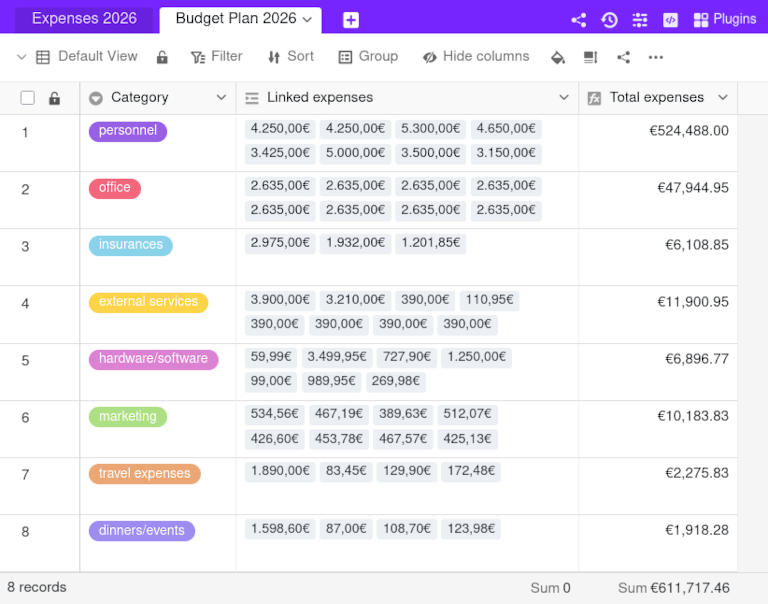

Con la ayuda de la fórmula roll-up del tipo de columna **Fórmula para enlaces**, puede establecer varios valores numéricos de una columna enlazada en relación con los demás y realizar cálculos estadísticos sencillos.

## Ámbito de aplicación de la fórmula roll-up

Con la **fórmula rollup** es posible determinar relaciones entre valores numéricos. Por ejemplo, en la [planificación presupuestaria]() puede **sumar** los gastos de una categoría, calcular el **valor** **máximo** o **mínimo** gastado o incluso la **media**.

Primero necesita una columna del tipo [Enlace a otras entradas](). Asegúrese de que la opción **Limitar los enlaces a una fila como máximo** está desactivada, porque sólo así podrá enlazar varias filas.

A continuación, la columna [Fórmula para enlaces]() muestra la relación seleccionada de los valores numéricos dentro de la columna de enlace utilizando la fórmula rollup. En este ejemplo hemos elegido el método de evaluación **Suma**:

## Crear una columna con la fórmula de rollup

Lea en el artículo sobre [la columna de enlace]() cómo crear una columna del tipo **Enlace a otras entradas**. Este es un requisito básico para poder utilizar la fórmula rollup.



El uso de la fórmula rollup sólo tiene sentido si la opción **Limitar los enlaces a una fila como máximo** está desactivada en los ajustes de una columna de enlace. Si la opción estuviera activada, la fórmula rollup mostraría siempre el mismo valor que la única fila enlazada.



1. Cree una nueva columna del tipo **Fórmula para los enlaces**.
2. Establezca la opción **Rollup** como fórmula.
3. Seleccione la **columna de enlace** que enlaza con la tabla deseada.
4. Ahora decida en el campo **Seleccionar columna a fusionar** de la **tabla vinculada** qué columna de la tabla deseada desea vincular y evaluar.
5. Establezca el **método de evaluación**. Puede elegir entre media, mínimo, máximo, suma y concatenación.
6. Haga clic en **Enviar**.

## Ajustes de formato

Puede definir con precisión el **formato** en que se muestran los valores numéricos. Para ello, haga clic en el **símbolo desplegable** triangular de la columna rollup y seleccione la opción **Ajustes de formato**. Además de números, también puede elegir como formato **divisas**, **porcentajes** y **duraciones**. Asimismo, puede definir los **separadores decimales y de miles** y el número de **decimales**.

## Cambios posteriores

Por supuesto, puede modificar la fórmula rollup posteriormente, por ejemplo, cambiar el método de evaluación de suma a media. Haga clic en el **símbolo desplegable** triangular situado a la derecha del nombre de la columna y, a continuación, en **Personalizar tipo de columna**. Allí accederá a los mismos ajustes que al crear la columna.
