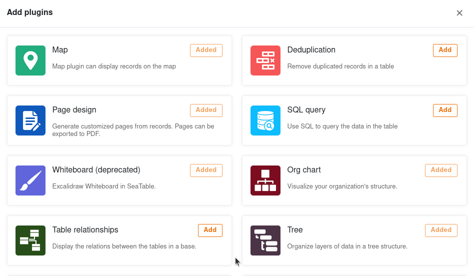
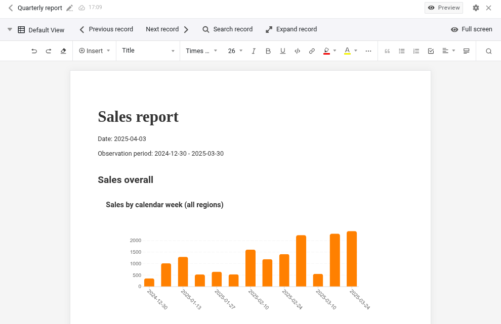
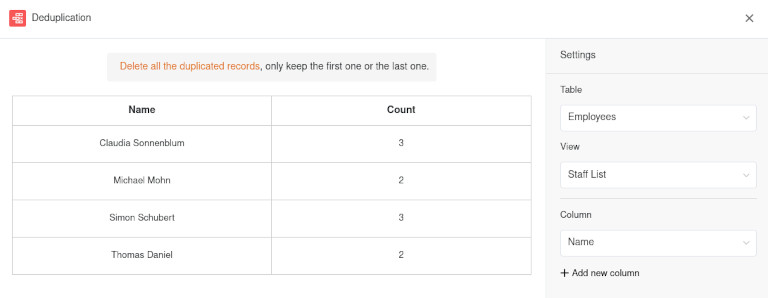
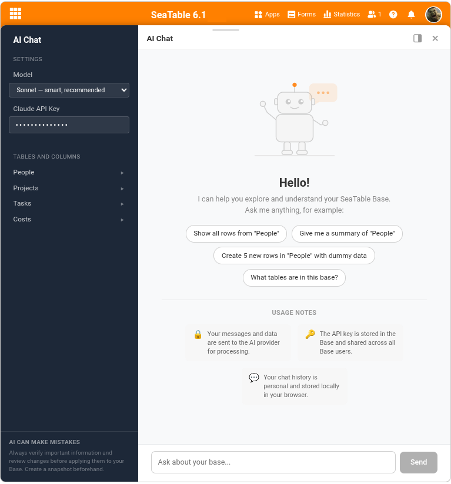
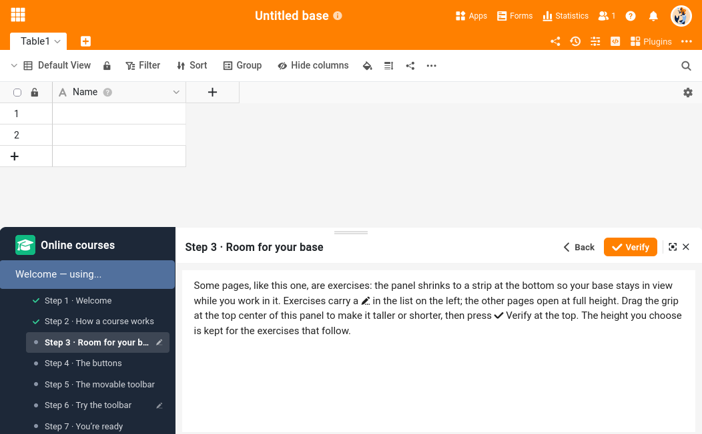
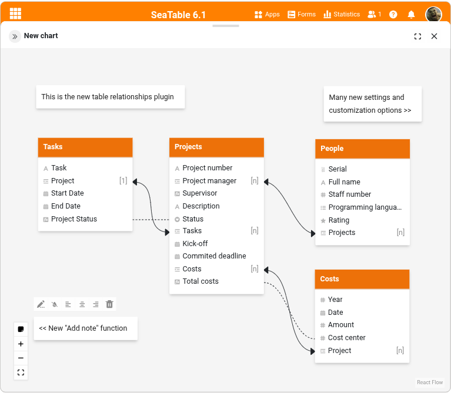

Mit den **Plugins** von SeaTable haben Sie die Möglichkeit, Ihre Daten aus ganz anderen Blickwinkeln zu sehen und erweiterte Funktionen zu nutzen. Visualisieren Sie beispielsweise Orte, Organigramme und Tabellenbeziehungen, erstellen Sie gelayoutete Dokumente oder richten Sie einen KI-Chat in Ihrer Base ein. Im folgenden Artikel erklären wir, welche Plugins in SeaTable zur Verfügung stehen und wie Sie mit ihnen umgehen können.

## Was ist ein Plugin?

In SeaTable können Sie für Ihre Tabellen verschiedene [Ansichten]() anlegen, mit denen Sie Ihre Daten zum Beispiel in **Kalendern**, **Galerien** und **Baumdiagrammen** visualisieren können. Darüber hinaus gibt es Plugins.

Ein **Plugin** ist eine optionale Softwarekomponente in SeaTable, die Ihnen zusätzliche Funktionen bietet. In jeder Base lassen sich verschiedene Plugins aktivieren, welche die Daten der jeweiligen Tabelle beispielsweise auf **Karten**, in **Organigrammen** oder **Dokumenten** darstellen. Zudem können Sie erweiterte Funktionen nutzen, um **Duplikate** aufzuspüren, einen **KI-Chat** einzurichten oder auf dem **Whiteboard** Ihrer Kreativität freien Lauf zu lassen.

Lesen Sie im verlinkten Hilfeartikel mehr darüber, [wie Sie ein Plugin aktivieren]().

##  Baum-Plugin {#tree-plugin}

Das Baum-Plugin stellt **verknüpfte Datensätze hierarchisch** dar, auf bis zu drei Ebenen. Während Ihnen das Tabellenbeziehungen-Plugin zeigt, wie Ihre Tabellen miteinander verbunden sind, zeigt Ihnen das Baum-Plugin die **Datensätze selbst** in dieser Struktur: Abteilungen mit ihren Kostenstellen und Ausgaben oder Versionen mit ihren Tests und den Fehlern, die jeder Test aufgedeckt hat. So erhalten Sie einen kompakten Überblick über große Datenmengen, die über mehrere verknüpfte Tabellen verteilt sind.

[Mehr zum Baum-Plugin]()

##  Berichtsdesign-Plugin {#report-design-plugin}

Mit diesem Plugin können Sie **mehrseitige Berichte** erstellen, in denen Tabellen, Diagramme und Felder dynamisch mit Daten aus Ihrer Base gespeist werden. Es ähnelt dem Seitendesign-Plugin in der Hinsicht, dass es ebenfalls **PDF-Dokumente auf Basis von gelayouteten Vorlagen** erstellt. Die statischen und dynamischen Elemente werden allerdings nicht pixelgenau auf der Vorlage positioniert, sondern wie in einem **Textverarbeitungsprogramm** (z. B. Microsoft Word oder Google Docs) fortlaufend untereinander platziert.

##  Datendeduplizierungs-Plugin {#data-deduplication-plugin}

Das Datendeduplizierungs-Plugin deckt **doppelte Einträge** in einer Tabelle auf. Dies ist besonders bei großen Datenmengen sehr hilfreich, um Dopplungen zu entdecken und diese zu entfernen. Dabei können Sie alle doppelten Einträge mit nur einem Klick löschen.

[Mehr zum Datendeduplizierungs-Plugin]()

##  Karten-Plugin {#map-plugin}

**Standorte** lassen sich mit dem Karten-Plugin auf einer Karte darstellen. Die eingepflegten geographischen Informationen können Sie durch Positionsmarker oder Bilder visualisieren. Das Karten-Plugin kommt dabei mit **GPS-Koordinaten** genauso wie mit **Adressen** zurecht. Adressen müssen jedoch eindeutig sein, um angezeigt werden zu können.

[Mehr zum Karten-Plugin]()

##  KI-Chat-Plugin {#ai-chat-plugin}

Das jüngste Plugin von SeaTable ist absolut am Puls der Zeit. Es erlaubt Ihnen, einen **KI-Chat** mit Ihrem bevorzugten Sprachmodell einzurichten. So können Sie Ihre Bases in natürlicher Sprache bearbeiten und auswerten, z. B. Datensätze anlegen, Werte ändern, Zeilen verknüpfen oder Analysen erstellen.

[Mehr zum KI-Chat-Plugin]()

##  Online-Kurse-Plugin {#online-courses-plugin}

Anders als die übrigen Plugins bietet Ihnen dieses keine neue Ansicht Ihrer Daten, sondern ist ein **Lernbegleiter**. Es führt Sie durch die praktischen Übungen der SeaTable-[Online-Kurse]() und **prüft Ihre Arbeit direkt in Ihrer eigenen Base**: Sie erstellen im Rahmen eines Kurses eine Automation, schreiben ein kurzes Skript oder richten eine Ansicht ein und lassen das Plugin anschließend prüfen, ob das erwartete Ergebnis tatsächlich da ist. Es kann Sie außerdem **Schritt für Schritt durch einen Vorgang führen**, während Sie ihn ausführen, und Ihre Base für eine Übung vorbereiten – es tut also mehr, als nur das Ergebnis anzusehen. So werden die Kurse direkt in SeaTable zu einem geführten, interaktiven Erlebnis.

[Mehr zum Online-Kurse-Plugin]()

##  Organigramm-Plugin {#organizational-chart-plugin}

Mithilfe des Organigramm-Plugins können Sie **Hierarchien** zwischen den Datensätzen in einer Tabelle darstellen. Das ist zum Beispiel nützlich, um die Positionen in einem Unternehmen oder über- und untergeordnete Aufgaben in einem Projekt zu visualisieren.

[Mehr zum Organigramm-Plugin]()

##  Seitendesign-Plugin {#page-design-plugin}

Mithilfe des Seitendesign-Plugins können Sie **Dokumente** wie Serienbriefe, Visitenkarten und Urkunden layouten und mit den Daten in Ihrer Tabelle füllen. Genauer gesagt können Sie mit **statischen Elementen** Layouts bauen, die durch **dynamische Elemente** und **Tabellenfelder** ergänzt und individualisiert werden. Diese bieten Ihnen den großen Vorteil, dass sie je nach Datensatz alle zugehörigen Informationen (beispielsweise Name, Adresse und Jobtitel einer Person) in standardisierte Vorlagen einfügen, ohne dass Sie manuell Daten in die Dokumente kopieren müssen. So erstellen Sie mit wenigen Klicks druckfertige Rechnungen, Zeugnisse oder andere wichtige Dokumente aus den gespeicherten Daten.

[Mehr zum Seitendesign-Plugin]()

##  SQL-Abfrage-Plugin {#sql-query-plugin}

Das SQL-Abfrage-Plugin eignet sich perfekt für die direkte **Ausführung von SQL-Befehlen** und ist daher vor allem für Datenbank-Profis interessant, die mit größeren Datenmengen arbeiten.

[Mehr zum SQL-Abfrage-Plugin]()

##  Tabellenbeziehungen-Plugin {#table-relationships-plugin}

Besonders wenn sich viele Tabellen mit Dutzenden Spalten in einer Base befinden, verliert man schnell den Überblick, wie diese miteinander in Beziehung stehen. Mithilfe des Tabellenbeziehungen-Plugins können Sie sichtbar machen, **welche Tabellen über welche Spalten miteinander verknüpft sind**.

[Mehr zum Tabellenbeziehungen-Plugin]()

##  Whiteboard-Plugin {#whiteboard-plugin}

Das Whiteboard-Plugin gibt Ihnen die Freiheit, Prozesse und Strukturen grafisch zu visualisieren, die Sie mit den bisherigen Plugins nicht darstellen können. Ebenso können Sie Layouts und Mockups **frei skizzieren**. Für die Gestaltung haben Sie verschiedene **Elemente** wie Vierecke, Ellipsen und Pfeile sowie **Werkzeuge** wie Stift, Radierer und das Text-Werkzeug zur Auswahl.

[Mehr zum Whiteboard-Plugin]()

## Weitere hilfreiche Artikel

### Statistiken

Das **Statistik-Modul** ermöglicht Ihnen die vielseitige Darstellung von Daten in Grafiken und Statistiken aller Art. Dabei stehen Ihnen unter anderem die folgenden **Diagrammtypen** zur Verfügung: Säulen-, Balken-, Linien- und Kuchendiagramme, aber auch Karten, Wärmebilder, Tacho oder Pivot-Tabellen. Sie können in den unterschiedlichen **Grafiken** die für Sie passende Visualisierung konfigurieren und sich ein **Dashboard mit den wichtigsten Statistiken** bauen.

[Mehr zum Statistik-Modul]()

### Webformulare

Mit dem **Formular-Editor** können Sie aus den Spalten einer Tabelle ein Webformular erzeugen, mit dem Sie bestimmte Daten von Nutzern in die Felder einer **Online-Umfrage** eingeben lassen können.

[Mehr zu den Webformularen]()
