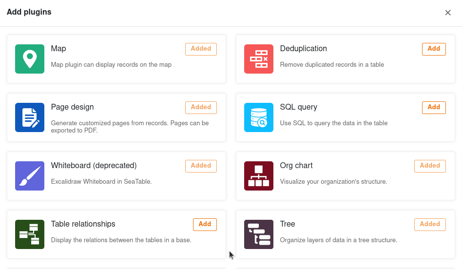
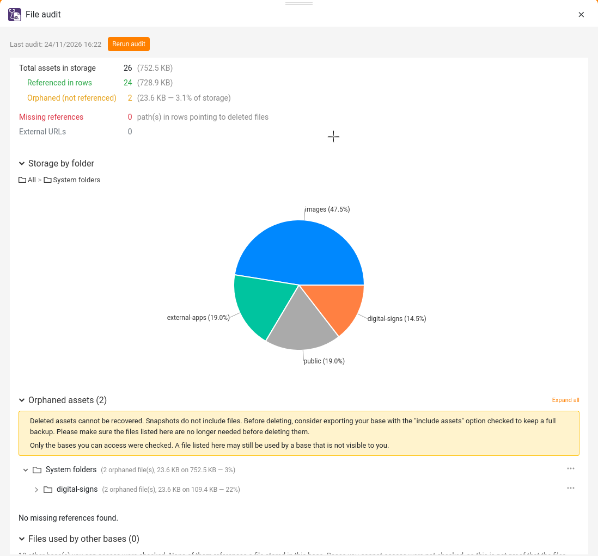
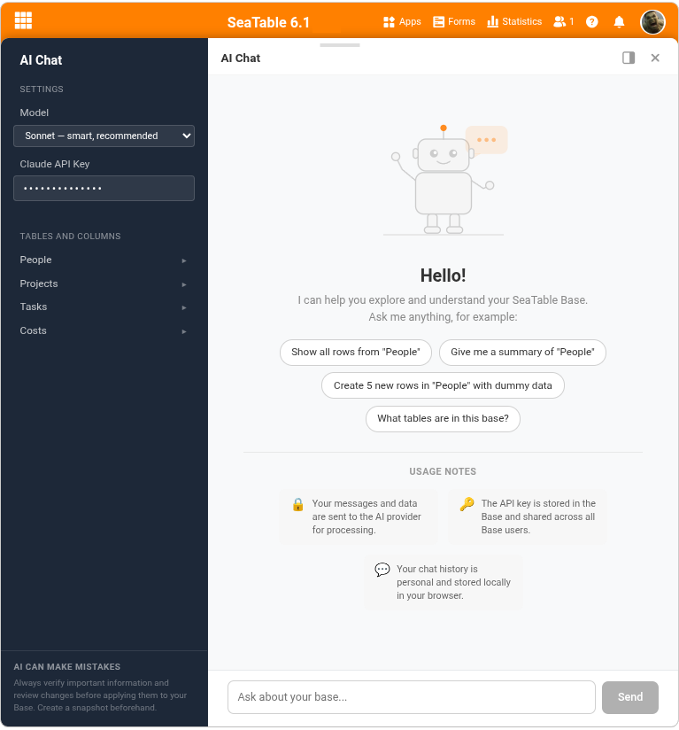
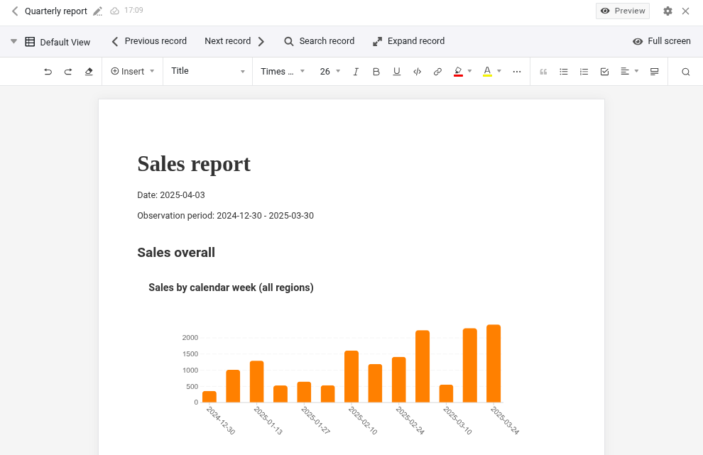
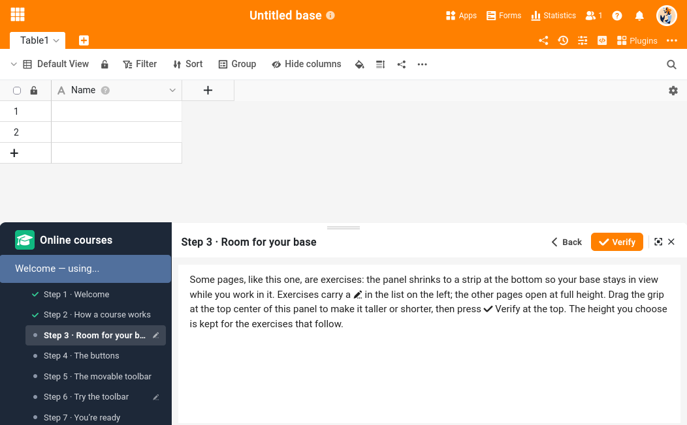
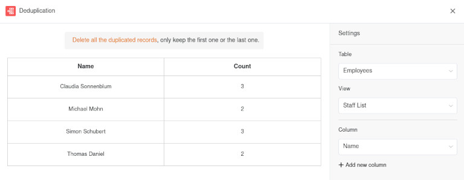
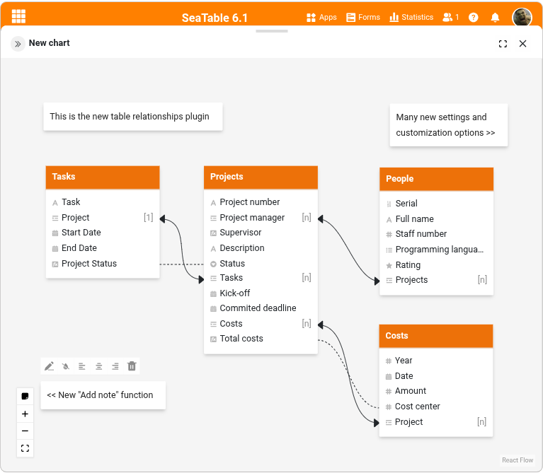

Avec les **plugins** de SeaTable, vous avez la possibilité de voir vos données sous des angles complètement différents et d'utiliser des fonctions avancées. Visualisez par exemple des lieux, des organigrammes et des relations entre les tableaux, créez des documents mis en page ou configurez un chat IA dans votre base. Dans l'article suivant, nous expliquons quels plugins sont disponibles dans SeaTable et comment vous pouvez les utiliser.

## Qu'est-ce qu'un plugin ?

Dans SeaTable, vous pouvez créer différentes [vues]() pour vos tableaux, avec lesquelles vous pouvez visualiser vos données, par exemple dans des **calendriers**, des **galeries** et des **diagrammes arborescents**. Il existe en outre des plugins.

Un **plugin** est un composant logiciel optionnel de SeaTable qui vous offre des fonctions supplémentaires. Dans chaque base, il est possible d'activer différents plugins qui affichent les données du tableau correspondant, par exemple sur des **cartes**, dans des **organigrammes** ou dans des **documents**. Vous pouvez également utiliser des fonctions avancées pour repérer des **doublons**, configurer un **chat IA** ou laisser libre cours à votre créativité sur le **tableau blanc**.

Pour en savoir plus sur [l'activation d'un plugin](), consultez l'article d'aide en lien.

##  Plugin Arbre {#tree-plugin}

Le plugin Arbre affiche les **enregistrements liés de façon hiérarchique**, sur trois niveaux au maximum. Là où le plugin de relations entre tableaux vous montre comment vos tableaux sont reliés, le plugin Arbre vous montre les **enregistrements eux-mêmes** dans cette structure : des services avec leurs centres de coûts et leurs dépenses, ou des versions avec leurs tests et les anomalies que chaque test a révélées. Vous obtenez ainsi une vue d'ensemble compacte de grandes quantités de données réparties sur plusieurs tableaux liés.

[En savoir plus sur le plugin Arbre]()

##  Plugin d'audit des fichiers {#file-audit-plugin}

Retirer un fichier d'une cellule ne le supprime pas : au fil des années, une base peut donc finir par stocker bien plus que ce que montrent ses lignes. Le plugin d'audit des fichiers compare les **fichiers stockés dans votre base** avec ceux que vos lignes référencent réellement : il repère les **fichiers orphelins** que plus personne n'utilise, les **références à des fichiers qui n'existent plus**, et vous montre **ce qui occupe le stockage**. Il détecte aussi les fichiers partagés avec d'autres bases, pour que vous ne supprimiez pas un fichier qu'une autre base affiche encore.

[En savoir plus sur le plugin d'audit des fichiers]()

##  Plugin de cartographie {#map-plugin}

**Les sites** peuvent être représentés sur une carte à l'aide du plugin de carte. Vous pouvez visualiser les informations géographiques saisies à l'aide de marqueurs de position ou d'images. Le plugin de carte s'occupe aussi bien des **coordonnées GPS** que des **adresses**. Les adresses doivent toutefois être uniques pour pouvoir être affichées.

[En savoir plus sur le plugin de carte]()

##  Plugin de chat IA {#ai-chat-plugin}

Le plugin le plus récent de SeaTable est absolument dans l'air du temps. Il vous permet de configurer un **chat IA** avec votre modèle de langage préféré. Vous pouvez ainsi éditer et analyser vos bases en langage naturel, par exemple créer des enregistrements, modifier des valeurs, lier des lignes ou créer des analyses.

[En savoir plus sur le plugin de chat IA]()

##  Plugin de conception de pages {#page-design-plugin}

À l'aide du plugin de conception de pages, vous pouvez mettre en page **des documents** tels que des lettres en série, des cartes de visite et des certificats et les remplir avec les données de votre tableau. Plus précisément, vous pouvez construire des mises en page avec des **éléments statiques** qui sont complétés et personnalisés par des **éléments dynamiques** et **des champs de tableau**. Ces derniers vous offrent le grand avantage d'insérer, en fonction de l'enregistrement, toutes les informations associées (par exemple le nom, l'adresse et le titre du poste d'une personne) dans des modèles standardisés, sans que vous ayez à copier manuellement des données dans les documents. Vous créez ainsi en quelques clics des factures, des certificats ou d'autres documents importants prêts à être imprimés à partir des données enregistrées.

[En savoir plus sur le plugin de conception de pages]()

##  Plugin de conception de rapports {#report-design-plugin}

Avec ce plugin, vous pouvez créer des **rapports de plusieurs pages** dans lesquels des tableaux, des diagrammes et des champs sont alimentés dynamiquement avec des données de votre base. Il ressemble au plugin de conception de pages dans le sens où il crée également des **documents PDF sur la base de modèles mis en page**. Cependant, les éléments statiques et dynamiques ne sont pas positionnés au pixel près sur le modèle, mais placés les uns en dessous des autres de manière continue, comme dans un **traitement de texte** (par ex. Microsoft Word ou Google Docs).

##  Plugin de cours en ligne {#online-courses-plugin}

Contrairement aux autres plugins, celui-ci ne vous offre pas une nouvelle façon de voir vos données : il vous **accompagne dans votre apprentissage**. Il vous guide dans les exercices pratiques des [cours en ligne]() de SeaTable et **vérifie votre travail directement dans votre propre base** : en suivant un cours, vous créez une automatisation, écrivez un court script ou configurez une vue, puis le plugin contrôle que le résultat attendu est bien là. Il peut aussi **vous guider pas à pas pendant que vous réalisez une opération** et préparer votre base pour un exercice : il ne se contente pas de regarder le résultat. Les cours deviennent ainsi une expérience guidée et interactive, directement dans SeaTable.

[En savoir plus sur le plugin de cours en ligne]()

##  Plugin de déduplication de données {#data-deduplication-plugin}

Le plugin de déduplication des données détecte les **entrées en double** dans un tableau. Cela est particulièrement utile pour les grandes quantités de données afin de détecter les doublons et de les supprimer. Vous pouvez supprimer toutes les entrées en double en un seul clic.

[En savoir plus sur le plugin de déduplication de données]()

##  Plugin d'organigramme {#organizational-chart-plugin}

Le plugin Organigramme permet de représenter **les hiérarchies** entre les enregistrements d'un tableau. C'est utile, par exemple, pour visualiser les postes dans une entreprise ou les tâches supérieures et inférieures dans un projet.

[En savoir plus sur le plugin d'organigramme]()

##  Plugin de relations entre tableaux {#table-relationships-plugin}

Surtout lorsque de nombreux tableaux avec des dizaines de colonnes se trouvent dans une base, on perd rapidement la vue d'ensemble de la manière dont ils sont reliés entre eux. Le plugin Relations entre les tableaux permet de voir **quels tableaux sont reliés entre eux et par quelles colonnes**.

[En savoir plus sur le plugin de relations entre tableaux]()

##  Plugin de requête SQL {#sql-query-plugin}

Le plugin de requête SQL est parfaitement adapté à l'**exécution** directe **de commandes SQL** et est donc particulièrement intéressant pour les professionnels des bases de données qui travaillent avec de grandes quantités de données.

[En savoir plus sur le plugin de requête SQL]()

##  Plugin de tableau blanc {#whiteboard-plugin}

Le plugin Whiteboard vous donne la liberté de visualiser graphiquement des processus et des structures que vous ne pouvez pas représenter avec les plugins précédents. De même, vous pouvez **esquisser librement** des mises en page et des mockups. Pour la conception, vous avez le choix entre différents **éléments** tels que des carrés, des ellipses et des flèches ainsi que **des outils** tels que le stylo, la gomme et l'outil de texte.

[En savoir plus sur le plugin Whiteboard]()

## Autres articles utiles

### Statistiques

Le **module Statistiques** vous permet une représentation polyvalente des données sous forme de graphiques et de statistiques de toutes sortes. Pour cela, vous disposez entre autres des **types de graphiques** suivants : diagrammes en colonnes, en barres, en lignes et en camemberts, mais aussi cartes, images thermiques, tachymètres ou tableaux croisés dynamiques. Vous pouvez configurer la visualisation qui vous convient dans les différents **graphiques** et vous construire un **tableau de bord avec les statistiques les plus importantes**.

[En savoir plus sur le module Statistiques]()

### Formulaires web

L'**éditeur de formulaires** vous permet de créer un formulaire web à partir des colonnes d'un tableau. Vous pouvez ainsi demander aux utilisateurs de saisir certaines données dans les champs d'une **enquête en ligne**.

[En savoir plus sur les formulaires web]()
