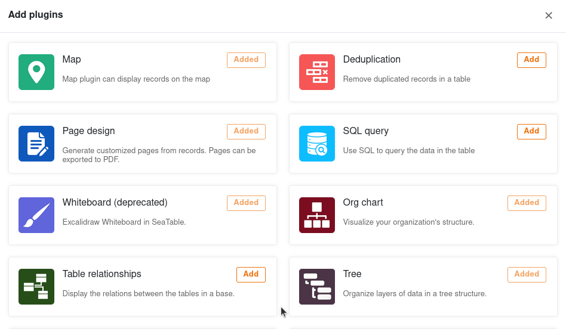
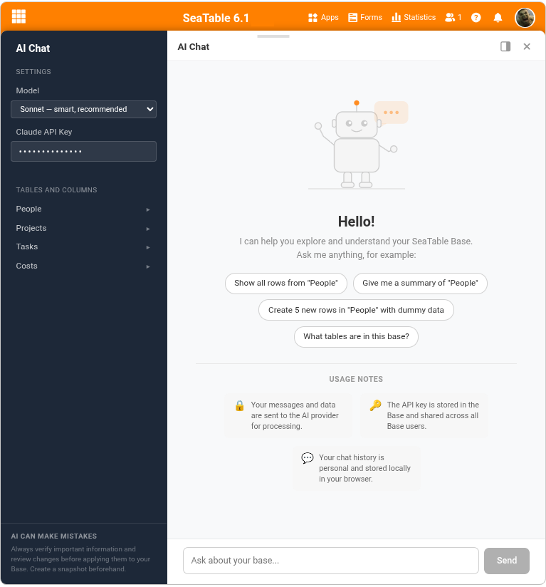
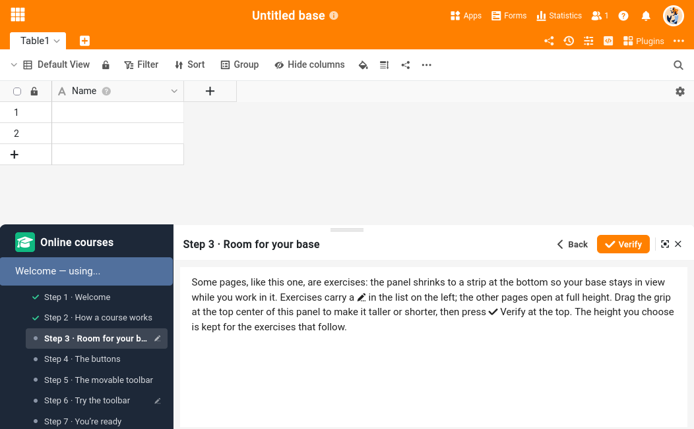
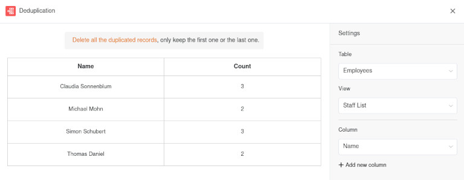
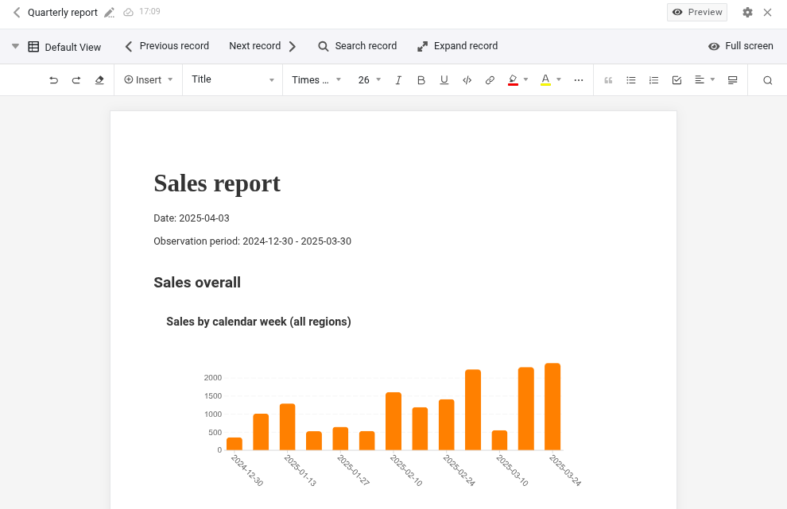
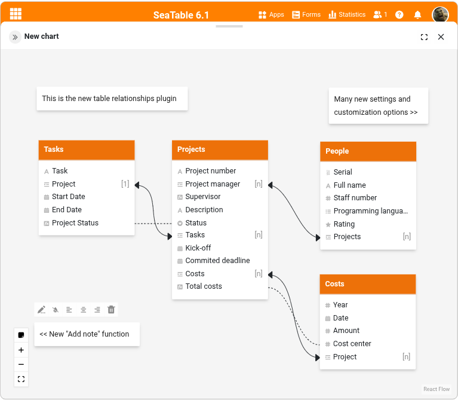

Os **plugins** do SeaTable dão-lhe a oportunidade de ver os seus dados de perspetivas completamente diferentes e utilizar funções alargadas. Por exemplo, visualize localizações, organogramas e relações entre tabelas, crie documentos com layout ou configure um chat de IA na sua base. No artigo seguinte, explicamos quais os plugins disponíveis no SeaTable e como os pode utilizar.

## O que é um plugin?

No SeaTable pode criar diferentes [vistas]() para as suas tabelas com as quais pode visualizar os seus dados, por exemplo, em **calendários**, **galerias** e **diagramas de árvore**. Além disso, existem os plugins.

Um **plugin** é um componente de software opcional do SeaTable que oferece funções adicionais. Em cada base podem ser ativados vários plugins que apresentam os dados da tabela correspondente, por exemplo, em **mapas**, **organogramas** ou **documentos**. Também pode utilizar funções alargadas para detetar **duplicados**, configurar um **chat de IA** ou dar rédea solta à sua criatividade no **quadro branco**.

Para mais informações sobre [como ativar um plugin](), consulte o artigo de ajuda.

##  Plugin Árvore {#tree-plugin}

O plugin Árvore apresenta os **registos ligados de forma hierárquica**, em até três níveis. Enquanto o plugin de relacionamentos entre tabelas lhe mostra como as suas tabelas estão ligadas, o plugin Árvore mostra-lhe os **próprios registos** nessa estrutura: departamentos com os seus centros de custo e despesas, ou versões com os seus testes e os problemas que cada teste revelou. Obtém assim uma visão geral compacta de grandes quantidades de dados repartidos por várias tabelas ligadas.

[Mais informações sobre o plugin Árvore]()

##  Plugin de chat de IA {#ai-chat-plugin}

O plugin mais recente do SeaTable está absolutamente na vanguarda. Permite-lhe configurar um **chat de IA** com o seu modelo de linguagem preferido. Assim, pode editar e analisar as suas bases em linguagem natural, por ex. criar registos, alterar valores, ligar linhas ou criar análises.

[Mais informações sobre o plugin de chat de IA]()

##  Plugin de consulta SQL {#sql-query-plugin}

O plugin de consulta SQL é perfeitamente adequado para a **execução** directa **de comandos SQL**, pelo que é particularmente interessante para os profissionais de bases de dados que trabalham com grandes quantidades de dados.

[Mais informações sobre o plugin de consulta SQL]()

##  Plugin de cursos online {#online-courses-plugin}

Ao contrário dos outros plugins, este não lhe oferece uma nova forma de ver os seus dados: **acompanha a sua aprendizagem**. Guia-o pelos exercícios práticos dos [cursos online]() do SeaTable e **verifica o seu trabalho diretamente na sua própria base**: ao seguir um curso, cria uma automação, escreve um pequeno script ou configura uma vista e, depois, deixa o plugin verificar se o resultado esperado está mesmo lá. Também pode **guiá-lo fase a fase enquanto realiza uma operação** e preparar a sua base para um exercício: faz mais do que olhar para o resultado. Assim, os cursos tornam-se uma experiência guiada e interativa dentro do próprio SeaTable.

[Mais informações sobre o plugin de cursos online]()

##  Plugin de desduplicação de dados {#data-deduplication-plugin}

O plugin de desduplicação de dados descobre **entradas duplicadas** numa tabela. Isto é especialmente útil com grandes quantidades de dados para detectar duplicados e removê-los. Pode eliminar todas as entradas duplicadas com apenas um clique.

[Mais informações sobre o plugin de desduplicação de dados]()

##  Plugin de design de páginas {#page-design-plugin}

Com a ajuda do plugin de design de páginas, pode criar o layout de **documentos** como cartas de formulário, cartões de visita e certificados e preenchê-los com os dados da sua tabela. Mais precisamente, pode criar layouts com **elementos estáticos** que são complementados e individualizados por **elementos dinâmicos** e **campos de tabela**. Estes oferecem-lhe a grande vantagem de, dependendo do registo de dados, inserirem todas as informações relacionadas (por exemplo, o nome de uma pessoa, a morada e o cargo) em modelos normalizados, sem que tenha de copiar manualmente os dados para os documentos. Desta forma, pode criar facturas prontas a imprimir, certificados ou outros documentos importantes a partir dos dados armazenados com apenas alguns cliques.

[Mais informações sobre o plugin de design de páginas]()

##  Plugin de design de relatórios {#report-design-plugin}

Com este plugin pode criar **relatórios de várias páginas** nos quais tabelas, gráficos e campos são dinamicamente alimentados com dados da sua base. É semelhante ao plugin de design de páginas no sentido em que também cria **documentos PDF com base em modelos com layout**. No entanto, os elementos estáticos e dinâmicos não são posicionados com precisão de pixel no modelo, mas colocados um a seguir ao outro de forma contínua, como num **processador de texto** (por ex. Microsoft Word ou Google Docs).

##  Plugin de mapa {#map-plugin}

**As localizações** podem ser apresentadas num mapa com o plugin de mapa. Pode visualizar as informações geográficas introduzidas com marcadores de posição ou imagens. O plugin de mapas pode tratar **coordenadas GPS** e **endereços**. No entanto, os endereços têm de ser únicos para poderem ser apresentados.

[Mais informações sobre o plugin de mapa]()

##  Plugin de organograma {#organizational-chart-plugin}

Pode utilizar o plugin do organograma para apresentar **hierarquias** entre os registos de dados de uma tabela. Isto é útil, por exemplo, para visualizar os cargos numa empresa ou as tarefas superiores e subordinadas num projeto.

[Mais informações sobre o plugin do organograma]()

##  Plugin de quadro branco {#whiteboard-plugin}

O plugin de quadro branco dá-lhe a liberdade de visualizar graficamente processos e estruturas que não pode apresentar com os plugins anteriores. Também pode **esboçar livremente** esquemas e maquetas. Para o desenho, tem à sua disposição vários **elementos** como quadrados, elipses e setas, bem como **ferramentas** como caneta, borracha e a ferramenta de texto.

[Mais informações sobre o plugin do quadro branco]()

##  Plugin de relacionamentos entre tabelas {#table-relationships-plugin}

Especialmente quando existem muitas tabelas com dezenas de colunas numa base, é fácil perder a noção de como estão relacionadas umas com as outras. Pode utilizar o plugin de relações entre tabelas para visualizar **quais as tabelas que estão ligadas entre si e através de que colunas**.

[Mais informações sobre o plugin de relacionamentos entre tabelas]()

## Outros artigos úteis

### Estatísticas

O **módulo de estatísticas** permite-lhe visualizar os dados em todos os tipos de gráficos e estatísticas. Tem à sua disposição os seguintes **tipos de gráficos**: coluna, barra, linha e pizza, bem como mapas, imagens térmicas, velocímetros e tabelas dinâmicas. Pode configurar a visualização que mais lhe convém nos vários **gráficos** e construir um **painel de controlo com as estatísticas mais importantes**.

[Mais informações sobre o módulo de estatísticas]()

### Formulários Web

Pode utilizar o **editor de formulários** para criar um formulário Web a partir das colunas de uma tabela, com o qual pode fazer com que os utilizadores introduzam determinados dados nos campos de um **inquérito online**.

[Mais informações sobre os formulários Web]()
