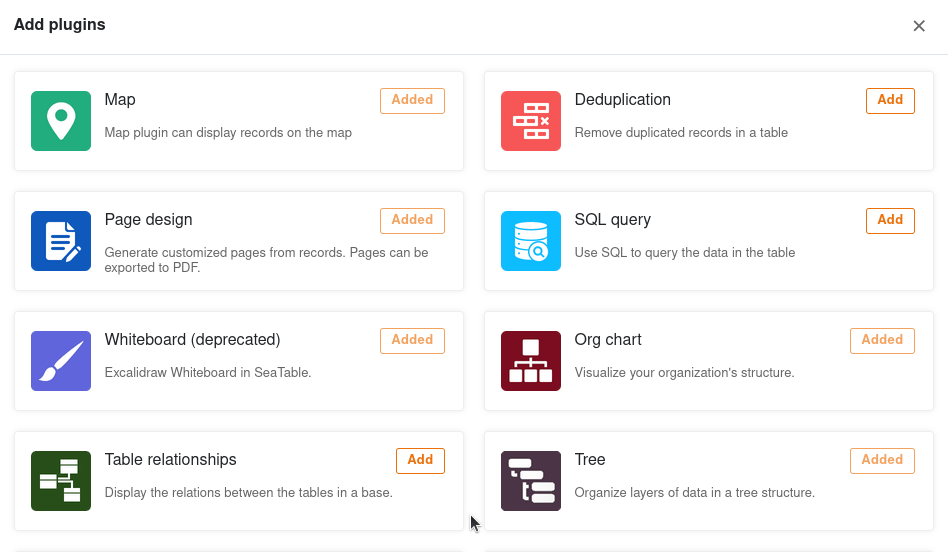
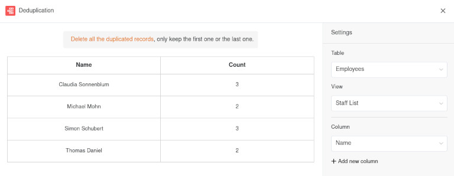
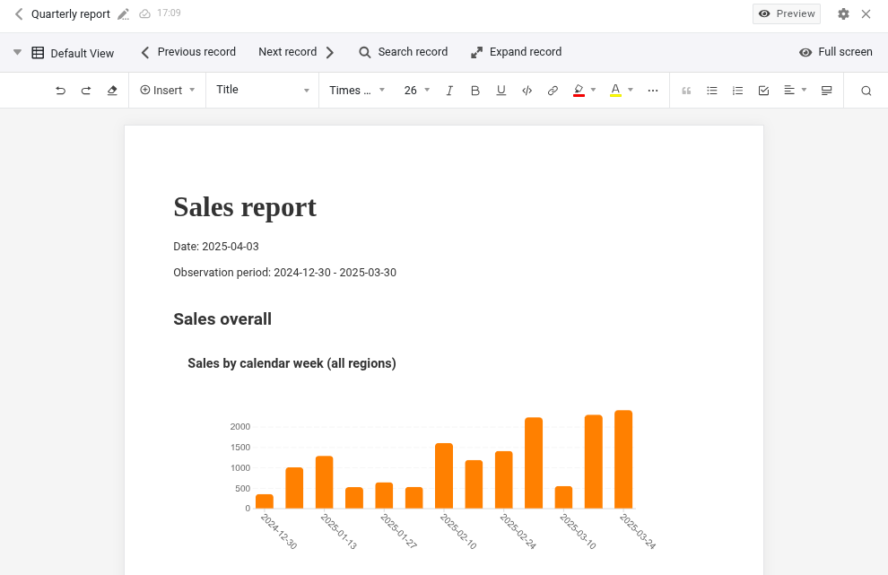
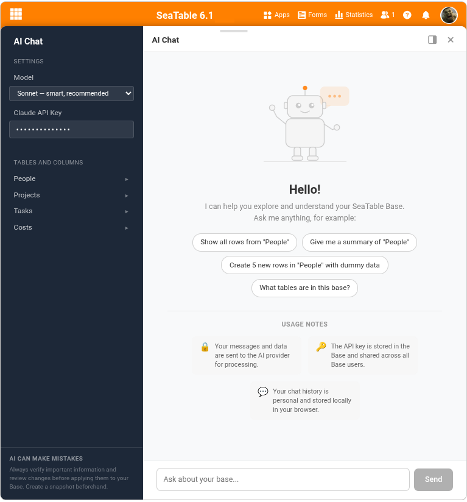
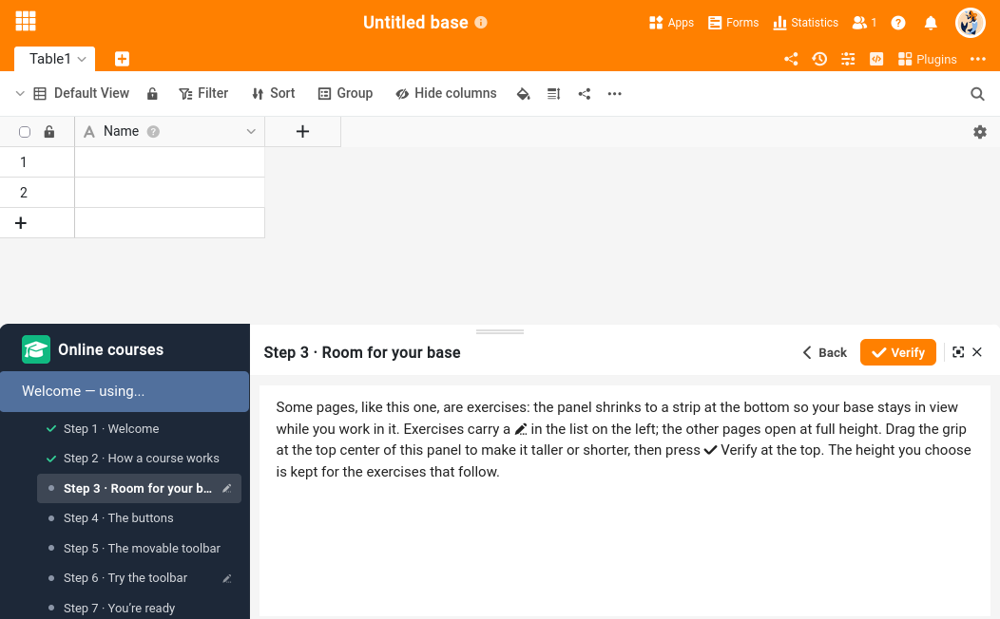
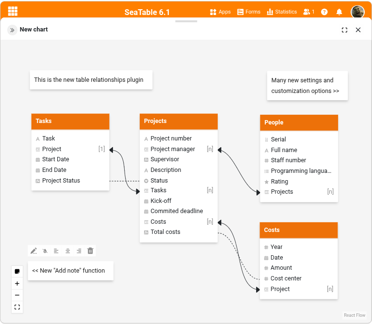

**Плагины** SeaTable позволяют смотреть на данные с совершенно разных точек зрения и использовать расширенные функции. Например, визуализируйте местоположения, организационные схемы и связи между таблицами, создавайте оформленные документы или настраивайте ИИ-чат в вашей базе. В следующей статье мы расскажем, какие плагины доступны в SeaTable и как ими пользоваться.

## Что такое плагин?

В SeaTable вы можете создавать различные [представления]() для своих таблиц, с помощью которых можно визуализировать данные, например, в **календарях**, **галереях** и **древовидных диаграммах**. Помимо этого, существуют плагины.

**Плагин** — это дополнительный программный компонент SeaTable, предлагающий вам дополнительные функции. В каждой базе можно активировать различные плагины, отображающие данные соответствующей таблицы, например, на **картах**, в **органограммах** или **документах**. Кроме того, вы можете использовать расширенные функции для поиска **дубликатов**, настройки **ИИ-чата** или полного раскрытия своего творческого потенциала на **доске**.

Прочитайте больше о том, [как активировать плагин](), в связанной статье справки.

##  Плагин SQL-запросов {#sql-query-plugin}

Плагин SQL-запросов идеально подходит для прямого **выполнения SQL-команд** и поэтому особенно интересен для специалистов по базам данных, которые работают с большими объёмами данных.

[Подробнее о подключаемом модуле SQL-запросов]()

##  Плагин для белой доски {#whiteboard-plugin}

Плагин для белой доски даёт вам возможность графически визуализировать процессы и структуры, которые невозможно отобразить с помощью предыдущих плагинов. Вы также можете **свободно** создавать макеты и **эскизы**. Для оформления вам предлагаются различные **элементы**, такие как квадраты, эллипсы и стрелки, а также такие **инструменты**, как перо, ластик и текстовый инструмент.

[Подробнее о плагине для белой доски]()

##  Плагин для дедупликации данных {#data-deduplication-plugin}

Плагин дедупликации данных обнаруживает **дубликаты записей** в таблице. Это особенно полезно при работе с большими объёмами данных для обнаружения дубликатов и их удаления. Вы можете удалить все дубликаты одним щелчком мыши.

[Подробнее о плагине для дедупликации данных]()

##  Плагин Дерево {#tree-plugin}

Плагин Дерево показывает **связанные записи в виде иерархии** — до трёх уровней. Если плагин связей между таблицами показывает, как соединены ваши таблицы, то плагин Дерево показывает в этой структуре **сами записи**: отделы с их центрами затрат и расходами или версии с их тестами и ошибками, которые выявил каждый тест. Так вы получаете компактный обзор больших объёмов данных, распределённых по нескольким связанным таблицам.

[Подробнее о плагине Дерево]()

##  Плагин дизайна отчётов {#report-design-plugin}

С помощью этого плагина вы можете создавать **многостраничные отчёты**, в которых таблицы, диаграммы и поля динамически заполняются данными из вашей базы. Он похож на плагин дизайна страниц в том, что также создаёт **PDF-документы на основе оформленных шаблонов**. Однако статические и динамические элементы располагаются не попиксельно на шаблоне, а последовательно один под другим, как в **текстовом редакторе** (например, Microsoft Word или Google Docs).

##  Плагин для дизайна страниц {#page-design-plugin}

С помощью плагина дизайна страниц можно верстать такие **документы**, как письма-анкеты, визитные карточки и сертификаты, и заполнять их данными из таблицы. Точнее, вы можете создавать макеты со **статическими элементами**, которые дополняются и индивидуализируются **динамическими элементами** и **полями таблицы**. Их преимущество заключается в том, что в зависимости от записи данных они вставляют всю сопутствующую информацию (например, имя, адрес и должность человека) в стандартизированные шаблоны без необходимости вручную копировать данные в документы. Таким образом, вы можете создавать готовые к печати счета, сертификаты и другие важные документы на основе сохранённых данных всего несколькими щелчками мыши.

[Подробнее о плагине для дизайна страниц]()

##  Плагин ИИ-чата {#ai-chat-plugin}

Самый новый плагин SeaTable абсолютно соответствует духу времени. Он позволяет настроить **ИИ-чат** с вашей предпочтительной языковой моделью. Так вы можете редактировать и анализировать свои базы на естественном языке, например создавать записи, изменять значения, связывать строки или создавать аналитику.

[Подробнее о плагине ИИ-чата]()

##  Картографический плагин {#map-plugin}

**Местоположения** можно отобразить на карте с помощью картографического плагина. Введённую географическую информацию можно визуализировать с помощью маркеров местоположения или изображений. Плагин карты может работать с **GPS-координатами**, а также с **адресами**. Однако адреса должны быть уникальными для отображения.

[Подробнее о плагине для карт]()

##  Плагин онлайн-курсов {#online-courses-plugin}

В отличие от других плагинов, этот не показывает ваши данные по-новому, а **сопровождает вас в обучении**. Он ведёт вас через практические задания [онлайн-курсов]() SeaTable и **проверяет вашу работу прямо в вашей базе**: по ходу курса вы создаёте автоматизацию, пишете короткий скрипт или настраиваете представление, а затем плагин проверяет, действительно ли ожидаемый результат на месте. Он также может **вести вас по операции шаг за шагом, пока вы её выполняете**, и подготовить вашу базу к заданию — то есть он не только смотрит на итог. Так курсы превращаются в интерактивное обучение с подсказками прямо в SeaTable.

[Подробнее о плагине онлайн-курсов]()

##  Плагин организационной диаграммы {#organizational-chart-plugin}

Вы можете использовать плагин организационной диаграммы для отображения **иерархии** между записями данных в таблице. Это полезно, например, для визуализации должностей в компании или вышестоящих и нижестоящих задач в проекте.

[Подробнее о плагине организационной диаграммы]()

##  Плагин связей между таблицами {#table-relationships-plugin}

Особенно когда в базе много таблиц с десятками столбцов, легко потерять представление о том, как они связаны друг с другом. Вы можете использовать плагин отношений таблиц, чтобы визуализировать **какие таблицы связаны друг с другом через какие столбцы**.

[Подробнее о плагине связей между таблицами]()

## Другие полезные статьи

### Статистика

**Модуль статистики** позволяет визуализировать данные в виде всевозможных графиков и статистических данных. Вам доступны следующие **типы графиков**: столбчатые, столбиковые, линейные и круговые диаграммы, а также карты, тепловые изображения, спидометры и поворотные таблицы. Вы можете настроить подходящую для вас визуализацию в различных **графиках** и создать **приборную панель с наиболее важными статистическими данными**.

[Подробнее о модуле статистики]()

### Веб-формы

С помощью **редактора форм** можно создать веб-форму из столбцов таблицы, с помощью которой пользователи смогут вводить определённые данные в поля **онлайн-опроса**.

[Подробнее о веб-формах]()
