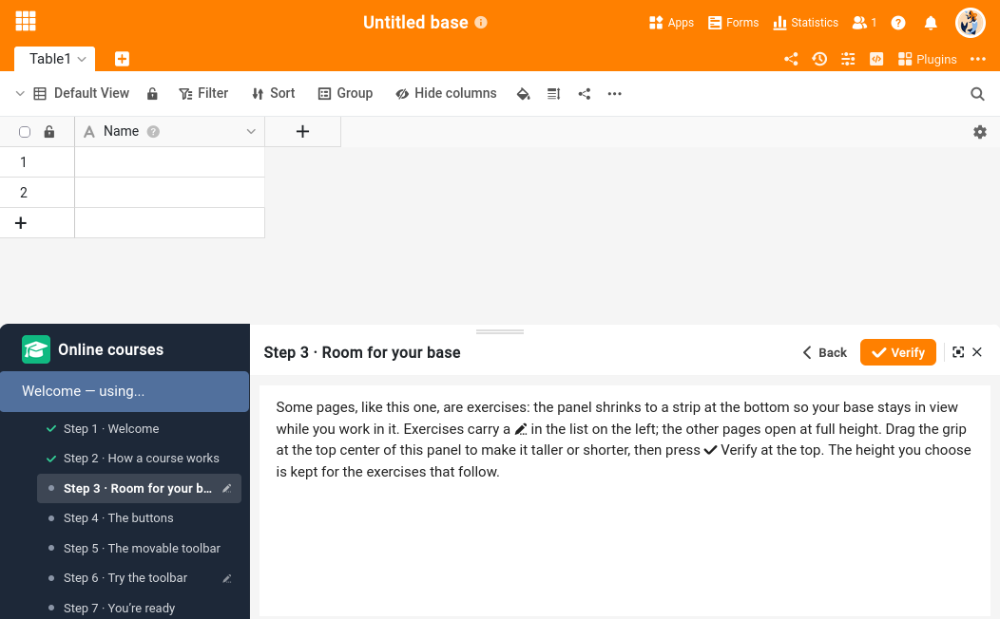

Das **Online-Kurse-Plugin** unterscheidet sich etwas von den anderen Plugins: Es bietet Ihnen keine neue Ansicht Ihrer Daten, sondern ist ein **Lernbegleiter**. Es führt Sie durch die praktischen Übungen der SeaTable-[Online-Kurse]() und **prüft Ihre Arbeit direkt in Ihrer eigenen Base**. Im Rahmen eines Kurses erstellen Sie zum Beispiel eine Automation, schreiben ein kurzes Skript oder richten eine Ansicht ein. Anschließend öffnen Sie das Plugin und lassen prüfen, ob das erwartete Ergebnis tatsächlich in Ihren Daten angekommen ist.

Wie Sie ein Plugin in einer Base aktivieren, erfahren Sie [hier]().

## Zusammenspiel mit den Kursen

Die Kurse selbst lesen Sie hauptsächlich auf unserer **Website**, wo sich das Szenario Schritt für Schritt entfaltet. An bestimmten Stellen fordert Sie der Kurs auf, **das Plugin zu öffnen und einen Schritt auszuwählen**: Dort setzen Sie das Gelernte in Ihrer Base um, und das Plugin prüft das Ergebnis.

Website und Plugin haben unterschiedliche Aufgaben:

- Die **Website** erzählt die Geschichte: Sie erklärt jedes Konzept und zeigt, was Sie bauen sollen und warum.
- Das **Plugin** arbeitet mit Ihnen in Ihrer Base. Es ist die Kontrollstelle: Es liest Ihre Daten und bestätigt, dass Ihre Automation richtig auslöst, Ihr Skript die richtigen Werte erzeugt hat oder Ihre Ansicht wie vorgesehen eingerichtet ist – mit sofortiger Rückmeldung.

Das Plugin bewertet Ihre Arbeit aber nicht nur am Ende. Besteht ein Vorgang aus mehreren Teilen – dem Auslöser einer Automation, dann ihren Bedingungen, dann jeder einzelnen Aktion –, kann es Sie **Teil für Teil hindurchführen**: Es sagt Ihnen, was Sie einstellen sollen, und bestätigt jeden Teil, bevor Sie zum nächsten übergehen. Sie können also alles selbst bauen und sich am Ende ein einziges Urteil geben lassen oder sich vom Plugin den ganzen Weg begleiten lassen.

Es kann auch **selbst Änderungen an Ihrer Base vornehmen**, wenn eine Übung das erfordert: die Zeilen anlegen, mit denen ein Schritt arbeiten soll, oder rückgängig machen, was ein vorheriger Schritt erzeugt hat, damit Sie ihn noch einmal von vorn durchführen können. Es kündigt jedes Mal an, was es gleich tun wird.

Im Kurs zur Zusammenarbeit geht das Plugin noch einen Schritt weiter und **übernimmt die Rolle einer Kollegin**: Es handelt in ihrem Namen in Ihrer Base (ein Kommentar, eine Änderung), sodass Sie Teamarbeit üben können, ohne eine zweite Person zu brauchen.

## Der erste Start

Wenn Sie das Plugin zum ersten Mal öffnen, beginnen Sie mit dem integrierten **Einführungskurs** – Sie finden ihn links in der Liste. Die zweiminütige Tour zeigt Ihnen, **wie ein Kurs abläuft**, was die **Buttons** bewirken und wie Sie **das Plugin verkleinern**, um es frei in der Oberfläche zu verschieben. Alles Weitere setzt voraus, dass Sie sicher zwischen Website und Plugin wechseln – hier fangen Sie also am besten an.

Sobald Sie mit dem Plugin vertraut sind, wählen Sie in derselben Liste den Kurs aus, den Sie gerade bearbeiten, und gehen ihn parallel auf der Website durch.

## Unterstützte Kurse

Das Plugin wird Kurs für Kurs eingeführt. [Online-Kurs 3 – Zusammenarbeit]() und [Online-Kurs 4 – Automatisierung & Integration (auf Englisch)]() werden bereits vollständig unterstützt, weitere Kurse folgen. Ein Kurs, den das Plugin noch nicht prüft, lässt sich trotzdem öffnen: Ein kurzer Hinweis weist darauf hin und empfiehlt, den Kurs bis dahin auf der Website zu bearbeiten.

## Weitere hilfreiche Artikel

- [Alle Plugins in der Übersicht]()
- [SeaTable Online-Kurse]()
- [Aktivieren eines Plugins in einer Base]()
