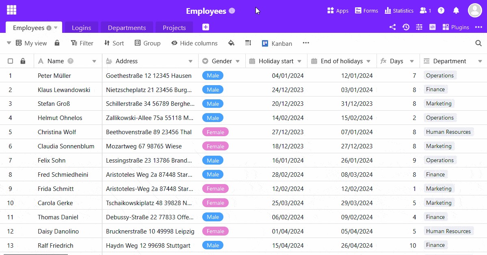

**Web forms** are the tool of choice for letting team members and external third parties enter new records into your tables. Users access a form via a **link**, so there's **no need to share** the table. As a result, web forms are especially useful for data entry by large numbers of **people inside and outside your team**.

Get familiar with SeaTable's form feature to conveniently collect data via web forms!

## How web forms work

The classic web form is ideal for **online surveys**, **applications** and the structured collection of new data. Table columns are integrated using **form fields** and users are guided through the completion process. For access, you create a link that allows users **without a SeaTable user account** to fill out the web form. A completed web form corresponds to **a new record** or an added row in the corresponding table.

Web forms always refer to a **table** in the opened base. Therefore, you must first select the relevant table before creating a form. You can create and save **any number** of web forms in each base.

## Create form

Open the form management via the  **Forms** button at the top right of the base header. If no forms have yet been created in the base, the form management will appear as an empty list. Otherwise, the existing forms are displayed in the open window.

You create a [new web form]() by clicking **Add form** at the bottom of the form management and then selecting **Traditional form**.

Now enter the **name** of the new web form that should also be displayed in the form management. Use a concise name to keep track of many forms. Of course, you can still adjust the name later.

Clicking the **pencil icon**  opens the **web form editor** with its two-part view: on the left, the web form is displayed in draft mode; on the right, there are the **settings**.

There are numerous [configuration options]() to quickly and easily customize a web form to your needs and preferences.

Using the **web form settings** on the right, you can make the following choices:

- To which **table** is the form linked?
- Which **static elements** and **table fields** do you want to include in the form?
- Do you want to use page breaks to create a **multi-page form**?
- Should a **notification** be sent (to you) when the form is submitted?
- Who may **access** the form?
- Should all fields be **mandatory**?
- Should a **progress bar** be displayed to respondents in multi-page forms?
- Should "Powered by" be displayed?
- What **message** is displayed to the participant after submitting the form?
- Do you want to **redirect** the participant to **a website** after submitting the form?
- Does the form have a **submission deadline**?
- Does the form have a **submission limit**?

The fields available in the form depend on the **columns** in the selected table. When you add or delete columns in the table, the available fields in the settings adjust automatically. The **names** and the **order** of the table fields are taken directly from the underlying table.

**Drag and drop** the table fields into your draft or click the **plus icon** to the right of the column name. You can change the order of the fields in the web form as desired by clicking the **six-dot icon**  in the right corner of a field and dragging and dropping the field to the desired location.



In the draft, you can click on each field, which will take you to the **field settings**. Per field you can specify whether ...

- a **field name** different from the column name should be displayed in the form,
- a field receives a supplementary **help text** as a completion note,
- a field is a **required field**,
- a field should contain a **default value**,
- the display of the field depends on a **condition**.



To check how the form looks to the recipient, click the **Form page** button in the upper right corner. A new tab will then open the form as another user would see it.

## Share form

To make the form accessible to others, you need a **link**. You can obtain the link for the form in the web form editor via the  **Share** button. You can use the **automatically generated link** or create **your own links** and extend them with [pre-filled values]().



Before you send the form link or make it publicly accessible, you should test the form extensively.

## Test form

Extensive testing avoids frustration on the part of recipients. Problems can be caused by ambiguities or conflicts in the form. In the worst case, a form cannot be submitted because a mandatory field cannot be filled in (e.g. if no values are defined for a single select field).

Open the web form for testing. From the web form editor, this is done via the **Form page** button. From the table view, first open the form management and then click on the name of the web form. In both cases, the web form opens in a new browser tab.

Values entered in the form are saved in the linked table. Do not forget to delete the test data from the table again before the actual data collection.

## Customize form

You can customize web forms at any time using the web form editor. To return to the editor, open the form management, hover the mouse pointer over the name of the form and then click the **pencil icon**  to the right of the name.

## Copy form

If you have already created a form that you only want to modify slightly for another use case, you can copy the form. To do so, hover the mouse pointer over the name of the form and click the **copy icon**  to the right of the name.

## Delete form

You can delete web forms at any time via the form management. Hover the mouse pointer over the name of the form and then click the **trash icon**  to the right of the name.

