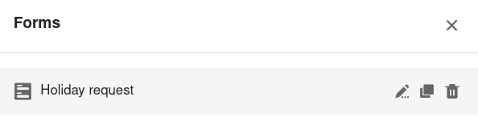

**Веб-формы** - это оптимальный инструмент, позволяющий членам команды и внешним третьим лицам вводить новые записи в ваши таблицы. Пользователи получают доступ к форме по **ссылке**, поэтому **нет необходимости предоставлять общий доступ** к таблице. Благодаря этому веб-формы особенно подходят для сбора данных от большого количества **людей внутри и вне вашей команды**.

Познакомьтесь с функцией форм SeaTable, чтобы удобно собирать данные через веб-формы!

## Принцип работы веб-форм

Классическая веб-форма идеально подходит для **онлайн-опросов**, **заявок** и структурированного сбора новых данных. Столбцы таблицы интегрируются с помощью **полей формы**, а пользователи проходят процесс заполнения шаг за шагом. Для доступа вы создаете ссылку, по которой пользователи могут заполнить веб-форму **без учетной записи SeaTable**. Заполненная веб-форма соответствует **новой записи** или добавленной строке в соответствующей таблице.

Веб-формы всегда относятся к **таблице** в открытой базе. Поэтому перед созданием формы необходимо сначала выбрать соответствующую таблицу. В каждой базе можно создать и сохранить **любое количество** веб-форм.

## Создание формы

Откройте управление формами с помощью кнопки  **Формы** в правом верхнем углу шапки базы. Если в базе еще не было создано ни одной формы, управление формами отобразится в виде пустого списка. В противном случае в открытом окне отобразятся уже существующие формы.

Чтобы создать [новую веб-форму](), нажмите кнопку **Создать веб-форму** в нижней части окна управления формами, а затем выберите **Классическая форма**.

Теперь введите **имя** новой веб-формы, которое также должно отображаться в управлении формами. Используйте лаконичное имя, чтобы не потерять обзор при большом количестве форм. Конечно, вы можете изменить имя позже.

Если вы нажмете на **значок карандаша** , откроется **редактор веб-формы**, состоящий из двух частей: слева веб-форма отображается в режиме черновика, справа находятся **настройки**.

Существует множество [вариантов конфигурации](), позволяющих быстро и легко адаптировать веб-форму к вашим желаниям и представлениям.

С помощью **настроек веб-формы** справа вы можете принять следующие решения:

- К какой **таблице** привязана форма?
- Какие **статические элементы** и **поля таблицы** вы хотите включить в форму?
- Хотите ли вы создать **многостраничную форму** с помощью разрывов страниц?
- Должно ли отправляться **уведомление** (вам) при отправке формы?
- Кто может **получить доступ** к форме?
- Должны ли все поля быть **обязательными**?
- Должен ли отображаться **индикатор прогресса** для заполняющих многостраничную форму?
- Должна ли отображаться надпись "Powered by"?
- Какое **сообщение** выводится участнику после отправки формы?
- Хотите ли вы **перенаправить** участника на **веб-сайт** после отправки формы?
- Есть ли у формы **крайний срок отправки**?
- Есть ли у формы **лимит отправок**?

Доступные в форме поля зависят от **столбцов** выбранной таблицы. Если вы добавляете или удаляете столбцы в таблице, доступные поля в настройках корректируются автоматически. **Имена** и **порядок** полей таблицы берутся непосредственно из базовой таблицы.

**Перетащите** поля таблицы в свой черновик или нажмите на **символ плюса** справа от названия столбца. Вы можете изменить порядок полей в веб-форме по своему усмотрению, нажав на **символ с шестью точками**  в правом углу поля и перетащив поле в нужное место.



В черновике вы можете нажать на любое поле, чтобы перейти к **настройкам поля**. Для каждого поля можно указать, ...

- должно ли в форме отображаться **имя поля**, отличное от имени столбца,
- получает ли поле дополнительный **текст подсказки** для заполнения,
- является ли поле **обязательным**,
- должно ли поле содержать **значение по умолчанию**,
- зависит ли отображение поля от **условия**.



Чтобы проверить, как форма выглядит для получателя, нажмите на кнопку **Страница веб-формы** в правом верхнем углу. После этого форма откроется в новой вкладке так, как ее увидит другой пользователь.

## Совместный доступ к форме

Чтобы сделать форму доступной для других, вам нужна **ссылка**. Ссылку на форму можно получить в редакторе веб-форм с помощью кнопки  **Поделиться**. Вы можете использовать **автоматически сгенерированную ссылку** или создавать **собственные ссылки** и дополнять их [предварительно заполненными значениями]().



Прежде чем отправлять ссылку на форму или делать ее общедоступной, вам следует тщательно протестировать форму.

## Тестирование формы

Тщательное тестирование позволяет избежать разочарования со стороны получателей. Проблемы могут быть вызваны двусмысленностями или противоречиями в форме. В худшем случае форму невозможно отправить, потому что обязательное поле не может быть заполнено (например, если для одиночного выбора не определены значения).

Откройте веб-форму для тестирования. В редакторе веб-формы это делается с помощью кнопки **Страница веб-формы**. Из представления таблицы сначала откройте управление формами, а затем нажмите на имя веб-формы. В обоих случаях веб-форма откроется в новой вкладке браузера.

Значения, введенные в форму, сохраняются в связанной таблице. Не забудьте удалить тестовые данные из таблицы перед фактическим сбором данных.

## Изменение формы

Вы можете в любой момент изменить веб-формы с помощью редактора веб-форм. Чтобы вернуться в редактор, откройте управление формами, наведите указатель мыши на название формы, а затем нажмите на **значок карандаша**  справа от названия.

## Копирование формы

Если вы уже создали форму, которую хотите лишь немного изменить для другого сценария использования, вы можете скопировать эту форму. Для этого наведите указатель мыши на название формы и нажмите на **значок копирования**  справа от названия.

## Удаление формы

Вы можете в любой момент удалить веб-формы через управление формами. Наведите указатель мыши на название формы, а затем нажмите на **значок корзины**  справа от названия.

