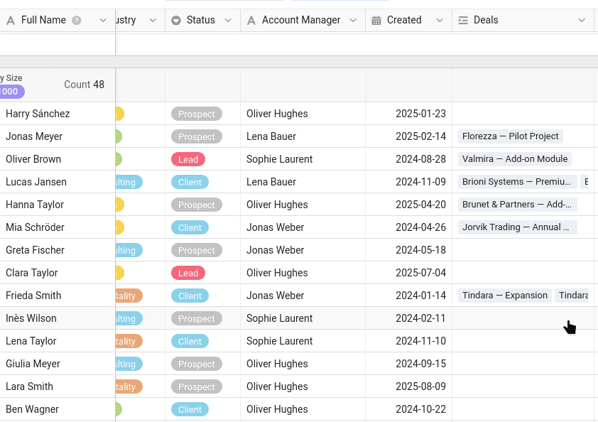
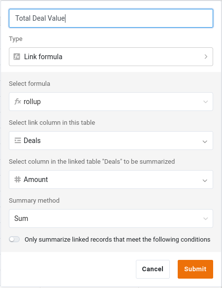

Um gemeinsam an Daten zu arbeiten, braucht man zunächst einmal Daten! In diesem Kurs gehören Sie zum Vertriebsteam (Commercial) und pflegen die Kundenliste des Unternehmens. Wir beginnen also dort, wo jede Zusammenarbeit beginnt: bei der Base mit den Daten, die Sie mit anderen teilen.

In Kurs 1 haben Sie gelernt, eine Base von Grund auf aufzubauen, in Kurs 2 haben Sie eine fertige Base importiert. Genauso gehen wir auch hier vor und starten direkt mit einer vorbereiteten Base. So bleibt die Zeit für die Zusammenarbeit statt für die Dateneingabe.

In diesem Schritt arbeiten Sie noch allein. Ihre Kollegin Malika kommt im nächsten Schritt dazu.

## Wo Ihre Daten liegen

Zuerst kommt der Ort, an dem die Base liegt. In SeaTable lassen sich Bases in **Gruppen** organisieren: gemeinsame Bereiche, die für ein bestimmtes Projekt stehen können oder, wie hier, für eine Abteilung. Ihre Abteilung ist der Vertrieb. Legen Sie deshalb als Erstes eine Gruppe mit dem Namen `Commercial` an.

Das ist mehr als eine Frage der Ordnung, und deshalb steht die Gruppe am Anfang: In Schritt 5 veröffentlichen Sie einen gemeinsamen Datensatz, und das funktioniert nur aus einer Base, die zu einer Gruppe gehört – nie aus Ihrem persönlichen Bereich.

{{< warning headline="Wenn Sie keine Gruppen anlegen können" text="Ob Sie eine Gruppe anlegen dürfen, hängt von Ihrer Rolle im Team ab. Fehlt Ihnen diese Möglichkeit, wenden Sie sich an Ihren Team-Administrator – und bitten Sie ihn bei der Gelegenheit gleich um alles, was der Kurs benötigt, wie in der Einführung aufgeführt. Diesen Schritt und fast den ganzen Kurs können Sie auch mit der Base in Ihrem persönlichen Bereich durcharbeiten; nur Schritt 5 bleibt Ihnen dann verschlossen. Die Base Campaign Hub für Schritt 6 können Sie trotzdem importieren." />}}

## Die Base importieren

Laden Sie die folgende Datei auf Ihren Computer herunter und importieren Sie sie als neue Base **in Ihre Gruppe `Commercial`**:

[SeaTable Course 3 - Sales CRM.dtable](/SeaTable-Course-3-Sales-CRM.dtable)

Fügen Sie dieser Base anschließend das Online-Kurse-Plugin hinzu. Den Kurs lesen Sie weiterhin hier auf der Website; das Plugin begleitet Sie in der Base. Ab und zu wechseln Sie dorthin, um das Gelernte praktisch anzuwenden, Malika ihre Rolle spielen zu lassen und Ihre Arbeit prüfen zu lassen. Falls Sie das Plugin noch nie genutzt haben, starten Sie am besten mit seinem integrierten Einführungskurs: eine kurze Tour durch die Bedienung mit zwei kleinen Übungen zum Ausprobieren.

Auch wenn Sie die Base nicht selbst aufbauen müssen, nehmen Sie sich Zeit, sie gut kennenzulernen. Der Kurs greift in jedem weiteren Schritt auf ihre Tabellen, Spalten und Ansichten zurück, und einige Spaltentypen sind Ihnen vielleicht noch neu.

## Die Bestandteile der Base

Die Base heißt `Sales CRM`: Mit ihr verwaltet das Vertriebsteam seine Kunden und Verkäufe. Auf den ersten Blick ist sie überschaubar:

- 2 verknüpfte Tabellen
- rund 350 Kontakte aus 90 Unternehmen und etwa 290 Deals
- einige Ansichten, von denen Sie manche freigeben werden

Diese Struktur ist bewusst einfacher als eine echte Datenbank, reicht aber aus, um alle Situationen der Zusammenarbeit abzudecken, um die es in diesem Kurs geht. So können wir uns auf das Wesentliche konzentrieren. Im Folgenden gehen wir sie Stück für Stück durch.

### Ihr Kundenstamm

Die Tabelle `Customers` ist das Herzstück der Base. Jede Zeile steht für einen Kontakt in einem Unternehmen und wird durch die erste Spalte, `Full Name`, identifiziert. Daneben finden Sie die Spalten, die man in einer Kundenliste erwartet: Unternehmen, Branche und Größe, Kontaktdaten und den Stand der Kundenbeziehung in der Spalte `Status` (`Client`, `Prospect`, `Lead` oder `Churned`), auf die wir später zurückkommen. Eine Spalte verdient besondere Erwähnung: `Account Manager` hält fest, wer den jeweiligen Kunden betreut. Um die Vielfalt der Daten aus der Praxis abzubilden, haben wir hier eine einfache Textspalte verwendet. In einer echten Datenbank speichern Sie diese Information besser in einer ` Mitarbeiter`-Spalte, die auf den tatsächlichen SeaTable-Benutzer verweist.

Die Tabelle öffnet sich in ihrer Ansicht ` Default View`, die **nach ` Company Size` gruppiert** ist. Die Kontakte stehen also unter Überschriften wie `11–50`, `201–500` oder `1000+`. Eine Einfachauswahl-Spalte eignet sich von Natur aus gut zum Gruppieren, denn ihre festen Optionen werden zu den Gruppen. Und durch die Gruppierung wird aus einer langen, flachen Liste eine Übersicht, die Sie auf einen Blick Segment für Segment erfassen – das zahlt sich aus, sobald die Liste wächst.



{{< warning headline="Die erste Spalte benennt die Zeile" text="Überall, wo auf eine Zeile verwiesen wird – in einem Kommentar, einer Benachrichtigung oder dem Änderungsverlauf, den Sie später kennenlernen –, zeigt SeaTable sie mit dem Wert ihrer ersten Spalte an. Deshalb steht die Spalte Full Name an erster Stelle: Einen Namen erkennt man viel leichter wieder als einen Code oder eine Nummer. Die erste Spalte muss nicht eindeutig sein, aber ein klarer, unverwechselbarer Wert macht jede Zeile leicht erkennbar, wenn sie in solchen Verweisen auftaucht." />}}

### Die Deals hinter jedem Kunden

Ein Kunde ist mehr als eine Visitenkarte: Dazu gehören auch die Deals, also die laufenden und abgeschlossenen Verkaufschancen mit ihm. Die zweite Tabelle, `Deals`, enthält die Vertriebsdaten. Jede Zeile steht für eine Verkaufschance:

- `Deal Name` und `Amount`: worum es bei dem Deal geht und wie viel er wert ist.
- `Stage`: wie weit er fortgeschritten ist (`Qualification`, `Proposal`, `Negotiation`, `Won` oder `Lost`).
- `Close Date`: wann er gewonnen oder verloren wurde.



## So greifen die beiden Tabellen ineinander

Eine Kundenliste und eine Liste von Deals entfalten erst ihr volles Potenzial, wenn sie miteinander verbunden sind. Drei Spalten übernehmen diese Aufgabe, und es lohnt sich, sie zu verstehen, bevor Sie weitermachen.

### Die Verknüpfung von Kunden und Deals

Die Tabelle `Customers` enthält eine Spalte ` Deals`, die jeden Kontakt mit seinen Verkaufschancen in der Tabelle `Deals` verknüpft. Klicken Sie auf eine Zelle dieser Spalte: Sie können die Deals dieses Kunden sehen, öffnen und neue hinzufügen, ohne die Zeile zu verlassen. Auf der Seite von `Deals` stellt die passende Spalte ` Customer` die Verbindung in umgekehrter Richtung her.

Es ist dieselbe Verknüpfungsspalte, die Sie aus Kurs 2 kennen, und sie macht die nächste Spalte erst möglich.

### Eine Summe über den Wert jedes Kunden

Weil Kunden und Deals verknüpft sind, kann die Tabelle `Customers` die verknüpften Deals automatisch zusammenfassen. Die Spalte ` Total Deal Value` ist eine Spalte vom Typ **Formel für Verknüpfungen**, die über die verknüpften Deals rechnet: Für jeden Kunden addiert sie die Beträge (`Amount`) aller seiner Deals. Sie tragen darin nie etwas ein – die Spalte rechnet neu, sobald sich ein Deal ändert oder ein neuer Deal mit dem Kunden verknüpft wird.

### Eine Formel, die Deals nach ihrem Fortschritt gewichtet

In der Tabelle `Deals` ist ` Weighted Value` eine **Formel**-Spalte, die den Betrag jedes Deals mit einer Wahrscheinlichkeit multipliziert, die von seiner Phase (`Stage`) abhängt:

`switch({Stage}, "Qualification", 0.2, "Proposal", 0.4, "Negotiation", 0.6, "Won", 1, "Lost", 0) * {Amount}`

Ein Deal in der Verhandlungsphase zählt damit mehr als einer, der sich noch in der Qualifizierung befindet. Das ergibt ein gewichtetes, aussagekräftigeres Bild der Vertriebsdaten als eine bloße Summe.

` Total Deal Value` und ` Weighted Value` sind genau die Art von Zahlen, die ein Team als **vertraulich** behandelt: Umsatz- und Prognosezahlen gibt man nicht jedem, der nur die Telefonnummer eines Kontakts braucht. Behalten Sie das im Hinterkopf – es wird wichtig, sobald Sie diese Base freigeben.

## Zwei Ansichten für zwei Zielgruppen

Die Tabelle `Customers` bringt zwei Ansichten für unterschiedliche Zwecke mit.

- ` All customers` zeigt alles, einschließlich der vertraulichen Spalte `Total Deal Value`. Das ist die interne, vollständige Ansicht für das Vertriebsteam.
- ` Active customers` ist eine abgespeckte Ansicht: Sie konzentriert sich auf die aktuellen Kundendaten und blendet die vertraulichen Zahlen aus. Diese Version können Sie bedenkenlos für ein anderes Team freigeben.
    - Filter: ` Status` schließt `Churned` aus
    - Ausgeblendete Spalten: ` Created`, ` Deals`, ` Total Deal Value`

Eine Ansicht ist in SeaTable nur ein bestimmter Blick auf dieselben zugrunde liegenden Daten: Die Zeilen sind an einem einzigen Ort gespeichert, und jede Ansicht legt fest, was sie zeigt, ausblendet, filtert und gruppiert. Auf diese Unterscheidung bauen die nächsten Schritte auf: Sie geben eine **Ansicht** frei statt uneingeschränkten Zugriff auf alles, und später veröffentlichen Sie ` Active customers` als stets aktuellen Datensatz für ein anderes Team.

Die Spalte `Created` in `Customers` ist eine gewöhnliche `Datum`-Spalte. So konnten wir sie für diesen Kurs mit realistischen Daten aus der Vergangenheit füllen. Wenn Sie in Ihren eigenen Bases festhalten möchten, wann eine Zeile angelegt oder zuletzt geändert wurde, verwenden Sie besser die Spaltentypen `Erstellt` und `Zuletzt bearbeitet`. SeaTable füllt sie automatisch – Sie können also weder vergessen, sie auszufüllen, noch sich beim Datum vertippen oder eine Änderung rückdatieren.

Wenn Ihnen die Base vertraut ist, kann Ihre Kollegin dazukommen.

## Hilfeartikel mit weiteren Informationen

- [Eine neue Gruppe anlegen]()
- [Erstellen einer Base aus einer DTABLE-Datei]()
- [Aktivieren eines Plugins in einer Base]()
- [Die Verknüpfungsspalte]()
- [Die Spalte Formel für Verknüpfungen]()
- [Die Formel-Spalte]()
- [Gruppierung, Sortierung und Filter]()
