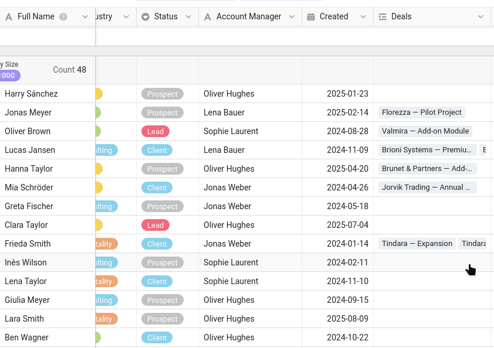
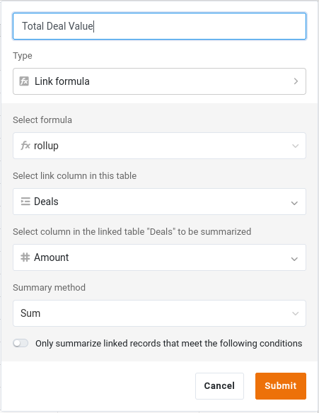

Para colaborar con datos, ¡primero hay que tenerlos! A lo largo de este curso forma parte del equipo comercial y es usted quien se encarga de la lista de clientes de la empresa. Así que empezamos por donde empieza toda colaboración: por la base que contiene los datos que se van a compartir.

En el curso 1 aprendió a construir una base desde cero, y en el curso 2 importó una ya preparada. Aquí haremos lo mismo y empezaremos directamente con una base preparada: el tiempo que no dedicamos a introducir datos lo dedicaremos a la colaboración.

En este paso trabaja solo. Su compañera, Malika, se une en el siguiente.

## ¿Dónde guardar sus datos?

SeaTable permite organizar las bases en **grupos**: espacios compartidos que pueden corresponder a un proyecto o, como aquí, a un departamento. Su departamento es el comercial, así que empiece por crear un grupo llamado `Commercial`.

No es solo una cuestión de orden, y por eso el grupo va primero: en el paso 5 publicará un conjunto de datos común, y eso solo es posible desde una base que pertenece a un grupo, nunca desde su espacio personal.



## Importar la base

Descargue el siguiente archivo en su ordenador e impórtelo como nueva base **en su grupo `Commercial`**:

[SeaTable Course 3 - Sales CRM.dtable](/SeaTable-Course-3-Sales-CRM.dtable)

A continuación, añada el plugin de cursos en línea a esta base. Sigue leyendo el curso aquí, en el sitio web; el plugin le acompaña en la base y recurrirá a él de vez en cuando para practicar, para dejar que Malika haga su parte y para que compruebe su trabajo. Si nunca lo ha utilizado, empiece por su curso de introducción integrado: una breve presentación de cómo funciona un curso con él, con dos pequeños ejercicios para probarlo.

Aunque no tenga que construir la base usted mismo, tómese el tiempo de conocerla bien. El curso hace referencia a sus tablas, columnas y vistas en todos los pasos siguientes, y puede que algunos tipos de columna sean nuevos para usted.

## Los componentes de la base

La base se llama `Sales CRM`: es la herramienta con la que el equipo comercial gestiona sus clientes y sus ventas. A primera vista es compacta:

- 2 tablas enlazadas
- unos 350 contactos repartidos en 90 empresas, y unos 290 negocios
- algunas vistas, varias de las cuales compartirá

Esta estructura es deliberadamente más sencilla que una base de datos real, pero basta para cubrir todas las situaciones de colaboración que trata el curso, lo que nos permite centrarnos en lo esencial. A continuación la recorremos parte por parte.

### Su fichero de clientes

La tabla `Customers` es el corazón de la base. Cada fila es un contacto en una empresa, identificado por la primera columna, `Full Name`. Junto a ella encontrará las columnas que cabe esperar en una lista de clientes: empresa, sector y tamaño, datos de contacto y el estado de la relación, `Status` (`Client`, `Prospect`, `Lead` o `Churned`), sobre el que volveremos más adelante. Una columna merece una mención especial: `Account Manager` indica quién se ocupa de cada cliente. Para reflejar la variedad de datos de un caso real, hemos utilizado una simple columna de texto, pero en una base de datos real es mejor guardar este dato en una columna ` Colaborador`, vinculada al usuario de SeaTable correspondiente.

La tabla se abre en su vista ` Default View`, que está **agrupada por ` Company Size`**: los contactos se reúnen bajo encabezados como `11–50`, `201–500` o `1000+`. Una columna de selección única se presta de forma natural a la agrupación, ya que sus opciones fijas se convierten en los grupos; y agrupar convierte una larga lista en algo que se recorre de un vistazo, segmento por segmento, lo que resulta muy útil en cuanto la lista crece.



{{< warning headline="La primera columna es la etiqueta de la fila" text="Allí donde se hace referencia a una fila (en un comentario, una notificación o el historial de cambios que descubrirá más adelante), SeaTable la muestra mediante el valor de su primera columna. Por eso la columna Full Name ocupa el primer lugar: un nombre se reconoce mucho más fácilmente que un código o un número. La primera columna no tiene por qué ser única, pero un valor claro y distintivo permite reconocer cada fila con facilidad cuando aparece en esas referencias (observe, de paso, que la elección actual no permite, por ejemplo, distinguir a dos personas con el mismo nombre)." />}}

### Los negocios de cada cliente

Un cliente es más que una ficha de contacto: también son los negocios (las ventas en curso o cerradas con ese cliente) que usted lleva con él. La segunda tabla, `Deals`, contiene los datos comerciales. Cada fila es una oportunidad de venta:

- `Deal Name` y `Amount`: en qué consiste el negocio y cuál es su importe.
- `Stage`: en qué fase se encuentra (`Qualification`, `Proposal`, `Negotiation`, `Won` o `Lost`).
- `Close Date`: la fecha en que se ganó o se perdió.



## Cómo funcionan juntas las dos tablas

Una lista de clientes y una lista de negocios son mucho más potentes una vez enlazadas. Tres columnas se encargan de ello, y vale la pena entenderlas antes de seguir.

### El enlace entre clientes y negocios

La tabla `Customers` tiene una columna ` Deals` que enlaza cada contacto con sus negocios de la tabla `Deals`. Haga clic en una celda de esa columna y podrá ver, abrir y añadir los negocios de ese cliente sin salir de la fila. En la tabla `Deals`, la columna ` Customer` establece el enlace en sentido contrario.

Es la misma columna de enlace que conoció en el curso 2, y es la que hace posible la columna siguiente.

### Un total acumulado del valor de cada cliente

Como clientes y negocios están enlazados, la tabla `Customers` puede resumir automáticamente los negocios enlazados. La columna ` Total Deal Value` es una columna **Fórmula para enlaces** que acumula los negocios enlazados: para cada cliente, suma el importe (`Amount`) de todos ellos. Nunca escribe nada en ella: se recalcula cada vez que cambia un negocio o se enlaza un negocio nuevo al cliente.

### Una fórmula que pondera el importe según la fase

En la tabla `Deals`, ` Weighted Value` es una columna de **fórmula** que multiplica el importe de cada negocio por una probabilidad que depende de su fase (`Stage`):

`switch({Stage}, "Qualification", 0.2, "Proposal", 0.4, "Negotiation", 0.6, "Won", 1, "Lost", 0) * {Amount}`

Así, un negocio en fase de negociación pesa más que uno todavía en fase de cualificación, lo que da una imagen ponderada de las ventas previstas, más representativa que un simple total.

` Total Deal Value` y ` Weighted Value` son justo el tipo de cifras que un equipo considera **confidenciales**: volumen de negocio y previsiones que no se entregan a cualquiera que solo necesite el número de teléfono de un contacto. Téngalo presente: será importante en cuanto empiece a compartir esta base.

## Dos vistas para dos públicos

La tabla `Customers` incluye dos vistas pensadas para usos distintos.

- ` All customers` lo muestra todo, incluida la columna confidencial `Total Deal Value`. Es la vista interna y completa del equipo comercial.
- ` Active customers` es una vista reducida: se centra en los clientes actuales y oculta las cifras confidenciales. Es la versión que se puede compartir sin riesgo con otro equipo.
    - Filtro: ` Status` no es ninguno de `Churned`
    - Columnas ocultas: ` Created`, ` Deals`, ` Total Deal Value`

En SeaTable, una vista no es más que una forma de mirar los mismos datos: las filas se guardan en un solo lugar, y cada vista decide qué muestra, qué oculta, cómo filtra y cómo agrupa. Esta distinción le será útil en los pasos siguientes: lo que comparte es una **vista**, no un acceso sin restricciones a todo, y más adelante publicará ` Active customers` para otro equipo como un conjunto de datos siempre actualizado.

La columna `Created` de la tabla `Customers` es una columna `Fecha` corriente, lo que nos ha permitido rellenarla con fechas pasadas realistas para este curso. En sus propias bases, cuando quiera registrar cuándo se creó o se modificó por última vez una fila, utilice mejor los tipos de columna `Fecha de creación` y `Última modificación`. SeaTable los rellena automáticamente, así que no hay riesgo de olvidarse de rellenarlos, equivocarse de fecha o antedatar un cambio.

Cuando la base le resulte familiar, estará listo para incorporar a su compañera.

## Artículo de ayuda con más información

- [Crear un nuevo grupo]()
- [Creación de una base a partir de un archivo DTABLE]()
- [Activación de un plugin en una base]()
- [La columna de enlace]()
- [La columna Fórmula para enlaces]()
- [La columna de fórmulas]()
- [Agrupar, ordenar y filtrar]()
