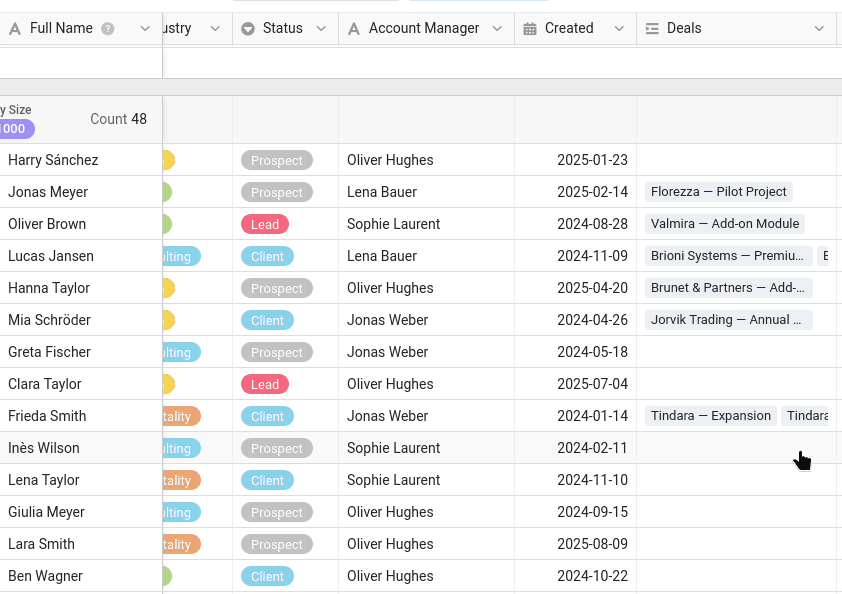
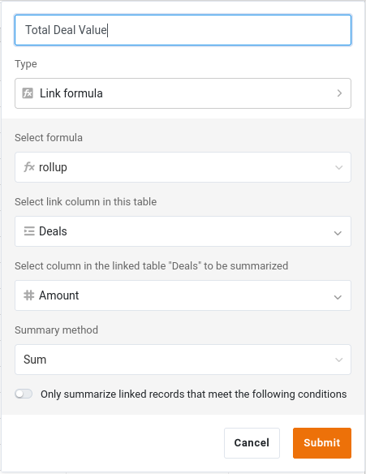

Pour collaborer sur des données, encore faut-il en avoir ! Tout au long de ce cours, vous faites partie de l'équipe commerciale et c'est vous qui gérez la liste des clients de l'entreprise. Nous commençons donc là où commence toute collaboration : par la base qui contient les données à partager.

Dans le cours 1, vous avez appris à construire une base de A à Z, et dans le cours 2, vous en avez importé une toute prête. Nous ferons de même ici en partant directement d'une base préparée : le temps gagné sur la saisie sera consacré à la collaboration.

Vous travaillez en solo à cette étape. Votre collègue, Malika, vous rejoint à la suivante.

## Où stocker vos données ?

SeaTable permet d'organiser les bases en **groupes** : des espaces partagés qui peuvent correspondre à un projet ou, comme ici, à un service. Votre service est le service commercial : commencez par créer un groupe nommé `Commercial`.

Ce n'est pas qu'une question de « rangement », et c'est pour cela que le groupe vient en premier : à l'étape 5, vous publierez un jeu de données commun, ce qui n'est possible que depuis une base rattachée à un groupe, jamais depuis votre espace personnel.

{{< warning headline="Si vous ne pouvez pas créer de groupe" text="La création d'un groupe dépend de votre rôle dans l'équipe. Si l'option ne vous est pas proposée, adressez-vous à votre administrateur d'équipe, et profitez-en pour demander en une fois tout ce dont le cours a besoin, comme l'indique l'introduction. Vous pouvez suivre cette étape et presque tout le cours avec la base dans votre espace personnel ; seule l'étape 5 vous restera inaccessible (vous pourrez toujours importer la seconde base Campaign Hub pour l'étape 6)." />}}

## Importer la base

Téléchargez le fichier suivant sur votre ordinateur et importez-le comme nouvelle base **dans votre groupe `Commercial`** :

[SeaTable Course 3 - Sales CRM.dtable](/SeaTable-Course-3-Sales-CRM.dtable)

Ajoutez ensuite le plugin de cours en ligne à cette base. Vous continuez à suivre le cours ici, sur le site ; le plugin vous accompagne lors de votre travail dans la base, et vous vous en servirez à certains moments, par exemple pour laisser Malika jouer son rôle ou faire vérifier vos modifications. Si vous ne l'avez jamais utilisé, commencez par son cours d'introduction : une courte présentation de son fonctionnement, avec deux petits exercices pour le prendre en main.

Vous n'avez pas à construire la base vous-même, mais prenez le temps de la découvrir et de vous familiariser avec elle. Le cours fait référence à ses tableaux, ses colonnes et ses vues à chaque étape, et certains types de colonnes vous sont peut-être encore inconnus.

## Ce que contient la base

La base s'appelle `Sales CRM` : c'est l'outil avec lequel l'équipe commerciale gère ses clients et ses ventes. Au premier abord, elle est compacte :

- 2 tableaux liés ;
- environ 350 contacts répartis dans 90 entreprises, et quelque 290 affaires ;
- quelques vues, dont certaines que vous partagerez.

Cette structure est volontairement plus simple qu'une vraie base de données, mais elle suffit pour couvrir toutes les situations de collaboration abordées dans le cours, ce qui nous permet de nous concentrer sur l'essentiel. Passons-la en revue.

### Votre fichier clients

Le tableau `Customers` est le cœur de la base. Chaque ligne correspond à un contact dans une entreprise, identifié par la première colonne, `Full Name`. On y trouve les colonnes attendues dans une liste de clients : entreprise, secteur et taille, coordonnées, et le statut `Status` de la relation (`Client`, `Prospect`, `Lead` ou `Churned`), sur lequel nous reviendrons. Une colonne mérite d'être signalée : `Account Manager` indique qui gère chaque client. Pour refléter la variété des données rencontrées dans la réalité, nous avons utilisé une simple colonne de texte. Dans une vraie base, mieux vaut stocker cette information dans une colonne ` Collaborateur`, reliée au véritable utilisateur SeaTable.

Le tableau s'ouvre sur sa vue ` Default View`, **regroupée par ` Company Size`** : les contacts sont rassemblés sous des intitulés comme `11–50`, `201–500` ou `1000+`. Une colonne de sélection unique se prête naturellement au regroupement, puisque ses options fixes deviennent les groupes ; et le regroupement transforme une longue liste en un ensemble qu'on parcourt d'un coup d'œil, segment par segment, ce qui devient précieux dès que les données deviennent plus nombreuses.



{{< warning headline="La première colonne sert d'étiquette à la ligne" text="Partout où une ligne est citée (dans un commentaire, une notification ou l'historique des modifications que vous découvrirez plus loin), SeaTable l'affiche par la valeur de sa première colonne. C'est pourquoi la colonne Full Name est en première position : un nom se reconnaît bien plus facilement qu'un code ou un numéro. La première colonne n'a pas besoin d'être unique, mais une valeur claire et distinctive permet de reconnaître chaque ligne facilement quand elle apparaît dans ces références (notez au passage que le choix actuel ne permet par exemple pas de distinguer les homonymes)." />}}

### Les affaires rattachées à chaque client

Un client, ce n'est pas qu'une fiche de contact : ce sont aussi les affaires (les ventes en cours ou conclues avec chaque client) que vous menez avec lui. Le second tableau, `Deals`, contient les données commerciales. Chaque ligne est une opportunité ou une transaction terminée :

- `Deal Name` et `Amount` : l'objet de l'affaire et son montant ;
- `Stage` : son état d'avancement (`Qualification`, `Proposal`, `Negotiation`, `Won` ou `Lost`) ;
- `Close Date` : la date à laquelle elle a été gagnée ou perdue.



## Comment les deux tableaux fonctionnent ensemble ?

Une liste de clients et une liste d'affaires expriment tout leur potentiel une fois reliées. Trois colonnes s'en chargent, et il vaut la peine de les comprendre avant d'aller plus loin.

### Le lien entre clients et affaires

Le tableau `Customers` comporte une colonne ` Deals` qui relie chaque contact aux affaires du tableau `Deals` qui lui sont rattachées. Cliquez sur une cellule de cette colonne : vous pouvez voir, ouvrir et ajouter les affaires de ce client sans quitter la ligne. Côté `Deals`, la colonne ` Customer` fait le lien dans l'autre sens.

C'est la même colonne de lien que dans le cours 2, et c'est elle qui rend possible la colonne suivante.

### Un cumul de la valeur de chaque client

Comme clients et affaires sont liés, le tableau `Customers` peut résumer automatiquement les affaires liées. La colonne ` Total Deal Value` est une colonne **Formule pour les liens** qui cumule les affaires liées : pour chaque client, elle additionne le montant (`Amount`) de toutes ses affaires. Vous n'y saisissez jamais rien : elle se recalcule dès qu'une affaire change ou qu'une nouvelle affaire est liée au client.

### Une formule qui pondère le montant en fonction de l'avancement

Dans le tableau `Deals`, ` Weighted Value` est une colonne **Formule** qui multiplie le montant de chaque affaire par une probabilité dépendant de son avancement (`Stage`) :

`switch({Stage}, "Qualification", 0.2, "Proposal", 0.4, "Negotiation", 0.6, "Won", 1, "Lost", 0) * {Amount}`

Une affaire en négociation pèse ainsi davantage qu'une affaire encore en phase de qualification, ce qui donne du processus une image pondérée, plus représentative qu'un simple total.

` Total Deal Value` et ` Weighted Value` sont typiquement le genre de chiffres qu'une équipe considère comme **confidentiels** : chiffre d'affaires et prévisions ne se donnent pas nécessairement à toute personne ayant seulement besoin du numéro de téléphone d'un contact. Gardez-le en tête : cela comptera dès que vous commencerez à partager cette base.

## Deux vues pour deux publics

Le tableau `Customers` est livré avec deux vues conçues pour des usages différents.

- ` All customers` montre tout, y compris la colonne confidentielle `Total Deal Value`. C'est la vue interne et complète de l'équipe commerciale ;
- ` Active customers` est une vue allégée : elle se concentre sur les clients actuels et masque les chiffres confidentiels. C'est la version qu'on peut partager sans risque avec une autre équipe :
    - filtre : ` Status` ne contient aucun `Churned` ;
    - colonnes masquées : ` Created`, ` Deals`, ` Total Deal Value`.

Dans SeaTable, une vue n'est qu'un regard particulier sur la totalité des données d'un tableau : les lignes sont stockées à un seul endroit, et chaque vue décide de ce qu'elle montre, masque, filtre et regroupe. Cette distinction vous servira dans les étapes suivantes : vous partagez une **vue**, pas un accès brut à l'ensemble des données, et vous publierez plus tard ` Active customers` pour une autre équipe, sous forme de données toujours à jour.

La colonne `Created` du tableau `Customers` est une colonne `Date` ordinaire, ce qui nous a permis de la remplir avec des dates passées dont la diversité illustre des données réelles. Dans vos propres bases, quand vous voulez enregistrer la date de création ou de dernière modification d'une ligne, préférez plutôt les types de colonnes `Date de création` et `Date de dernière modification`. SeaTable les remplit automatiquement : aucun risque d'oublier de les renseigner, de se tromper de date ou d'antidater une modification.

Quand la base vous semblera familière, vous pourrez faire entrer votre collègue en scène.

## Article d'aide avec plus d'informations

- [Créer un nouveau groupe]()
- [Créer une base à partir d'un fichier DTABLE]()
- [Activer un plugin dans une base]()
- [La colonne de lien]()
- [La colonne Formule pour les liens]()
- [La colonne de formule]()
- [Regroupement, tri et filtre]()
