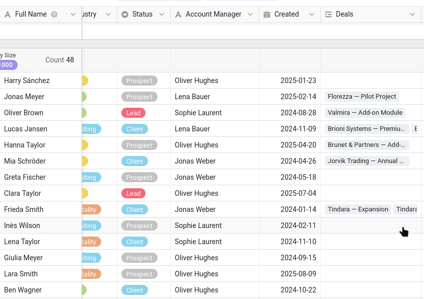
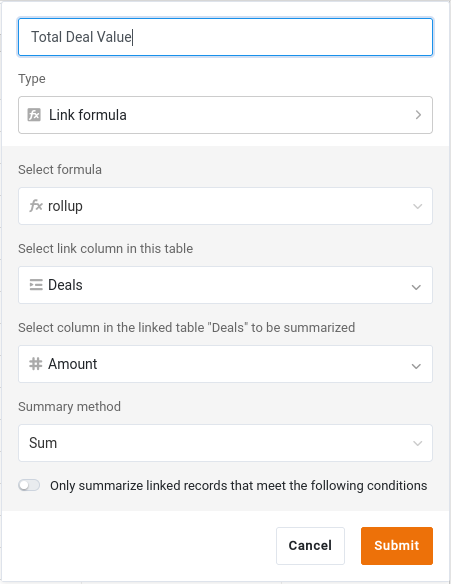

Para colaborar sobre dados, primeiro é preciso tê-los! Ao longo deste curso, faz parte da equipa comercial e é a si que cabe gerir a lista de clientes da empresa. Começamos, por isso, por onde começa qualquer colaboração: pela base que contém os dados a partilhar.

No Curso 1 aprendeu a construir uma base do zero e no Curso 2 importou uma base já pronta. Vamos fazer o mesmo aqui e começar diretamente com uma base preparada: o tempo poupado na introdução de dados fica para a colaboração.

Neste passo, trabalha sozinho. A sua colega, Malika, junta-se a si no próximo.

## Onde guardar os seus dados?

O SeaTable permite organizar as bases em **grupos**: espaços partilhados que podem corresponder a um projeto ou, como aqui, a um departamento. O seu departamento é o comercial, por isso comece por criar um grupo chamado `Commercial`.

Não é só uma questão de arrumação, e é por isso que o grupo vem primeiro: no passo 5, vai publicar um conjunto de dados comum, o que só é possível a partir de uma base que pertença a um grupo, nunca a partir do seu espaço pessoal.



## Importar a base

Descarregue o seguinte ficheiro para o seu computador e importe-o como nova base **no seu grupo `Commercial`**:

[SeaTable Course 3 - Sales CRM.dtable](/SeaTable-Course-3-Sales-CRM.dtable)

Depois, adicione o plugin de cursos online a esta base. Continua a seguir o curso aqui, no site; o plugin acompanha o seu trabalho na base, e vai recorrer a ele em certos momentos para pôr as coisas em prática, deixar a Malika desempenhar o seu papel e mandar verificar o seu trabalho. Se nunca o usou, comece pelo curso introdutório integrado: uma breve apresentação de como funciona um curso, com dois pequenos exercícios para se familiarizar com ele.

Não tem de construir a base, mas reserve algum tempo para a conhecer bem. O curso volta a estas tabelas, colunas e vistas em todos os passos seguintes, e alguns tipos de coluna podem ser novos para si.

## O que contém a base

A base chama-se `Sales CRM`: é a ferramenta com que a equipa comercial gere os seus clientes e as suas vendas. À primeira vista, é compacta:

- 2 tabelas ligadas;
- cerca de 350 contactos de 90 empresas, e cerca de 290 negócios;
- algumas vistas, das quais vai partilhar algumas.

Esta estrutura é propositadamente mais simples do que uma base de dados real, mas chega para cobrir todas as situações de colaboração abordadas no curso, o que nos permite concentrar no essencial. Vamos percorrê-la por partes.

### O seu ficheiro de clientes

A tabela `Customers` é o coração da base. Cada linha corresponde a um contacto numa empresa, identificado pela primeira coluna, `Full Name`. Encontra também as colunas que se esperam numa lista de clientes: empresa, setor e dimensão, dados de contacto e o estado da relação (`Status`: `Client`, `Prospect`, `Lead` ou `Churned`), ao qual voltaremos mais tarde. Uma coluna merece destaque: `Account Manager` indica quem gere cada cliente. Para refletir a variedade de dados de um caso real, usámos uma simples coluna de texto; numa base a sério, é preferível guardar esta informação numa coluna ` Colaborador`, ligada ao verdadeiro utilizador do SeaTable.

A tabela abre na sua vista ` Default View`, **agrupada por ` Company Size`**: os contactos ficam reunidos sob títulos como `11–50`, `201–500` ou `1000+`. Uma coluna de seleção única presta-se naturalmente ao agrupamento, porque as suas opções fixas passam a ser os grupos; e o agrupamento transforma uma longa lista num conjunto que se percorre num relance, segmento a segmento, o que se torna precioso assim que os dados aumentam.



{{< warning headline="A primeira coluna serve de etiqueta à linha" text="Sempre que uma linha é referida (num comentário, numa notificação ou no histórico de alterações que vai descobrir mais adiante), o SeaTable apresenta-a pelo valor da sua primeira coluna. É por isso que a coluna Full Name está em primeiro lugar: um nome reconhece-se muito mais facilmente do que um código ou um número. A primeira coluna não tem de ser única, mas um valor claro e distintivo permite reconhecer facilmente cada linha quando ela aparece nessas referências." />}}

### Os negócios de cada cliente

Um cliente não é só uma ficha de contacto: são também os negócios que tem em curso com ele, ou seja, as vendas em curso ou já concluídas com cada cliente. A segunda tabela, `Deals`, contém os dados comerciais. Cada linha é uma oportunidade:

- `Deal Name` e `Amount`: o objeto do negócio e o seu valor;
- `Stage`: a fase em que se encontra (`Qualification`, `Proposal`, `Negotiation`, `Won` ou `Lost`);
- `Close Date`: a data em que foi ganho ou perdido.



## Como funcionam as duas tabelas em conjunto?

Uma lista de clientes e uma lista de negócios mostram todo o seu potencial quando estão ligadas. Há três colunas que fazem esse trabalho, e vale a pena percebê-las antes de avançar.

### A ligação entre clientes e negócios

A tabela `Customers` tem uma coluna ` Deals` que liga cada contacto às suas oportunidades na tabela `Deals`. Clique numa célula desta coluna: pode ver, abrir e adicionar os negócios desse cliente sem sair da linha. Do lado de `Deals`, a coluna ` Customer` faz a ligação no sentido inverso.

É a mesma coluna de ligação que conheceu no Curso 2, e é ela que torna possível a coluna seguinte.

### Um total do valor de cada cliente

Como clientes e negócios estão ligados, a tabela `Customers` pode resumir automaticamente os negócios ligados. A coluna ` Total Deal Value` é uma coluna **Fórmula para ligações** que agrega os negócios ligados: para cada cliente, soma o valor (`Amount`) de todos eles. Nunca escreve nada nela: é recalculada sempre que um negócio muda ou que um novo negócio é ligado ao cliente.

### Uma fórmula que pondera o valor conforme a fase

Na tabela `Deals`, ` Weighted Value` é uma coluna de **fórmula** que multiplica o valor de cada negócio por uma probabilidade que depende da sua fase (`Stage`):

`switch({Stage}, "Qualification", 0.2, "Proposal", 0.4, "Negotiation", 0.6, "Won", 1, "Lost", 0) * {Amount}`

Assim, um negócio em negociação pesa mais do que um ainda em fase de qualificação, o que dá uma imagem ponderada das vendas previstas, mais representativa do que um simples total.

` Total Deal Value` e ` Weighted Value` são exatamente o tipo de números que uma equipa considera **confidenciais**: volume de negócios e previsões que não se entregam a qualquer pessoa que só precise do número de telefone de um contacto. Tenha isto em mente: vai ser importante assim que começar a partilhar esta base.

## Duas vistas para dois públicos

A tabela `Customers` traz duas vistas pensadas para usos diferentes.

- ` All customers` mostra tudo, incluindo a coluna confidencial `Total Deal Value`. É a vista interna e completa da equipa comercial.
- ` Active customers` é uma vista reduzida: concentra-se nos clientes atuais e oculta os valores confidenciais. É a versão que pode partilhar sem risco com outra equipa.
    - Filtro: ` Status` não é nenhum de `Churned`
    - Colunas ocultas: ` Created`, ` Deals`, ` Total Deal Value`

No SeaTable, uma vista é apenas uma forma de olhar para os mesmos dados: as linhas estão guardadas num único sítio, e cada vista decide o que mostra, oculta, filtra e agrupa. Vai apoiar-se nesta distinção nos próximos passos: partilha uma **vista**, e não um acesso sem restrições a tudo, e mais tarde vai publicar ` Active customers` para outra equipa, como um conjunto de dados sempre atualizado.

A coluna `Created` da tabela `Customers` é uma coluna `Data` comum, o que nos permitiu preenchê-la com datas passadas realistas para este curso. Nas suas próprias bases, quando quiser registar a data de criação ou de última alteração de uma linha, prefira os tipos de coluna `Tempo criado` e `Último tempo modificado`. São preenchidos automaticamente pelo SeaTable: não há o risco de se esquecer de os preencher, de se enganar na data ou de antedatar uma alteração.

Quando a base lhe parecer familiar, está pronto para chamar a sua colega.

## Artigo de ajuda com mais informações

- [Criar um novo grupo]()
- [Criar uma base a partir de um ficheiro DTABLE]()
- [Ativar um plugin numa base]()
- [A coluna de ligação]()
- [A coluna Fórmula para ligações]()
- [A coluna de fórmula]()
- [Agrupamento, ordenação e filtragem]()
