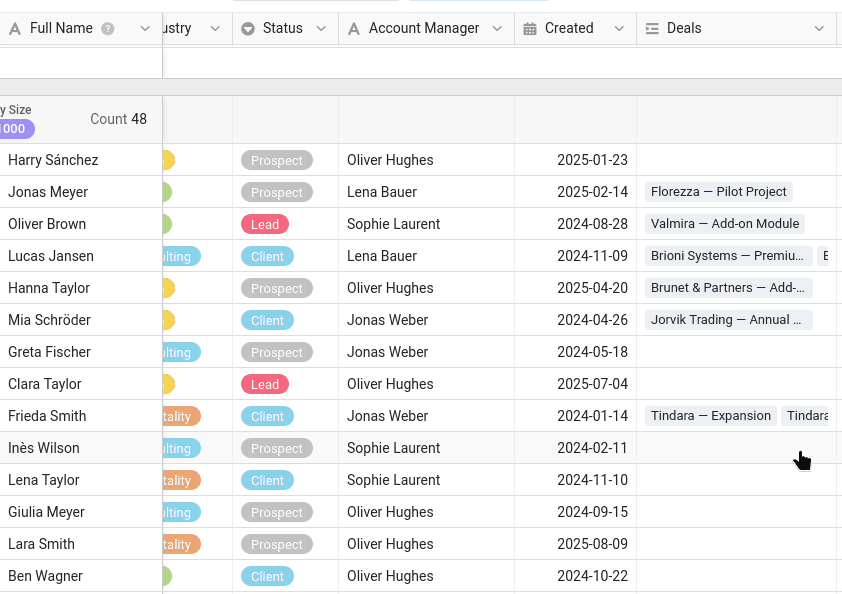
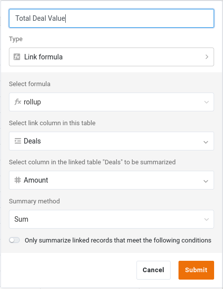

Чтобы работать с данными вместе, нужны сами данные! На протяжении всего курса вы работаете в отделе продаж и ведёте список клиентов компании. Поэтому начнём с того, с чего начинается любая совместная работа: с базы, в которой хранятся общие данные.

В курсе 1 вы научились создавать базу с нуля, а в курсе 2 импортировали готовую. Здесь мы поступим так же и сразу возьмём подготовленную базу: время, сэкономленное на вводе данных, лучше потратить на совместную работу.

На этом шаге вы работаете в одиночку. Ваша коллега Малика присоединится на следующем.

## Где хранить ваши данные?

SeaTable позволяет объединять базы в **группы** — общие пространства, которые могут соответствовать проекту или, как в нашем случае, отделу. Ваш отдел — отдел продаж, поэтому для начала создайте группу с названием `Commercial`.

Дело не только в порядке, и именно поэтому группа создаётся первой: на шаге 5 вы опубликуете общий набор данных, а это возможно только из базы, которая принадлежит группе, и никогда — из вашего личного пространства.



## Импорт базы

Скачайте следующий файл на свой компьютер и импортируйте его как новую базу **в группу `Commercial`**:

[SeaTable Course 3 - Sales CRM.dtable](/SeaTable-Course-3-Sales-CRM.dtable)

Затем добавьте в эту базу плагин онлайн-курсов. Сам курс вы по-прежнему проходите здесь, на сайте, а плагин сопровождает вас в базе: время от времени вы переключаетесь на него, чтобы применить изученное на практике, дать Малике сыграть свою роль и проверить свою работу. Если вы ещё ни разу им не пользовались, начните со встроенного вводного курса: это короткое знакомство с тем, как устроен курс, и два небольших упражнения, чтобы освоиться.

Строить базу самостоятельно не нужно, но всё же уделите время тому, чтобы хорошо с ней познакомиться. Курс возвращается к этим таблицам, столбцам и представлениям на каждом следующем шаге, а некоторые типы столбцов могут оказаться для вас новыми.

## Из чего состоит база

База называется `Sales CRM` — это система, с помощью которой отдел продаж ведёт своих клиентов и продажи. На первый взгляд она компактна:

- 2 связанные таблицы;
- около 350 контактов из 90 компаний и примерно 290 сделок;
- несколько представлений, к некоторым из которых вы откроете доступ.

Эта структура намеренно проще настоящей базы данных, но её достаточно, чтобы охватить все ситуации совместной работы, которые рассматриваются в курсе, — так мы можем сосредоточиться на главном. Разберём её по частям.

### Ваш основной список клиентов

Таблица `Customers` — сердце базы. Каждая строка — это один контакт в одной компании; его определяет первый столбец, `Full Name`. Рядом вы найдёте столбцы, которые обычно бывают в списке клиентов: компания, отрасль и размер, контактные данные, а также статус отношений `Status` (`Client`, `Prospect`, `Lead` или `Churned`), к которому мы ещё вернёмся. Отдельно стоит отметить столбец `Account Manager`: в нём указано, кто ведёт каждого клиента. Чтобы отразить разнообразие данных, встречающееся на практике, мы использовали обычный текстовый столбец, но в настоящей базе эти данные лучше хранить в столбце типа ` Сотрудник`, связанном с реальным пользователем SeaTable.

Таблица открывается в представлении ` Default View`, **сгруппированном по столбцу ` Company Size`**, поэтому контакты собраны под заголовками вроде `11–50`, `201–500` или `1000+`. Столбец с одиночным выбором естественно подходит для группировки — его фиксированный набор вариантов и становится группами, — а группировка превращает длинный плоский список в нечто, что можно с первого взгляда просмотреть по сегментам. Это становится ценным, как только список разрастается.





### Сделки каждого клиента

Клиент — это не только карточка контакта, но и сделки, которые вы с ним ведёте или уже завершили. Вторая таблица, `Deals`, содержит воронку продаж. Каждая строка — одна сделка:

- `Deal Name` и `Amount` — суть сделки и её сумма;
- `Stage` — на каком этапе она находится (`Qualification`, `Proposal`, `Negotiation`, `Won` или `Lost`);
- `Close Date` — когда сделка была выиграна или проиграна.



## Как две таблицы работают вместе

Список клиентов и список сделок раскрывают свои возможности, только когда они связаны. Эту работу выполняют три столбца, и в них стоит разобраться, прежде чем идти дальше.

### Связь между клиентами и сделками

В таблице `Customers` есть столбец ` Deals`, который связывает каждый контакт с его сделками в таблице `Deals`. Щёлкните ячейку этого столбца — и вы сможете увидеть, открыть и добавить сделки этого клиента, не покидая строку. На стороне `Deals` соответствующий столбец ` Customer` указывает в обратном направлении.

Это тот же столбец ссылок, который вы уже встречали в курсе 2, и именно он делает возможным следующий столбец.

### Сумма по всем сделкам клиента

Поскольку клиенты и сделки связаны, таблица `Customers` может автоматически подводить итоги по связанным сделкам. Столбец ` Total Deal Value` — это столбец типа **«Формула связи»**, который обобщает связанные сделки: для каждого клиента он складывает суммы (`Amount`) всех его сделок. Вы никогда ничего в него не вводите — он пересчитывается, как только меняется сделка или с клиентом связывается новая.

### Формула, взвешивающая воронку продаж

В таблице `Deals` столбец ` Weighted Value` — это столбец **формулы**, который умножает сумму каждой сделки на вероятность, зависящую от её этапа (`Stage`):

`switch({Stage}, "Qualification", 0.2, "Proposal", 0.4, "Negotiation", 0.6, "Won", 1, "Lost", 0) * {Amount}`

Так сделка на этапе переговоров весит больше, чем сделка, которая ещё только квалифицируется, и воронка выглядит реалистичнее, чем при простом подсчёте общей суммы.

` Total Deal Value` и ` Weighted Value` — именно такие цифры команда считает **конфиденциальными**: выручку и прогнозы не обязательно показывать каждому, кому нужен лишь номер телефона контакта. Запомните это: это станет важно, как только вы начнёте открывать доступ к базе.

## Два представления для двух аудиторий

В таблице `Customers` есть два представления, созданных для разных задач.

- ` All customers` показывает всё, включая конфиденциальный столбец `Total Deal Value`. Это внутреннее, полное представление для отдела продаж.
- ` Active customers` — облегчённое представление: оно показывает только текущих клиентов и скрывает конфиденциальные цифры. Именно эту версию можно без опасений показать другому отделу.
    - Фильтр: значение ` Status` не равно `Churned`
    - Скрытые столбцы: ` Created`, ` Deals`, ` Total Deal Value`

Представление в SeaTable — это лишь особый взгляд на одни и те же данные: строки хранятся в одном месте, а каждое представление решает, что показывать, скрывать, фильтровать и группировать. На этом различии строятся следующие шаги: вы открываете доступ к **представлению**, а не ко всем данным сразу, а позже опубликуете ` Active customers` для другого отдела в виде набора данных, который всегда остаётся актуальным.

Столбец `Created` в таблице `Customers` — обычный столбец типа `Дата`, поэтому для курса мы смогли заполнить его правдоподобными прошлыми датами. В своих базах, если нужно фиксировать, когда строка была создана или в последний раз изменена, лучше используйте типы столбцов `Время создания` и `Время последнего изменения`. SeaTable заполняет их автоматически, поэтому нельзя забыть их заполнить, ошибиться в дате или задним числом изменить момент правки.

Когда база станет для вас привычной, можно приглашать коллегу.

## Справочная статья с дополнительной информацией

- [Создать новую группу]()
- [Создание базы из файла DTABLE]()
- [Активация плагина в базе]()
- [Столбец ссылок]()
- [Столбец «Формула связи»]()
- [Основы формул SeaTable]()
- [Группировка, сортировка и фильтрация]()
