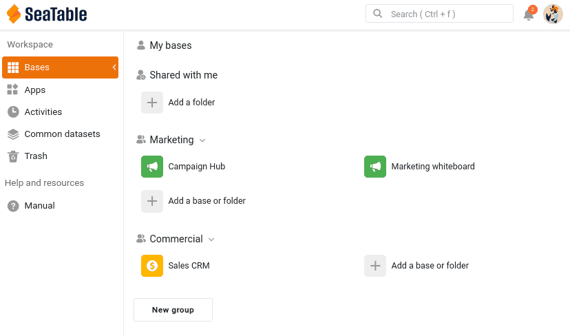

Ihre Base steckt voller wertvoller Daten. Zusammenarbeit beginnt in dem Moment, in dem jemand anderes damit arbeiten muss. In diesem Schritt holen Sie Ihre Kollegin Malika aus dem Marketing dazu und entscheiden ganz bewusst, wie viel sie in Ihrer Base sehen und ändern darf.

## Malika ins Team holen

Malika braucht einen eigenen Account in Ihrem Team. In SeaTable heißt das, ein Teammitglied hinzuzufügen: Ein Team-Administrator lädt die Person per E-Mail ein, und sobald sie die Einladung annimmt, kann man Bases für sie freigeben, sie mit @ erwähnen und sie zu Gruppen hinzufügen.

Laden Sie in Ihrer [Teamverwaltung](https://account.seatable.com) eine zweite E-Mail-Adresse ein – eine kostenlose Adresse bei einem beliebigen Anbieter genügt, um Ihre Kollegin zu spielen – und nehmen Sie die Einladung über diese Adresse an. Geben Sie dem Account beim Einrichten den Namen **Malika**. So stimmen die Namen, die Sie später in Kommentaren, Erwähnungen und im Log sehen, mit denen in diesem Kurs überein.

Eine letzte Sache, solange Sie mit ihrem Account angemeldet sind: Öffnen Sie ihre `Persönlichen Einstellungen` und kopieren Sie ihr Account-Token. Öffnen Sie dann das Online-Kurse-Plugin in Ihrer Base `Sales CRM`, wählen Sie **Schritt 2a** und fügen Sie das Token dort ein. Das Plugin prüft es und zeigt den zugehörigen Namen und Avatar an. So wissen Sie, dass Sie Malikas Token eingefügt haben und nicht Ihr eigenes. Von nun an zeigt Ihnen das Plugin, was Malika sieht, und handelt später in ihrem Namen – Sie müssen sich nicht noch einmal mit ihrem Account anmelden.



## Teammitglied sein heißt nicht Zugriff auf Bases haben

Sie haben Malika gerade zu Ihrem Team hinzugefügt. Es lohnt sich, genau zu wissen, was das bewirkt hat und was nicht. Als Teammitglied existiert Malika in Ihrem Team: Sie können Bases für sie freigeben, sie erwähnen und sie zu Gruppen hinzufügen. Zugriff auf Ihre Bases erhält sie dadurch aber **nicht**. Jede Base wird einzeln und bewusst freigegeben – nichts ist sichtbar, solange Sie es nicht freigeben.

Gehen Sie im Plugin weiter zu **Schritt 2b**: Dort sehen Sie Malikas Startseite so, wie sie sie gerade sieht – und von `Sales CRM` keine Spur. Das ändern wir jetzt.

## Ihre Base für eine Kollegin freigeben

Malika soll in Ihrer Base arbeiten, also geben Sie sie für sie frei. Da Malika zum Marketing gehört und Ihre Base zum Vertrieb, ist hier eine direkte **Freigabe für einen Benutzer** das richtige Werkzeug: Sie geben einer bestimmten Person Zugriff.

Öffnen Sie auf der Startseite von SeaTable das Menü der Base `Sales CRM` und wählen Sie `Freigeben`. Wählen Sie unter `Freigabe für Benutzer` Malika aus, stellen Sie die Berechtigung auf `Lesen und Schreiben` und bestätigen Sie.

Sie können diesen Dialog auch innerhalb der Base öffnen, über das Teilen-Icon  bei den Base-Optionen oben rechts.

Beachten Sie, dass Sie entweder den Benutzernamen oder die **vollständige E-Mail-Adresse** eingeben müssen, damit SeaTable die Person findet.

Sie können eine Base auch für eine ganze **Gruppe** freigeben, allerdings nur für eine Gruppe, in der Sie selbst Mitglied sind – und dann sehen alle Mitglieder die Base. Mit einer Gruppenfreigabe öffnen Sie die Base also dem Rest **Ihres eigenen** Vertriebsteams, nicht einer anderen Abteilung. Um einem anderen Team wie dem Marketing Daten bereitzustellen, ohne ihm Ihre ganze Base zu öffnen, verwenden Sie einen gemeinsamen Datensatz – genau darum geht es in Schritt 5.

Sehen Sie sich jetzt Malikas Seite an: Klicken Sie im Plugin auf `Aktualisieren`, so, als würde sie ihre Seite neu laden. Die **Glocke**  oben rechts auf ihrer Startseite zeigt eine neue Benachrichtigung. Öffnen Sie sie: Sie teilt ihr mit, dass Sie eine Base für sie freigegeben haben. Und `Sales CRM` erscheint jetzt in ihrem Bereich ` An mich freigegebene Bases`, zusammen mit dem Namen der Gruppe, zu der die Base gehört: `Commercial`. Welche Berechtigung sie hat, steht nicht auf ihrer Startseite, deshalb zeigt das Plugin es Ihnen an: `Lesen und Schreiben`. Malika arbeitet jetzt mit Ihnen in Ihrer Base.

{{< warning headline="Wo Benachrichtigungen erscheinen" text="Die Glocke oben rechts ist die Benachrichtigungszentrale. Sie können sie sowohl auf der Startseite als auch innerhalb einer Base öffnen. Wo eine Benachrichtigung erscheint, hängt von ihrem Inhalt ab. Ereignisse, die den ganzen Account betreffen, etwa eine für Sie freigegebene Base, stehen auf der Startseite unter Allgemein. Ereignisse innerhalb einer Base – Kommentare, Erwähnungen, Automationen – erscheinen in der Glocke dieser Base und außerdem in der Benachrichtigungszentrale der Startseite unter Bases. Deshalb hat Malika diese Freigabe unter Allgemein gefunden, während die Benachrichtigungen zu Kommentaren, die Sie ihr im nächsten Schritt schicken, sie in der Base erreichen." />}}

## Die passende Berechtigung wählen

Wenn Sie eine Base freigeben, treffen Sie eine wichtige Entscheidung. SeaTable bietet drei Arten, eine Base freizugeben, von der einfachsten bis zur genauesten.

| Berechtigung | Was die Kollegin oder der Kollege tun kann | Wann sie passt |
|---|---|---|
| Nur Lesen | Alle Tabellen, Ansichten und Werte sehen, aber keine Daten ändern. Kommentieren und erwähnt werden ist trotzdem möglich, die Person kann also mitdiskutieren – die Lesefreigabe sperrt die Daten, nicht das Gespräch. Außerdem kann sie eine eigene, private Kopie der Base anlegen, die mit Ihrer nicht verbunden ist. | Die Person soll die Daten nur einsehen, aber darüber mitreden können. |
| Lesen und Schreiben | Die gesamte Base sehen und bearbeiten. Die Base umbenennen, Plugins installieren oder sie weiter freigeben kann die Person nicht – das bleibt dem Eigentümer vorbehalten. | Die Person arbeitet gleichberechtigt an allen Daten mit. |
| Benutzerdefinierte Freigabe | Nur die Tabellen und Ansichten sehen und bearbeiten, die Sie auswählen, jeweils einzeln eingestellt auf Lesen und Schreiben, nur Lesen oder gar keinen Zugriff. | Die Person soll mit einem Teil der Base arbeiten, vom Rest aber ausgeschlossen bleiben. |

Für diesen Kurs haben Sie `Lesen und Schreiben` gewählt, damit Malika an den folgenden Schritten voll teilnehmen kann: kommentieren, bearbeiten und im Log auftauchen. Das heißt aber auch, dass sie Ihre Daten ändern und dabei sogar Fehler machen kann, wie Sie in Schritt 4 sehen werden. Lassen Sie diese Freigabe bestehen.



## Wenn jemand nur einen Teil der Base sehen soll

Mit der Lese- und Schreibfreigabe hat Malika die ganze Base bekommen – einschließlich der Tabelle `Deals` und der vertraulichen Zahlen in ` Total Deal Value` und ` Weighted Value`, auf die Sie in Schritt 1 gestoßen sind. Für eine enge Mitarbeiterin mag das in Ordnung sein. Aber Malika ist im Marketing, und die Vertriebsdaten gehen sie nichts an. Genau dafür gibt es die **benutzerdefinierte Freigabe**.

Mit einer benutzerdefinierten Freigabe legen Sie eine einzige Berechtigung an, die mehrere Tabellen und Ansichten mit jeweils eigener Stufe bündelt. Für Malika könnten Sie zum Beispiel:

- der Tabelle `Customers` Lese- und Schreibrechte geben, damit sie weiter mit der Kontaktliste arbeiten kann.
- der Tabelle `Deals` gar keinen Zugriff geben, sodass ihr die gesamten Vertriebsdaten verborgen bleiben.
- oder, noch feiner, nur die Ansicht ` Active customers` statt ` All customers` freigeben, sodass die in dieser Ansicht ausgeblendeten vertraulichen Spalten sie nie erreichen.

Das ist das passende Werkzeug für den Fall: „Arbeite mit diesen Kontakten, aber die Umsatzzahlen sind nicht für dich bestimmt.“

{{< warning headline="Die benutzerdefinierte Freigabe erfordert ein kostenpflichtiges Abonnement" text="Die benutzerdefinierte Freigabe einzelner Tabellen und Ansichten ist in den Abonnements Plus und Enterprise verfügbar, nicht im kostenlosen Abonnement. Dort geben Sie eine Base immer als Ganzes frei, entweder mit Lese- oder mit Lese- und Schreibrechten. Keine Sorge, wenn Sie diesen Teil nicht ausprobieren können: In Schritt 5 lernen Sie den gemeinsamen Datensatz kennen, der nur eine ausgewählte, unbedenkliche Ansicht an ein anderes Team weitergibt und in jedem Abonnement verfügbar ist. Für die meisten Freigaben zwischen Teams ist er ohnehin das bessere Werkzeug." />}}

Die benutzerdefinierte Freigabe ist nicht die einzige Möglichkeit, einzuschränken, was jemand sieht. Sie können auch eine einzelne Ansicht für sich allein freigeben – direkt für ein Teammitglied oder eine Gruppe oder als **externen Link** mit Lesezugriff für Personen, die gar keinen SeaTable-Account haben. Da eine Ansicht ihren eigenen Filter und ihre ausgeblendeten Spalten bereits mitbringt, gibt die Freigabe der Ansicht ` Active customers` genau diesen Ausschnitt weiter und nichts darüber hinaus. Wie die benutzerdefinierte Freigabe ist auch die Freigabe einer Ansicht den Abonnements Plus und Enterprise vorbehalten.

Ein anderer Weg kommt ganz ohne Freigabe der Base aus: Sie bauen eine **Universelle App** auf der Base auf. In einer App gestalten Sie Seiten verschiedener Typen, und Tabellenseiten können voreingestellte Filter, Sortierungen und ausgeblendete Spalten verwenden. Wer die App nutzt, sieht also immer nur den Ausschnitt, den Sie freigeben wollten, und nie die zugrunde liegende Base. Das eignet sich eher für einen größeren Kreis von Personen, die Daten nur nutzen, als für Mitarbeitende, die in Ihrem Team mitarbeiten – und es ist in jedem Abonnement verfügbar.

## Den Zugriff wieder entziehen

Eine Freigabe ist nicht endgültig. Um sie zu beenden, öffnen Sie den Freigeben-Dialog erneut und entfernen Malika.

Klicken Sie dann im Plugin noch einmal auf `Aktualisieren` (weiterhin bei **Schritt 2b**): `Sales CRM` ist aus ihrem Bereich `An mich freigegebene Bases` verschwunden, und das Plugin kann in dieser Base nicht mehr in ihrem Namen handeln – der Zugriff endet in dem Moment, in dem Sie ihn entziehen. Das ist das Sicherheitsnetz hinter jeder Freigabe: Zugriff ist etwas, das Sie gewähren und jederzeit wieder entziehen können.

Geben Sie die Base für den Rest des Kurses wieder mit `Lesen und Schreiben` für Malika frei. Sie braucht den Zugriff, um weiter mit Ihnen zu arbeiten – und das Plugin ebenso, denn es kann nur in einer Base in ihrem Namen handeln, auf die sie Zugriff hat.

Malika kann Ihre Daten jetzt sehen und bearbeiten. Doch wer stillschweigend Daten ändert, sorgt schnell für Verwirrung – als Nächstes lernen Sie deshalb, Rückfragen direkt an der betreffenden Zeile zu klären.

## Zur Vertiefung

Probieren Sie eine der Möglichkeiten aus, Malika nur einen Teil der Base zu zeigen, und prüfen Sie das Ergebnis aus ihrer Sicht. Dafür brauchen Sie ein zweites Fenster, in dem Sie mit ihrem Account angemeldet sind: Öffnen Sie in Ihrem Browser ein privates Fenster (Inkognito-Modus) und melden Sie sich dort mit ihrem Account an. Ein privates Fenster hält die beiden Sitzungen getrennt, sodass Sie in Ihrem gewohnten Fenster mit Ihrem eigenen Account angemeldet bleiben.

- **Mit einem Plus- oder Enterprise-Abonnement**: Legen Sie eine benutzerdefinierte Freigabe an, die Malika Zugriff auf die Tabelle `Customers` gibt, aber keinen auf `Deals`. Öffnen Sie in ihrem Fenster `Sales CRM` und überzeugen Sie sich, dass `Deals` vollständig verschwunden ist. Wechseln Sie danach wieder zu einer einfachen Lese- und Schreibfreigabe, damit Malika für die nächsten Schritte vollen Zugriff behält.
- **Mit jedem Abonnement, auch dem kostenlosen**: Bauen Sie auf `Sales CRM` eine Universelle App mit einer einzigen Tabellenseite für `Customers` und blenden Sie in den Seiteneinstellungen `Total Deal Value` und `Deals` aus. Fügen Sie Malika in der Benutzer- und Rollenverwaltung der App über `Benutzer importieren` hinzu und öffnen Sie die App dann in ihrem Fenster: Sie sieht die Kunden, aber nicht die Zahlen, die Sie weggelassen haben. Bedenken Sie, dass sie die Base selbst trotzdem öffnen kann, weil Sie sie mit Lese- und Schreibrechten für sie freigegeben haben!

## Hilfeartikel mit weiteren Informationen

- [Ein neues Teammitglied hinzufügen]()
- [Base- und Ansichtsfreigaben im Überblick]()
- [Tabellenberechtigungen setzen]()
- [Zugriff auf die Benachrichtigungen]()
- [Tabellenseiten in SeaTable Apps]()
- [Benutzer- und Rollenverwaltung einer App]()
