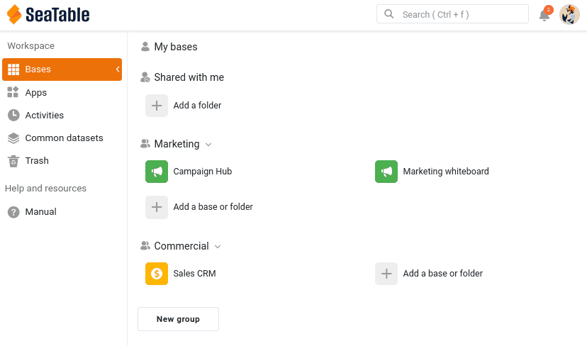

Su base está llena de datos valiosos. La colaboración empieza en cuanto otra persona necesita trabajar con ellos. En este paso entra en escena su compañera Malika, del departamento de marketing, y usted decide con conocimiento de causa qué puede ver y modificar ella en su base.

## Incorporar a Malika a su equipo

Malika necesita su propia cuenta en su equipo. En SeaTable, esto se llama añadir un miembro al equipo: un administrador del equipo invita a la persona por correo electrónico y, una vez aceptada la invitación, se pueden compartir bases con ella, mencionarla con @ y añadirla a grupos.

Desde la [administración del equipo](https://account.seatable.com), invite a una segunda dirección de correo electrónico (una dirección gratuita de cualquier proveedor basta para hacer de su compañera) y acepte la invitación desde esa dirección. Al configurar la cuenta, llámela **Malika**: así los nombres que verá después en los comentarios, las menciones y el registro de actividades coincidirán con los de este curso.

Una última cosa mientras tiene abierta la sesión con la cuenta de Malika: abra sus `Opciones personales` y copie el token de cuenta. Después abra el plugin de cursos en línea en su base `Sales CRM`, seleccione el **paso 2a** y pegue allí el token. El plugin lo comprueba y muestra el nombre y el avatar correspondientes: así sabe que ha pegado el token de Malika y no el suyo. A partir de ahora, el plugin le muestra lo que ve Malika y, más adelante, actúa en su nombre: no tendrá que volver a iniciar sesión con la cuenta de Malika.



## Ser miembro del equipo no da acceso a las bases

Acaba de añadir a Malika a su equipo. Conviene tener claro lo que eso cambia y lo que no. Ser miembro del equipo significa que Malika existe en su equipo: puede compartir bases con ella, mencionarla y añadirla a grupos. Pero eso **no** le da acceso a ninguna de sus bases. Cada base se comparte por separado y de forma deliberada, así que nada queda expuesto hasta que usted decida compartirlo.

Pase al **paso 2b** del plugin: muestra la página de inicio de Malika tal como ella la ve ahora mismo, y `Sales CRM` no aparece por ninguna parte. Vamos a cambiarlo.

## Compartir su base con una compañera

Malika tiene que trabajar en su base, así que va a compartirla con ella. Como Malika pertenece a marketing y su base al departamento comercial, la herramienta adecuada aquí es **compartir con un usuario**: da acceso a una persona concreta.

En la página de inicio de SeaTable, abra el menú de la base `Sales CRM` y elija `Compartir`. En `Compartir con usuario`, seleccione a Malika, ajuste el permiso a `Lectura-escritura` y confirme.

También puede abrir este cuadro de diálogo desde la propia base, con el icono de compartir  entre las opciones de la base, arriba a la derecha.

Tenga en cuenta que debe escribir el nombre de usuario o la **dirección de correo electrónico completa** para que el sistema encuentre a la persona.

También puede compartir una base con todo un **grupo**, pero solo con un grupo del que usted sea miembro, y entonces todos sus miembros ven la base. Por eso compartir con un grupo sirve para dar acceso al resto de **su propio** equipo comercial, no para llegar a otro departamento. Para hacer llegar datos a un equipo distinto, como marketing, sin abrirle toda su base, se utiliza un conjunto de datos común: es precisamente el tema del paso 5.

Mire ahora el lado de Malika: en el plugin, pulse `Actualizar`, como si ella recargara su página. La **campana de notificaciones** , arriba a la derecha de su página de inicio, muestra un aviso nuevo; ábralo: le indica que usted ha compartido una base con ella. Y `Sales CRM` aparece ahora en su sección ` Compartidas conmigo`, con el nombre del grupo al que pertenece, `Commercial`. Su página de inicio no dice qué puede hacer ella con la base, así que se lo indica el plugin: `Lectura-escritura`. Malika ya colabora en su base.

{{< warning headline="Dónde aparecen las notificaciones" text="La campana de arriba a la derecha es el centro de notificaciones, y puede abrirla tanto desde la página de inicio como desde una base. El lugar donde aparece una notificación depende de su asunto. Los eventos que afectan a la cuenta, como una base compartida con usted, figuran en General en la página de inicio. Los eventos que ocurren dentro de una base (comentarios, menciones, automatizaciones) aparecen en la campana de esa base, y también en Bases dentro del centro de notificaciones de la página de inicio. Por eso Malika ha encontrado este uso compartido en General, mientras que las notificaciones de comentarios que le enviará en el paso siguiente le llegarán dentro de la base." />}}

## Elegir el nivel de permiso adecuado

Al compartir una base hay que tomar una decisión importante. SeaTable ofrece tres formas de compartir una base, de la más sencilla a la más precisa.

| Permiso | Qué puede hacer el compañero | Cuándo utilizarlo |
|---|---|---|
| Solo lectura | Ver todas las tablas, vistas y valores, pero sin cambiar ningún dato. Aun así, puede añadir comentarios y ser mencionado, así que puede participar en la conversación: la solo lectura bloquea los datos, no la conversación. También puede hacerse su propia copia privada de la base, sin conexión con la suya. | El compañero solo necesita consultar los datos, pero puede comentarlos. |
| Lectura-escritura | Ver y modificar toda la base. No puede cambiar el nombre de la base, instalar plugins ni volver a compartirla: eso queda reservado al propietario. | El compañero trabaja con usted en igualdad de condiciones sobre todos los datos. |
| Uso compartido personalizado | Ver y modificar solo las tablas y vistas que usted elija, cada una con su propio ajuste: lectura y escritura, solo lectura o sin acceso. | El compañero debe trabajar con una parte de la base, pero quedar fuera del resto. |

Para este curso ha elegido `Lectura-escritura`, para que Malika pueda participar plenamente en los pasos siguientes: comentar, modificar y aparecer en el registro de actividades. Eso también significa que puede cambiar sus datos, e incluso equivocarse, como verá en el paso 4. Mantenga este uso compartido.



## Cuando un compañero solo debe ver una parte de la base

El permiso de lectura y escritura ha dado a Malika toda la base, incluidas la tabla `Deals` y las cifras confidenciales ` Total Deal Value` y ` Weighted Value` que señalamos en el paso 1. Para una colaboradora muy cercana puede estar bien. Pero Malika trabaja en marketing, y los datos comerciales no son asunto suyo. Para esto existe precisamente el **uso compartido personalizado**.

Con un uso compartido personalizado, crea un único permiso que agrupa varias tablas y vistas, cada una con su propio nivel. Para Malika podría, por ejemplo:

- dar acceso de lectura y escritura a la tabla `Customers`, para que pueda seguir trabajando con la lista de contactos.
- no dar ningún acceso a la tabla `Deals`, para dejar todos los datos comerciales fuera de su alcance.
- o, con más detalle, compartir solo la vista ` Active customers` en lugar de ` All customers`, para que las columnas confidenciales ocultas en esa vista nunca le lleguen.

Es la herramienta precisa para decir: «trabaja con estos contactos, pero las cifras de ventas no te corresponden».

{{< warning headline="El uso compartido personalizado requiere un plan de pago" text="El uso compartido personalizado de tablas y vistas concretas está disponible en los planes Plus y Enterprise, no en el plan gratuito. Con el plan gratuito, una base se comparte entera, en solo lectura o en lectura y escritura. Si no puede probar esta parte, no se preocupe: en el paso 5 conocerá el conjunto de datos común, que hace llegar a otro equipo solo una vista elegida y segura, y que está disponible en todos los planes. Para la mayoría de los usos compartidos entre equipos es, de todos modos, la mejor herramienta." />}}

El uso compartido personalizado no es la única forma de limitar lo que ve una persona. También puede compartir una vista por separado: directamente con un miembro del equipo o con un grupo, o como **enlace externo** de solo lectura para personas que no tienen cuenta de SeaTable. Como una vista ya lleva su propio filtro y sus columnas ocultas, compartir solo la vista ` Active customers` entrega exactamente esa parte y nada más. Al igual que el uso compartido personalizado, compartir una vista es una función de los planes Plus y Enterprise.

Otra vía evita por completo compartir la base: construir una **aplicación universal** sobre ella. En una aplicación se diseñan páginas de varios tipos, y las páginas de tabla pueden aplicar filtros, ordenaciones y columnas ocultas predefinidos, de modo que quienes usan la aplicación solo ven la parte que usted ha decidido mostrar, nunca la base que hay detrás. Esta solución conviene a un público más amplio que consulta datos, más que a colaboradores que trabajan dentro de su equipo, y está disponible en todos los planes.

## Retirar el acceso

Compartir no es para siempre. Para dejar de compartir, vuelva a abrir el cuadro de diálogo de uso compartido y quite a Malika.

Pulse de nuevo `Actualizar` en el plugin: `Sales CRM` ha desaparecido de la sección `Compartidas conmigo` de Malika, y el plugin ya no puede actuar en su nombre en esta base. El acceso desaparece en el momento en que usted lo retira. Esa es la red de seguridad del uso compartido: el acceso se concede y puede retirarse en cualquier momento.

Para el resto del curso, vuelva a compartir la base con Malika con permiso `Lectura-escritura`. Ella lo necesita para seguir trabajando con usted, y el plugin también, porque solo puede actuar en su nombre en una base a la que ella tiene acceso.

Malika ya puede ver y modificar sus datos. Pero modificar sin decir nada es la receta perfecta para la confusión: a continuación aprenderá a conversar sobre filas concretas, allí mismo donde están los datos.

## Para profundizar

Pruebe una de las formas de mostrar a Malika solo una parte de la base y compruebe el resultado desde su lado. Para ello necesita una segunda ventana con la sesión de Malika abierta: abra una ventana privada (de incógnito) en su navegador e inicie sesión en ella con la cuenta de Malika. Una ventana privada mantiene separadas las dos sesiones, así que usted sigue con su propia sesión en su ventana habitual.

- **Con un plan Plus o Enterprise**: cree un uso compartido personalizado que dé a Malika la tabla `Customers` pero ningún acceso a `Deals`. En su ventana, abra `Sales CRM` y compruebe que `Deals` ha desaparecido por completo. Después vuelva a un uso compartido simple de lectura y escritura, para que Malika conserve el acceso completo en los pasos siguientes.
- **Con cualquier plan, también el gratuito**: cree en `Sales CRM` una aplicación universal con una sola página de tabla sobre `Customers`, y oculte `Total Deal Value` y `Deals` en la configuración de la página. Añada a Malika a la aplicación desde su administración de usuarios y roles, y luego abra la aplicación en la ventana de Malika: ve los clientes, pero no las cifras que usted ha excluido. Tenga en cuenta que ella todavía puede abrir la propia base, ya que la ha compartido con ella con permiso de lectura y escritura; la aplicación muestra lo que obtendría si le diera la aplicación en lugar de la base.

## Artículo de ayuda con más información

- [Añadir un nuevo miembro del equipo]()
- [Compartición de bases y vistas]()
- [Establecer permisos de tabla]()
- [Acceso a las notificaciones]()
- [Páginas de tabla en aplicaciones de SeaTable]()
- [Administración de usuarios y roles de una aplicación]()
