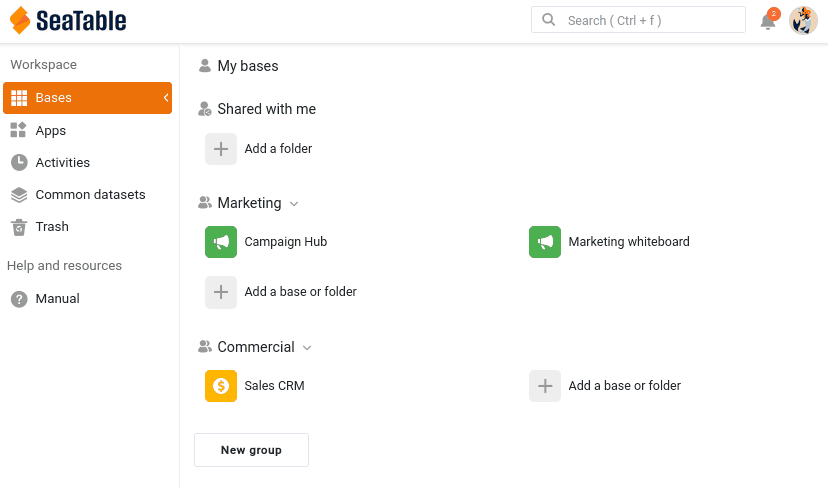

Votre base regorge de données précieuses. La collaboration commence dès que quelqu'un d'autre doit s'en servir. Durant cette étape votre collègue Malika, du service marketing, entre en scène, et vous décidez en connaissance de cause de ce qu'elle a le droit de voir et de modifier dans votre base.

## Faire entrer Malika dans votre équipe

Malika a besoin de son propre compte dans votre équipe. Dans SeaTable, on parle d'ajouter un membre à l'équipe : un administrateur d'équipe invite la personne par e-mail, et une fois l'invitation acceptée, on peut partager des bases avec elle, la mentionner avec @ et l'ajouter à des groupes.

Depuis votre [administration d'équipe](https://account.seatable.com), invitez une deuxième adresse e-mail (une adresse gratuite, chez n'importe quel fournisseur, suffit pour jouer le rôle de votre collègue) et acceptez l'invitation depuis cette adresse. En créant le compte, nommez-le **Malika** : le nom que vous verrez ensuite dans les commentaires, les mentions et le journal correspondra ainsi à celui du cours.

Une dernière chose tant que vous êtes connecté à son compte : ouvrez ses `Paramètres personnels` et copiez son jeton de compte. Ouvrez ensuite le plugin de cours en ligne dans votre base `Sales CRM`, choisissez l'**étape 2a** et collez-y le jeton. Le plugin vérifie sa validité et affiche le nom et l'avatar correspondant : vous savez ainsi que vous avez bien collé le jeton de Malika, et non le vôtre. Dès lors, le plugin vous montre ce que voit Malika, puis agit à sa place : vous n'aurez plus besoin de vous connecter à son compte.



## Faire partie de l'équipe ne donne pas accès aux bases

Vous venez d'ajouter Malika à votre équipe. Il est utile de bien voir ce que cela change, et ce que cela ne change pas. Être membre de l'équipe signifie que Malika existe dans votre équipe : vous pouvez partager des bases avec elle, la mentionner et l'ajouter à des groupes. Cela, en tant que tel, ne lui donne cependant accès à **aucune** de vos bases. Chaque base se partage séparément et volontairement : rien n'est exposé tant que vous n'avez pas décidé de le partager.

Passez à l'**étape 2b** du plugin : elle montre la page d'accueil de Malika telle qu'elle la voit en ce moment, et `Sales CRM` n'y figure nulle part. Changeons cela.

## Partager votre base avec une collègue

Malika doit travailler dans votre base : vous allez donc la partager avec elle. Comme Malika fait partie du marketing et que votre base appartient au commercial, l'outil adapté est ici un **partage avec un utilisateur** : vous donnez accès à une personne précise.

Sur la page d'accueil de SeaTable, ouvrez le menu de la base `Sales CRM` et choisissez `Partager`. Sous `Partager avec un utilisateur`, sélectionnez Malika, réglez l'autorisation sur `Lecture / écriture` et validez.

Vous pouvez aussi ouvrir cette boîte de dialogue depuis la base elle-même, avec l'icône de partage  parmi les options de la base, en haut à droite.

Notez qu'il faut saisir soit le nom d'utilisateur, soit l'**adresse e-mail complète** pour que SeaTable trouve la personne.

Vous pouvez aussi partager une base avec tout un **groupe**, mais uniquement un groupe dont vous êtes membre, et tous ses membres voient alors la base. Le partage avec un groupe sert donc à ouvrir l'accès au reste de **votre propre** équipe commerciale, pas à atteindre un autre service. Pour transmettre des données à une équipe distincte comme le marketing sans lui ouvrir toute votre base, on utilise un jeu de données commun : c'est tout le sujet de l'étape 5.

Regardez maintenant du côté de Malika : dans le plugin, cliquez sur `Actualiser`, comme si elle rechargeait sa page. La **cloche de notifications** , en haut à droite de sa page d'accueil, affiche une nouvelle alerte ; ouvrez-la : elle lui indique que vous avez partagé une base avec elle. Et `Sales CRM` apparaît désormais dans la section ` Bases partagées avec moi`, avec le nom du groupe auquel elle appartient, `Commercial`. La page d'accueil ne précise pas le niveau d'autorisation, mais le plugin vous l'indique : `Lecture / écriture`. Malika collabore désormais sur votre base.

{{< warning headline="Où apparaissent les notifications" text="La cloche en haut à droite est le centre de notifications, que vous pouvez ouvrir aussi bien depuis la page d'accueil que depuis une base. L'endroit où apparaît une notification dépend de son objet. Les événements relatifs au compte, comme une base partagée avec vous, sont visibles dans l'onglet Général sur la page d'accueil. Les événements qui se produisent dans une base (commentaires, mentions, automatisations) apparaissent dans l'éditeur de base, et aussi dans l'onglet Bases du centre de notifications de la page d'accueil. C'est pourquoi Malika a trouvé ce partage sous Général, et que les notifications de commentaires que vous enverrez à l'étape suivante lui parviendront dans la base." />}}

## Choisir le bon niveau d'autorisation

Partager une base implique une décision importante. SeaTable propose trois niveaux de partage d'une base, de la plus simple et restrictive à la plus détaillée.

| Autorisation | Ce que l'utilisateur peut faire | Quand l'utiliser |
|---|---|---|
| Lecture seule | Voir tous les tableaux, vues et valeurs, sans rien modifier. Il peut tout de même ajouter des commentaires et être mentionnée, et donc prendre part à la discussion : la lecture seule verrouille les données, pas la conversation. Il peut également faire sa propre copie privée de la base, sans lien avec la vôtre. | Votre collègue a seulement besoin de consulter les données, tout en pouvant en discuter. |
| Lecture / écriture | Voir et modifier toute la base. Il ne peut ni renommer la base, ni installer de plugins, ni la repartager : ces droits restent au propriétaire. | Votre collègue travaille pleinement avec vous sur l'ensemble des données. |
| Partage personnalisé | Voir et modifier uniquement les tableaux et les vues que vous choisissez, chacun réglé séparément en lecture et écriture, en lecture seule ou sans accès. | Votre collègue doit travailler sur une partie de la base, mais rester à l'écart du reste. |

Pour ce cours, nous avons choisi `Lecture / écriture`, pour que Malika puisse participer pleinement aux étapes suivantes : commenter, modifier, apparaître dans le journal. Cela signifie aussi qu'elle peut modifier vos données, et même se tromper, comme vous le verrez à l'étape 4. Laissez ce partage en place.



## Quand un collègue ne doit voir qu'une partie de la base

L'accès en lecture et écriture a donné accès à Malika à toute la base, y compris le tableau `Deals` et les chiffres confidentiels ` Total Deal Value` et ` Weighted Value` repérés à l'étape 1. Pour une proche collaboratrice, cela peut convenir. Mais Malika travaille au marketing, et les données commerciales ne la concernent pas. C'est exactement à cela que sert le **partage personnalisé**.

Avec un partage personnalisé, vous construisez une seule autorisation qui regroupe plusieurs tableaux et vues, chacun avec son propre niveau. Pour Malika, vous pourriez par exemple :

- lui donner un accès en lecture et écriture au tableau `Customers`, pour qu'elle puisse continuer à travailler avec la liste des contacts ;
- ne lui donner aucun accès au tableau `Deals`, pour garder tout ces données hors de sa portée ;
- ou, plus finement, ne partager que la vue ` Active customers` plutôt que ` All customers`, pour que les colonnes confidentielles masquées dans cette vue ne lui parviennent jamais.

C'est l'outil précis pour dire : « travaille avec ces contacts, mais les chiffres de vente ne te regardent pas ».

{{< warning headline="Le partage personnalisé demande un abonnement payant" text="Le partage personnalisé de tableaux et de vues est disponible avec les abonnements Plus et Enterprise, pas avec l'offre gratuite. Avec l'offre gratuite, vous partagez une base dans son ensemble, en lecture seule ou en lecture et écriture. Si vous ne pouvez pas essayer cette partie, pas d'inquiétude : à l'étape 5, vous découvrirez le jeu de données commun, qui transmet à une autre équipe une seule vue choisie et sans risque, et qui est disponible avec toutes les offres. Pour la plupart des partages entre équipes, c'est de toute façon le meilleur outil." />}}

Le partage personnalisé n'est pas le seul moyen de restreindre ce que voit une personne. Vous pouvez aussi partager une vue isolée : directement avec un membre de l'équipe ou un groupe, ou sous forme de **lien externe** en lecture seule pour des personnes qui n'ont pas de compte SeaTable. Comme une vue porte déjà son propre filtre et ses colonnes masquées, partager uniquement la vue ` Active customers` transmet exactement cette portion, et rien de plus. Comme le partage personnalisé, le partage d'une vue est réservé aux abonnements Plus et Enterprise.

Une autre voie permet d'éviter le partage complet de la base : construire une **application universelle** sur la base. Dans une application, vous concevez des pages de différents types, et les pages de tableau peuvent appliquer des filtres, des tris et des colonnes masquées prédéfinis : les utilisateurs de l'application ne voient que la portion que vous avez choisi d'exposer, jamais la base elle-même. Cette solution convient à un public plus large qui consulte les données, plutôt qu'à des collaborateurs qui travaillent au sein de votre équipe, et est disponible avec tous les plans.

## Retirer l'accès

Un partage n'est pas définitif. Pour y mettre fin, rouvrez la boîte de dialogue de partage et retirez Malika.

Cliquez ensuite de nouveau sur `Actualiser` dans le plugin (toujours à l'**étape 2b**) : `Sales CRM` a disparu de la section `Bases partagées avec moi` de Malika, et le plugin ne peut plus agir pour elle dans cette base. L'accès disparaît dès que vous le retirez. C'est le filet de sécurité du partage : un accès s'accorde, et peut se retirer à tout moment.

Pour la suite du cours, partagez de nouveau la base avec Malika en `Lecture / écriture`. Elle en a besoin pour continuer à travailler avec vous, et le plugin aussi, puisqu'il ne peut agir pour elle que dans une base à laquelle elle a accès.

Malika peut désormais voir et modifier vos données. Mais modifier sans rien dire est la meilleure façon de semer la confusion : vous allez maintenant apprendre à discuter de données précises, directement là où elles se trouvent.

## Pour aller plus loin

Essayez l'une des manières de ne montrer à Malika qu'une partie de la base, et vérifiez le résultat de son côté. Il vous faut pour cela une deuxième fenêtre connectée à son compte : ouvrez une fenêtre de navigation privée et connectez-vous dans celle-ci avec le compte de Malika. Une fenêtre privée crée une session à part, donc vous restez connecté à votre propre compte dans votre fenêtre habituelle.

- **Avec un abonnement Plus ou Enterprise** : créez un partage personnalisé qui donne accès à Malika au tableau `Customers`, mais aucun accès à `Deals`. Dans sa fenêtre, ouvrez `Sales CRM` et vérifiez que `Deals` a complètement disparu. Revenez ensuite à un simple partage en lecture et écriture, pour que Malika garde un accès complet pour les étapes suivantes.
- **Avec n'importe quelle offre, gratuite comprise** : créez sur `Sales CRM` une application universelle avec une seule page de tableau sur `Customers`, et masquez `Total Deal Value` et `Deals` dans les paramètres de la page. Ajoutez Malika à l'application depuis la gestion des utilisateurs et des rôles, puis ouvrez l'application dans sa fenêtre : elle voit les clients, mais pas les chiffres que vous avez exclus. Gardez à l'esprit qu'elle peut toujours ouvrir la base elle-même, puisque vous l'avez partagée avec elle en lecture et écriture !

## Article d'aide avec plus d'informations

- [Ajouter un nouveau membre à l'équipe]()
- [Vue d'ensemble des partages de base et de vues]()
- [Définir des permissions de tableau]()
- [Accéder aux notifications]()
- [Pages de tableau dans les applications de SeaTable]()
- [Gestion des utilisateurs et des rôles d'une application]()
