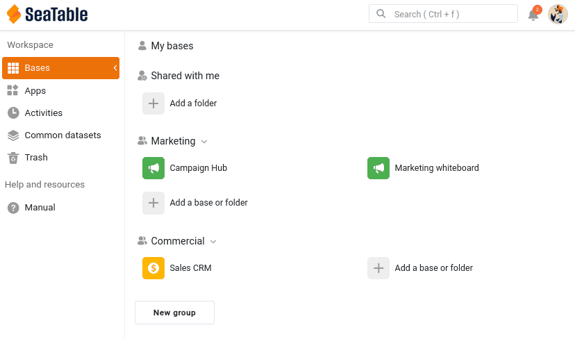

A sua base está cheia de dados valiosos. A colaboração começa no momento em que outra pessoa precisa de trabalhar com eles. Neste passo, a sua colega Malika, do departamento de marketing, entra em cena, e decide com conhecimento de causa o que ela pode ver e alterar na sua base.

## Trazer a Malika para a sua equipa

A Malika precisa de uma conta própria na sua equipa. No SeaTable, isto chama-se adicionar um membro à equipa: um administrador da equipa convida a pessoa por e-mail e, depois de ela aceitar o convite, é possível partilhar bases com ela, mencioná-la com @ e adicioná-la a grupos.

Na sua [administração da equipa](https://account.seatable.com), convide um segundo endereço de e-mail (um endereço gratuito de qualquer fornecedor chega para fazer de sua colega) e aceite o convite a partir desse endereço. Ao configurar a conta, dê-lhe o nome **Malika**: assim, os nomes que vai ver mais tarde nos comentários, nas menções e no registo de atividades correspondem aos do curso.

Uma última coisa enquanto tem a sessão iniciada na conta dela: abra as `Configurações pessoais` dela e copie o token de conta. Depois, abra o plugin de cursos online na sua base `Sales CRM`, escolha o **passo 2a** e cole aí o token. O plugin verifica-o e mostra o nome e o avatar correspondentes: fica assim a saber que colou o token da Malika, e não o seu. A partir daí, o plugin mostra-lhe o que a Malika vê e, mais tarde, age em nome dela: não vai precisar de voltar a iniciar sessão com a conta dela.



## Fazer parte da equipa não dá acesso às bases

Acabou de adicionar a Malika à sua equipa. Vale a pena perceber bem o que isso fez e o que não fez. Ser membro da equipa significa que a Malika existe na sua equipa: pode partilhar bases com ela, mencioná-la e adicioná-la a grupos. Mas isso **não** lhe dá acesso a nenhuma das suas bases. Cada base é partilhada separadamente e de forma intencional, por isso nada fica exposto enquanto não decidir partilhá-lo.

Passe para o **passo 2b** no plugin: mostra a página inicial da Malika tal como ela a vê neste momento, e `Sales CRM` não aparece em lado nenhum. Vamos mudar isso.

## Partilhar a sua base com uma colega

A Malika precisa de trabalhar na sua base, por isso vai partilhá-la com ela. Como a Malika é do marketing e a sua base pertence ao comercial, a ferramenta certa aqui é uma **partilha com um utilizador**: dá acesso a uma pessoa concreta.

Na página inicial do SeaTable, abra o menu da base `Sales CRM` e escolha `Partilhar`. Em `Partilhar com utilizador`, selecione a Malika, defina a permissão como `Ler escrever` e confirme.

Também pode abrir esta caixa de diálogo a partir da própria base, com o ícone de partilha  nas opções da base, no canto superior direito.

Tenha em atenção que tem de escrever o nome de utilizador ou o **endereço de e-mail completo** para que o SeaTable encontre a pessoa.

Também pode partilhar uma base com um **grupo** inteiro, mas apenas com um grupo de que seja membro, e todos os membros desse grupo passam a ver a base. A partilha com um grupo serve, portanto, para dar acesso ao resto da **sua própria** equipa comercial, e não para chegar a outro departamento. Para fazer chegar dados a uma equipa separada como o marketing sem lhe abrir toda a sua base, usa-se um conjunto de dados comum: é precisamente esse o tema do passo 5.

Veja agora o lado da Malika: no plugin, clique em `Atualizar`, como se ela recarregasse a página. O **sino de notificações** , no canto superior direito da página inicial dela, mostra um novo alerta; abra-o: informa-a de que partilhou uma base com ela. E `Sales CRM` aparece agora na secção ` Compartilhou comigo`, com o nome do grupo a que pertence, `Commercial`. A página inicial dela não diz o que ela pode fazer com a base, mas o plugin indica-lho: `Ler escrever`. A Malika colabora agora na sua base.

{{< warning headline="Onde aparecem as notificações" text="O sino no canto superior direito é o centro de notificações, que pode abrir tanto na página inicial como dentro de uma base. O sítio onde uma notificação aparece depende do assunto. Os acontecimentos relativos à conta, como uma base partilhada consigo, aparecem no separador Em geral da página inicial. Os acontecimentos que ocorrem dentro de uma base (comentários, menções, automações) aparecem no sino dessa base, e também no separador Bases do centro de notificações da página inicial. É por isso que a Malika encontrou esta partilha em Em geral, enquanto as notificações de comentários que vai enviar no próximo passo lhe chegam dentro da base." />}}

## Escolher o nível de permissão adequado

Partilhar uma base implica uma decisão importante. O SeaTable oferece três formas de partilhar uma base, da mais simples à mais precisa.

| Permissão | O que o colega pode fazer | Quando a usar |
|---|---|---|
| Apenas leitura | Ver todas as tabelas, vistas e valores, sem alterar nenhum dado. Pode, ainda assim, adicionar comentários e ser mencionado, e participar assim na discussão: a permissão de apenas leitura bloqueia os dados, não a conversa. Também pode fazer a sua própria cópia privada da base, sem ligação à sua. | O colega só precisa de consultar os dados, mas pode discuti-los. |
| Leitura e escrita | Ver e editar toda a base. Não pode mudar o nome da base, instalar plugins nem voltar a partilhá-la: esses direitos ficam com o proprietário. | O colega trabalha consigo, em pleno, sobre todos os dados. |
| Partilha personalizada | Ver e editar apenas as tabelas e vistas que escolher, cada uma definida individualmente como leitura e escrita, apenas leitura ou sem qualquer acesso. | O colega deve trabalhar com uma parte da base, mas ficar afastado do resto. |

Para este curso, escolheu `Ler escrever`, para que a Malika possa participar plenamente nos passos seguintes: comentar, editar e aparecer no registo de atividades. Isso também significa que ela pode alterar os seus dados, e até enganar-se, como vai ver no passo 4. Mantenha esta partilha.



## Quando um colega só deve ver uma parte da base

A permissão de leitura e escrita deu à Malika acesso a toda a base, incluindo a tabela `Deals` e os valores confidenciais ` Total Deal Value` e ` Weighted Value` que assinalou no passo 1. Para uma colaboradora próxima, isso pode ser aceitável. Mas a Malika é do marketing, e os dados comerciais não lhe dizem respeito. É exatamente para isso que serve a **partilha personalizada**.

Com uma partilha personalizada, cria uma única permissão que reúne várias tabelas e vistas, cada uma com o seu próprio nível. Para a Malika, poderia, por exemplo:

- dar acesso de leitura e escrita à tabela `Customers`, para que ela continue a poder trabalhar com a lista de contactos;
- não dar qualquer acesso à tabela `Deals`, mantendo todos os dados comerciais fora do alcance dela;
- ou, com mais precisão, partilhar apenas a vista ` Active customers` em vez de ` All customers`, para que as colunas confidenciais ocultas nessa vista nunca lhe cheguem.

É a ferramenta precisa para dizer: «trabalhe com estes contactos, mas os números das vendas não são para si».

{{< warning headline="A partilha personalizada exige um plano pago" text="A partilha personalizada de tabelas e vistas está disponível nos planos Plus e Enterprise, não no plano gratuito. No plano gratuito, partilha uma base como um todo, em apenas leitura ou em leitura e escrita. Não se preocupe se não puder experimentar esta parte: no passo 5 vai conhecer o conjunto de dados comum, que transmite a outra equipa apenas uma vista escolhida e segura, e que está disponível em todos os planos. Para a maioria das partilhas entre equipas, é de qualquer forma a melhor ferramenta." />}}

A partilha personalizada não é a única forma de restringir o que uma pessoa vê. Também pode partilhar uma vista isolada: diretamente com um membro da equipa ou um grupo, ou como **ligação externa** de apenas leitura para pessoas que nem sequer têm conta no SeaTable. Como uma vista já traz o seu próprio filtro e as suas colunas ocultas, partilhar apenas a vista ` Active customers` entrega exatamente essa parte, e nada mais. Tal como a partilha personalizada, a partilha de uma vista está reservada aos planos Plus e Enterprise.

Outra via evita de todo a partilha da base: construir uma **aplicação universal** sobre a base. Numa aplicação, concebe páginas de vários tipos, e as páginas de tabela podem aplicar filtros, ordenações e colunas ocultas predefinidos: quem usa a aplicação só vê a parte que escolheu mostrar, nunca a base propriamente dita. Esta solução serve um público mais vasto que consulta dados, mais do que colaboradores que trabalham dentro da sua equipa, e está disponível em todos os planos.

## Retirar o acesso

Uma partilha não é definitiva. Para lhe pôr fim, volte a abrir a caixa de diálogo de partilha e retire a Malika.

Depois, clique de novo em `Atualizar` no plugin: `Sales CRM` desapareceu da secção `Compartilhou comigo` da Malika, e o plugin já não pode agir em nome dela nesta base. O acesso desaparece no momento em que o retira. É esta a rede de segurança da partilha: um acesso concede-se e pode ser retirado a qualquer momento.

Para o resto do curso, volte a partilhar a base com a Malika com a permissão `Ler escrever`. Ela precisa dela para continuar a trabalhar consigo, e o plugin também, pois só pode agir em nome dela numa base a que ela tenha acesso.

A Malika pode agora ver e editar os seus dados. Mas editar em silêncio é meio caminho andado para a confusão: a seguir, vai aprender a discutir linhas concretas, diretamente onde os dados estão.

## Para ir mais longe

Experimente uma das formas de mostrar à Malika apenas uma parte da base, e confirme o resultado do lado dela. Para isso, precisa de uma segunda janela com a sessão dela iniciada: abra uma janela privada (anónima) no seu navegador e inicie aí sessão com a conta dela. Uma janela privada mantém as duas sessões separadas, por isso continua com a sua própria sessão iniciada na janela habitual.

- **Num plano Plus ou Enterprise**: crie uma partilha personalizada que dê à Malika a tabela `Customers`, mas nenhum acesso a `Deals`. Na janela dela, abra `Sales CRM` e confirme que `Deals` desapareceu por completo. No fim, volte a uma simples partilha de leitura e escrita, para que a Malika mantenha o acesso completo nos passos seguintes.
- **Em qualquer plano, incluindo o gratuito**: crie sobre `Sales CRM` uma aplicação universal com uma única página de tabela sobre `Customers`, e oculte `Total Deal Value` e `Deals` nas definições da página. Adicione a Malika à aplicação com `Importar utilizador`, na gestão de utilizadores e funções da aplicação, e depois abra a aplicação na janela dela: ela vê os clientes, mas não os valores que deixou de fora. Lembre-se de que ela continua a poder abrir a própria base, já que a partilhou com ela em leitura e escrita; a aplicação mostra o que ela teria se lhe desse a aplicação em vez da base.

## Artigo de ajuda com mais informações

- [Adicionar um novo membro da equipa]()
- [Partilhar bases e vistas]()
- [Definir permissões de tabela]()
- [Aceder às notificações]()
- [Páginas de tabela em aplicações de SeaTable]()
- [Gestão de utilizadores e funções de uma aplicação]()
