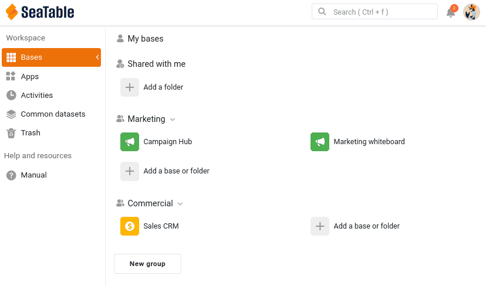

У вас есть база, полная ценных данных. Совместная работа начинается в тот момент, когда с ними нужно поработать кому-то ещё. На этом шаге вы приглашаете свою коллегу Малику из отдела маркетинга и осознанно решаете, что в вашей базе ей можно видеть и что — изменять.

## Малика входит в вашу команду

Малике нужна собственная учётная запись в вашей команде. В SeaTable это называется добавить члена команды: администратор команды приглашает человека по электронной почте, и как только тот принимает приглашение, ему можно открывать доступ к базам, упоминать его через @ и добавлять в группы.

В [администрировании команды](https://account.seatable.com) пригласите второй адрес электронной почты — чтобы сыграть роль коллеги, хватит бесплатного адреса у любого почтового сервиса — и примите приглашение с этого адреса. При настройке учётной записи назовите её **Malika**, чтобы имена, которые вы позже увидите в комментариях, упоминаниях и журнале активности, совпадали с теми, что показаны в курсе.

И последнее, пока вы вошли под её учётной записью: откройте её `Личные настройки` и скопируйте токен учётной записи. Затем откройте плагин онлайн-курсов в своей базе `Sales CRM`, выберите **шаг 2a** и вставьте туда токен. Плагин проверит его и покажет соответствующее имя и аватар — так вы убедитесь, что вставили токен Малики, а не свой. С этого момента плагин показывает вам, что видит Малика, а позже действует от её имени — входить под её учётной записью вам больше не придётся.



## Членство в команде — ещё не доступ к базе

Вы только что добавили Малику в свою команду. Стоит чётко понимать, что это дало, а что нет. Членство в команде означает, что Малика есть в вашей команде: вы можете открывать ей доступ к базам, упоминать её и добавлять в группы. Но доступа к вашим базам оно **не** даёт. Доступ к каждой базе открывается отдельно и осознанно, поэтому ничего не становится видно, пока вы сами этого не решите.

Перейдите в плагине к **шагу 2b**: он показывает главную страницу Малики такой, какой она видит её сейчас, — и `Sales CRM` там нигде нет. Давайте это изменим.

## Как открыть коллеге доступ к базе

Малике нужно работать в вашей базе, поэтому вы откроете ей доступ. Малика работает в маркетинге, а ваша база принадлежит отделу продаж, поэтому здесь подходит прямой **доступ для пользователя**: вы предоставляете доступ одному конкретному человеку.

На главной странице SeaTable откройте меню базы `Sales CRM` и выберите `Общий доступ`. В разделе `Поделиться с пользователем` выберите Малику, установите права `Чтение-Запись` и подтвердите.

Это окно можно открыть и изнутри базы — через значок общего доступа  среди параметров базы в правом верхнем углу.

Учтите, что для поиска пользователя нужно ввести либо имя пользователя, либо **полный адрес электронной почты**.

Можно также открыть доступ к базе целой **группе**, но только той, в которой вы сами состоите, — и тогда базу увидят все её участники. Поэтому общий доступ для группы — способ дать доступ остальным сотрудникам **вашего** отдела продаж, а не способ связаться с другим отделом. Чтобы передать данные отдельной команде, например отделу маркетинга, не открывая ей всю базу, используется общий набор данных — ему и посвящён шаг 5.

Теперь посмотрите на сторону Малики: нажмите в плагине `Обновить`, как будто она перезагрузила страницу. **Колокольчик уведомлений**  в правом верхнем углу её главной страницы показывает новое оповещение; откройте его — в нём сказано, что вы открыли ей доступ к базе. А `Sales CRM` теперь появилась в её разделе ` Поделился со мной` с пометкой группы, к которой база принадлежит, — `Commercial`. Главная страница не сообщает, что Малике разрешено делать с базой, поэтому это показывает плагин: `Чтение-Запись`. Теперь Малика работает в вашей базе вместе с вами.

{{< warning headline="Где появляются уведомления" text="Колокольчик в правом верхнем углу — это центр уведомлений, и открыть его можно как с главной страницы, так и изнутри базы. Где появится уведомление, зависит от того, к чему оно относится. События уровня учётной записи, например открытый вам доступ к базе, отображаются на главной странице на вкладке «Общие». События внутри базы — комментарии, упоминания, автоматизации — появляются в колокольчике самой базы, а также на вкладке «Базы» центра уведомлений на главной странице. Поэтому Малика нашла этот доступ на вкладке «Общие», а уведомления о комментариях, которые вы отправите на следующем шаге, дойдут до неё внутри базы." />}}

## Выбор уровня прав

Открывая доступ к базе, нужно принять важное решение. SeaTable предлагает три способа поделиться базой — от самого простого до самого точного.

| Права | Что может коллега | Когда использовать |
|---|---|---|
| Только для чтения | Видеть все таблицы, представления и значения, но не изменять данные. При этом он может добавлять комментарии и его можно упоминать, так что он участвует в обсуждении: режим «только для чтения» закрывает данные, а не разговор. Он также может сделать собственную копию базы, никак не связанную с вашей. | Коллеге нужно только просматривать данные, но обсуждать их он тоже может. |
| Чтение-Запись | Видеть и редактировать всю базу. Он не может переименовать базу, устанавливать плагины или открывать к ней доступ другим — это остаётся за владельцем. | Коллега — полноценный партнёр по работе со всеми данными. |
| Пользовательский общий доступ | Видеть и редактировать только выбранные вами таблицы и представления, для каждого из которых отдельно задаётся чтение и запись, только чтение или отсутствие доступа. | Коллега должен работать с частью базы, но не иметь доступа к остальному. |

В этом курсе вы выбрали `Чтение-Запись`, чтобы Малика могла полноценно участвовать в следующих шагах: комментировать, редактировать и появляться в журнале активности. Это также значит, что она может изменять ваши данные и даже ошибаться — как вы увидите на шаге 4. Оставьте этот доступ как есть.



## Когда коллега должен видеть только часть базы

Права на чтение и запись дали Малике доступ ко всей базе — включая таблицу `Deals` и конфиденциальные показатели ` Total Deal Value` и ` Weighted Value`, которые вы отметили на шаге 1. Для близкого партнёра по работе это может быть нормально. Но Малика работает в маркетинге, а воронка продаж её не касается. Именно для этого и нужен **пользовательский общий доступ**.

В нём вы создаёте одно разрешение, объединяющее несколько таблиц и представлений, каждое со своим уровнем прав. Для Малики вы могли бы, например:

- дать доступ на чтение и запись к таблице `Customers`, чтобы она по-прежнему могла работать со списком контактов;
- не давать никакого доступа к таблице `Deals`, чтобы вся воронка продаж оставалась вне её досягаемости;
- или, ещё точнее, открыть доступ только к представлению ` Active customers`, а не к ` All customers`, чтобы скрытые в нём конфиденциальные столбцы никогда до неё не дошли.

Это точный инструмент для ситуации «работай с этими контактами, но данные о выручке не для тебя».

{{< warning headline="Пользовательский общий доступ доступен только на платных тарифах" text="Пользовательский общий доступ к отдельным таблицам и представлениям есть в тарифах Plus и Enterprise, но не в бесплатном. На бесплатном тарифе доступ открывается ко всей базе целиком — только для чтения или для чтения и записи. Если вы не можете попробовать эту часть, не беспокойтесь: на шаге 5 вы познакомитесь с общим набором данных, который передаёт другому отделу только выбранное, безопасное представление и доступен на всех тарифах. Для большинства случаев обмена данными между отделами это в любом случае лучший инструмент." />}}

Пользовательский общий доступ — не единственный способ ограничить то, что видит человек. Можно также открыть доступ к отдельному представлению: напрямую члену команды или группе, либо в виде **внешней ссылки** только для чтения для тех, у кого вообще нет учётной записи SeaTable. Поскольку у представления уже есть свой фильтр и скрытые столбцы, доступ только к представлению ` Active customers` передаёт ровно эту часть данных и ничего больше. Как и пользовательский общий доступ, общий доступ к представлению есть только в тарифах Plus и Enterprise.

Есть и путь, при котором доступ к базе вообще не открывается: создать на основе базы **универсальное приложение**. В приложении вы проектируете страницы разных типов, а на страницах таблиц можно задать фильтры, сортировку и скрытые столбцы, так что пользователи приложения видят только ту часть данных, которую вы решили показать, — и никогда саму базу. Этот вариант подходит скорее для широкого круга потребителей данных, чем для коллег, работающих внутри вашей команды, и он доступен на всех тарифах.

## Как снова закрыть доступ

Общий доступ не навсегда. Чтобы закрыть его, снова откройте окно общего доступа и удалите Малику.

Затем снова нажмите в плагине `Обновить` (всё ещё на **шаге 2b**): `Sales CRM` исчезла из её раздела `Поделился со мной`, и плагин больше не может действовать от её имени в этой базе — доступ пропадает в тот же момент, когда вы его закрываете. В этом и состоит страховка общего доступа: вы его предоставляете и в любой момент можете отозвать.

Для дальнейшего прохождения курса снова откройте Малике доступ к базе с правами `Чтение-Запись`. Он нужен ей, чтобы и дальше работать вместе с вами, — и плагину тоже: он может действовать от её имени только в базе, к которой у неё есть доступ.

Теперь Малика может просматривать и редактировать ваши данные. Но молчаливое редактирование — верный путь к путанице, поэтому дальше вы узнаете, как обсуждать конкретные строки прямо там, где они находятся.

## Для углублённого изучения

Попробуйте один из способов показать Малике только часть базы и проверьте результат с её стороны. Для этого понадобится второе окно, в котором вы вошли под её учётной записью: откройте в браузере приватное окно (режим инкогнито) и войдите в нём под учётной записью Малики. Приватное окно разделяет два сеанса, поэтому в обычном окне вы остаётесь в своей учётной записи.

- **На тарифе Plus или Enterprise**: настройте пользовательский общий доступ, который даёт Малике таблицу `Customers`, но не даёт доступа к `Deals`. В её окне откройте `Sales CRM` и убедитесь, что таблица `Deals` полностью исчезла. После этого верните обычный доступ с правами на чтение и запись, чтобы на следующих шагах у Малики был полный доступ.
- **На любом тарифе, включая бесплатный**: создайте на основе `Sales CRM` универсальное приложение с единственной страницей таблицы `Customers` и скройте в настройках страницы столбцы `Total Deal Value` и `Deals`. Добавьте Малику в приложение в разделе управления пользователями и ролями, а затем откройте приложение в её окне: она видит клиентов, но не видит исключённых вами цифр. Помните, что саму базу она всё равно может открыть, ведь вы открыли ей доступ с правами на чтение и запись!

## Справочная статья с дополнительной информацией

- [Добавить нового члена команды]()
- [Общий доступ к базам и представлениям: обзор]()
- [Установка разрешений для таблиц]()
- [Доступ к уведомлениям]()
- [Страницы таблиц в приложениях SeaTable]()
- [Администрирование пользователей и ролей в приложении]()
