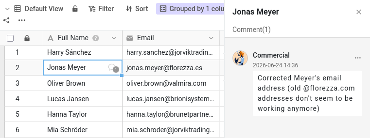

Malika kann Ihre Base jetzt lesen und bearbeiten. Doch Daten allein erzählen selten die ganze Geschichte. „Warum ist dieser Kunde immer noch ein Interessent?“ „Kannst du diese Telefonnummer noch einmal prüfen?“ Solche Rückfragen liefen bisher per E-Mail oder Chat, weit weg von den Daten, um die es geht – und eine Woche später findet sie niemand mehr. SeaTable hält die Diskussion genau dort fest, wo sie hingehört: an der Zeile selbst.

In diesem Schritt spielen Sie mit Malika einen vollständigen Ablauf der Zusammenarbeit durch: Sie bitten sie um etwas zu einem Eintrag, sie erfährt davon, erledigt es und sagt Ihnen Bescheid. Das Plugin zeigt Ihnen ihre Seite des Austauschs und handelt in ihrem Namen, wenn sie an der Reihe ist.

## Einen Eintrag kommentieren

Jede Zeile hat ihre eigene Konversation. Es gibt zwei Wege, ihre Kommentare zu öffnen:

- Klicken Sie mit der rechten Maustaste auf die Zeile und wählen Sie `Zeile kommentieren`, oder
- öffnen Sie die Zeilendetails (klicken Sie auf das Doppelpfeil-Symbol  an der Zeilennummer) und wechseln Sie zum Kommentarbereich (unter Umständen müssen Sie den Bereich für Kommentare und Logs erst über das Kommentar-Symbol  einblenden).

Rechts öffnet sich eine Kommentarspalte.

Öffnen Sie die Tabelle `Customers` und wählen Sie den Kunden `James Bennett` als Gesprächsthema. Schreiben Sie eine Nachricht – bitten Sie zum Beispiel eine Kollegin oder einen Kollegen, die Branche (`Industry`) von `James Bennett` zu bestätigen – und schicken Sie sie über das Senden-Symbol ab. In der ersten Spalte dieser Zeile erscheint nun ein kleines Sprechblasen-Icon: Wer die Tabelle überfliegt, sieht sofort, dass hier ein Gespräch läuft.

## Ein Kommentar erreicht nur die Konversation

Öffnen Sie das Plugin bei **Schritt 3a**: Es zeigt Malikas Fenster in dieser Base. Klicken Sie auf `Aktualisieren` und sehen Sie sich ihre Glocke an. Nichts. Ihr Kommentar steht an der Zeile und ist gut sichtbar, falls Malika sie zufällig öffnet – aber SeaTable hat ihr nicht mitgeteilt, dass es ihn gibt.

Das liegt daran, dass ein Kommentar nur die Personen benachrichtigt, die an der Konversation dieser Zeile teilnehmen. Wer einen Kommentar schreibt, gehört dazu – und bisher sind das nur Sie. Um eine Kollegin oder einen Kollegen einzubeziehen, müssen Sie die Person zur Konversation hinzufügen.

## Eine Kollegin zur Konversation hinzufügen

Schreiben Sie in der Base einen zweiten Kommentar zur selben Zeile und erwähnen Sie diesmal Malika direkt: Tippen Sie  gefolgt von ihrem Namen, `Malika`, und wählen Sie sie in der angezeigten Liste aus. Formulieren Sie eine echte Bitte – zum Beispiel, dass sie die Branche von `James Bennett` aktualisiert und Ihnen Bescheid gibt, wenn es erledigt ist. Schicken Sie den Kommentar ab.

Die Erwähnung macht nicht nur einmal auf sie aufmerksam: Sie fügt Malika der Konversation dieser Zeile hinzu. Das Plus-Symbol über dem Kommentarfeld bewirkt dasselbe, ohne dass Sie ihren Namen schreiben.



## Die andere Seite der Konversation

Klicken Sie im Plugin noch einmal auf `Aktualisieren`. Diesmal zeigt ihre Glocke eine neue Benachrichtigung, in der die Zeile Ihres Kommentars genannt ist. Weil diese Benachrichtigung aus der Base kommt, wartet sie dort auf Malika – und auf ihrer Startseite steht sie unter Bases, nicht unter Allgemein wie die Freigabe aus Schritt 2.

Schreiben Sie nun noch einen Kommentar zur Zeile, ohne sie zu erwähnen – etwa ein kurzes „Danke im Voraus“ – und aktualisieren Sie erneut. Sie wird wieder benachrichtigt. Malika gehört jetzt zur Konversation, also erreicht sie jeder neue Kommentar in dieser Zeile, ob er sie nennt oder nicht.

Jetzt ist Malika an der Reihe. Gehen Sie im Plugin weiter zu **Schritt 3b** und lassen Sie sie antworten. Da sie Lese- und Schreibrechte hat, ändert sie die Branche von `James Bennett` von `Manufacturing` auf `Technology` und antwortet dann in derselben Konversation, dass es erledigt ist. Wo sie schon einmal in der Base ist, aktualisiert sie auch ein paar andere Kunden, die sie betreut – diesen Änderungen begegnen Sie in Schritt 4. Ihre Antwort erwähnt Sie nicht, und trotzdem leuchtet Ihre eigene Glocke in der Base auf: Sie haben diese Konversation begonnen, also gehören auch Sie dazu. Die ganze Diskussion bleibt an den Eintrag gebunden – Frage, Änderung und Bestätigung an einem Ort.

{{< warning headline="Manche Daten beschreiben das Unternehmen, nicht den Kontakt" text="Die Branche beschreibt das Unternehmen, Indelo, und nicht James Bennett selbst – trotzdem steht sie in jeder Kundenzeile. Indelo hat in dieser Base noch einen weiteren Kontakt, Lena de Vries. Wenn Sie die Branche von Indelo in einer Zeile korrigieren, sollten Sie sie also auch in den anderen korrigieren. Ein schneller Filter auf die Spalte Company (Filterregel: Company ist Indelo) findet alle betroffenen Zeilen, bevor Sie sie bearbeiten. Sauberer wäre es, jedes Unternehmen nur einmal in einer eigenen Tabelle zu speichern und die Kunden damit zu verknüpfen, sodass die Angaben zu einem Unternehmen an einer einzigen Stelle liegen – leistungsfähiger, aber auch aufwendiger. Deshalb bleibt in diesem Kurs alles in einer Tabelle." />}}

## Den Vorgang abschließen

Ist eine Bitte erledigt, können Sie die Konversation löschen – oder, wenn Sie sie nachvollziehbar halten möchten, als erledigt markieren. Jeder, der Zugriff auf die Base hat, kann einen Kommentar als erledigt markieren. Öffnen Sie die Konversation zu `James Bennett` – über Ihre Glocke oder über die Zeile – und lesen Sie Malikas Antwort. Öffnen Sie dann das Menü Ihrer Bitte und markieren Sie sie als erledigt: Sie wird grün und zeigt so, dass die Sache geklärt ist. Die Konversation bleibt am Eintrag erhalten und dokumentiert, was besprochen wurde.

Sie haben gerade einen vollständigen Ablauf durchgespielt – fragen, benachrichtigen, handeln, bestätigen, abschließen –, ohne die Daten je zu verlassen.

{{< warning headline="Kommentare bleiben, wo sie geschrieben wurden" text="Kommentare sind an die Zeile gebunden, an der sie stehen. Sie werden nicht mitkopiert, wenn Sie eine Zeile duplizieren, sie gelangen nicht in eine Tabelle, die aus einem gemeinsamen Datensatz erstellt wurde, und sie werden weder in Snapshots noch in exportierten Dateien gespeichert. Außerdem gibt es in SeaTable weder einen eigenen Posteingang für offene Kommentare noch einen allgemeinen Chat: Die Konversation an der Zeile ist das Gespräch. Führen Sie Diskussionen also an dem Eintrag, um den es geht – dann sind sie auch Monate später noch verständlich." />}}

Sie können jetzt jeden Eintrag mit Kolleginnen und Kollegen besprechen und sicher sein, dass sie davon erfahren. Gespräche erklären aber Absichten – sie halten nicht von selbst fest, was sich in den Daten tatsächlich geändert hat. Dafür führt SeaTable eine vollständige Historie, um die es im nächsten Schritt geht.

## Zur Vertiefung

Prüfen Sie die Regel, dass Sie nur Mitarbeiter der Base hinzufügen können: Beginnen Sie einen Kommentar, tippen Sie `@` und sehen Sie nach, wer erscheint. Malika ist dabei, weil Sie die Base in Schritt 2 für sie freigegeben haben. Hat Ihr Team weitere Mitglieder, für die Sie diese Base **nicht** freigegeben haben, werden Sie feststellen, dass sie nicht erscheinen, auch wenn sie zu Ihrem Team gehören. So sehen Sie am schnellsten, warum die Freigabe zuerst kommen musste.

Sie können auch jemanden aus einer Konversation entfernen. Öffnen Sie das Plus-Symbol über dem Kommentarfeld bei `James Bennett` und entfernen Sie das Häkchen bei Malika. Schreiben Sie dann einen weiteren Kommentar und klicken Sie im Plugin bei Schritt 3a auf `Aktualisieren`: Diesmal erreicht sie nichts. Sie kann die Konversation weiterhin lesen, wenn sie die Zeile öffnet; sie wird nur nicht mehr über neue Kommentare benachrichtigt.

## Hilfeartikel mit weiteren Informationen

- [Zeilen kommentieren]()
- [Sinn und Zweck von Benachrichtigungen in SeaTable]()
