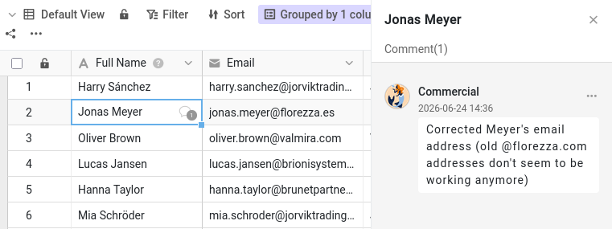

Malika ya puede consultar y modificar su base. Pero los datos por sí solos rara vez cuentan toda la historia. «¿Por qué este cliente sigue siendo un cliente potencial?» «¿Puedes comprobar este número de teléfono?» Estas conversaciones solían tener lugar por correo electrónico o por chat, lejos de los datos a los que se refieren, y una semana después nadie las encuentra. SeaTable mantiene la conversación justo donde corresponde: en la propia fila.

En este paso completa un ciclo de colaboración entero con Malika: usted le pide algo sobre una fila, ella se entera, se ocupa de ello y le dice que está hecho. El plugin le muestra el lado de Malika en este intercambio, y actúa en su nombre cuando le toca a ella.

## Comentar una fila

Cada fila tiene su propio hilo de comentarios. Hay dos formas de abrirlo:

- haga clic con el botón derecho en la fila y elija `Comentar fila`, o
- abra los detalles de la fila (haga clic en el icono de la doble flecha  sobre su número de fila) y pase al panel de comentarios (quizá tenga que mostrarlo con el icono de comentarios ).

Se abre una columna de comentarios a la derecha.

Abra la tabla `Customers` y elija al cliente `James Bennett` como tema de conversación. Escriba un mensaje, por ejemplo para pedir a un compañero que confirme el sector (`Industry`) de `James Bennett`, y envíelo con el icono de envío. En la primera columna de esa fila aparece ahora un pequeño icono de burbuja: cualquiera que recorra la tabla ve que hay una conversación en curso.

## Un comentario solo llega a quienes participan en la conversación

Abra el plugin en el **paso 3a**: muestra una representación simplificada de la cabecera de la base tal como la ve Malika. Pulse `Actualizar` y mire su campana de notificaciones. Nada. El comentario que acaba de escribir está en la fila, perfectamente visible si Malika la abre, pero SeaTable no le ha avisado de que existe.

Esto se debe a que un comentario solo notifica a las personas que participan en la conversación de esa fila. Al escribir un comentario, usted pasa a formar parte de ella, y por ahora es el único. Para que entre un compañero, tiene que añadirlo a la conversación.

## Añadir a una compañera a la conversación

De vuelta en la base, escriba un segundo comentario en la misma fila, y esta vez mencione directamente a Malika: escriba  seguido de su nombre, `Malika`, y elíjala en la lista que aparece. Formúlelo como una petición real, por ejemplo que actualice el sector (`Industry`) de `James Bennett` y le avise cuando esté hecho. Envíe el comentario.

Mencionarla no solo llama su atención una vez: la añade a la conversación de esta fila. El icono del signo más, encima del campo de comentario, hace lo mismo sin tener que escribir su nombre.



## El otro lado de la conversación

Pulse de nuevo `Actualizar` en el plugin. Esta vez su campana de notificaciones muestra un aviso nuevo, con el nombre de la fila en la que está su comentario. Como este aviso procede del interior de la base, la espera allí; y en su página de inicio aparece en Bases, no en General como el uso compartido del paso 2.

Escriba ahora otro comentario en la fila, sin mencionarla (un rápido «Gracias de antemano», por ejemplo), y actualice de nuevo. Vuelve a recibir un aviso. Malika ya forma parte de la conversación, así que cada nuevo comentario en esta fila le llega, la nombre o no.

Ahora le toca a Malika. Pase al **paso 3b** del plugin y deje que responda. Como tiene acceso de lectura y escritura, cambia el sector (`Industry`) de `James Bennett` de `Manufacturing` a `Technology` y luego responde en el mismo hilo que ya está hecho. Ya que está en la base, actualiza también algunos otros clientes de los que se ocupa: encontrará esos cambios en el paso 4. Su respuesta no le menciona a usted y, sin embargo, la campana de usted también se enciende, dentro de la base: usted inició esta conversación, así que también forma parte de ella. Toda la conversación queda unida a la fila: la pregunta, el cambio y la confirmación, en un mismo lugar.

{{< warning headline="Algunos datos describen a la empresa, no al contacto" text="El sector describe a la empresa, Indelo, y no a James Bennett en persona; sin embargo, figura en cada fila de cliente. Indelo tiene otro contacto en esta base, Lena de Vries, así que corregir el sector de Indelo en una fila implica corregirlo también en las demás. Un filtro rápido sobre la columna Company (regla de filtro: Company es Indelo) las encuentra todas antes de editar. Un diseño más limpio guardaría cada empresa una sola vez en su propia tabla, enlazada con los clientes, de modo que los datos de cada empresa estén en un único lugar: más potente, pero también más complejo, y por eso este curso lo mantiene todo en una sola tabla." />}}

## Cerrar el ciclo

Cuando una petición ya está atendida, puede eliminar la conversación o, si quiere conservar constancia de ella, marcarla como resuelta. Cualquier persona con acceso a la base puede marcar un comentario como resuelto. Abra el hilo de `James Bennett`, desde su campana o desde la fila, y lea la respuesta de Malika. Después abra el menú de su petición y elija marcarla como resuelta: se vuelve verde para indicar que el asunto está zanjado. El hilo permanece en la fila como registro de lo que se habló.

Acaba de completar un ciclo entero (pedir, avisar, actuar, confirmar, cerrar) sin salir nunca de los datos.

{{< warning headline="Los comentarios se quedan donde se escriben" text="Los comentarios están ligados a la fila en la que se encuentran. No se copian al duplicar una fila, no pasan a una tabla creada a partir de un conjunto de datos común y no se guardan ni en las instantáneas ni en los archivos exportados. Tampoco existe en SeaTable una bandeja de entrada de comentarios abiertos ni un chat general: el hilo de la fila es la conversación. Mantenga cada conversación en la fila a la que se refiere, y seguirá teniendo sentido meses después." />}}

Ya sabe conversar sobre cualquier fila con un compañero y tener la certeza de que se enterará. Pero las conversaciones explican intenciones: no registran por sí solas lo que realmente cambió en los datos. Para eso, SeaTable guarda un historial completo, que es el tema del paso siguiente.

## Para profundizar

Compruebe que solo se puede añadir a colaboradores: empiece un comentario, escriba `@` y mire quién aparece. Malika está ahí porque usted compartió la base con ella en el paso 2. Si su equipo tiene otros miembros con los que **no** ha compartido esta base, verá que no aparecen, por mucho que formen parte de su equipo. Es la forma más rápida de entender por qué compartir tenía que ir primero.

También puede sacar a alguien de una conversación. Abra el icono del signo más encima del campo de comentario de `James Bennett` y desmarque a Malika; después escriba otro comentario y pulse `Actualizar` en el paso 3a del plugin: esta vez no le llega nada. Malika puede seguir leyendo el hilo siempre que abra la fila; simplemente ya no recibe avisos de los nuevos comentarios.

## Artículo de ayuda con más información

- [Comentar las filas]()
- [Sentido y finalidad de las notificaciones en SeaTable]()
