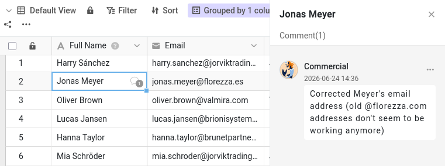

Malika peut désormais consulter et modifier votre base. Mais les données seules racontent rarement toute l'histoire. « Pourquoi ce client est-il encore un prospect ? » « Tu peux vérifier ce numéro de téléphone ? » Ces échanges se faisaient autrefois par e-mail ou par messagerie, loin des données qu'ils concernaient, et une semaine plus tard, plus personne ne les retrouvait. SeaTable garde la discussion exactement là où elle a sa place : sur la ligne elle-même.

Dans cette étape, vous menez un échange complet avec Malika : vous lui demandez quelque chose à propos d'un enregistrement, elle en est informée, elle s'en occupe et vous dit que c'est fait. Le plugin vous montre son côté de l'échange, et agit pour elle quand c'est son tour.

## Commenter un enregistrement

Chaque ligne a son propre fil de commentaires. Il y a deux façons de l'ouvrir :

- faites un clic droit sur la ligne et choisissez `Commenter la ligne` ;
- ou ouvrez les détails de la ligne (cliquez sur l'icône à double flèche  sur son numéro de ligne) et passez au panneau des commentaires (il faudra peut-être l'afficher avec l'icône de commentaire ).

Une colonne de commentaires s'ouvre à droite.

Ouvrez le tableau `Customers` et choisissez le client `James Bennett` comme sujet de discussion. Écrivez un message, par exemple pour demander à une collègue de confirmer l'`Industry` de `James Bennett`, et cliquez sur `Soumettre`. Une petite icône de bulle apparaît alors dans la première colonne de la ligne : en parcourant le tableau, chacun voit qu'une conversation est en cours.

## Un commentaire n'atteint que les participants de la conversation

Ouvrez le plugin à l'**étape 3a** : il montre la fenêtre de Malika dans cette base. Cliquez sur `Actualiser` et regardez sa cloche de notifications. Rien. Le commentaire que vous venez d'écrire est bien sur la ligne, parfaitement visible si Malika l'ouvre, mais SeaTable ne lui a pas signalé son existence.

C'est qu'un commentaire ne prévient que les personnes qui participent à la conversation de la ligne. En écrivant un commentaire, vous en faites partie, et pour l'instant, personne d'autre n'y participe. Pour y faire entrer une collègue, il faut l'ajouter à la conversation.

## Ajouter une collègue à la conversation

De retour dans la base, écrivez un deuxième commentaire sur la même ligne, et cette fois mentionnez directement Malika : tapez  suivi de son nom, `Malika`, puis choisissez-la dans la liste qui s'affiche. Formulez une vraie demande, par exemple qu'elle mette à jour l'`Industry` de `James Bennett` et vous prévienne quand c'est fait. Envoyez le commentaire.

La mention ne se contente pas d'attirer son attention une fois : elle l'ajoute à la conversation de cette ligne. L'icône « plus », au-dessus du champ de commentaire, fait la même chose sans avoir à écrire son nom.



## L'autre côté de la conversation

Cliquez de nouveau sur `Actualiser` dans le plugin. Cette fois, sa cloche affiche une nouvelle alerte qui nomme la ligne de votre commentaire. Comme celle-ci vient de l'intérieur de la base, c'est là qu'elle l'attend ; et sur sa page d'accueil, elle est rangée sous Bases, et non sous Général avec le partage de l'étape 2.

Écrivez maintenant un commentaire de plus sur la ligne, sans la mentionner (un rapide « Merci d'avance », par exemple), et actualisez de nouveau. Elle est encore prévenue. Malika fait désormais partie de la conversation : chaque nouveau commentaire sur cette ligne lui parvient, qu'il la nomme ou non.

C'est maintenant au tour de Malika. Passez à l'**étape 3b** du plugin et laissez-la répondre. Comme elle a un accès en lecture et écriture, elle remplace l'`Industry` de `James Bennett`, `Manufacturing`, par `Technology`, puis répond dans le même fil que c'est fait. Tant qu'elle est dans la base, elle met aussi à jour quelques autres clients dont elle s'occupe : vous retrouverez ces modifications à l'étape 4. Sa réponse ne vous mentionne pas, et pourtant votre propre cloche s'allume, dans la base : c'est vous qui avez lancé cette conversation, vous en faites donc partie vous aussi. Toute la discussion reste attachée à l'enregistrement : la question, la modification et la confirmation, au même endroit.

{{< warning headline="Certaines données décrivent l'entreprise, pas le contact" text="Le secteur (Industry) décrit l'entreprise, Indelo, et non James Bennett lui-même ; il figure pourtant sur chaque ligne client. Indelo a un autre contact dans cette base, Lena de Vries : corriger le secteur d'Indelo sur une ligne implique de le corriger aussi sur les autres. Un filtre rapide sur la colonne Company (règle de filtre : Company est Indelo) les retrouve toutes avant de modifier. Une meilleure conception stockerait chaque entreprise une seule fois dans son propre tableau, relié aux clients, pour que ses informations se trouvent à un seul endroit : c'est plus puissant, mais plus complexe, c'est pourquoi ce cours garde tout dans un seul tableau." />}}

## Boucler la boucle

Une fois la demande traitée, vous pouvez supprimer la conversation, ou, si vous voulez en garder une trace, la marquer comme résolue. Toute personne ayant accès à la base peut marquer un commentaire comme résolu. Ouvrez le fil de `James Bennett`, depuis votre cloche ou depuis la ligne, et lisez la réponse de Malika. Ouvrez ensuite le menu de votre demande et choisissez de la marquer comme résolue : elle passe au vert pour montrer que la question est réglée. Le fil reste sur l'enregistrement, comme historique de ce qui a été discuté.

Vous venez de boucler un échange complet (demander, prévenir, agir, confirmer, clore) sans jamais quitter les données.

{{< warning headline="Les commentaires restent là où ils ont été écrits" text="Les commentaires sont liés à la ligne sur laquelle ils se trouvent. Ils ne sont pas copiés quand vous dupliquez une ligne, ils ne suivent pas dans un tableau créé à partir d'un jeu de données commun, et ils ne sont enregistrés ni dans les snapshots ni dans les fichiers exportés. Il n'existe pas non plus de boîte de réception des commentaires ouverts ni de messagerie générale dans SeaTable : le fil de la ligne est la conversation. Gardez les discussions sur l'enregistrement qu'elles concernent : elles auront encore du sens des mois plus tard." />}}

Vous savez maintenant discuter de n'importe quel enregistrement avec une collègue, avec la certitude qu'elle en est informée. Mais les conversations expliquent des intentions : elles n'enregistrent pas, à elles seules, ce qui a réellement changé dans les données. Pour cela, SeaTable tient un historique complet, qui fait l'objet de l'étape suivante.

## Pour aller plus loin

Vérifiez que seuls les collaborateurs peuvent être ajoutés : commencez un commentaire, tapez `@` et regardez qui apparaît. Malika y figure parce que vous avez partagé la base avec elle à l'étape 2. Si votre équipe compte d'autres membres avec qui vous n'avez **pas** partagé cette base, vous constaterez qu'ils n'apparaissent pas, même s'ils font bien partie de votre équipe. C'est le moyen le plus rapide de comprendre pourquoi le partage devait venir en premier.

Vous pouvez aussi retirer quelqu'un d'une conversation. Ouvrez l'icône plus au-dessus du champ de commentaire de `James Bennett` et décochez Malika, puis écrivez un nouveau commentaire et cliquez sur `Actualiser` à l'étape 3a du plugin : cette fois, rien ne lui parvient. Elle peut toujours lire le fil quand elle ouvre la ligne ; simplement, elle n'est plus prévenue des nouveaux commentaires.

## Article d'aide avec plus d'informations

- [Commenter des lignes]()
- [Sens et utilité des notifications dans SeaTable]()
