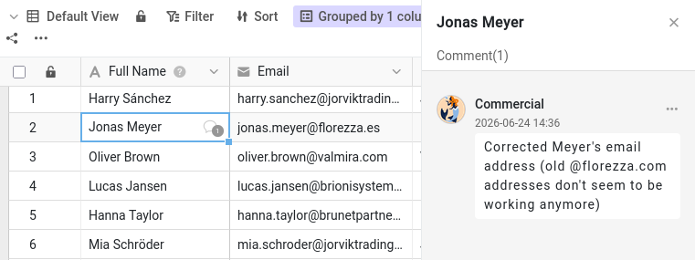

A Malika pode agora consultar e editar a sua base. Mas os dados, por si só, raramente contam a história toda. «Porque é que este cliente ainda é um potencial cliente?» «Pode confirmar este número de telefone?» Estas conversas costumavam acontecer por e-mail ou por chat, longe dos dados a que dizem respeito, e uma semana depois já ninguém as encontra. O SeaTable mantém a discussão exatamente onde ela faz sentido: na própria linha.

Neste passo, faz um ciclo completo de colaboração com a Malika: pede-lhe algo sobre uma linha, ela é avisada, trata do assunto e diz-lhe que está feito. O plugin mostra-lhe o lado dela da conversa, e age em nome dela quando chega a sua vez.

## Comentar uma linha

Cada linha tem a sua própria conversa de comentários. Há duas formas de abrir os comentários:

- clique com o botão direito na linha e escolha `Comentário fila`;
- ou abra os detalhes da linha (clique no ícone de seta dupla  no número da linha) e passe para o painel de comentários (pode ser preciso mostrar o painel de comentários e registos com o ícone de comentário ).

Abre-se uma coluna de comentários à direita.

Abra a tabela `Customers` e escolha o cliente `James Bennett` como assunto. Escreva uma mensagem, por exemplo a pedir a um colega que confirme o setor de atividade (`Industry`) de `James Bennett`, e envie-a com o ícone de envio. Aparece então um pequeno ícone de balão na primeira coluna dessa linha: quem percorrer a tabela vê que há uma conversa em curso.

## Um comentário só chega a quem participa na conversa

Abra o plugin no **passo 3a**: mostra uma representação simplificada do cabeçalho da base tal como a Malika o vê. Clique em `Atualizar` e olhe para o sino de notificações dela. Nada. O comentário que acabou de escrever está na linha, perfeitamente visível se a Malika a abrir, mas o SeaTable não a avisou de que ele existe.

Isto acontece porque um comentário só notifica as pessoas que participam na conversa dessa linha. Ao escrever um comentário, passa a ser uma delas e, por agora, é a única. Para trazer um colega para a conversa, tem de o adicionar.

## Adicionar uma colega à conversa

De volta à base, escreva um segundo comentário na mesma linha e, desta vez, mencione diretamente a Malika: escreva  seguido do nome dela, `Malika`, e escolha-a na lista que aparece. Formule-o como um pedido a sério: por exemplo, peça-lhe que atualize o valor `Industry` de `James Bennett` e que o avise quando estiver feito. Envie o comentário.

A menção não serve só para chamar a atenção dela uma vez: adiciona-a à conversa desta linha. O ícone de mais por cima do campo de comentário faz o mesmo, sem ser preciso escrever o nome dela.



## O outro lado da conversa

Clique de novo em `Atualizar` no plugin. Desta vez, o sino dela mostra um novo alerta, com o nome da linha em que está o seu comentário. Como este vem de dentro da base, é aí que fica à espera dela; na página inicial dela, aparece no separador Bases, e não em Em geral, como a partilha do passo 2.

Escreva agora mais um comentário na linha, sem a mencionar (um rápido «Obrigado desde já», por exemplo), e volte a atualizar. Ela é avisada de novo. A Malika faz agora parte da conversa, por isso cada novo comentário nesta linha chega até ela, quer a mencione quer não.

Agora é a vez da Malika. Passe para o **passo 3b** no plugin e deixe-a responder. Como tem acesso de leitura e escrita, ela muda o valor `Industry` de `James Bennett` de `Manufacturing` para `Technology` e depois responde na mesma conversa a dizer que está feito. Já que está na base, atualiza também alguns outros clientes de que trata: vai encontrar essas alterações no passo 4. A resposta dela não o menciona e, mesmo assim, o seu próprio sino acende-se, dentro da base: foi quem iniciou esta conversa, por isso também faz parte dela. Toda a discussão fica associada à linha: a pergunta, a alteração e a confirmação, tudo no mesmo sítio.

{{< warning headline="Alguns dados descrevem a empresa, não o contacto" text="O setor de atividade descreve a empresa, Indelo, e não o próprio James Bennett; no entanto, está em cada linha de cliente. A Indelo tem outro contacto nesta base, Lena de Vries, por isso corrigir o setor da Indelo numa linha obriga a corrigi-lo também nas outras. Um filtro rápido na coluna Company (regra de filtro: Company é Indelo) encontra-as todas antes de editar. Uma conceção mais limpa guardaria cada empresa uma única vez, numa tabela própria ligada aos clientes, para que os dados de cada empresa ficassem num único sítio: mais poderosa, mas também mais complexa, e é por isso que este curso mantém tudo numa só tabela." />}}

## Fechar o ciclo

Depois de um pedido estar tratado, pode eliminar a conversa ou, se quiser guardar um registo, marcá-la como resolvida. Qualquer pessoa com acesso à base pode marcar um comentário como resolvido. Abra a conversa de `James Bennett`, a partir do seu sino ou da linha, e leia a resposta da Malika. Depois, abra o menu do seu pedido e escolha marcá-lo como resolvido: fica verde, para mostrar que o assunto está arrumado. A conversa continua na linha, como histórico do que foi discutido.

Acabou de completar um ciclo inteiro (pedir, avisar, agir, confirmar, resolver) sem nunca sair dos dados.

{{< warning headline="Os comentários ficam onde foram escritos" text="Os comentários estão associados à linha onde se encontram. Não são copiados quando duplica uma linha, não passam para uma tabela criada a partir de um conjunto de dados comum e não ficam guardados nos instantâneos nem nos ficheiros exportados. Também não existe no SeaTable uma caixa de entrada de comentários por resolver, nem um chat geral: a conversa de uma linha é a conversa. Mantenha as discussões na linha a que dizem respeito, e continuarão a fazer sentido daqui a meses." />}}

Já sabe discutir qualquer linha com um colega e ter a certeza de que ele é avisado. Mas as conversas explicam intenções: por si só, não registam o que mudou realmente nos dados. Para isso, o SeaTable mantém um histórico completo, que é o tema do próximo passo.

## Para ir mais longe

Teste a regra de que só pode adicionar colaboradores: comece um comentário, escreva `@` e veja quem aparece. A Malika está lá porque partilhou a base com ela no passo 2. Se a sua equipa tiver outros membros com quem **não** partilhou esta base, vai ver que eles não aparecem, por muito que façam parte da sua equipa. É a forma mais rápida de perceber porque é que a partilha tinha de vir primeiro.

Também pode retirar alguém de uma conversa. Abra o ícone de mais por cima do campo de comentário de `James Bennett` e desmarque a Malika; depois, escreva outro comentário e clique em `Atualizar` no passo 3a do plugin: desta vez, nada lhe chega. Ela continua a poder ler a conversa sempre que abrir a linha; simplesmente, deixa de ser avisada dos novos comentários.

## Artigo de ajuda com mais informações

- [Comentar as filas]()
- [Senso e objectivo das notificações em SeaTable]()
