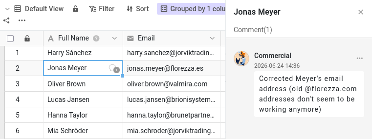

Теперь Малика может просматривать и редактировать вашу базу. Но сами по себе данные редко рассказывают всю историю. «Почему этот клиент до сих пор только потенциальный?» «Можешь перепроверить этот номер телефона?» Обычно такие разговоры ведутся по почте или в мессенджере, вдали от данных, о которых идёт речь, — и через неделю их уже никто не найдёт. SeaTable хранит обсуждение именно там, где ему место: в самой строке.

На этом шаге вы проходите с Маликой полный цикл совместной работы: просите её о чём-то по поводу конкретной записи, она узнаёт об этом, выполняет просьбу и сообщает, что всё готово. Плагин показывает вам её сторону разговора и действует за неё, когда наступает её очередь.

## Комментарий к записи

У каждой строки своя ветка комментариев. Открыть комментарии можно двумя способами:

- щёлкните строку правой кнопкой мыши и выберите `Панель комментариев`;
- или откройте сведения о строке (нажмите значок с двойной стрелкой  у номера строки) и перейдите на панель комментариев (возможно, её сначала придётся включить значком комментария ).

Справа откроется панель комментариев.

Откройте таблицу `Customers` и выберите для обсуждения клиента `James Bennett`. Напишите сообщение — например, попросите коллегу подтвердить отрасль (`Industry`) клиента `James Bennett` — и отправьте его значком отправки. В первом столбце этой строки появился маленький значок облачка: любой, кто просматривает таблицу, видит, что здесь идёт обсуждение.

## Комментарий доходит только до участников обсуждения

Откройте в плагине **шаг 3a**: он показывает упрощённое представление шапки базы такой, какой её видит Малика. Нажмите `Обновить` и посмотрите на её колокольчик уведомлений. Ничего. Комментарий, который вы только что написали, находится в строке и прекрасно виден, если Малика её откроет, но SeaTable не сообщил ей о нём.

Дело в том, что комментарий уведомляет только участников обсуждения в этой строке. Написав комментарий, вы становитесь одним из них — и пока вы единственный. Чтобы подключить коллегу, нужно добавить его в обсуждение.

## Добавляем коллегу в обсуждение

Вернитесь в базу, напишите в той же строке второй комментарий и на этот раз упомяните Малику напрямую: введите , затем её имя, `Malika`, и выберите её в появившемся списке. Сформулируйте настоящую просьбу — например, обновить значение `Industry` у `James Bennett` и сообщить вам, когда будет готово. Отправьте комментарий.

Упоминание не просто однажды привлекает её внимание: оно добавляет её в обсуждение этой строки. Значок «плюс» над полем комментария делает то же самое, без указания её имени.



## Другая сторона разговора

Снова нажмите `Обновить` в плагине. На этот раз её колокольчик показывает новое оповещение с названием строки, к которой относится ваш комментарий. Поскольку оно пришло изнутри базы, оно ждёт её там, а на её главной странице оно указано на вкладке «Базы», а не на вкладке «Общие», где находится доступ из шага 2.

Теперь напишите в строке ещё один комментарий, не упоминая её, — скажем, короткое «Заранее спасибо», — и снова обновите. Она опять получает уведомление. Малика теперь участвует в обсуждении, поэтому каждый новый комментарий в этой строке доходит до неё, упоминается она в нём или нет.

Теперь очередь Малики. Перейдите в плагине к **шагу 3b** и дайте ей ответить. Поскольку у неё есть права на чтение и запись, она меняет значение `Industry` у `James Bennett` с `Manufacturing` на `Technology`, а затем отвечает в той же ветке, что всё сделано. Раз уж она в базе, она обновляет и нескольких других своих клиентов — эти изменения встретятся вам на шаге 4. Её ответ вас не упоминает, и всё же ваш колокольчик в базе загорается: обсуждение начали вы, значит, вы в нём тоже участвуете. Всё обсуждение остаётся привязанным к записи — вопрос, изменение и подтверждение в одном месте.

{{< warning headline="Некоторые данные описывают компанию, а не контакт" text="Отрасль описывает компанию Indelo, а не самого James Bennett, — и всё же она хранится в каждой строке клиента. У Indelo в этой базе есть ещё один контакт, Lena de Vries, поэтому, исправив отрасль Indelo в одной строке, нужно исправить её и в остальных. Быстрый фильтр по столбцу Company (правило фильтра: Company равно Indelo) найдёт их все до того, как вы начнёте редактировать. В более аккуратной структуре каждая компания хранилась бы один раз в отдельной таблице, а клиенты были бы с ней связаны, так что данные о компании находились бы в одном месте. Это мощнее, но и сложнее, поэтому в этом курсе всё хранится в одной таблице." />}}

## Завершаем цикл

Когда просьба выполнена, обсуждение можно удалить или, если хотите сохранить его след, отметить как решённое. Отметить комментарий как решённый может любой, у кого есть доступ к базе. Откройте ветку `James Bennett` — из колокольчика или из строки — и прочитайте ответ Малики. Затем откройте меню своей просьбы и отметьте её как решённую: она станет зелёной, показывая, что вопрос закрыт. Ветка остаётся в записи как история того, что обсуждалось.

Вы только что прошли полный цикл — попросить, уведомить, выполнить, подтвердить, закрыть, — ни разу не покинув данные.



Теперь вы можете обсудить с коллегой любую запись и быть уверены, что он об этом узнает. Но обсуждения объясняют намерения, а сами по себе не фиксируют, что на самом деле изменилось в данных. Для этого SeaTable ведёт полную историю — ей посвящён следующий шаг.

## Для углублённого изучения

Проверьте правило, что добавить можно только тех, у кого есть доступ: начните комментарий, введите `@` и посмотрите, кто появится в списке. Малика там есть, потому что на шаге 2 вы открыли ей доступ к базе. Если в вашей команде есть другие участники, которым вы **не** открывали доступ к этой базе, вы увидите, что их в списке нет, хотя они и состоят в вашей команде. Это самый быстрый способ понять, почему сначала нужно было открыть доступ.

Можно также убрать человека из обсуждения. Откройте значок «плюс» над полем комментария у `James Bennett` и снимите флажок у Малики, затем напишите ещё один комментарий и нажмите `Обновить` на шаге 3a в плагине: на этот раз до неё ничего не доходит. Она по-прежнему может прочитать ветку, когда откроет строку, — просто о новых комментариях ей больше не сообщают.

## Справочная статья с дополнительной информацией

- [Комментировать строки]()
- [Смысл и назначение уведомлений в SeaTable]()
