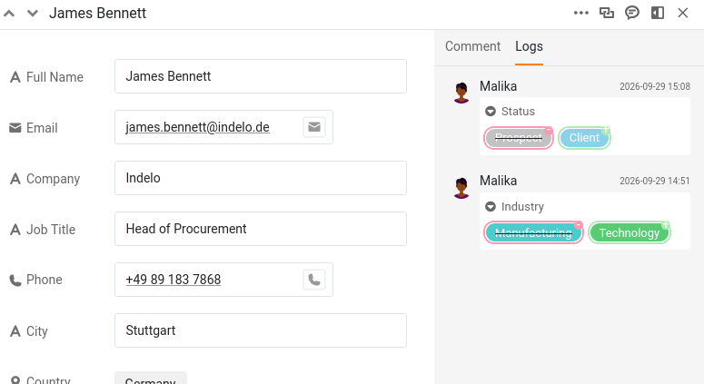

Sobald mehrere Personen dieselbe Base bearbeiten können, stellt sich eine neue Frage: Wer hat was wann geändert? Und gleich die nächste: Wenn eine Änderung falsch war, wie machen Sie genau diese eine rückgängig, ohne alles andere zu stören? SeaTable beantwortet beide. Jede Bearbeitung wird im Hintergrund festgehalten, und Sie können eine einzelne davon gezielt rückgängig machen. In diesem Schritt geht eine Änderung Ihrer Kollegin schief, und Sie bringen sie wieder in Ordnung.

In der Historie, die Sie lesen, tauchen Sie beide auf, denn auch Malika hat diese Base bearbeitet.

## Wo SeaTable die Historie festhält

SeaTable zeichnet Änderungen an drei Stellen auf, und jede beantwortet eine andere Frage.

- **Das Aktivitätenprotokoll** auf der Startseite beantwortet die Frage: „Was ist in letzter Zeit in all meinen Bases passiert?“ Es listet Änderungen von Ihnen, Ihren Teammitgliedern und Automationen auf, allerdings nur aus den **letzten 7 Tagen**.
- **Das Base-Log** beantwortet die Frage: „Was ist in dieser Base passiert?“ Sie öffnen es über das Versionen-Icon im Historie-Menü oben rechts in der Base. Es enthält die jüngsten Änderungen (bis zu den letzten 1.000 Einträgen), die neuesten zuerst, und lässt sich danach filtern, wer die Änderung vorgenommen hat, in welcher Tabelle und wann. Nur hier können Sie etwas **wiederherstellen**.
- **Das Zeilen-Log** beantwortet die Frage: „Was ist mit diesem einen Eintrag passiert?“ Sie öffnen die Zeilendetails und wechseln zum Log. Es ist ein gezielter, schreibgeschützter Zeitverlauf für diese eine Zeile.

Die drei gehen unterschiedlich weit ins Detail, und dieser Unterschied bestimmt den Rest dieses Schritts. Das Zeilen-Log ist das genaueste: Für jede Änderung nennt es die Spalte und stellt den ersetzten Wert dem neuen gegenüber. Das Base-Log bleibt auf der Ebene des Eintrags – wer welche Zeile in welcher Tabelle wann geändert hat –, aber nicht, welcher Wert sich geändert hat und wie er vorher lautete. Sie lesen eine Änderung also im Zeilen-Log nach und machen sie im Base-Log rückgängig. Dieser Schritt nutzt beide, in genau dieser Reihenfolge.

## Eine Kollegin ändert Ihre Daten

Stellen wir die Situation nach. Malika hatte verstanden, dass der Kunde `James Bennett` gerade einen Vertrag unterschrieben hat. Weil Sie ihr in Schritt 2 Lese- und Schreibrechte gegeben haben, musste sie Sie nicht fragen – sie hat es selbst eingetragen.

Öffnen Sie das Plugin bei **Schritt 4** und lassen Sie Malika loslegen: Neben ein paar anderen Aktualisierungen Ihrer Kunden ändert sie den Status (`Status`) von `James Bennett` von `Prospect` auf `Client`.

Öffnen Sie jetzt das Log dieser Zeile, um nachzusehen, was passiert ist: Klicken Sie auf das Doppelpfeil-Symbol  an der Zeilennummer, um die Zeile zu öffnen, und wechseln Sie dann zum Log. Da ist es: `Status` wurde von `Prospect` auf `Client` geändert, versehen mit Malikas Namen und der Uhrzeit. Merken Sie sich diese Uhrzeit, Sie brauchen sie gleich. Direkt darunter sehen Sie auch die Änderung von `Industry`, die Malika in Schritt 3 an dieser Zeile vorgenommen hat. Weil zwei echte Accounts am Werk sind, nennt die Historie jeden von Ihnen korrekt beim Namen – es ist also immer klar, wer was getan hat.



## Eine spätere, unabhängige Änderung

Während der Eintrag geöffnet ist, fällt Ihnen auf, dass die Telefonnummer (`Phone`) von `James Bennett` veraltet ist. Korrigieren Sie sie – auf `+49 75 899 3917`. Das ist eine eigene, bewusste Änderung, und wichtig: Sie erfolgt **nach** Malikas Änderung des Status. Behalten Sie diese Reihenfolge im Kopf, gleich kommt es darauf an. Wenn Sie diese Änderung im Zeilen-Log sehen möchten, laden Sie die Seite vorher neu: Ein bereits geöffnetes Zeilen-Log zeigt eine Änderung, die Sie gerade vorgenommen haben, nicht an.

## Der Fehler

Die Telefonnummer war einfach. Das eigentliche Problem ist der Status: `James Bennett` hat nie unterschrieben, der Wert muss also zurück auf seinen vorherigen Stand.

Das Zeilen-Log hat Ihnen diesen Wert schon verraten: `Prospect`. Sie könnten ihn also einfach wieder eintippen und fertig. Aber neu eintippen heißt nicht rückgängig machen – es ist eine zweite Änderung über der ersten, und es funktioniert hier nur, weil es um eine einzige Zelle geht und Sie das Log gerade offen hatten. Wiederherstellen macht die Änderung selbst rückgängig und reicht dorthin, wo Neueintippen nicht hinkommt: eine gelöschte Zeile, eine gelöschte Spalte, eine ganze gelöschte Tabelle. Lernen Sie es am einfachen Fall, dann steht es Ihnen im schwierigen zur Verfügung.

## Eine einzelne Änderung wiederherstellen

Öffnen Sie das **Base-Log** über das Versionen-Icon im Historie-Menü oben rechts in der Base. Es listet alle Änderungen in der Base auf, die neuesten zuerst. Grenzen Sie die Liste deshalb mit den Filtern am oberen Rand ein: die Tabelle `Customers` und Malika als Urheberin.

Übrig bleibt eine Reihe von Einträgen, die alle ziemlich gleich aussehen – Malika hat die Tabelle `Customers` geändert, darunter jeweils die geänderte Zeile –, denn das Base-Log hält fest, welche Zeile sich geändert hat, nicht welcher Wert darin. Der Name der Zeile grenzt die Suche auf `James Bennett` ein, doch er taucht mehr als einmal auf: Malika hat in Schritt 3 auch seine Branche geändert. Jetzt zahlt sich die Uhrzeit aus, die Sie sich gemerkt haben: Der Eintrag mit dem Zeitpunkt der Statusänderung ist der richtige.

Öffnen Sie das Menü dieses Eintrags und wählen Sie ` Wiederherstellen`. SeaTable setzt `Status` sofort wieder auf `Prospect` und bestätigt das mit einer kurzen Meldung. Öffnen Sie `James Bennett` erneut zur Kontrolle: Er ist wieder ein `Prospect`.



## Was Wiederherstellen wirklich tut

Wiederherstellen ist keine Zeitmaschine, die die ganze Zeile auf ihren Stand zu einem früheren Zeitpunkt zurückdreht. Es **macht eine bestimmte Änderung rückgängig**: Der Wert, den dieser Eintrag geändert hat, wird zurückgesetzt, und alles andere bleibt genau so, wie es ist.

Am deutlichsten sieht man das an der Telefonnummer. Sie haben sie **nach** Malikas Statusänderung korrigiert. Eine Zeitmaschine, die alles auf den Stand vor der Statusänderung zurücksetzt, hätte auch diese spätere Korrektur gelöscht – sie bleibt aber erhalten, weil Wiederherstellen nur die eine Änderung betrifft, die Sie ausgewählt haben. Auch der Wert von `Industry`, den Malika in Schritt 3 aktualisiert hat, bleibt bestehen; nur der Status kehrt zu seinem vorherigen Wert zurück. Sie haben genau den einen Fehler rückgängig gemacht und nichts sonst. Diese Präzision macht das Wiederherstellen aus dem Log auch in einer Base im laufenden Betrieb, in der andere arbeiten, sicher.

{{< warning headline="Nicht alles lässt sich wiederherstellen" text="Wiederherstellen funktioniert bei geänderten Werten und auch bei gelöschten Zeilen, Spalten und Tabellen. Bei allem anderen aber nicht: Eine neu eingefügte Zeile oder Spalte lässt sich über das Log nicht rückgängig machen – sie steht zwar dort, doch ihr Menü zeigt Keine Optionen statt Wiederherstellen. Kommentare sind gar nicht erfasst, denn sie erscheinen überhaupt nicht im Log. Und beachten Sie: Auch das Wiederherstellen ist eine Änderung. Der rückgängig gemachte Eintrag bleibt in der Liste, und das Wiederherstellen fügt dem Log einen eigenen neuen Eintrag hinzu." />}}

Für eine umfassendere Wiederherstellung – eine ganze Base auf einen früheren Stand zurücksetzen oder einen größeren Unfall beheben – bietet SeaTable außerdem Snapshots und weitere Werkzeuge. Das ist ein eigenes Thema, das in einen späteren Kurs zur Wartung gehört.

Sie können Änderungen jetzt sicher nachverfolgen und rückgängig machen. Bisher hat sich allerdings alles in einer einzigen Base abgespielt. Der nächste Schritt stellt Ihnen das leistungsfähigste Werkzeug der Zusammenarbeit in diesem Kurs vor: stets aktuelle Daten mit einem ganz anderen Team teilen.


Hier ist ein guter Moment, um für heute aufzuhören. Alles, was Sie aufgebaut haben, bleibt in Ihrer Base erhalten, und der nächste Schritt beginnt mit einer kurzen Zusammenfassung, damit Sie leicht dort weitermachen, wo Sie aufgehört haben.


## Zur Vertiefung

Finden Sie heraus, wo die Grenzen dessen liegen, was das Log rückgängig machen kann: Fügen Sie `Customers` eine ganz neue Zeile hinzu, öffnen Sie dann das Base-Log, suchen Sie diesen Eintrag und öffnen Sie sein Menü. Statt ` Wiederherstellen` sehen Sie `Keine Optionen` – neue Zeilen, neue Spalten und Kommentare lassen sich über das Log nicht zurücknehmen, nur geänderte und gelöschte Werte. Zu wissen, wo Wiederherstellen an seine Grenzen stößt, ist genauso nützlich wie zu wissen, was es kann.

**Löschen Sie diese Testzeile danach wieder**, damit Ihre Kundenliste wieder so aussieht, wie der restliche Kurs sie erwartet: Sie brauchen sie später genau in diesem Zustand.

## Hilfeartikel mit weiteren Informationen

- [Historie und Logs]()
- [Möglichkeiten der Datenwiederherstellung mit SeaTable]()
