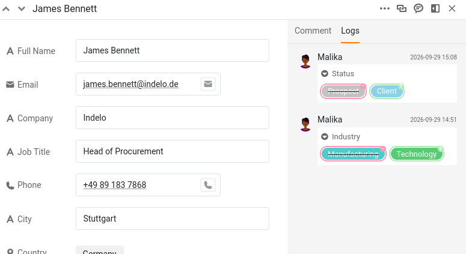

En cuanto varias personas pueden modificar la misma base, surge una pregunta nueva: ¿quién cambió qué, y cuándo? Y otra a continuación: si un cambio era erróneo, ¿cómo se deshace exactamente ese cambio sin alterar todo lo demás? SeaTable responde a las dos. Registra discretamente cada modificación y le permite revertir una sola de ellas. En este paso, un cambio de su compañera sale mal, y usted lo corrige.

El historial que va a leer muestra a los dos, porque Malika también ha estado modificando esta base.

## ¿Dónde guarda SeaTable el historial?

SeaTable registra los cambios en tres lugares, y cada uno responde a una pregunta distinta.

- **El registro de actividades**, en la página de inicio, responde a «¿qué ha pasado últimamente en todas mis bases?». Recoge los cambios hechos por usted, por los miembros de su equipo y por las automatizaciones, pero solo de los **últimos 7 días**.
- **El registro de la base** responde a «¿qué ha pasado en esta base?». Se abre con el icono de versiones, dentro del menú desplegable del historial, en la esquina superior derecha de la base. Contiene los cambios más recientes (hasta las últimas 1000 entradas), del más nuevo al más antiguo, y puede filtrarlo por autor, por tabla y por fecha. Es el único de los tres desde el que se puede **restaurar**.
- **El registro de la fila** responde a «¿qué le ha pasado a esta fila concreta?». Se abren los detalles de una fila y se pasa a su registro. Es una cronología centrada en esa única fila y de solo lectura.

Los tres no entran en el mismo nivel de detalle, y esa diferencia marca el resto de este paso. El registro de la fila es el preciso: para cada cambio indica la columna y muestra el valor sustituido junto al nuevo. El registro de la base se queda en el nivel de la fila: quién cambió qué fila, en qué tabla y cuándo, pero no qué valor cambió ni cuál era antes. Así que un cambio se lee en el registro de la fila y se deshace en el registro de la base. Este paso utiliza los dos, en ese orden.

## Una compañera cambia sus datos

Vamos a crear la situación. Malika había entendido que el cliente `James Bennett` acababa de firmar un contrato. Como en el paso 2 le dio acceso de lectura y escritura, no tuvo que preguntarle: lo marcó ella misma.

Abra el plugin en el **paso 4** y deje que Malika se ponga a trabajar: entre algunas otras actualizaciones de sus clientes, cambia el estado (`Status`) de `James Bennett` de `Prospect` a `Client`.

Abra ahora el registro de esa fila para ver qué ha pasado: haga clic en el icono de la doble flecha  sobre su número de fila para abrirla y pase al registro. Ahí está: `Status` cambiado de `Prospect` a `Client`, con el nombre de Malika y la hora. Anote esa hora; la necesitará enseguida. Justo debajo verá también el cambio de `Industry` que Malika hizo en esta fila en el paso 3. Con dos cuentas reales trabajando, el historial nombra correctamente a cada uno, así que siempre está claro quién hizo qué.



## Otro cambio, posterior y sin relación

Mientras tiene la fila abierta, se da cuenta de que el número de teléfono (`Phone`) de `James Bennett` está desactualizado. Corríjalo: escriba `+49 75 899 3917`. Es un cambio distinto y deliberado y, lo que es importante, se produce **después** de que Malika cambiara `Status`. Retenga ese orden: será importante dentro de un momento. Si quiere ver este cambio en el registro de la fila, recargue antes la página: un registro de la fila que ya está abierto no muestra un cambio que acaba de hacer.

## El error

Lo del teléfono era fácil. El verdadero problema es el estado: `James Bennett` nunca firmó, así que tiene que recuperar su valor anterior.

El registro de la fila ya le ha dicho cuál era ese valor: `Prospect`. Podría volver a escribirlo y dar el asunto por terminado. Pero volver a escribir no es deshacer: es un segundo cambio que se suma al primero, y aquí solo funciona porque está en juego una única celda y tenía el registro abierto. Restaurar revierte el propio cambio, y llega adonde no llega volver a escribir: una fila eliminada, una columna eliminada, una tabla entera eliminada. Aprenda a hacerlo en el caso fácil y lo tendrá a mano para los difíciles.

## Restaurar un único cambio

Abra el **registro de la base** con el icono de versiones, dentro del menú desplegable del historial, en la esquina superior derecha de la base. Recoge todos los cambios de la base, del más nuevo al más antiguo, así que acote la lista con los filtros de la parte superior: la tabla `Customers` y Malika como autora.

Queda una serie de entradas que se parecen mucho (una modificación de la tabla `Customers` por Malika y, debajo, la fila modificada), porque el registro de la base anota qué fila cambió, no qué valor cambió dentro de ella. El nombre de la fila reduce la búsqueda a `James Bennett`, pero aparece más de una vez: Malika también cambió su sector (`Industry`) en el paso 3. Aquí es donde la hora que anotó antes demuestra su utilidad: la entrada con la hora del cambio de `Status` es la que hay que tocar.

Abra el menú de esa entrada y elija ` Restaurar`. SeaTable devuelve inmediatamente `Status` a `Prospect` y lo confirma con una breve notificación emergente. Vuelva a abrir `James Bennett` para comprobarlo: vuelve a ser `Prospect`.



## Lo que hace realmente Restaurar

Restaurar no es una máquina del tiempo que devuelve toda la fila al aspecto que tenía en una fecha pasada. **Deshace un cambio concreto**: revierte el valor que modificó esa entrada y deja todo lo demás exactamente como está.

Se ve mejor con el número de teléfono. Usted lo corrigió **después** de que Malika cambiara `Status`. Volver atrás en el tiempo hasta antes del cambio de `Status` habría borrado también esa corrección posterior; pero se mantiene, porque Restaurar solo afecta al cambio que usted ha elegido. El valor de `Industry` que Malika actualizó en el paso 3 también se mantiene; solo el estado vuelve a su valor anterior. Ha revertido exactamente el error, y nada más. Esa precisión es lo que hace que restaurar desde el registro sea seguro en una base en uso, en la que trabajan otras personas.

{{< warning headline="No todo se puede restaurar" text="Restaurar funciona con valores modificados, y también con filas, columnas y tablas eliminadas. Pero no funciona con todo: una fila o una columna recién añadida no se puede deshacer desde el registro; aparece en él, pero su menú muestra Sin opciones en lugar de Restaurar. Los comentarios no se incluyen en absoluto, ya que nunca aparecen en el registro. Y tenga en cuenta que restaurar es en sí mismo un cambio: la entrada que ha deshecho sigue en la lista, y la restauración añade al registro su propia entrada." />}}

Para recuperaciones de mayor alcance (devolver toda una base a un momento anterior o recuperarse de un accidente grave), SeaTable ofrece también instantáneas y otras herramientas, que son un tema en sí mismas y tendrán su lugar en un curso posterior sobre mantenimiento.

Ya sabe rastrear y revertir cambios con seguridad. Sin embargo, hasta ahora todo ha ocurrido dentro de una sola base. El paso siguiente le presenta la herramienta de colaboración más potente del curso: compartir datos siempre actualizados con todo un equipo distinto del suyo.


Este es un buen momento para dejarlo por hoy. Todo lo que ha construido se queda en su base, y el paso siguiente empieza con un breve resumen para ayudarle a retomarlo donde lo dejó.


## Para profundizar

Descubra hasta dónde llega lo que el registro puede deshacer: añada una fila nueva a `Customers`, abra después el registro de la base, busque esa inserción y abra su menú. En lugar de ` Restaurar` verá `Sin opciones`: las filas nuevas, las columnas nuevas y los comentarios no se pueden revertir desde el registro; solo los valores modificados y eliminados. Saber dónde se detiene Restaurar es tan útil como saber lo que hace.

**Elimine después esa fila de prueba**, para que su lista de clientes vuelva a ser la que espera el resto del curso: más adelante la necesitará exactamente como estaba.

## Artículo de ayuda con más información

- [Historia y registros]()
- [Opciones de recuperación de datos con SeaTable]()
