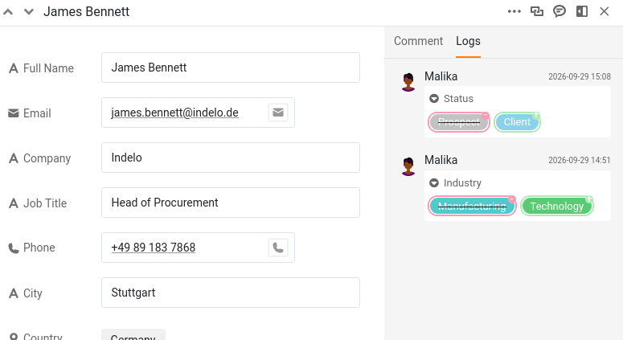

Dès que plusieurs personnes peuvent modifier la même base, une nouvelle question se pose : qui a changé quoi, et quand ? Puis une autre : si une modification était erronée, comment annuler précisément celle-là sans toucher au reste ? SeaTable répond aux deux. Il enregistre discrètement chaque modification, et il permet d'en annuler une seule. Dans cette étape, une modification de votre collègue tourne mal, et vous la corrigez.

L'historique que vous allez lire vous montre tous les deux, puisque Malika a elle aussi modifié cette base.

## Où SeaTable conserve l'historique

SeaTable enregistre les modifications à trois endroits, qui répondent chacun à une question différente.

- **Le journal des activités**, sur la page d'accueil, répond à « que s'est-il passé récemment dans toutes mes bases ? ». Il liste les modifications faites par vous, par les membres de votre équipe et par les automatisations, mais seulement sur les **7 derniers jours**.
- **Le journal de la base** répond à « que s'est-il passé dans cette base ? ». Vous l'ouvrez avec l'icône des versions, dans le menu déroulant de l'historique, en haut à droite de la base. Il contient les modifications les plus récentes (jusqu'aux 1 000 dernières entrées), de la plus récente à la plus ancienne, et vous pouvez le filtrer par auteur, par tableau et par date. C'est le seul des trois qui permet de **restaurer**.
- **Le journal de la ligne** répond à « qu'est-il arrivé à cet enregistrement ? ». Vous ouvrez les détails d'une ligne et passez à son journal. C'est une chronologie ciblée, en lecture seule, pour cette seule ligne.

Ces trois journaux n'entrent pas dans le même détail, et cette différence organise toute la suite de l'étape. Le journal de la ligne est le plus précis : pour chaque modification, il nomme la colonne et place la valeur remplacée à côté de la nouvelle. Le journal de la base, lui, s'arrête à l'enregistrement : qui a modifié quelle ligne, dans quel tableau et quand, mais ni quelle valeur a changé, ni ce qu'elle était avant. On lit donc une modification dans le journal de la ligne, et on l'annule dans le journal de la base. Cette étape utilise les deux, dans cet ordre.

## Une collègue modifie vos données

Créons la situation. Malika avait compris que le client `James Bennett` venait de signer un contrat. Comme vous lui avez donné un accès en lecture et écriture à l'étape 2, elle n'a pas eu besoin de vous demander : elle l'a indiqué elle-même.

Ouvrez le plugin à l'**étape 4** et laissez Malika se mettre au travail : parmi quelques autres mises à jour de vos clients, elle fait passer le `Status` de `James Bennett` de `Prospect` à `Client`.

Ouvrez maintenant le journal de cette ligne pour voir ce qui s'est passé : cliquez sur l'icône à double flèche  sur son numéro de ligne pour ouvrir la ligne, puis passez au journal. La modification est là : `Status` passé de `Prospect` à `Client`, avec le nom de Malika et l'heure. Notez cette heure, vous en aurez bientôt besoin. Juste en dessous, vous voyez aussi la modification de l'`Industry` que Malika a faite sur cette ligne à l'étape 3. Comme deux vrais comptes sont à l'œuvre, l'historique nomme correctement chacun de vous : on sait toujours qui a fait quoi.



## Une autre modification, plus tard

Tant que la fiche est ouverte, vous remarquez que le numéro de téléphone (`Phone`) de `James Bennett` n'est plus à jour. Corrigez-le en `+49 75 899 3917`. C'est une modification distincte et volontaire, et surtout, elle intervient **après** celle du `Status` par Malika. Retenez bien cet ordre : il comptera dans un instant. Si vous voulez voir cette modification dans le journal de la ligne, rechargez d'abord la page : un journal déjà ouvert n'affiche pas une modification que vous venez de faire.

## L'erreur

Le téléphone, c'était facile. Le vrai problème, c'est le `Status` : `James Bennett` n'a jamais signé, il doit donc retrouver sa valeur précédente.

Le journal de la ligne vous a déjà donné cette valeur : `Prospect`. Vous pourriez donc la ressaisir et en rester là. Mais ressaisir n'est pas annuler : c'est une deuxième modification empilée sur la première, et cela ne marche ici que parce qu'une seule cellule est en jeu et que vous aviez le journal sous les yeux. Restaurer annule la modification elle-même, et va là où la ressaisie ne peut pas aller : une ligne supprimée, une colonne supprimée, un tableau entier supprimé. Apprenez-le sur le cas facile, et il vous servira dans les cas difficiles.

## Restaurer une seule modification

Ouvrez le **journal de la base** avec l'icône des versions, dans le menu déroulant de l'historique, en haut à droite de la base. Il liste toutes les modifications de la base, de la plus récente à la plus ancienne : affinez-le avec les filtres du haut, le tableau `Customers` et Malika comme auteur.

Il reste une série d'entrées qui se ressemblent toutes (une modification du tableau `Customers` par Malika, puis `Ligne … modifiée`), car le journal de la base enregistre quelle ligne a changé, pas quelle valeur. Le nom de la ligne réduit la recherche à `James Bennett`, mais il apparaît plusieurs fois : Malika a aussi modifié son `Industry` à l'étape 3. C'est là que l'heure notée plus tôt prend tout son intérêt : l'entrée marquée de l'heure de la modification du `Status` est celle sur laquelle agir.

Ouvrez le menu de cette entrée et choisissez ` Restaurer`. SeaTable remet immédiatement le `Status` sur `Prospect` et le confirme par une brève notification. Rouvrez `James Bennett` pour vérifier : il est de nouveau `Prospect`.



## Ce que fait vraiment la restauration

Restaurer n'est pas une machine à remonter le temps qui ramènerait toute la ligne à son état d'une date passée. Cela **annule une modification précise** : la valeur modifiée par cette entrée revient à son état antérieur, et tout le reste reste exactement tel quel.

Le numéro de téléphone le montre bien. Vous l'avez corrigé **après** que Malika a modifié le `Status`. Un retour en arrière à l'état d'avant la modification du `Status` aurait aussi effacé cette correction ultérieure ; or elle reste, car la restauration ne touche qu'à la modification choisie. La valeur de l'`Industry` mise à jour par Malika à l'étape 3 reste elle aussi ; seul le `Status` revient à sa valeur précédente. Vous avez annulé précisément l'erreur, et rien d'autre. C'est cette précision qui rend la restauration depuis le journal sûre, même sur une base en production où d'autres personnes travaillent.

{{< warning headline="Tout ne se restaure pas" text="La restauration fonctionne sur les valeurs modifiées, mais aussi sur les lignes, colonnes et tableaux supprimés. Elle ne fonctionne pas sur tout pour autant : une ligne ou une colonne nouvellement ajoutée ne peut pas être annulée depuis le journal ; elle y apparaît, mais son menu affiche Pas d'options au lieu de Restaurer. Les commentaires ne sont pas concernés du tout, puisqu'ils n'apparaissent jamais dans le journal. Notez enfin qu'une restauration est elle-même une modification : l'entrée annulée reste dans la liste, et la restauration ajoute sa propre entrée au journal." />}}

Pour une récupération plus profonde (ramener toute une base à un état antérieur, ou se remettre d'un incident sérieux), SeaTable propose aussi des snapshots et d'autres outils : c'est un sujet à part entière, qui trouvera sa place dans un prochain cours sur la maintenance.

Vous savez maintenant retrouver et annuler des modifications en toute confiance. Jusqu'ici, pourtant, tout s'est passé dans une seule base. L'étape suivante vous ouvre l'outil de collaboration le plus puissant du cours : partager des données toujours à jour avec toute une autre équipe.


C'est le bon moment pour vous arrêter aujourd'hui. Tout ce que vous avez construit reste dans votre base, et l'étape suivante commence par un court récapitulatif pour vous aider à reprendre là où vous en étiez.


## Pour aller plus loin

Trouvez la limite de ce que le journal permet d'annuler : ajoutez une toute nouvelle ligne à `Customers`, puis ouvrez le journal de la base, trouvez cet ajout et ouvrez son menu. Au lieu de ` Restaurer`, vous verrez `Pas d'options` : les nouvelles lignes, les nouvelles colonnes et les commentaires ne peuvent pas être annulés depuis le journal ; seules les valeurs modifiées et supprimées peuvent l'être. Savoir où s'arrête la restauration est aussi utile que savoir ce qu'elle fait.

**Supprimez ensuite cette ligne de test**, pour que votre liste de clients redevienne celle qu'attend la suite du cours : vous en aurez besoin telle quelle plus tard.

## Article d'aide avec plus d'informations

- [Historique et journaux]()
- [Possibilités de récupération de données avec SeaTable]()
