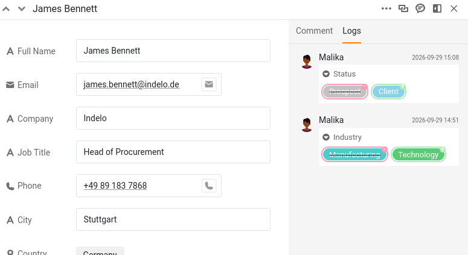

Assim que várias pessoas podem editar a mesma base, surge uma nova pergunta: quem alterou o quê, e quando? E logo a seguir: se uma alteração estava errada, como se anula exatamente essa alteração sem mexer em tudo o resto? O SeaTable responde às duas. Regista discretamente cada edição e permite reverter uma só delas. Neste passo, uma alteração feita por uma colega corre mal, e cabe-lhe a si corrigi-la.

O histórico que vai ler mostra as alterações de ambos, porque a Malika também tem editado esta base.

## Onde é que o SeaTable guarda o histórico?

O SeaTable regista as alterações em três sítios, cada um a responder a uma pergunta diferente.

- **O registo de atividades**, na página inicial, responde a «o que aconteceu recentemente em todas as minhas bases?». Lista as alterações feitas por si, pelos membros da sua equipa e pelas automações, mas apenas dos **últimos 7 dias**.
- **O registo da base** responde a «o que aconteceu nesta base?». Abre-o com o ícone de versões, no menu pendente do histórico, no canto superior direito da base. Contém as alterações mais recentes (até às últimas 1000 entradas), das mais recentes para as mais antigas, e pode filtrá-lo por autor, por tabela e por data. É o único dos três a partir do qual pode **restaurar**.
- **O registo da linha** responde a «o que aconteceu a esta linha?». Abre os detalhes de uma linha e passa para o respetivo registo. É uma cronologia focada e só de leitura dessa única linha.

Os três não entram no mesmo nível de pormenor, e essa diferença determina o resto deste passo. O registo da linha é o mais preciso: para cada alteração, indica a coluna e mostra o valor substituído ao lado do novo. O registo da base fica-se pela linha: quem alterou que linha, em que tabela e quando, mas não que valor mudou nem qual era antes. Por isso, lê-se uma alteração no registo da linha e anula-se no registo da base. Este passo usa os dois, por esta ordem.

## Uma colega altera os seus dados

Vamos criar a situação. A Malika tinha percebido que o cliente `James Bennett` acabara de assinar um contrato. Como lhe deu acesso de leitura e escrita no passo 2, ela não precisou de lhe perguntar: registou-o ela mesma.

Abra o plugin no **passo 4** e deixe a Malika pôr-se a trabalhar: entre algumas outras atualizações dos seus clientes, ela muda o estado (`Status`) de `James Bennett` de `Prospect` para `Client`.

Abra agora o registo dessa linha para ver o que aconteceu: clique no ícone de seta dupla  no número da linha para a abrir e passe para o registo. Lá está: `Status` mudou de `Prospect` para `Client`, com o nome da Malika e a hora. Tome nota dessa hora, porque vai precisar dela daqui a pouco. Logo abaixo, vê também a alteração de `Industry` que a Malika fez nesta linha no passo 3. Como estão a trabalhar duas contas reais, o histórico identifica corretamente cada pessoa, e fica sempre claro quem fez o quê.



## Uma alteração posterior, sem relação

Enquanto tem a linha aberta, repara que o número de telefone (`Phone`) de `James Bennett` está desatualizado. Corrija-o para `+49 75 899 3917`. É uma alteração separada e intencional e, o que é importante, acontece **depois** de a Malika ter mudado o estado. Guarde esta ordem na memória: vai contar daqui a pouco. Se quiser ver esta edição no registo da linha, recarregue primeiro a página: um registo da linha que já está aberto não mostra uma alteração que acabou de fazer.

## O erro

O telefone foi fácil. O verdadeiro problema é o estado: `James Bennett` nunca assinou, por isso tem de voltar ao valor anterior.

O registo da linha já lhe disse qual era esse valor: `Prospect`. Podia, portanto, voltar a escrevê-lo e ficar por aqui. Mas voltar a escrever não é anular: é uma segunda alteração por cima da primeira, e só funciona aqui porque está em causa uma única célula e tinha o registo aberto. Restaurar reverte a própria alteração, e chega onde reescrever não chega: uma linha eliminada, uma coluna eliminada, uma tabela inteira eliminada. Aprenda-o no caso fácil, e terá a ferramenta à mão no caso difícil.

## Restaurar uma única alteração

Abra o **registo da base** com o ícone de versões, no menu pendente do histórico, no canto superior direito da base. Lista todas as alterações feitas na base, das mais recentes para as mais antigas, por isso restrinja a lista com os filtros no topo: a tabela `Customers` e a Malika como autora.

O que resta é uma série de entradas muito parecidas (uma alteração da tabela `Customers` pela Malika e, depois, a linha modificada), porque o registo da base guarda que linha mudou, e não que valor mudou nela. O nome da linha reduz a procura a `James Bennett`, mas ele aparece mais do que uma vez: a Malika também alterou o valor `Industry` dele no passo 3. É aqui que a hora que anotou mostra o seu valor: a entrada com a hora da alteração do estado é aquela em que deve agir.

Abra o menu dessa entrada e escolha ` Restaurar`. O SeaTable repõe imediatamente `Status` em `Prospect` e confirma-o com uma breve notificação. Abra de novo `James Bennett` para verificar: voltou a ser `Prospect`.



## O que faz realmente o Restaurar

Restaurar não é uma máquina do tempo que faz recuar toda a linha até ao estado em que estava numa data passada. **Anula uma alteração específica**: reverte o valor que essa entrada alterou e deixa tudo o resto exatamente como está.

O número de telefone mostra-o bem. Corrigiu-o **depois** de a Malika ter mudado `Status`. Um recuo no tempo até antes da alteração de `Status` teria apagado também essa correção posterior; mas ela mantém-se, porque o Restaurar só mexe na alteração que escolheu. O valor de `Industry` que a Malika atualizou no passo 3 também se mantém; só o estado volta ao valor anterior. Reverteu precisamente aquele erro, e mais nada. É essa precisão que torna seguro restaurar a partir do registo numa base em produção, onde outras pessoas estão a trabalhar.

{{< warning headline="Nem tudo se pode restaurar" text="O Restaurar funciona com valores alterados, e também com linhas, colunas e tabelas eliminadas. Mas não funciona com tudo: uma linha ou coluna acabada de inserir não pode ser anulada a partir do registo; aparece lá, mas o seu menu mostra Sem opções em vez de Restaurar. Os comentários ficam totalmente de fora, porque nem sequer aparecem no registo do histórico. E repare que restaurar é também uma alteração: a entrada que anulou continua na lista, e o restauro acrescenta ao registo uma nova entrada própria." />}}

Para uma recuperação mais profunda (repor uma base inteira num momento anterior, ou recuperar de um acidente grave), o SeaTable oferece também instantâneos e outras ferramentas, que são um tema à parte e terão lugar num curso futuro sobre manutenção.

Já sabe encontrar e reverter alterações com confiança. Até agora, porém, tudo aconteceu dentro de uma única base. O próximo passo abre a ferramenta de colaboração mais poderosa do curso: partilhar dados sempre atualizados com toda uma outra equipa.


Este é um bom sítio para parar por hoje. Tudo o que construiu fica na sua base, e o próximo passo começa com um breve resumo para o ajudar a retomar onde ficou.


## Para ir mais longe

Descubra o limite do que o registo consegue anular: adicione uma linha nova a `Customers`, depois abra o registo da base, encontre essa inserção e abra o respetivo menu. Em vez de ` Restaurar`, vai ver `Sem opções`: linhas novas, colunas novas e comentários não podem ser revertidos a partir do registo; só os valores alterados e eliminados podem. Saber onde o Restaurar para é tão útil como saber o que faz.

**Elimine depois essa linha de teste**, para que a sua lista de clientes volte a ser a que o resto do curso espera: vai precisar dela exatamente como estava mais à frente.

## Artigo de ajuda com mais informações

- [Histórico e registos]()
- [Opções de recuperação de dados com o SeaTable]()
