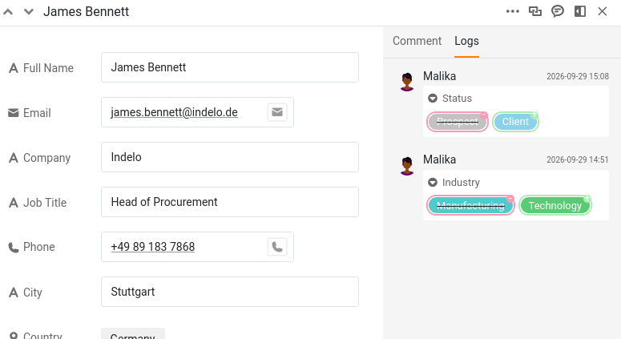

Когда одну базу могут редактировать несколько человек, возникает новый вопрос: кто что изменил и когда? И следом второй: если изменение ошибочно, как отменить именно его, не затронув всё остальное? SeaTable отвечает на оба. Он незаметно записывает каждую правку и позволяет отменить любую из них по отдельности. На этом шаге коллега вносит ошибочное изменение, а вы его исправляете.

В истории, которую вы будете читать, есть вы оба, потому что Малика тоже редактировала эту базу.

## Где SeaTable хранит историю?

SeaTable записывает изменения в трёх местах, и каждое отвечает на свой вопрос.

- **Журнал активности** на главной странице отвечает на вопрос «Что происходило в последнее время во всех моих базах?». В нём перечислены изменения, сделанные вами, членами вашей команды и автоматизациями, но только за **последние 7 дней**.
- **Журнал базы** отвечает на вопрос «Что происходило в этой базе?». Он открывается значком версий в выпадающем меню истории в правом верхнем углу базы. В нём хранятся последние изменения (до 1000 записей), начиная с самых новых, и его можно отфильтровать по автору изменения, таблице и времени. Только из этого журнала можно **восстановить** прежнее значение.
- **Журнал строки** отвечает на вопрос «Что происходило с этой конкретной записью?». Чтобы его открыть, откройте сведения о строке и перейдите к журналу. Это подробная хронология только этой строки, доступная только для просмотра.

Подробность этих журналов разная, и от этой разницы зависит весь шаг. Журнал строки — самый точный: для каждого изменения он называет столбец и показывает рядом прежнее и новое значение. Журнал базы работает на уровне записи — кто изменил какую строку, в какой таблице и когда, — но не показывает, какое значение изменилось и каким оно было раньше. Поэтому изменение вы находите в журнале строки, а отменяете в журнале базы. На этом шаге используются оба, именно в таком порядке.

## Коллега меняет ваши данные

Создадим ситуацию. Малика решила, что клиент `James Bennett` только что подписал договор. Поскольку на шаге 2 вы дали ей права на чтение и запись, спрашивать вас ей не понадобилось — она отметила это сама.

Откройте в плагине **шаг 4** и дайте Малике взяться за работу: среди нескольких других обновлений ваших клиентов она меняет статус (`Status`) клиента `James Bennett` с `Prospect` на `Client`.

Теперь откройте журнал этой строки, чтобы посмотреть, что произошло: нажмите значок с двойной стрелкой  у номера строки, чтобы открыть её, и перейдите к журналу. Вот оно: `Status` изменён с `Prospect` на `Client`, с именем Малики и временем. Запомните это время — скоро оно вам понадобится. Чуть ниже вы увидите и изменение значения `Industry`, которое Малика внесла в эту строку на шаге 3. Поскольку работают две настоящие учётные записи, история правильно называет каждого из вас, так что всегда понятно, кто что сделал.



## Более позднее, не связанное изменение

Пока запись открыта, вы замечаете, что номер телефона (`Phone`) у `James Bennett` устарел. Исправьте его на `+49 75 899 3917`. Это отдельное, намеренное изменение, и, что важно, оно происходит **после** того, как Малика изменила `Status`. Запомните этот порядок: через минуту он будет иметь значение. Если хотите увидеть эту правку в журнале строки, сначала перезагрузите страницу: уже открытый журнал строки не показывает изменение, которое вы только что внесли.

## Ошибка

С телефоном всё просто. Настоящая проблема — статус: `James Bennett` ничего не подписывал, поэтому нужно вернуть прежнее значение.

Журнал строки уже сообщил вам, каким оно было: `Prospect`. Можно было бы просто ввести его заново. Но повторный ввод — это не отмена, а второе изменение поверх первого, и здесь он сработает лишь потому, что речь об одной ячейке и журнал был у вас перед глазами. Восстановление отменяет само изменение и справляется там, где повторный ввод бессилен: с удалённой строкой, удалённым столбцом, целой удалённой таблицей. Освоив его на простом случае, вы сможете применить его и в сложном.

## Восстановление одного изменения

Откройте **журнал базы** значком версий в выпадающем меню истории в правом верхнем углу базы. В нём перечислены все изменения в базе, начиная с самых новых, поэтому сузьте список фильтрами вверху: таблица `Customers` и Малика в качестве автора.

Остаётся ряд почти одинаковых записей — Малика изменила таблицу `Customers`, затем изменена такая-то строка, — потому что журнал базы фиксирует, какая строка изменилась, а не какое значение в ней. Название строки сужает поиск до `James Bennett`, но он встречается не один раз: на шаге 3 Малика изменила у него ещё и `Industry`. Здесь и пригодится время, которое вы запомнили: действовать нужно с записью, отмеченной моментом изменения статуса.

Откройте меню этой записи и выберите ` Восстановить`. SeaTable сразу возвращает `Status` к значению `Prospect` и подтверждает это коротким всплывающим уведомлением. Откройте `James Bennett` снова, чтобы проверить: он опять `Prospect`.



## Что на самом деле делает восстановление

Восстановление — это не машина времени, которая возвращает всю строку к тому виду, какой она имела в прошлом. Оно **отменяет одно конкретное изменение**: возвращает значение, которое изменила эта запись журнала, и оставляет всё остальное в точности как есть.

Проще всего это увидеть на номере телефона. Вы исправили его **после** того, как Малика изменила `Status`. Откат строки к состоянию до изменения статуса стёр бы и это более позднее исправление, но оно осталось, потому что восстановление затрагивает только выбранное вами изменение. Значение `Industry`, обновлённое Маликой на шаге 3, тоже остаётся; к прежнему значению возвращается только статус. Вы отменили ровно одну ошибку и ничего больше. Именно эта точность делает восстановление из журнала безопасным даже в рабочей базе, где параллельно работают другие люди.

{{< warning headline="Восстановить можно не всё" text="Восстановление работает для изменённых значений, а также для удалённых строк, столбцов и таблиц. Но не для всего: новую добавленную строку или столбец через журнал отменить нельзя — они в нём отображаются, но в их меню вместо Восстановить написано Нет опций. Комментарии не охвачены вовсе, потому что в журнал истории они вообще не попадают. И учтите, что восстановление само по себе тоже изменение: отменённая запись остаётся в списке, а восстановление добавляет в журнал собственное событие." />}}

Для более глубокого восстановления — отката всей базы к более раннему состоянию или исправления последствий серьёзной аварии — в SeaTable есть снимки и другие инструменты. Это отдельная тема, которой будет посвящён один из следующих курсов, об обслуживании баз.

Теперь вы умеете уверенно отслеживать и отменять изменения. Но пока всё происходило внутри одной базы. Следующий шаг откроет самый мощный инструмент совместной работы в этом курсе: обмен актуальными данными с целым другим отделом.


Здесь удобно остановиться на сегодня. Всё, что вы сделали, сохранится в вашей базе, а следующий шаг начинается с краткого напоминания, которое поможет продолжить с того же места.


## Для углублённого изучения

Найдите границу того, что можно отменить через журнал: добавьте в `Customers` совершенно новую строку, затем откройте журнал базы, найдите это добавление и откройте его меню. Вместо ` Восстановить` вы увидите `Нет опций`: новые строки, новые столбцы и комментарии через журнал отменить нельзя — только изменённые и удалённые значения. Знать, где заканчиваются возможности восстановления, так же полезно, как знать, что оно умеет.

**Затем удалите эту тестовую строку**, чтобы список клиентов снова был таким, каким его ожидает остальная часть курса: позже он понадобится вам именно в прежнем виде.

## Справочная статья с дополнительной информацией

- [История и журналы]()
- [Варианты восстановления данных с помощью SeaTable]()
