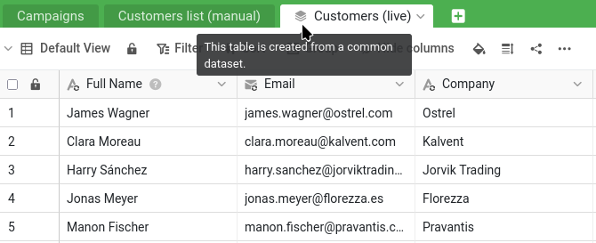


Hier haben Sie aufgehört:

- Ihre Base `Sales CRM` liegt in der Gruppe `Commercial`, und Sie haben sie mit `Lesen und Schreiben` für Malika freigegeben (Schritte 1 und 2).
- Sie haben `James Bennett` mit ihr in einer Konversation besprochen: Sie hat seine Branche (`Industry`) auf `Technology` geändert, und Sie haben die Konversation als erledigt markiert (Schritt 3).
- Sie haben ihre Änderung von `Status` im Base-Log gefunden und rückgängig gemacht, während Ihre spätere Korrektur der Telefonnummer erhalten blieb (Schritt 4).

Um dort weiterzumachen, können Sie auch `Sales CRM` wieder öffnen und das Online-Kurse-Plugin starten: Seine Liste der Schritte zeigt, wo Sie stehen, und lässt Sie die bisherigen Schritte noch einmal ansehen.


Viele Unternehmen kennen dieses Problem: Auch das Marketing braucht die Kundenliste – darf aber die Vertriebsdaten nicht anfassen und soll Ihren Kundenstamm schon gar nicht bearbeiten. Also hat irgendwann jemand die Kunden in eine separate Kopie für das Marketing exportiert. Diese Kopie war nur sehr kurz aktuell. Seitdem driftet sie immer weiter ab: Neue Kunden fehlen, alte Segmente stimmen nicht mehr und so weiter.

Gemeinsame Datensätze sind eine zentrale Funktion für die Zusammenarbeit, weil sie genau dieses Problem lösen. Mit ihnen stellen Sie einem anderen Team eine stets aktuelle Version Ihrer Daten bereit, auf der dieses Team aufbauen kann – ohne ihm Zugriff auf Ihre vertraulichen Zahlen zu geben und ohne jedes Risiko, dass es Ihre Quelldaten verändert.

## Die Ausgangslage: die Base des Marketings

Zuerst braucht das Marketing eine eigene Gruppe und eine eigene Base. Legen Sie eine Gruppe mit dem Namen `Marketing` an – Malikas Abteilung – und fügen Sie Malika als Mitglied hinzu. Laden Sie dann die folgende Datei herunter und importieren Sie sie als neue Base **in die Gruppe `Marketing`**, genau so, wie Sie `Sales CRM` in Schritt 1 in die Gruppe `Commercial` importiert haben:

[SeaTable Course 3 - Campaign Hub.dtable](/SeaTable-Course-3-Campaign-Hub.dtable)

Das können Sie, weil Sie die Gruppe angelegt haben und damit ihr Eigentümer sind. Eine Base in eine Gruppe aufzunehmen ist dem Eigentümer und den Administratoren der Gruppe vorbehalten: Ein einfaches Mitglied kann in den Bases arbeiten, die schon dort liegen, aber keine neue hinzufügen. In einem echten Unternehmen würde Malika das als Administratorin der Gruppe ihrer Abteilung selbst erledigen; hier richten Sie die Seite des Marketings für sie ein.

`Campaign Hub` ist die kleine, eigene Base des Marketings. Sie enthält eine Tabelle `Campaigns` und – darauf kommt es hier an – eine Tabelle namens `Customers list (manual)`. Öffnen Sie sie und sehen Sie genau hin: Sie enthält etwa 150 Kunden, während Ihr Kundenstamm 350 umfasst. Die neuesten Kunden fehlen einfach, die Segmente sind veraltet, und die Daten der „letzten Aktualisierung“ liegen alle einige Jahre zurück. Das ist die veraltete Kopie, die wir ablösen werden. Im Plugin-Bereich der Base liegt außerdem ein Whiteboard des Marketings; lassen Sie es vorerst links liegen, es kommt in Schritt 6 wieder ins Spiel.

## Warum Malika nicht einfach Lesezugriff geben?

Nach Schritt 4 liegt ein einfacher Schluss nahe: Wenn Malika mit Lese- und Schreibrechten versehentlich Ihren Kundenstamm ändern konnte, stellen Sie sie eben auf „Nur Lesen“ um. Damit sind Ihre Daten zwar sicher – aber das Marketing bekommt nicht, was es braucht. Mit Lesezugriff kann Malika Ihre Kunden ansehen, aber nichts darauf aufbauen: kein Kampagnensegment, keine Verknüpfung, keine eigene Spalte. Arbeiten kann sie mit den Daten nur, indem sie eine eigene Kopie davon anlegt – und eine statische Kopie ist genau die veraltete Tabelle `Customers list (manual)`, die Sie sich gerade in `Campaign Hub` angesehen haben. Mit einer Lesefreigabe wäre das Marketing also wieder genau dort, wo es angefangen hat.

Was das Marketing braucht, ist eine dritte Möglichkeit: Daten, die so sicher sind wie bei einer Lesefreigabe, auf denen es aber aufbauen kann wie in der eigenen Base. Genau das ist ein gemeinsamer Datensatz. Er gibt Malika in `Campaign Hub` eine stets aktuelle Kopie Ihrer Kundenliste, die sie um eigene Spalten erweitern, mit ihren Kampagnen in `Campaigns` verknüpfen und jederzeit aktualisieren kann – während Ihr Kundenstamm unangetastet bleibt und Ihre vertraulichen Zahlen ihn nie verlassen. Sicher und produktiv zugleich.

## Gemeinsame Datensätze setzen Gruppen voraus

Ein gemeinsamer Datensatz fließt von einer Gruppe zur anderen – deshalb kam `Sales CRM` schon in Schritt 1 in eine Gruppe. Ihre Base `Sales CRM` liegt in der Gruppe `Commercial`, die Base `Campaign Hub` des Marketings in der Gruppe `Marketing`. Indem Sie den Datensatz aus `Commercial` veröffentlichen und für `Marketing` freigeben, verbinden Sie die beiden.

{{< warning headline="Zum Veröffentlichen brauchen Sie Eigentümer- oder Administratorrechte in der Gruppe" text="Um einen gemeinsamen Datensatz zu veröffentlichen, müssen Sie Eigentümer oder Administrator der Gruppe sein, zu der die Base gehört – Mitglied zu sein reicht nicht. Bleibt die Option zum Veröffentlichen ausgegraut, wenden Sie sich an Ihren Team-Administrator. Und wenn Sales CRM gar nicht erst in einer Gruppe gelandet ist, steht die Option überhaupt nicht zur Verfügung – siehe den Hinweis zu Gruppen in Schritt 1." />}}

## Den Datensatz veröffentlichen

Erinnern Sie sich an die zwei Ansichten aus Schritt 1. ` All customers` zeigt alles, einschließlich der vertraulichen Spalte `Total Deal Value`; ` Active customers` ist die abgespeckte Ansicht, die die vertraulichen Zahlen ausblendet und sich bedenkenlos freigeben lässt. Sie veröffentlichen die unbedenkliche – und weil ein gemeinsamer Datensatz den Filter und die ausgeblendeten Spalten seiner Ansicht mitnimmt, verlassen die vertraulichen Daten Ihre Base nie.

Öffnen Sie die Ansicht `Active customers` der Tabelle `Customers` – die unbedenkliche – und wählen Sie in ihrem Menü ` Als gemeinsamen Datensatz veröffentlichen`. Geben Sie dem Datensatz einen eindeutigen Namen, zum Beispiel `Customers (live)`, und bestätigen Sie.

Der Datensatz existiert jetzt, aufgebaut auf der unbedenklichen Ansicht. Achten Sie darauf, was Sie aufgenommen haben und was nicht: die aktuellen Kunden und die unbedenklichen Spalten, aber nichts von den Vertriebsdaten oder den Umsatzzahlen. Bisher existiert er allerdings nur in Ihrer Gruppe `Commercial` – das Marketing sieht ihn noch nicht.

## Einer anderen Gruppe Zugriff auf den Datensatz geben

Um Ihre Liste in die Hände des Marketings zu legen, geben Sie seiner Gruppe Zugriff. Anders als bei der Freigabe einer Base geschieht das auf der Startseite: Öffnen Sie den Reiter ` Gemeinsame Datensätze`, suchen Sie `Customers (live)` und geben Sie der Gruppe `Marketing` über `Zugriff verwalten` Zugriff. Ihre stets aktuelle Kundenliste steht dem Marketing jetzt zur Verfügung, während alles, was Sie weggelassen haben, in Ihrer Base bleibt.

{{< warning headline="Für die Freigabe an eine andere Gruppe müssen Sie dort Mitglied sein" text="Um einen gemeinsamen Datensatz für eine andere Gruppe freizugeben, müssen Sie Mitglied dieser Gruppe sein, nicht nur Eigentümer der Quell-Base. Hier haben Sie die Gruppe Marketing selbst angelegt, Sie erfüllen die Bedingung also bereits, und die Freigabe funktioniert sofort. Ein Detail ist gut zu wissen: Es ist der Herausgeber (ein Eigentümer oder Administrator der Quellgruppe), der in die andere Gruppe hineinreichen muss, nicht die Personen, die den Datensatz nutzen – Malika braucht nie Zugriff auf Ihre Gruppe Commercial, um die Daten zu erhalten. In einem echten Unternehmen, in dem die Person, die die Kundenliste pflegt, nicht zum Marketing gehört, richtet meist ein Team-Administrator diese gruppenübergreifende Freigabe ein: Er gehört allen Gruppen an und kann die beiden verbinden, ohne dass eine Abteilung in die andere eingreift." />}}

## Den Datensatz auf der anderen Seite importieren

Wechseln Sie jetzt auf die Seite des Marketings. Ab hier arbeiten Sie in `Campaign Hub` und tun, was Malika für ihr Team tun würde – als Mitglied der Gruppe `Marketing` steht die Base auch Ihnen offen. Fügen Sie in `Campaign Hub` eine neue Tabelle hinzu, wählen Sie ` Gemeinsamen Datensatz importieren` und dann `Customers (live)`.

Eine neue Tabelle erscheint, gekennzeichnet mit einem kleinen Stapel-Symbol, das zeigt, dass sie aus einem gemeinsamen Datensatz stammt. Sie enthält Ihre aktuellen Kunden – die vollständige, aktuelle Liste ohne die verlorenen Kunden, die die Ansicht herausfiltert – und nur die unbedenklichen Spalten. Neben der veralteten Tabelle `Customers list (manual)` springt der Unterschied sofort ins Auge.

Beachten Sie, dass jede synchronisierte Spalte zusätzlich zu ihrem üblichen Typ-Symbol ein Synchronisierungs-Symbol `` trägt.

## Die Daten für das Marketing erweitern

Die synchronisierte Tabelle ist nicht eingefroren – das Marketing kann darauf aufbauen. Fügen Sie der synchronisierten Tabelle eine eigene Spalte hinzu, zum Beispiel eine Einfachauswahl-Spalte ` Segment`, um Kunden für Kampagnen zu kennzeichnen. Das ist die Ergänzung des Marketings, direkt neben den synchronisierten Daten. Ihre neue Spalte trägt kein Synchronisierungs-Symbol ``, anders als die synchronisierten Spalten daneben – genau an diesem Symbol erkennen Sie auf einen Blick den Unterschied: Synchronisierte Spalten kommen aus der Quelle und werden bei jeder Synchronisierung aktualisiert, Spalten ohne das Symbol gehören dem Marketing und bleiben, wie sie sind.

Hier wird sichtbar, dass ein gemeinsamer Datensatz nur in eine Richtung fließt. Gehen Sie zurück in Ihre Base `Sales CRM` und sehen Sie sich die Ansicht `Active customers` an (die Quelle des gemeinsamen Datensatzes). Die Spalte `Segment` des Marketings ist dort nicht zu finden, und sie wird dort auch nie auftauchen. Die Daten fließen nur in eine Richtung: von Ihrer Quelle zur Kopie des Marketings. Was das Marketing auf seiner Seite ergänzt, bleibt auf seiner Seite.

## Die alten Daten übernehmen

Die neue Spalte `Segment` ist anfangs leer – doch das Marketing hat an diesen Kunden durchaus schon gearbeitet. Diese Arbeit steckt in der alten Tabelle `Customers list (manual)`: das Segment jedes Kunden und in der Spalte ` Acquired via` die Kampagne, über die er ursprünglich gewonnen wurde. Fügen Sie `Customers (live)` neben `Segment` eine Einfachauswahl-Spalte `Acquired via` hinzu und lassen Sie SeaTable dann beide Spalten in einem einzigen Schritt übernehmen, abgeglichen über die E-Mail-Adresse.

Legen Sie im Menü der Tabelle `Customers (live)` unter ` Datenverarbeitung` eine Operation `Vergleichen und kopieren` an:

- von `Customers list (manual)` nach `Customers (live)`,
- Zeilen abgleichen, bei denen `Email` gleich `Email` ist,
- `Segment` nach `Segment` und `Acquired via` nach `Acquired via` kopieren.

Führen Sie sie aus: Jeder Kunde, der in der alten Liste stand, erhält in der stets aktuellen Tabelle sein Segment und seine Akquisekampagne zurück – SeaTable legt die Optionen beim Kopieren neu an. Kunden, die nicht in der alten Liste standen, also die neueren aus Ihrem Kundenstamm, bleiben einfach leer und können ergänzt werden.



## Die Synchronisierung beobachten

Jetzt kommt der entscheidende Moment. Ändern Sie in `Sales CRM` die Quelle – bearbeiten Sie einen Wert bei einem Kunden in der Ansicht `Active customers`, zum Beispiel seine Berufsbezeichnung. Wechseln Sie dann zurück in `Campaign Hub` und synchronisieren Sie den Datensatz. Über ` Mit Datensatz synchronisieren` im Menü der Tabelle `Customers (live)` können Sie bei Bedarf synchronisieren oder eine periodische Synchronisation einschalten, damit SeaTable automatisch synchronisiert. (Erhalten Sie eine Fehlermeldung, weil die letzte Synchronisierung zu kurz zurückliegt, können Sie die Synchronisierung trotzdem von der Quellseite aus erzwingen, über das Menü des Datensatzes im Reiter ` Gemeinsame Datensätze` auf der Startseite.)

Die synchronisierte Tabelle passt sich Ihrer Quelle an: Die Änderung erscheint, genauso wie ein neuer Kunde erscheinen würde, der zur Ansicht hinzukommt. Und die Spalte `Segment`, die das Marketing hinzugefügt hat, bleibt unberührt: Die bereits gekennzeichneten Kunden behalten ihr Segment. Die stets aktuellen Daten werden aus Ihrem Kundenstamm aufgefrischt, die eigene Arbeit des Marketings darauf bleibt erhalten.

{{< warning headline="Die synchronisierte Kopie ist nicht zum Bearbeiten da" text="Weil die Daten nur in eine Richtung fließen, ist alles, was das Marketing in den synchronisierten Spalten selbst ändert, nur vorübergehend: Die nächste Synchronisierung überschreibt es mit den Werten Ihrer Quelle. Genau so ist es gewollt – der Kundenstamm bleibt maßgeblich. Spalten, die das Marketing selbst hinzufügt, wie Segment, sind die Ausnahme und bleiben erhalten. Also: Die synchronisierten Daten lesen und darauf aufbauen, Korrekturen an der Kundenliste selbst aber in der Quell-Base vornehmen." />}}

## Die veraltete Kopie ablösen

`Campaign Hub` hat jetzt eine stets aktuelle, korrekte Kundenliste, in die die alten Segmente übernommen wurden. Die Tabelle `Customers list (manual)` hat nichts mehr zu bieten. Löschen Sie sie. Nichts geht kaputt, denn diese Tabelle war eine eigenständige, manuelle Kopie – nichts anderes in der Base hing von ihr ab. Das Marketing ist von einer Kopie, die schnell veraltet war, zu einer Liste gewechselt, die nie veraltet.



Sie haben jetzt stets aktuelle Daten über Teamgrenzen hinweg verteilt und Ihren Kundenstamm dabei privat und maßgeblich gehalten – das Herzstück der Zusammenarbeit in SeaTable. Ein leichtes Werkzeug, mit dem die Arbeit Spaß macht, fehlt noch, bevor wir zum Abschluss kommen.

## Zur Vertiefung

`Acquired via` ist das Beste, was die alte Liste zu bieten hatte: ein einziger Kampagnenname, in ein Feld getippt. Die flache, manuelle Kopie war nie mit den echten Einträgen in `Campaigns` verbunden. Sie konnte also weder abbilden, dass ein Kunde zu **mehreren** Kampagnen gehört, noch von einer Kampagne zu ihren Kunden führen. Der Neuaufbau der Tabelle ist der richtige Moment, das zu beheben.

Fügen Sie in `Campaign Hub` der Tabelle `Campaigns` eine Verknüpfungsspalte ` Audience` hinzu, die auf `Customers (live)` verweist. Wenn das Marketing künftig eine Kampagne startet, wählt es die Zielkunden direkt dort aus – eine echte n:m-Verknüpfung statt eines einzelnen Labels.

{{< warning headline="Eine Struktur im laufenden Betrieb verbessern" text="Die neue Verknüpfung Audience ist anfangs leer und füllt sich mit jeder neuen Kampagne. Rückwirkend füllen lässt sie sich nicht: Acquired via enthält nur die eine Kampagne, die die alte Kopie zufällig festgehalten hat, und die vollständige Geschichte, zu welchen Kampagnen jeder Kunde gehörte, wurde nie erfasst – sie lässt sich also nicht rekonstruieren. Das ist der übliche Kompromiss, wenn man eine Struktur unterwegs verbessert: sauberere Daten ab jetzt, die alten Daten bleiben, wie sie sind." />}}

## Hilfeartikel mit weiteren Informationen

- [Ein Teammitglied einer Gruppe hinzufügen]()
- [Funktionsweise von gemeinsamen Datensätzen]()
- [Datenverarbeitung: Vergleichen und kopieren]()
- [Optionen exportieren und importieren]()
